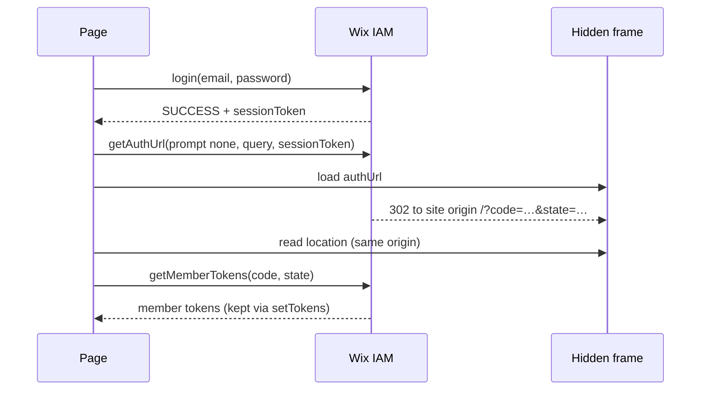

# Design Log 34: Direct Member Login on the Page

## Status

Implemented

Builds on [DL 18](./18%20-%20wix-members-package.md) and deviates from two earlier decisions, both kept as options rather than replaced:

- **DL 18's revision (redirect-based login):** that revision dropped on-page login and sign-up for the Wix-hosted redirect. This log adds on-page login back, alongside the redirect, which stays the default.
- **[DL 29](./29%20-%20app-strategy-support.md) (exactly one server strategy required):** this log also accepts a config with neither strategy, for visitor-only server access.

## Background

Migrating Classic Wix sites to Jay means the new site has to keep the site's own members experience. On Wix, a visitor logs in and signs up in the **site members dialog** on the page: email and password, with Wix's own field errors, email verification codes and password reset. Only Google and Facebook leave the page.

DL 18's revision chose the Wix-hosted login page instead, which is right for a new Jay site designed around it. A migrated site, though, has to look and behave like the site it copies, so the visitor must not land on a different, Wix-branded page.

Such sites can also be served without a Jay server, as a static export on Wix-managed headless hosting. There:

- every member call runs in the browser with OAuth tokens;
- the build reads public data only, so it should need no server secret.

## Problem

1. Log a member in, and sign one up, from a site-owned dialog, with Wix's error codes, email verification and password reset.
2. Keep the member logged in across page loads. Member tokens set on `client.auth` were lost on the next page load, so a member was logged out after any navigation.
3. **The SDK's own token exchange never completes.**
   - `getMemberTokensForDirectLogin` waits for Wix's authorize page to `postMessage` the code to each of the OAuth app's allowed domains.
   - Those domains are stored as bare hosts (`site.example`), as the OAuth Apps API documents them.
   - A bare host is not a valid `postMessage` target origin, so the page throws at the first one and the login hangs.
4. Give a site backend the member's current token, so it can check the member with Wix: for example, to serve members-only pages only to members.
5. Send the dialog's Google and Facebook buttons straight to that provider, as Wix does, instead of Wix's own Log In page.
6. Build a site with no server secret.

## Questions and Answers

**Q: Why not fix the allowed-domains format on the OAuth app instead of working around `postMessage`?**
A: The site owner's OAuth app isn't ours to change, and the documented format is bare hosts. A same-origin redirect doesn't depend on that format at all.

**Q: Which redirect URI does the hidden frame use?**
A: `${origin}/`. It's already an allowed redirect URI of a site's OAuth app. The frame is read as soon as its address is same-origin, and removed before the page in it does anything.

**Q: Does on-page login replace the hosted redirect?**
A: No. `redirectToLogin` and the `auth-callback` flow stay as DL 18's revision designed them. A site chooses per action, and social logins still use the redirect.

**Q: Is the access token safe to hand to a backend?**
A: It's the member's own OAuth access token, already held by the page. The backend must still check it with Wix (`members/v1/members/my`) and never trust it as an identity on its own.

## Design

**wix-members**

- `lib/utils/direct-login.ts`, `createDirectLogin(auth, onMemberTokens, { redirectUri?, frame? })`, providing:
  - `login(email, password, { captchaToken? })` and `register(email, password, { publicProfile?, nickname?, captchaToken? })`;
  - `verifyEmail(code)` and `sendPasswordReset(email, redirectUri)`.
  - Results come back as a `MemberAuthResult`: `success`, `emailVerificationRequired`, `ownerApprovalRequired`, `captchaRequired`, or `failure` with `invalidEmail`, `invalidPassword`, `emailAlreadyExists`, `resetPassword` and the like.
  - **Token exchange:** `memberTokensByRedirect(auth, sessionToken, redirectUri, frame)`. It gets an auth URL with `prompt: 'none'`, `responseMode: 'query'` and the login's `sessionToken`, loads it in a hidden frame (`hiddenRedirectFrame`), waits until the frame is at `redirectUri`, then exchanges the code (`parseFromUrl`, `getMemberTokens`).
  - It falls back to `getMemberTokensForDirectLogin` only when no redirect URI is given.
- `WixMembersContext` gains `login`, `register`, `verifyEmail` and `sendPasswordReset`. Member tokens are kept through `WixClientContext.setTokens`.
- `memberAccessToken()` (`lib/utils/member-access-token.ts`): the current access token, renewed first through the SDK's `getAuthHeaders` if it expired; `undefined` for a visitor.
- `redirectToLogin(callbackUrl?, { idp?: 'google' | 'facebook' })` (`lib/utils/hosted-login.ts`): with a provider, the hosted login goes straight to its sign-in, using the SDK's well-known IdP connections.

**wix-server-client**

- `WixClientContext.setTokens(tokens)` sets the tokens and stores them, per OAuth client, for later page loads. `clearStoredTokens(oauthClientId)` clears that client's tokens.
- **Visitor-only server mode:** with neither `apiKeyStrategy` nor `appStrategy`, `config.auth.kind` is `'visitor'`, and the server client uses `OAuthStrategy({ clientId: oauthStrategy.clientId })`.



## Examples

```ts
const members = useGlobalContext(WIX_MEMBERS_CONTEXT);
const result = await members.login(email, password);
if (result.status === 'emailVerificationRequired') await members.verifyEmail(code);
if (result.status === 'failure' && result.errorCode === 'invalidPassword') showFieldError(); // Wix's message
```

✅ `redirectToLogin(undefined, { idp: 'google' })`: Google's sign-in directly.
❌ Before: the Google button went to Wix's Log In page, where the visitor picked Google again.

## Trade-offs

| Decision                             | Benefit                                          | Cost                                                          |
| ------------------------------------ | ------------------------------------------------ | ------------------------------------------------------------- |
| On-page login alongside the redirect | Migrated sites keep Wix's own dialog             | The site handles CAPTCHA and errors (with the codes provided) |
| Same-origin frame for the code       | Works with the documented allowed-domains format | Briefly loads `/` in a hidden frame                           |
| Visitor-only server mode             | A static export ships without secrets            | Server code can read public data only                         |

## Verification Criteria

- A member logs in on the page and stays logged in after navigating.
- A wrong password gets Wix's error code, and a new member who must verify gets `emailVerificationRequired`.
- The login completes on a site whose allowed domains are bare hosts.

## Implementation Results

- `packages/wix-members`:
  - `lib/utils/direct-login.ts`, `lib/utils/member-access-token.ts`, `lib/utils/hosted-login.ts`;
  - `lib/contexts/wix-members-context.ts`.
- `packages/wix-server-client`: `lib/config-loader.ts`, `lib/wix-client-context.ts`, `lib/wix-client-service.ts`.
- Both packages get a vitest setup (`"test": "vitest run"`, node environment).
- Tests:
  - `wix-members`: **11/11 passing**, covering `direct-login.test.ts` (login, sign-up, verification and failure outcomes, redirect-frame exchange, fallback), `member-access-token.test.ts` and `hosted-login.test.ts`.
  - `wix-server-client`: **4/4 passing**, covering the visitor-only config and `setTokens`.
  - `tsc --noEmit` is clean in both packages.
- Used end to end on a migrated Wix Bookings site, served as a static export: a member logs in with email on the page, stays logged in across pages, gets members-only pages, and books a class.
- **Deviations:**
  - The `postMessage` workaround wasn't foreseen: the SDK method designed for this (DL 18, "Token Flow") doesn't complete with documented allowed-domains values.
  - The visitor-only mode relaxes DL 29's "exactly one strategy" rule.
