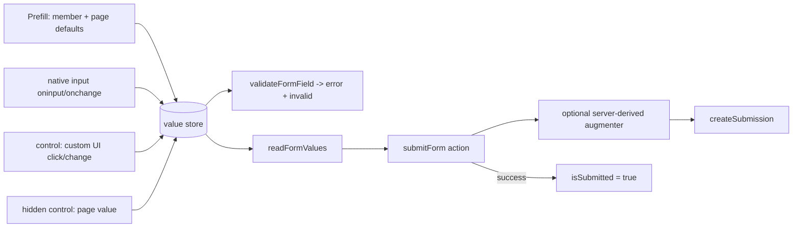

# 39 - General Forms Infrastructure for wix-forms

Status: Design (development-ready — awaiting independent review + user approval)

Builds directly on **DL#38 (Per-Form Contracts for wix-forms)**. DL#38 gave each Wix form its own contract with field-named tags, one shared `wixForm` component, and a plugin validator. DL#39 turns that into a **general forms-infrastructure plugin**: rich production forms (success/confirmation state, prefill, live validation, hidden/derived values, custom step UI) adopt the plugin instead of hand-rolling a page contract + interactive component + a bespoke server action over the Wix `createSubmission` API. Reusable by **any** Jay project — the design is described generically and names no downstream site.

## Decisions for the Implementer (TL;DR)

- **One new spine, five capability areas + honeypot.** The whole DL rests on a single refactor: introduce a **per-field value store** (a `Record<target, value>` signal) in the shared component as the one source of truth for a field's current value. Today the component has **no** per-field value — it reads `element.value` straight off the DOM only at submit time (`components/wix-form.ts:87-100`). Every capability below is a thin consumer of that store. Do the store first; the rest compose onto it.
- **Capability 1 — Success/sent state.** Add two reserved form-level tags: an **`isSubmitted` variant** (stays `true` after a successful submit so the page can swap the whole form for a thank-you view with `if`/`if="!"`) and a **`resetButton` interactive** ("send another" → clears the store, sets `isSubmitted=false`). Echo of submitted values for a personalized confirmation is **free**: it reuses the per-field `value` data tag from Capability 2 (don't clear the store on submit; clear only on reset). `statusMessage` (`components/wix-form.ts:84,131`) stays for inline status but is **not** the sent-state signal — it is a `data` tag (not a variant) that also carries submit errors (`wix-form.ts:141`), so it cannot cleanly drive a persistent view swap.
- **Capability 2 — Prefill.** Add a per-field **`value` data tag**. Seed the store before first interactive render from two generic sources, last-wins: (a) **page-supplied defaults**, delivered through the same hidden-`control` channel as Capability 4a (the page binds a value it already has — a route param, query, page data); (b) **signed-in member** name/email, prefilled in the **interactive (client) phase by default**. Member identity comes from the **public Wix Members REST endpoint `GET /members/v1/members/my?fieldsets=FULL`** — the same endpoint + field shape `wix-members` reads, but note its precedent (`member-profile.ts:46-66`) is **client-side** (it imports `wixFetch` from `@jay-framework/wix-server-client/client`). wix-forms calls it through its **own** `wixFetch` wrapper; **do not add a `@jay-framework/wix-members` package dependency** (sibling plugin, not an upstream of wix-forms). Member-aware SSR (a fast-phase server fetch) is an optimization to **confirm** (Q4), not the assumed happy path. Member prefill is **opt-in per field** via config mapping (`email → member.loginEmail`, `name → member.profile.firstName`…), because the plugin cannot guess which field is "the email".
- **Capability 3 — Live validation.** Reuse the existing `validateFormField` (`utils/project-form-fields.ts:113-146`) **unchanged in this phase** (it stays string-only; it is widened later in Phase 6 when the non-string field kinds arrive — see 4c) — today only run on submit click (`components/wix-form.ts:117-126`). Wire it on **`oninput`/`onblur`** (both confirmed on interactive refs — `@jay-framework/runtime` `index.d.ts:168-169,124-125`, used widely e.g. `wix-cart/.../cart-page.ts:325`). Add a per-field **`invalid` variant tag** for an `aria-invalid`-style hook. Required + email/tel/url format are **declarative** (already known from the field schema) — nothing to configure. The screen-reader affordance is a **documented markup pattern** (page wraps the existing `error` data tag in `role="alert"`/`aria-live="polite"`, binds `aria-invalid` to `invalid`) — no new runtime.
- **Capability 4 — Hidden / extra values + non-string fields.**
  - **(4a) Page-provided hidden values** reuse Capability 5's `control` channel: generate a **hidden-field sub-contract** (a `value` data tag + a `control` interactive tag, **no** label/placeholder/`input`) for Wix hidden fields a page wants to populate. This **narrowly lifts DL#38 OQ-4** (hidden fields were excluded and, in fact, **dropped from submission entirely** — `projectFormFields` filters `!field.hidden`, `utils/project-form-fields.ts:44`, and `readFormValues` only iterates projected fields). The page sets the value with one hidden element: `<input type="hidden" ref="contact.propertyId.control" data-value="{propertyId}">`. **Spam protection** is the companion hidden-field pattern: a reserved form-level **`honeypot` interactive tag** bound to a visually-hidden input; a non-empty honeypot at submit **silently aborts** `createSubmission` (fakes success so a bot can't tell). Plugin-level, opt-in, no Wix field, no jay change (Q12, §Design 4a).
  - **(4b) Server-derived values** are merged inside the plugin's `submitForm` action (`actions/forms-actions.ts:11-16`) by an **optional project-registered submission augmenter** resolved before `createSubmission`. jay already exports a **non-throwing** `hasService` alongside the throwing `getService` (both from `@jay-framework/stack-server-runtime`), and the plugin already uses this service layer (`createJayService`/`registerService`/`getService`), so the augmenter is an **optional service marker** (`hasService(marker) ? getService(marker).augment(...) : values`) — **expected plugin-only, no jay DL, pending a half-day spike** that confirms service resolution works inside a request-time action handler. Only if that spike fails does it become a **separate, explicitly-flagged jay dependency** (an optional submission hook on the action builder) — see §Design 4b and §Jay Dependency.
  - **Non-string fields (the bug):** the submit path is typed `Record<string, string>` end-to-end across **five layers** (`components/wix-form.ts:87`, `actions/forms-actions.ts:13`, the service interface `services/wix-forms-service-marker.ts:17`, the service impl `services/wix-forms-service.ts:74`, `wix-apis/create-submission.ts:7`) and reads `element.value` (`components/wix-form.ts:89-91`). A multi-value choice (checkbox group / `<select multiple>`) is **truncated to a single string** and a boolean/consent checkbox submits its **static `value` attribute, not its checked state**. Widen the value type to `string | string[] | boolean`, add `checkbox` (boolean) and `multiselect` (array) input kinds to the projection + contract + element-type map, and read `.checked` / selected-options accordingly. This takes on the field types DL#38 deferred.
- **Capability 5 — Custom-UI-driven fields / multi-step.** Add a per-field **`control` interactive tag** (`elementType: HTMLElement`). Any page element the author binds to `control` (a chooser button, a date-picker cell, a time-slot, a native `<select>`, a checkbox) feeds the field's store slot: the component wires `onclick`/`oninput` (the handler names the cited precedent uses — `product-search.ts:361`, `cart-page.ts:325`), reads the chosen value from the element's **`data-value`** (or `.value`), writes it to the store, and runs the same validation. `control` and the native `input` write the **same** store slot (last-wins; the store, not the DOM, is what `readFormValues` returns), so custom UX and native inputs reconcile with zero extra wiring. Multi-step is **enabled** by this (step UIs are page elements feeding the store; the store persists across steps as component state) — step **navigation** stays page-owned and is **not** modeled here (§Scope pre-mortem).
- **Each capability is independently adoptable.** A page uses only the tags it binds; unused tags (`isSubmitted`, `value`, `invalid`, `control`, hidden fields) are inert. The generator always emits them (cheap, uniform); the component always drives them.
- **No jay change for Capabilities 1, 2, 3, 4a, 5, and 4c's non-string fix.** Only **4b's server-derived hook** carries a flagged jay dependency *if* the plugin-level augmenter proves infeasible.
- **Four bounded verify-before-closing gates (none blocks the core — all have a default/fallback):** (i) **4c** — two checks sharing one fallback: the Wix `/forms/v4/submissions` API accepts a boolean/array value, **and** a boolean `selected` variant round-trips inside a repeated `options` sub-contract; fallback for either is to serialize the selection at the `create-submission.ts:7` boundary (§Design 4c MUST-VERIFY #1/#2). (ii) **Q4** — whether the fast-phase client carries the member token (member-aware SSR); default is interactive-phase prefill either way. (iii) **Q8 / 4b** — a half-day spike confirming the optional `hasService`/`getService` augmenter resolves inside a request-time action handler (the non-throwing `hasService` is confirmed to exist and the plugin already uses the service layer, so this is expected to pass); only if it fails does 4b split to its own jay-dependency DL, and phases 1-6 still ship either way. (iv) **Validator** — whether nested sub-contract tags are in the validation context for the `.control` second-segment check; fallback is first-segment check + agent-kit guide (§Agent Feedback Loop). Each is a single pre-build check; the design is development-ready without resolving them because every one has a stated default.
- **jay-feedback:** one new agent-kit guide (`rich-forms.md`) covering all five capabilities plus the honeypot pattern; **extend** the `wix-forms-bindings` plugin validator with two deterministic checks (unknown `control` ref tags — the DL#38 ref check validates only the **first** ref segment, the field name, so catching an unknown `.control` sub-tag on a known field is **new second-segment sub-tag validation**, not reuse of an existing `.input` check; and a `member`-prefill config that targets a non-existent field). Full table in §Agent Feedback Loop.

---

## Background

DL#38 (Implemented) established, inside `packages/wix-forms` only:

- **One contract per form**, tags named after the form's visible fields, each field a `sub-contract` with `label` / `placeholder` / `required` / `error` data+variant tags and one `input` interactive tag; select fields add a repeated `options` sub-contract (`generators/contract-utils.ts:37-74`). Reserved form-level tags: `isLoading`, `loadError`, `isSubmitting`, `statusMessage`, `submitButton` (`generators/contract-utils.ts:77-86`).
- **One shared, schema-agnostic component** `wixForm = makeJayStackComponent<any>()…` that reads `props.metadata.formId`, loads the form in the slow phase, and builds a view-state keyed by field `target` (`components/wix-form.ts:45-63,173-178`; `components/form-view-state.ts:61-72`).
- **A plugin validator** `validateWixFormBindings` (`validators/wix-form-bindings.ts`) flagging the retired generic `fields` tag and unknown `ref=` field tags.
- **Auto-enumeration** of forms at agent-kit time via List Forms, a `forms.yaml` discovery reference (`setup.ts:70-123`), and the config flip to an optional filter (`config-loader.ts`).

DL#38 deliberately kept scope tight: it made bindings **explicit and checkable**, but the runtime behaviour stayed exactly what the generic contract already did — load schema, render inputs, validate-on-submit, submit a flat string map, show a transient status line.

## Problem

A real production form needs more than "render inputs and submit a string map". Teams that adopt wix-forms today still fall back to hand-rolling a page contract + a custom interactive component + a bespoke server action whenever they need any of:

1. **A confirmation / "sent" view.** After a successful submit the whole form should swap for a thank-you panel (optionally personalized with what was entered), with a "send another" path back to a blank form. The plugin offers only `statusMessage`, which cannot drive this swap: it is a **`data` tag, not a `variant`** (`contract-utils.ts:83`), and it is **overloaded as the error channel** — the same signal carries the success string on submit (`wix-form.ts:131`) *and* the submit-failure message (`wix-form.ts:141`). A `data` string that doubles as the error display cannot cleanly or safely gate an `if`/`if="!"` form→thank-you branch.
2. **Prefill.** Seed name/email from the signed-in member, or seed a field from a value the page already has (a route param). The field sub-contract has **no value channel at all** (`generators/contract-utils.ts:37-59`; `form-view-state.ts:28-43`), so there is nothing to seed.
3. **Live validation before submit.** `validateFormField` already encodes required + email/tel/url + length + pattern (`utils/project-form-fields.ts:113-146`) but runs **only** on the submit click (`components/wix-form.ts:117-126`). There is no on-blur/on-input feedback, no `aria-invalid` hook, no screen-reader alert affordance.
4. **Hidden / extra submission values.** (a) A value the page knows at render (a parent entity id the form is embedded for) — hidden Wix fields are currently **dropped**, not submitted (`utils/project-form-fields.ts:44`). (b) A value derived server-side at submit (a lookup) — the submit action has **no extension point** (`actions/forms-actions.ts:11-16`). And the whole submit path is typed `Record<string, string>`, so **multi-value and boolean fields are silently corrupted** (details in §Design 4).
5. **Custom UI / multi-step.** A date picker, a time-slot grid, a chooser — bespoke UX that must set a field value and still participate in the plugin's validation + submission. The only value input the component understands is a native element bound to `input`, read via `element.value` (`components/wix-form.ts:89-91`).

Each of these, hand-rolled per project, re-implements the Wix submission wiring the plugin already owns — and loses the per-form contract, the validator, and the discovery reference DL#38 provides.

## Prior Art / Adjacent Mechanisms

- **DL#38** — the base this extends; all citations above. The field sub-contract shape, the reserved-tag set, the per-target view-state, and the submit flow are the surfaces DL#39 adds to.
- **`validateFormField` already exists** (`utils/project-form-fields.ts:113-146`) and encodes required + format(email/tel/url) + min/max length + pattern from the field schema. Its signature is `validateFormField(field: FormFieldView, value: string): string` and it assumes a **string** value — line 114 does `const trimmed = (value ?? '').trim();`, the required check is `if (field.required && !trimmed)` (`:115`), and every format/length/pattern branch runs on `trimmed`. Capability 3 **reuses it unchanged** — only the *when* changes. It is **widened in Phase 6** (not Phase 3) when the `checkbox` (boolean) and `multiselect` (array) kinds arrive — `.trim()` on a boolean or array, and a `!trimmed` required check for them, would be wrong (see §Design 4c and Phase 6).
- **Interactive-ref DOM events are first-class.** `oninput`/`onblur`/`onchange` (+ their `$` event-data builders) are on every interactive ref (`@jay-framework/runtime` `index.d.ts:124-131,168-169`), used across the repo for input-driven state — e.g. `wix-cart/.../cart-page.ts:325`, `wix-stores-v1/.../product-search.ts:361`, and the **collection ref with `coordinate`** pattern (`product-search.ts:413,439`) which is the template for a repeated `control` over choice buttons. Capabilities 3 and 5 need **no new runtime** — just handlers the component already can register.
- **Member identity is a public Wix REST surface.** `wix-members` reads the signed-in member with `GET /members/v1/members/my?fieldsets=FULL` → `member.loginEmail`, `member.profile.firstName/lastName/nickname` (`packages/wix-members/lib/utils/member-profile.ts:46-66,9-19`). That endpoint is Wix's public API; wix-forms can call it through its **own** `wixFetch` without a package dependency on the sibling plugin. **Mind the import, not just the pattern:** the member fetch runs in the **interactive (client) phase** (Q4 default), so it must import `wixFetch` from **`@jay-framework/wix-server-client/client`** — exactly as the client-side precedent `member-profile.ts:2` does — **not** from `@jay-framework/wix-server-client` (the server entry) the way `wix-apis/get-form.ts:2` does. `get-form.ts:39-43` is the right *shape* for a `wixFetch` wrapper, but it is a **slow-phase (server)** call; the member prefill wrapper mirrors `member-profile.ts`'s `/client` import instead. (The client-side `memberIndicator` exposes only `memberName`/`memberAvatar` — `wix-members-context.ts:68-73` — not the structured email/first/last prefill needs, so a direct `/members/v1/members/my` fetch is the right source — the same one `member-profile.ts:46-66` already runs **client-side**, not the context.)
- **`PageProps` is minimal** — `{ language, url }` (`@jay-framework/fullstack-component` `index.d.ts:58-61`); route params (`UrlParams`, `:77`) and `RequestQuery`/`RequestCookies` (`:67-76`, fast-phase only). So a "value the page knows at render" (Capability 4a) is already in the page's binding scope as a normal `{param}` — the plugin only needs a channel to accept it, which Capability 5's `control` provides. No new prop plumbing.
- **The jay service layer already supports optional lookup.** `@jay-framework/stack-server-runtime` exports `registerService`, the throwing `getService`, and a **non-throwing `hasService(marker): boolean`** (`serviceRegistry.has(marker)`), plus `createJayService` for markers. The wix-forms plugin already uses all three — markers via `createJayService` (`services/wix-forms-service-marker.ts`), `registerService` (`services/wix-forms-service.ts:82`), `getService` (`init.ts:10`, `setup.ts:79`). This is the **primary** prior art for the 4b submission augmenter: an **optional service marker** the project registers into, resolved with a `hasService` guard. No jay change.
- **DL#37 (Project Action Registration)** — establishes that a project's own server actions/modules are bundled and registered via `registerActionsFromModules`. Secondary prior art for 4b: if the service-marker route fails its spike, the project could own a wrapper action. Cited as the boundary for the (now unlikely) flagged jay dependency.
- **`wix-data`** — the DL#38 template; unchanged relevance here. No per-item runtime behaviour like submit/validate, so no further borrow.

### Null hypothesis (applied per capability)

For every capability the question is: *does a DL#38 tag/component feature or an existing jay/plugin primitive already suffice?* Answered inline in §Design. Summary of why each addition earns its place:

| Capability | Could an existing primitive do it? | Verdict |
|---|---|---|
| 1 Sent state | `statusMessage` — **no**, it is a `data` tag (not a variant) that also carries submit errors (`wix-form.ts:131,141`); a view swap needs a dedicated **variant** | New `isSubmitted` variant + `resetButton` |
| 2 Prefill | the field sub-contract — **no value channel exists** (`contract-utils.ts:37-59`) | New `value` data tag + seed logic |
| 3 Live validation | `error` data tag + `validateFormField` — **partially**: logic exists, wiring + `aria-invalid` hook do not | Reuse logic; add `invalid` variant + event wiring |
| 4a Hidden page value | `input` + `readFormValues` — **no**, hidden fields are dropped (`project-form-fields.ts:44`); no non-visible value channel | Reuse Cap-5 `control`; emit hidden-field sub-contract |
| 4b Server-derived | `submitForm` action — **no extension point** (`forms-actions.ts:11-16`), but the jay service layer (`hasService`/`getService`) does provide optional resolution | Optional-service-marker augmenter (plugin-only, spike-gated — no jay DL expected) |
| 4 Non-string | `Record<string,string>` + `element.value` — **no**, it corrupts arrays/booleans (`wix-form.ts:89`) | Widen value type; add `checkbox`/`multiselect` kinds |
| 5 Custom UI | native `input` only — **no** channel for non-input UI to set a value | New `control` interactive tag + value store |

The **value store** itself is the null-hypothesis-satisfying unifier: rather than five bespoke mechanisms, one store serves prefill, live validation, non-string reads, hidden/extra values, and custom UI. Any proposal to add a *second* value channel must justify itself against the store.

## Questions and Answers

**Q1 — Should `isSubmitted` reset automatically, or only via an explicit "send another"?**
Explicit only. Auto-reset (e.g. on a timer) would surprise a user mid-read of a confirmation. `resetButton` click → clear store → `isSubmitted=false`. **Answered.**

**Q2 — Where does personalized-confirmation data come from without a second mechanism?**
From the per-field `value` data tag (Capability 2), by **not** clearing the store on submit (DL#38 clears inputs at `wix-form.ts:102-109`; that behaviour moves to `resetButton`). The thank-you view binds `{contact.firstName.value}`. **Answered** — zero new surface.

**Q3 — How does the plugin know which field is "the email" / "the name" for member prefill?**
It cannot infer it safely (field targets are site-defined). Member prefill is **opt-in config**: a per-form (or default) map `{ <fieldTarget>: <memberPath> }`, e.g. `{ email: loginEmail, firstName: profile.firstName }`. Absent config → no member prefill. **Answered.**

**Q4 — Does reading member identity require depending on `@jay-framework/wix-members`?**
No. Call the public `GET /members/v1/members/my` endpoint via wix-forms' own `wixFetch` (pattern: `wix-apis/get-form.ts:39-43`). Avoids coupling two sibling plugins. **Default: prefill in the interactive (client) phase** — the only in-repo precedent is client-side (`wix-members`' `member-profile.ts:46-66` imports `wixFetch` from `@jay-framework/wix-server-client/client`), and the member token is reliably on the client there. ⚠️ **Confirm (do not assume):** whether the fast-phase request-context client carries the member token (member-aware SSR) rather than the site/visitor identity. If it does, member prefill MAY move server-side to avoid a flash; if not, it stays in the interactive phase. **Open — server-side member identity is the thing to confirm; interactive-phase prefill is the default either way.**

**Q5 — In which render phase is a prefilled value injected into the DOM?**
Prefill that is member-derived or page-derived is known by the **fast/interactive** boundary. Seed the store at interactive start and reflect into native inputs via `input.exec$(el => el.value = v)` (the inverse of DL#38's `clearFormValues`, `wix-form.ts:102-109`), and expose it as the `value` data tag for custom UI. SSR can pre-render the `value` into the markup when it is slow/fast-known (page defaults), avoiding a flash. **Answered** (member-prefill phase pending Q4).

**Q6 — `control` vs native `input`: who wins when a field has both?**
The **store** is authoritative; last write wins. `oninput` on a native `input` and `onclick`/`oninput` on a `control` element both write the same slot. `readFormValues` reads the store, never the DOM. When a value is set programmatically (via `control`) the component reflects it back into any native `input` element for visual consistency. **Answered.**

**Q7 — How does a repeated custom UI (a grid of choice buttons) identify which value was chosen?**
Via the element's `data-value` attribute, read in the `onclick`/`oninput` handler (and `coordinate` destructured alongside `event` when `control` is bound to a repeated collection — the `oninput(({ event, coordinate }) => …)` pattern at `product-search.ts:413,439`). **Answered** — no new runtime.

**Q8 — Is the server-derived-values hook (4b) achievable without a jay change?**
**Almost certainly yes — plugin-only, pending a half-day spike.** jay already exports a **non-throwing** service lookup, `hasService`, alongside the throwing `getService`, from `@jay-framework/stack-server-runtime` (`hasService<ServiceType>(marker: ServiceMarker<ServiceType>): boolean` — it returns `serviceRegistry.has(marker)`; `getService` throws "Service '…' not found" when absent). The wix-forms plugin **already** uses this service layer — it creates markers with `createJayService` (`services/wix-forms-service-marker.ts`), registers with `registerService` (`services/wix-forms-service.ts:82`), and resolves with `getService` (`init.ts:10`, `setup.ts:79`). So the plugin exports a marker `WIX_FORMS_SUBMISSION_AUGMENTER`, the project registers an augmenter service into it in its own `init`, and the `submitForm` handler does `hasService(marker) ? await getService(marker).augment(...) : values`. This **likely CLOSES Q8 with no jay DL** — 4b moves from "possible jay dependency" to **plugin-only**. The remaining uncertainty is narrow — that `hasService`/`getService` resolve correctly **inside an action handler at submit time** (the existing `getService` calls are in `init`/`setup`, not in a request-time action handler) — so a **half-day spike confirms the submit-time resolution before Phase 7**; only if that spike fails does 4b fall back to a flagged jay dependency (an optional `.withSubmissionHook()` on the action builder). **Effectively answered — spike-gated, not open.** See §Design 4b and §Jay Dependency.

**Q9 — Do multi-select / boolean fields change the per-field contract shape?**
Yes, minimally — but the contract stays on supported primitives (arrays are not a valid `dataType`): a `checkbox` (boolean) field's `input` is `HTMLInputElement`, its value is `.checked`, so it is exposed as a `value` **variant** (boolean). A `multiselect` field is `HTMLSelectElement` (multiple) or a repeated checkbox `control`; its runtime value is a `string[]` held in the store, but it is **exposed** via the reused `options` sub-contract (DL#38) with a per-option `selected` **variant** — not a flat `value: string[]` data tag. The `options` sub-contract is reused for both select and multiselect. **Answered.**

**Q10 — Does exposing hidden fields in the contract contradict DL#38 OQ-4?**
It **narrows** it. DL#38 OQ-4 excluded hidden fields from the design surface; DL#39 exposes **only a value+control channel** (no label/placeholder/`input`) for hidden fields a page chooses to populate, and only emits them when a hidden field exists. Visible-field ergonomics are unchanged. The DL#38 claim that hidden fields are "still submitted" is corrected: they are currently dropped (`project-form-fields.ts:44`); DL#39 is what actually submits them. **Answered.**

**Q11 — Member prefill is async; what stops it from clobbering what the user typed?**
A per-field **dirty** set, written on the first `input`/`control` change. Member seeding skips dirty fields; page defaults (synchronous, pre-interaction) seed unconditionally. So async member prefill yields to the user, while interactive `input`/`control` keeps the simple last-wins rule (Q6). **Answered** (§Design 2).

**Q12 — How does spam protection work without a Wix field, a captcha dependency, or a jay change?**
A **honeypot**: a reserved form-level `honeypot` interactive tag the page binds to a visually-hidden input a human never fills. At submit the component reads the honeypot store slot **before** `readFormValues`/`submitForm`; if non-empty it **aborts silently** — it does **not** call `createSubmission`, and (to not tip off a bot) sets `isSubmitted=true` so the confirmation view still shows. Entirely plugin-level (one reserved interactive tag + a submit-handler guard), opt-in (no honeypot element → no honeypot), no new Wix field, no jay change. Stronger anti-spam (captcha/reCAPTCHA) is **deferred** (§Scope pre-mortem). **Answered** (§Design 4a).

## Design

Shared spine first, then the five capabilities. All changes are inside `packages/wix-forms`.

> **Path convention:** file paths in this log are **relative to `packages/wix-forms/lib/`** unless otherwise noted — e.g. `components/wix-form.ts` is `packages/wix-forms/lib/components/wix-form.ts`, `utils/project-form-fields.ts` is `packages/wix-forms/lib/utils/project-form-fields.ts`, `types.ts` is `packages/wix-forms/lib/types.ts`.

### 0. The per-field value store (foundation)

Add to the interactive component a signal `const [values, setValues] = createSignal<Record<string, FieldValue>>({})` where `type FieldValue = string | string[] | boolean`. Semantics:

- **Key by `field.target`, not the tag name.** The store is keyed by the raw Wix `field.target` — the **submission key** `readFormValues` already returns (`wix-form.ts:97` builds `values[field.target]`). View-state and refs are keyed by `contractTagName(field.target)` (camelCased — `contract-utils.ts:106-109`), so the store→view-state projection applies `contractTagName` exactly where `buildFieldsViewState` already does (`form-view-state.ts:52`). Keeping the store on `target` means the submit payload needs no reverse mapping.
- **Single source of truth.** `readFormValues()` returns a **projection of the store** (`components/wix-form.ts:87-100` is rewritten to read `values()`, not the DOM). This also drops the current **async** `exec$` DOM read at submit (each `input.exec$` returns a `Promise`, `wix-form.ts:89-93`): the store is a signal read **synchronously** at submit time, so `readFormValues` no longer awaits the DOM.
- **Writers:** prefill seeds it (Cap 2); `input.oninput`/native change updates it (Cap 3/5); `control` updates it (Cap 5); page-provided hidden `control` seeds it (Cap 4a). Each writer does `setValues((v) => ({ ...v, [target]: next }))`.
- **Readers:** submit (Cap 4), per-field `value` data tag (Caps 1/2 echo + prefill display), validation (Cap 3).
- **Reactivity trace.** The new per-field `value`/`invalid` and the form-level `isSubmitted` are surfaced the **same way** the existing component already surfaces reactive state: the `render()` closure (`wix-form.ts:148-155`) calls `buildFormViewState(...)` on each render, reading `isSubmitting()`, `statusMessage()`, `errorByTarget()`. The new signals (`values()`, an `invalidByTarget()` derived from validation, `isSubmitted()`) are read in that same call, so `buildFormViewState` (`components/form-view-state.ts:61-72`) gains `value` (per field) + `invalid` (per field) + `isSubmitted` (form-level) computed from the store + validation + submit outcome, and the view re-renders on every store write with no new reactive machinery.



### 1. Submission success / sent state

- **Contract:** add two reserved form-level tags in `generators/contract-utils.ts:reservedFormTags` (`:77-86`): `{ tag: isSubmitted, type: variant, dataType: boolean, phase: fast+interactive }` and `{ tag: resetButton, type: interactive, elementType: HTMLButtonElement }`. Add `isSubmitted` and `resetButton` to `RESERVED_TAG_NAMES` (`:89-95`) so a field target colliding with them is suffixed.
- **Component:** add `const [isSubmitted, setIsSubmitted] = createSignal(false)`. On successful `submitForm` (`wix-form.ts:130`), set `isSubmitted(true)` and **do not** clear the store (remove the `clearFormValues()` call from the submit path, `:132`). Wire `refs.resetButton?.onclick(...)` → a **full reset**: clear the store, `setIsSubmitted(false)`, and also clear the existing validation/status signals (`setErrorByTarget({})`, `setStatusMessage('')`, and the new `invalidByTarget` — `wix-form.ts:84-85`), then reset native inputs via `exec$` (reuse the retired `clearFormValues` logic, `:102-109`, as the reset action). Expose `isSubmitted` in view-state. A reset that cleared values but left stale `error`/`invalid`/`statusMessage` would show a blank form still flagged invalid — hence all four are cleared together.
- **Echo (personalized confirmation):** free via the per-field `value` data tag (Cap 2) — the store survives submit until reset.
- **Null hypothesis:** `statusMessage` cannot be the sent-state signal. It is a **`data` tag, not a `variant`** (`contract-utils.ts:83`), and it is the **error channel too** — the submit handler writes the success string (`wix-form.ts:131`) and the failure message (`wix-form.ts:141`) to the *same* signal. A `data` string that also displays errors cannot cleanly or safely drive the persistent `if`/`if="!"` form→confirmation swap; a dedicated **variant** is the primitive for a reactive view branch. Justified.

### 2. Initial / prefill values

- **Contract:** add a per-field `value` channel to each field sub-contract in `fieldTag` (`contract-utils.ts:37-59`), using **supported primitive `dataType`s only** — an **array is not a valid jay-contract `dataType`** (`dataType: array`/`string[]` fails contract validation; the array representation is a `sub-contract` with `repeated: true`, per the `wix-bookings` troubleshooting guidance). So the channel is modeled per field kind:
  - text / email / tel / url / textarea → `{ tag: value, type: data, dataType: string }`.
  - checkbox / boolean → `{ tag: value, type: variant, dataType: boolean }` (a variant, so the markup can branch on checked state).
  - `multiselect` → **no flat `value: string[]` data tag.** Reuse DL#38's repeated `options` sub-contract (`contract-utils.ts:60-73`) and add a per-option `{ tag: selected, type: variant, dataType: boolean }`; the selected value set is exactly the options whose `selected` is `true`. (This mirrors how `options` is already modeled as a repeated sub-contract, and stays **plugin-level — no jay change**.)
- **Internal vs contract — keep them distinct:** the interactive component's value store still holds `string | string[] | boolean` as **runtime TypeScript** (`type FieldValue`, §0) — that is fine, it is not a contract `dataType`. Only what is **exposed in the contract / view-state** is constrained to the supported primitives above; a multiselect's array lives in the runtime store and is reflected into the repeated options' `selected` variants for binding.
- **Sources & precedence** (seeded into the store at interactive start, last-wins):
  1. **Page-supplied default** — delivered through the Cap-4a hidden `control` channel: `<input type="hidden" ref="contact.email.control" data-value="{defaultEmail}">`. The page already has the value in binding scope (a route param/query/page data — `PageProps`/`UrlParams`, `index.d.ts:58-61,77`).
  2. **Signed-in member** — opt-in config map (Q3): `memberPrefill: { email: loginEmail, firstName: profile.firstName }`. The component (phase per Q4) fetches `GET /members/v1/members/my?fieldsets=FULL` via a new `wix-apis/get-my-member.ts`, reads the mapped member paths, seeds the store for any field **the user has not yet edited** (Q11). Because this fetch runs in the **interactive (client) phase**, `get-my-member.ts` must import `wixFetch` from **`@jay-framework/wix-server-client/client`** — mirroring the client-side precedent `member-profile.ts:2` — **not** from the server entry `@jay-framework/wix-server-client` as `get-form.ts:2` does (that is a slow/server-phase call). The `get-form.ts:39-43` body is a fine template for the wrapper *shape*; only the import entry differs.
- **Dirty-field guard (Q11).** Member prefill is **async** (a client fetch), so a user can start typing before it resolves. The component tracks a per-field **dirty** set — a field is marked dirty on its first `input.oninput`/`control` write. Member seeding (and only member seeding) **skips any dirty field** and never overwrites a value the user already changed; page-supplied defaults (source 1) are known synchronously at interactive start, before any input, so they seed unconditionally. This makes "last-wins" (Q6) hold for *interaction*, while *async member prefill* explicitly yields to the user.
- **Reflect:** seed native inputs via `input.exec$(el => el.value = v)` for text-like fields, `el.checked = v` for a checkbox, and selected-option sync for a multiselect (§Design 4c); expose `value` in view-state for custom UI and SSR pre-render.
- **Null hypothesis:** the field sub-contract has no value channel at all (`contract-utils.ts:37-59`) — there is nothing to seed and nothing for a confirmation to echo. A `value` data tag is the minimal addition; it is reused by Caps 1 and 5. Justified. Member identity reuses an existing public Wix endpoint (no new API, no wix-members dependency).

### 3. Client-side live validation

- **Contract:** add `{ tag: invalid, type: variant, dataType: boolean }` to each field sub-contract (`contract-utils.ts:37-59`), beside the existing `error` data tag. `required` is already a variant (DL#38). Type/format are already encoded structurally (element type) and in the field schema.
- **Component:** for each field's native `input`, register `oninput` (update store, clear a stale error) and `onblur` (run `validateFormField(field, storeValue)` — `project-form-fields.ts:113-146`, **unchanged in Phase 3** because every field is still string-valued here; it is widened in Phase 6 when checkbox/multiselect arrive (4c) — set that field's `error` + `invalid`). Custom `control` fields validate on their `onclick`/`oninput`. Submit-time validation (`wix-form.ts:117-126`) stays as the final gate.
- **Accessibility (documented markup pattern, no runtime):** the page binds `aria-invalid="{contact.email.invalid}"` on the input and wraps the error in a live region: `<span role="alert" aria-live="polite" if="contact.email.error">{contact.email.error}</span>`. The `invalid` variant also drives error styling.
- **Declarative vs configurable:** required + email/tel/url format + min/max/pattern are **fully declarative** (read from the Wix field schema — `project-form-fields.ts:60-65`); nothing to configure. Custom per-field messages/validators are **deferred** (§Scope pre-mortem) — Wix-supplied validation already covers the common set.
- **Null hypothesis:** the validation **logic** and the `error` **data tag** already exist (DL#38). What is missing is (a) event wiring (no new runtime — §Prior Art) and (b) an `aria-invalid` hook, which needs a **variant** (data can't branch an attribute cleanly). Minimal: one variant + handler registration. Justified.

### 4. Hidden / extra submission fields + non-string values

**(4a) Page-provided hidden values** — reuse Capability 5's `control` channel.

- **Type change:** `FormFieldView` (`types.ts:8-18`) gains a `hidden?: boolean` field, and `projectFormFields` (`project-form-fields.ts:38-45`) **stops filtering** hidden fields out (the `!field.hidden` guard at `:44`) and instead **projects them with `hidden: true`** — the generator and component both depend on seeing the hidden fields in order to emit and drive their value/control channel.
- **Contract:** emit a **hidden-field sub-contract** for Wix hidden fields (that is what the `hidden: true` marker above enables, replacing DL#38's `!field.hidden` drop): `{ tag: <target>, type: sub-contract, tags: [ {value: data}, {control: interactive, elementType: HTMLElement} ] }` — **no** label/placeholder/`input`. Only emitted when the form actually has hidden fields.
- **Page:** `<input type="hidden" ref="contact.propertyId.control" data-value="{propertyId}">`. The component's `control` handler seeds the store; `readFormValues` includes it.
- This is **one primitive** (the `control` channel) serving both "custom UI value" and "hidden page value" — the composable win.

**(4a-spam) Honeypot spam protection** — a reserved form-level channel (Q12).

- **Contract:** add a reserved form-level `{ tag: honeypot, type: interactive, elementType: HTMLInputElement }` to `reservedFormTags` (`contract-utils.ts:77-86`) and `honeypot` to `RESERVED_TAG_NAMES` (`:89-95`). Always emitted, inert unless bound.
- **Component:** wire `refs.honeypot?.oninput` to record the honeypot's value in a dedicated signal (not the submission store — it must never reach `readFormValues`). In the submit handler, **before** validation/`submitForm`, if the honeypot value is non-empty: skip `createSubmission` entirely and set `isSubmitted(true)` (fake success — a bot sees the same confirmation a human would, so it cannot distinguish a dropped submission). No error, no network call.
- **Page pattern (documented):** a visually-hidden, `aria-hidden`, `tabindex="-1"`, `autocomplete="off"` input bound to `ref="contact.honeypot"`. Real users never see or fill it; bots that auto-fill every input trip it.
- **Why plugin-level:** it is a client-side submit guard plus one reserved interactive tag — no Wix field, no jay change, no server hook. It composes with (does not replace) 4b, where a server augmenter could add further checks.

**(4b) Server-derived values** — submission augmenter resolved via an optional service marker (plugin-only, spike-gated).

- **Design (preferred, now the expected path):** the plugin exports a service marker `WIX_FORMS_SUBMISSION_AUGMENTER = createJayService<SubmissionAugmenter>('WixFormsSubmissionAugmenter')` (same `createJayService` the plugin already uses for `WIX_FORMS_SERVICE` — `services/wix-forms-service-marker.ts`). A project that wants server-derived values registers an augmenter into it from its own `init`, exactly as plugins register their services (`registerService(WIX_FORMS_SERVICE, …)` — `services/wix-forms-service.ts:82`). The `submitForm` handler (`actions/forms-actions.ts:11-16`) then does, **before** `createSubmission`:
  ```ts
  const augmented = hasService(WIX_FORMS_SUBMISSION_AUGMENTER)
      ? await getService(WIX_FORMS_SUBMISSION_AUGMENTER).augment({ formId, values, context })
      : values;
  ```
  where `augment({ formId, values, context }) => Promise<Record<string, FieldValue>>`. `hasService` and `getService` are both exported from `@jay-framework/stack-server-runtime` (`hasService` is a **non-throwing** `serviceRegistry.has(marker)`; `getService` throws when absent — so the `hasService` guard is what makes the lookup optional). The plugin already imports `getService` from this package (`init.ts:2`, `setup.ts:10`) and `registerService` (`services/wix-forms-service.ts:2`).
- **Merge semantics:** the augmenter returns a partial `Record<string, FieldValue>` that is **shallow-merged over** the DOM-derived `values` — `{ ...values, ...augmenterResult }` — so an augmenter key **overwrites** the same-named DOM value (the server value is authoritative for derived fields; a project that wants to preserve a user value simply does not return that key). Only the submission payload is merged; the value store/view-state is untouched.
- **Failure behavior:** if the augmenter throws, the submit handler surfaces it as a **submit error** on the existing error channel (the `statusMessage`/`errorByTarget` path already used for `createSubmission` failures, `wix-form.ts:138-141`) — **not** an unhandled 500. `createSubmission` is **not** called when augmentation fails.
- **This likely CLOSES Q8 with NO jay DL** — 4b moves from "possible jay dependency" to **plugin-only**. The one thing left to confirm is narrow and does not touch jay's public surface: that `hasService`/`getService` resolve correctly **inside a request-time action handler** (the plugin's existing `getService` calls are in `init`/`setup`, not in a submit action). A **half-day spike before Phase 7** confirms this.
- **⚠️ Fallback (only if the spike fails):** if a plugin action genuinely cannot resolve an optionally-registered service at submit time, this becomes a **flagged jay dependency** — add `.withSubmissionHook()` (or equivalent) to the action builder so the framework invokes a registered transform. **That would be explicitly a jay change, NOT counted in the "no jay change" claim** (§Jay Dependency). DL#37's `registerActionsFromModules` (conventional project module the action imports) is a secondary fallback at wix-deploy level.
- Do **not** bury this. If the spike fails and 4b cannot land plugin-level in this DL's timebox, ship Caps 1/2/3/4a/5 + the non-string fix (all plugin-level) and split 4b into its own follow-up DL.

**(4c) Non-string field values — the correctness bug.**

- **Today:** `readFormValues` returns `Record<string,string>` from `element.value` (`wix-form.ts:87-100`, esp. `:89-91`); the `submitForm` action input is `Record<string,string>` (`forms-actions.ts:13`); it calls the **service method `createSubmission`** (`forms.createSubmission`, `forms-actions.ts:14`) — typed `values: Record<string,string>` on the service interface (`services/wix-forms-service-marker.ts:17`) and implemented at `services/wix-forms-service.ts:74`, which just delegates — which invokes the **local wrapper `createFormSubmission`** whose body types `submissions: Record<string,string>` (`create-submission.ts:7`; `:6` is `formId`) before POSTing to the **Wix `createSubmission` API** (`/forms/v4/submissions`). (These three — the Wix SDK/API call `createSubmission`, the local wrapper `createFormSubmission`, and the service method `createSubmission` — are distinct surfaces, not interchangeable.) A **multi-value** choice is truncated to one string; a **boolean/consent** checkbox submits its static `value` attribute regardless of `.checked`. (Note: DL#38's projection maps any options-bearing field to a single `select`/`HTMLSelectElement` and anything else to `text`/`HTMLInputElement` — `readInputType`, `project-form-fields.ts:20-36`; `FormFieldInputType` has **no** boolean/multiselect kind — `types.ts:1`. So these fields are reachable but mis-read.)
- **Fix:**
  - `types.ts:1` — add `'checkbox'` and `'multiselect'` to `FormFieldInputType`; `readInputType` (`project-form-fields.ts:20-36`) detects them (multiple-selection choice → `multiselect`; a single boolean checkbox with no options and a boolean validation → `checkbox`).
  - `elementTypeFor` (`contract-utils.ts:20-29`) maps `checkbox`→`HTMLInputElement`, `multiselect`→`HTMLSelectElement`; the multiselect's array is carried at runtime by the store (via the `control` channel / `.selectedOptions` read), **not** by a contract array `dataType`.
  - **Runtime** value type widens to `string | string[] | boolean` through **all five layers the value flows through — widening fewer than five is a TypeScript compile error at the first un-widened one**: (1) the store + `readFormValues` (`wix-form.ts:87`); (2) the `submitForm` action input (`forms-actions.ts:13`, `Record<string, FieldValue>`); (3) the **service interface** `WixFormsService.createSubmission` (`services/wix-forms-service-marker.ts:17`, `values: Record<string, FieldValue>`); (4) the **service impl** `createSubmission` (`services/wix-forms-service.ts:74`, which delegates to `createFormSubmission`); and (5) the `createFormSubmission` wrapper (`create-submission.ts:7`, `submissions: Record<string, FieldValue>`) — this is TypeScript, not a contract `dataType`, so it is fine.
  - **Validation widens with the store type.** `validateFormField` (`project-form-fields.ts:113-146`) is string-only today (`(value ?? '').trim()`, `:114`); when the value type widens to `FieldValue = string | string[] | boolean`, extend its signature to `validateFormField(field: FormFieldView, value: FieldValue): string` and branch by kind — a **required checkbox** ⇒ the value must be `true` (not `(false).trim()`); a **required multiselect** ⇒ a non-empty array; the string format/length/regex branches apply **only** when the value is a string (unchanged). This widening lands here in Phase 6 together with the type widening — Phase 3 keeps it string-only (see §Design 3, Phase 3). See the Phase 6 plan bullet.
  - ⚠️ **MUST-VERIFY #1 — Wix API accepts non-string values (the 4c fix rests on this):** that the Wix `/forms/v4/submissions` API accepts a boolean / string-array in `submission.submissions[target]` **for the field kinds that require it** (DL#38 only ever sent strings). The implementer confirms this against a real form's submit response (one authenticated POST, VPN) **before** closing 4c. **Fallback if the API requires a specific wire encoding:** keep `FieldValue` as the internal/store type but serialize at the `createFormSubmission` boundary to whatever shape the API expects per field kind (e.g. a checkbox as the Wix-expected boolean/`"true"`, a multiselect as the Wix-expected array/CSV). The correctness guarantee (a checkbox submits its checked state, a multiselect submits all selections) is unchanged by which encoding the boundary uses; only the single serialization point in `create-submission.ts` moves.
  - ⚠️ **MUST-VERIFY #2 — the per-option `selected` variant round-trips:** the multiselect contract exposure (below) puts a boolean `selected` **variant** *inside a repeated `options` sub-contract*. DL#38 established repeated `options` sub-contracts and top-level boolean variants, but a **boolean variant nested inside a repeated sub-contract** is **assumed, not independently demonstrated in-repo** — the implementer confirms a `parseContract` fixture emits and reads it (and that `buildFieldsViewState` populates it per option) **before** closing 4c. **Fallback:** if a nested per-option variant proves unworkable, fall back to the **same serialize-at-the-`create-submission.ts`-boundary** approach as #1 — carry the selection as the runtime `string[]` in the store and serialize at the single boundary point, leaving the array correctness guarantee intact while the contract exposes the selection through whatever primitive does round-trip.
  - **Contract exposure** stays on supported primitives only (§Design 2): a checkbox's selected state is a `value` **variant** (boolean); a multiselect's selection is the repeated `options` sub-contract's per-option `selected` **variant** (an array `dataType` would fail contract validation — the repeated sub-contract is the sanctioned array representation; per MUST-VERIFY #2 the nested variant is confirmed before closing). **No jay change for 4c** — this is contract modeling over DL#38's existing repeated-sub-contract pattern.
  - Read logic: values land in the store **on change** (not via the async `exec$` DOM read at submit) — a native `<select multiple>`'s `oninput` handler reads `el.selectedOptions` into a `string[]`, and a checkbox's handler reads `el.checked` into a boolean; the `control` channel supplies arrays/booleans directly. **Event-wiring precedent, not a read precedent:** `product-search.ts:383` is the template for *wiring* a `<select>`'s `oninput`/reading from `event.target`, but it reads a **single `.value`** (`(event.target as HTMLSelectElement).value`) — the `<select multiple>` `.selectedOptions` array read is **new** here, not borrowed from that call. At submit, `readFormValues` reads these **synchronously** from the store.
- **Null hypothesis:** no existing primitive can represent a non-string submission value — the type is wrong at five layers (store/`readFormValues` → action → service interface → service impl → wrapper). Widening is the fix; there is nothing to reuse. Justified.

**(4c-tests) Bug-reproduction test plan (failing test FIRST — no false green).**

Per the Bug-Reproduction and No-False-Green rules, write tests that assert the **correct** behaviour before the fix, so they fail red against today's `Record<string,string>` code and go green only once 4c lands. Each test carries a doc comment linking the bug (expected vs actual). Lives in `test/` mirroring `lib/` (repo testing standard), using `parseContract`/fixtures where a contract is involved.

> **Harness note (what is runtime-red, what is type-level, and what only the demo can prove).** `vite.config.ts` sets `test.environment: node` and **every existing test is a pure-function test** — the repo has **no DOM/component harness** that drives the interactive `WixFormInteractive` / submit / element-read path. That shapes the four tests below:
> - **Tests 3 and 4 are the failing-first *runtime* guarantees.** Test 3 fails red in vitest because `readInputType` has no checkbox/multiselect branch (`project-form-fields.ts:20-36`; `FormFieldInputType` lacks the kinds — `types.ts:1`); test 4 fails red as a `parseContract` fixture `toEqual` diff because the generator emits no `value`/`selected` variant. Both run and fail at runtime today and go green only once 4c lands. These are the genuine bug-reproduction tests.
> - **Tests 1 and 2 are *type-level* checks, not runtime-red tests.** At runtime a JS object holds a boolean or array unchanged, so feeding the pure `readFormValues` projection `{ consent: true }` or `{ interests: ['a','b'] }` would *not* throw or coerce — the value survives. They fail only against `tsc` / `build:check-types`, because the projection is declared `Record<string,string>`, so returning/holding a boolean or array is a **compile** error. They are honest failing-first checks **at the type layer**; they are labelled as such below and must not be presented as runtime reproductions.
> - **The real corruption is a DOM read with no unit harness.** The actual bug lives in the component's element read — `.value` where a checkbox needs `.checked`, and a `<select multiple>` truncated to a single `.value` instead of `.selectedOptions` (`wix-form.ts:89-91`). No unit test in this repo can exercise that read; its correctness is verifiable **only via the end-to-end browser demo** (Phase 9 / the demo QA in Verification Criterion 7), not a unit test.

1. **The store projection preserves a boolean checkbox value (does not stringify it) — _type-level check_ (`tsc` / `build:check-types`, not vitest runtime).**
   ```
   /**
    * Bug: a boolean/consent checkbox value is coerced to a string by the Record<string,string>
    *      submit path, so the submission cannot carry the field's checked state as a boolean.
    * Found in: DL#39 §Design 4c; projection/submit path is Record<string,string>
    *           (readFormValues/wix-form.ts:87, create-submission.ts:7).
    * Expected: projecting a store whose `consent` slot is boolean `true` yields `true` (boolean),
    *           and `false` when unchecked — the checked state, not a static string.
    * Actual (pre-fix): the projection is *typed* Record<string,string>, so a boolean payload is a
    *           compile error (type-level red); and in the live component the DOM read uses
    *           element.value (the static attribute "true"), not .checked — the real corruption,
    *           provable only by the browser demo, not this unit test.
    */
   ```
   Feed the pure `readFormValues` store-projection a store state `{ consent: true }` (the value a `.checked` read would write); **assert the projected payload value is the boolean `true`** (and `false` for `{ consent: false }`). Write these **correct boolean expectations first**. **Fails at the type layer today** (`tsc` / `build:check-types`) — the projection's declared value type is `string`, so returning/holding a boolean is a compile error; it does **not** fail in the vitest runtime (JS keeps the boolean unchanged). Goes type-clean once the five-layer widening lands.
2. **The store projection preserves a multiselect array (does not truncate to one string) — _type-level check_ (`tsc` / `build:check-types`, not vitest runtime).**
   Feed the pure projection a store state `{ interests: ['a', 'b'] }` (what a `.selectedOptions` read would write); **assert the projected payload value is the 2-element `string[]` `['a', 'b']`**, written as the correct expected value first. **Fails at the type layer today** — the `Record<string,string>` projection cannot be typed to hold an array, so it is a compile error; at runtime JS holds the array unchanged, so this is not a runtime-red test. Goes type-clean once the value type widens.
3. **Projection assigns the new kinds — _runtime, failing-first_.** `readInputType` returns `'checkbox'` for a single boolean field and `'multiselect'` for a multiple-selection choice (`project-form-fields.ts:20-36`). **Fails red at runtime today** (`FormFieldInputType` has neither — `types.ts:1`; `readInputType` returns `'select'`/`'text'`).
4. **Generated contract exposes the correct shape — _runtime, failing-first_** (fixture + `parseContract` + `toEqual`, write the correct expected contract first): a `checkbox` field emits a `value` **variant** (boolean); a `multiselect` emits the repeated `options` sub-contract with a per-option `selected` variant. No `dataType: array` anywhere (would fail `parseContract`). **Fails red at runtime today** as a fixture diff (the generator emits no such variant).

Tests 3 and 4 are the failing-first runtime guarantees that reproduce the bug; tests 1 and 2 are the type-layer safety net for the widening. The `.checked` / `.selectedOptions` DOM-read correctness is **not** unit-testable here (no component harness — see the Harness note) and is proven by the Phase 9 browser demo. Only after tests 3 and 4 are red (and 1 and 2 red at the type layer) do we widen the types/projection/contract to turn them green.

### 5. Custom-UI-driven fields / multi-step

- **Contract:** add an **optional `control` interactive tag** (`{ tag: control, type: interactive, elementType: HTMLElement }`) to each field sub-contract (`fieldTag`, `contract-utils.ts:37-59`). A field may have `input` (native) and/or `control` (custom UI).
- **Component:** wire `control` with `onclick`/`oninput` (matching the cited precedent — `product-search.ts:361`, `cart-page.ts:325`); the handler reads the chosen value from the bound element's `data-value` (or `.value` for a native `<select>`), and destructures `coordinate` alongside `event` when `control` is a repeated collection (the `oninput(({ event, coordinate }) => …)` pattern at `product-search.ts:413,439`). Write the store slot; run validation; reflect back into a native `input` if the field has one (Q6).
- **Reconciliation:** the store is authoritative (§0); `input` and `control` write the same slot (last-wins). `readFormValues` reads the store, so native and custom paths converge with no special casing.
- **Seed order on mount:** on interactive mount, **after refs attach**, seed the store **once** from every `control` element's `data-value` (including hidden `control` elements — Cap 4a page defaults, which are synchronous and pre-interaction). The async member fetch (Cap 2) runs **after** this seed and respects the per-field **dirty** guard (Q11), so it never clobbers a page default or a value the user has already changed.
- **Multi-step:** the store persists across steps as component state, so a step can collect a field via custom UI (date picker → `contact.date.control`), the next step collects another, and submit at the end sends the whole store. **Step navigation** (which step is visible) is **page-owned** and not modeled here — the plugin does not fight it; it just holds values and validates/submits (§Scope pre-mortem).
- **Null hypothesis:** the only value input the component understands is a native element bound to `input`, read via `element.value` (`wix-form.ts:89-91`). A date-picker cell or a chooser button is not that element and has no value channel. `control` + the store is the minimal addition and is the **same** primitive Cap 4a reuses. Justified.

### 6. Does `jay` need changes?

- **Capabilities 1, 2, 3, 4a, 4c, 5:** **No jay change.** New contract tags (generator-emitted), component logic over existing interactive-ref events (`index.d.ts:124-169`), an existing public Wix REST endpoint for member identity, and a widened value type — all inside `packages/wix-forms`, all over DL#38/jay public surface already exercised in-repo.
- **Capability 4b (server-derived hook):** **expected plugin-level** — the optional-service-marker augmenter uses jay's existing non-throwing `hasService` + `getService` (Q8 / §Design 4b), no jay change. A **flagged, separate jay dependency** arises only if the half-day spike shows a plugin action cannot resolve an optional service at submit time — see §Jay Dependency.

## Agent Feedback Loop (jay-feedback — definition of done)

Order per the fleet rule: **validation → agent-kit guide → framework**. Decision for **each** capability:

| Capability | Deterministic validation (plugin `JayHtmlValidatorFn`) | agent-kit guide |
|---|---|---|
| 1 Sent state | **Neither new check.** `isSubmitted`/`resetButton` are reserved tags; an unknown `ref=` whose field name (first segment) is not a tag is already caught by the DL#38 field-name ref check. | Yes — `rich-forms.md`: confirmation/reset pattern, don't clear store on submit. |
| 2 Prefill | **Yes:** a `memberPrefill` config key that targets a field **not** in the form's contract → error (config drift, catchable against `forms.yaml`/materialized contract). | Yes — member-prefill config + page-default `control` pattern; Q4 phase caveat. |
| 3 Live validation | **Neither new check** — `invalid`/`error` are known tags; the accessibility markup is a doc pattern, not statically enforceable without false positives. | Yes — on-blur/on-input wiring, `aria-invalid`/`role="alert"` markup pattern. |
| 4a Hidden value + honeypot | **Yes (new second-segment logic), gated:** `ref="<key>.<hiddenField>.control"` with an unknown `<hiddenField>` (first segment) is already caught by the DL#38 field-name check (`validators/wix-form-bindings.ts:83-116`, first segment at `:99,104`); catching an unknown **second** segment (`.control` on a field that has no control channel) is **new** sub-tag validation the current check does not perform — subject to the nested-tags feasibility gate below. `honeypot` is a reserved form-level ref, caught by the same first-segment path. | Yes — hidden `control` element pattern (fields the generator emitted) + the honeypot visually-hidden-input pattern. |
| 4b Server-derived | **Neither** (server-side; not a jay-html concern). | Yes — augmenter shape + optional-service-marker registration (`createJayService`/`registerService` in the project's `init`; resolved with a `hasService` guard); note it is expected plugin-only. |
| 4c Non-string | **Neither** — the generated contract/element types are produced by the generator, not authored; a wrong binding is caught by existing unknown-ref/data checks. | Yes — note array/boolean `value` types; how to bind a checkbox/multiselect. |
| 5 Custom UI | **Yes (same as 4a):** unknown `.control` ref tags. | Yes — `control` + `data-value`, reconciliation with `input`, multi-step note. |

- **Validation lands as:** extend `validators/wix-form-bindings.ts` (`detectUnknownRefFieldTags`, `:83-116`) — which today validates **only the first ref segment** (the field name: `const [key, firstSegment] = ref.split('.')` at `:99`, checked against the top-level `info.tags` at `:104`) — with **new second-segment sub-tag validation** (so an unknown `.control`/`.input` sub-tag on a known field is flagged), and add a **config-vs-contract** check for `memberPrefill` targets. No new validator module, no new framework code.
  - ⚠️ **Feasibility gate (verify before promising the second-segment check):** the current validator only reads **top-level** tags (`imp.contract?.tags ?? []` → `tag.tag`, `:92`). Second-segment validation needs each field sub-contract's **nested** tags (`imp.contract.tags[].tags`) to be present in the validation context. DL#38's Implementation Results confirmed top-level field tags are populated, but **nested sub-contract tags are unconfirmed.** If they are present → add the check. If not → the unknown-`.control` check is **not feasible from a plugin validator**; fall back to the guaranteed first-segment check (unknown field name) plus the agent-kit guide, and record it as "covered by first-segment + docs" rather than silently dropping it. Do not claim the second-segment check without this verification (same discipline as DL#38's core-vs-plugin gate).
- **agent-kit:** one new guide `agent-kit/plugin/rich-forms.md` (all five capabilities + the honeypot pattern) + a pointer added to `agent-kit/plugin/per-form-contracts.md` and `wix-forms-setup.md`. The generated `forms.yaml` (`setup.ts:87-98`) gains per-field `inputType` already; add `hasControl`/`value` type hints so agents discover the new channels.
- **framework:** none, except the flagged 4b fallback.

## Implementation Plan (phased — each phase independently shippable)

1. **Value store foundation.** Introduce the store in `WixFormInteractive` (`components/wix-form.ts`); rewrite `readFormValues` to read the store instead of the DOM (`wix-form.ts:87-100`). Because the store is now the source of truth, this phase **must wire an `oninput` store-writer on every native `input`** so the store stays populated — it is not merely "keep behaviour identical"; without the writers `readFormValues` returns an empty store. Phase 3 then extends this same wiring with `onblur`/`invalid` for live validation. Unit-test the store projection. *No contract change yet.*
2. **Capability 1 (sent state).** Add `isSubmitted` + `resetButton` to `reservedFormTags`/`RESERVED_TAG_NAMES` (`contract-utils.ts:77-95`); wire the component; stop clearing on submit, clear on reset. Fixture test the generated contract (`parseContract` + `toEqual`, per repo standard — write the **correct** expected contract first, no false green). Update `form-view-state.ts`.
3. **Capability 3 (live validation).** Add `invalid` variant to `fieldTag`; wire `oninput`/`onblur`; view-state. (Before prefill because it is pure-reuse and de-risks the event wiring.) Fixtures + validator unchanged.
4. **Capability 2 (prefill).** Add `value` data tag to `fieldTag`; add `wix-apis/get-my-member.ts`; config `memberPrefill` map; seed logic + native reflect. **The `value` data tag added here is string-only** (text/email/tel/url/textarea); the checkbox-`boolean` and multiselect-`options.selected` value kinds (§Design 2 / capability 2) arrive in Phase 6 (4c) together with the non-string widening — so no tension with §Design capability 2, which describes the full per-kind shape this phase begins. Resolve Q4 (member-identity phase) against a member-aware request first. Add the `memberPrefill`-target validator check.
5. **Capability 5 (`control`) + 4a (hidden fields + honeypot).** Add `control` interactive tag to `fieldTag`; add `hidden?: boolean` to `FormFieldView` (`types.ts:8-18`) and make `projectFormFields` mark-not-drop hidden fields (`project-form-fields.ts:44`); emit hidden-field sub-contracts; add the reserved `honeypot` interactive tag + submit-guard; component `control` wiring + reconciliation. Extend `validators/wix-form-bindings.ts` for `.control` **after** confirming the nested-tags feasibility gate (§Agent Feedback Loop); otherwise land the first-segment fallback. Fixtures for a form with a hidden field, a custom-UI field, and a honeypot.
6. **Capability 4c (non-string) — bug-repro first.** Write the red tests from §Design 4c-tests (checkbox `.checked`, multiselect array, projection kinds, contract shape) and confirm they **fail** against today's code. Verify the Wix submissions API accepts non-string values (§Design 4c MUST-VERIFY). Then widen `FormFieldInputType` (`types.ts:1`), `readInputType` (`project-form-fields.ts:20-36`), `elementTypeFor` (`contract-utils.ts:20-29`), and the value type through **all five layers it flows through** — store → `readFormValues` (`wix-form.ts:87`) → `submitForm` action (`forms-actions.ts:13`) → the service interface `WixFormsService.createSubmission` (`services/wix-forms-service-marker.ts:17`) → the service impl (`services/wix-forms-service.ts:74`) → `createFormSubmission` (`create-submission.ts:7`) — until the red tests go green. **Widening fewer than all five is a TypeScript error**, since each layer passes the value to the next. Also **widen `validateFormField`** (`project-form-fields.ts:113-146`) to accept `value: FieldValue`: a required checkbox must be `true`, a required multiselect must be a non-empty array, and the existing string format/length/regex branches run only on string values (the `(value ?? '').trim()` path at `:114` is string-only). This keeps live validation (Phase 3) correct once the new field kinds exist — Phase 3 left it string-only on purpose.
7. **Capability 4b (server-derived) — spike-gated.** **First run the half-day spike** (Q8 / §Design 4b): confirm `hasService`/`getService` resolve the optional `WIX_FORMS_SUBMISSION_AUGMENTER` marker **inside the request-time `submitForm` action handler** (the plugin's existing `getService` calls are in `init`/`setup`, not an action). If it resolves (expected): add the optional augmenter to `submitForm` with shallow-merge-over semantics and augmenter-throw → surfaced submit error — **plugin-only, no jay change.** If it fails: **stop**, write the jay-dependency follow-up DL, ship phases 1-6. Do not force a jay change in this DL.
8. **agent-kit + discovery.** New `rich-forms.md`; update `per-form-contracts.md`, `wix-forms-setup.md`, and `forms.yaml` emission (`setup.ts:87-98`).
9. **Build + propagate.** `npm run build` (ends in `validate-plugin`); `yarn test`; then the generic downstream playbook — sync the new `@jay-framework/wix-forms`, regenerate agent-kit, migrate a consuming page to the new tags, and QA a production form end-to-end (render → prefill → live-validate → submit → confirmation → reset). The concrete site playbook lives **outside this repo**.

## Examples

Field names (`firstName`, `email`, `country`, `consent`, `slot`) are **illustrative** — real names come from each site's `forms.yaml`.

**✅ Confirmation / sent state + reset (Capability 1), with echo (Capability 2):**
```html
<script type="application/jay-headless" plugin="@jay-framework/wix-forms"
        contract="form/contact" key="contact"></script>

<form if="!contact.isSubmitted">
  <label>{contact.email.label}
    <input ref="contact.email.input" aria-invalid="{contact.email.invalid}"
           placeholder="{contact.email.placeholder}" />
    <span role="alert" aria-live="polite" class="error" if="contact.email.error">{contact.email.error}</span>
  </label>
  <button ref="contact.submitButton">Send</button>
  <p if="contact.statusMessage">{contact.statusMessage}</p>
</form>

<section if="contact.isSubmitted" role="status">
  <h2>Thanks, {contact.firstName.value}!</h2>
  <p>We'll reply to {contact.email.value} shortly.</p>
  <button ref="contact.resetButton">Send another</button>
</section>
```

**✅ Live validation with accessible alert (Capability 3):** shown above — `aria-invalid` bound to the `invalid` variant, the `error` data tag in a `role="alert"` live region, validated on blur/input by the plugin.

**✅ Page-provided hidden value (Capability 4a) + custom-UI field (Capability 5):**
```html
<!-- a value the page already has in scope (route param / page data) -->
<input type="hidden" ref="contact.propertyId.control" data-value="{propertyId}" />

<!-- custom UI (time-slot grid) feeding a field, no native input -->
<div class="slots">
  <button type="button" forEach="availableSlots" trackBy="id"
          ref="contact.slot.control" data-value="{id}">{label}</button>
</div>

<!-- boolean consent (Capability 4c): submits .checked, not a string -->
<label><input type="checkbox" ref="contact.consent.input" /> I agree</label>

<!-- honeypot spam trap (Capability 4a): visually hidden; a filled value aborts submit -->
<input ref="contact.honeypot" type="text" tabindex="-1" autocomplete="off"
       aria-hidden="true" style="position:absolute;left:-9999px" />
```

**❌ Anti-patterns (flagged by the extended validator or by DL#38):**
```html
<!-- ❌ DL#38: generic fields loop was removed -->
<label forEach="contact.fields"><input ref="contact.fields.formInputs" /></label>

<!-- ❌ DL#39: control on a field the form doesn't have -> unknown-ref error -->
<button ref="contact.notAField.control" data-value="x">x</button>

<!-- ❌ using statusMessage to gate the confirmation view: it is a data tag, not a variant,
     and doubles as the error channel (shows submit-failure text too) -->
<section if="contact.statusMessage">Thanks!</section>   <!-- use the contact.isSubmitted variant -->
```

## Trade-offs

- **(+)** Five production capabilities land as thin consumers of **one** value store — low surface, high reuse (echo, hidden values, and custom UI all reuse existing tags/channels). Mirrors proven in-repo patterns (DL#38 generator, interactive-ref events, `wix-data`), so framework risk stays low.
- **(+)** No jay change for 6 of 7 items; the single risky item (4b) is isolated and gated, not buried.
- **(−)** The generated contract grows: every field gains `value`, `invalid`, and `control` tags, and forms with hidden fields gain hidden sub-contracts. Larger materialized contracts; mitigated by their being uniform and inert when unused.
- **(−)** Member prefill requires config (Q3) and a server fetch per render when enabled — a cost only prefill-using forms pay. The phase question (Q4) is a genuine unknown that gates member prefill.
- **(−)** `control` reconciliation (Q6, last-wins) can surprise an author who binds both `input` and `control` to one field with conflicting values; documented, and the store-is-truth rule is simple.
- **(−)** Non-string widening (4c) touches the submit type at five layers; a focused but cross-cutting change. Caught by the no-false-green fixture tests.
- **(−)** Multi-step navigation is out of scope — teams still own step-switching UI. The plugin only guarantees the store survives steps.
- **(−)** The honeypot fakes success: a confirmation shown after a honeypot trip **does not imply server persistence** (no `createSubmission` was called). This is intentional (a bot must not be able to tell), but it means "confirmation shown" is not a reliable signal that a submission was stored — note this in the agent-kit guide so authors don't build on the confirmation as a persistence guarantee.

## Verification Criteria

1. **Sent state:** after a valid submit, `contact.isSubmitted` is `true`, the form hides and the confirmation shows (with echoed `value`s); `resetButton` returns to a blank form with `isSubmitted=false` and a cleared store.
2. **Prefill:** with `memberPrefill` configured, a signed-in member sees name/email pre-filled in both the native inputs and the `value` tags; a page-bound hidden `control` default pre-fills its field; a visitor sees blanks.
3. **Live validation:** blurring an invalid email sets `contact.email.error` and `contact.email.invalid=true` **before** any submit; `aria-invalid` reflects it; the error is announced in the `role="alert"` region; fixing it clears both.
4. **Hidden value:** a hidden `control`-bound field is present in the submission payload though it has no visible input and no `input` tag; a page without it does not submit it.
5. **Honeypot:** with the honeypot input filled (simulating a bot), the component does **not** call `createSubmission` yet still shows the confirmation (`isSubmitted=true`); with it empty, submission proceeds normally. A page with no honeypot element submits normally.
6. **Server-derived (if 4b ships):** a project-registered augmenter's value appears in the submission without the page binding it; absent augmenter, submission is unchanged.
7. **Non-string:** a boolean checkbox submits `true`/`false` per `.checked` (not its static `value`); a multiselect submits a `string[]` of all selected values (not a truncated single string). The type-widening, the new projection kinds, and the contract shape are covered by unit/type tests (§Design 4c-tests: tests 3 & 4 runtime-red, tests 1 & 2 type-level). The **DOM-read correctness itself** — that `.checked` and `.selectedOptions` are read instead of `.value` — has **no unit harness** in this repo (`vite.config.ts` environment: node; all tests pure) and is verified **only via the end-to-end browser demo** (§Implementation Plan Phase 9's end-to-end production-form QA — render → prefill → live-validate → submit → confirmation → reset), not a unit test.
8. **Custom UI / multi-step:** a date-picker/time-slot UI bound to `control` sets the field, validates, and submits; a two-step flow collects fields across steps into one submission.
9. **No regressions / no jay change:** DL#38 pages still validate and submit; `npm run build` ends in a passing `validate-plugin`; `jay` is untouched for criteria 1-5,7,8 (criterion 6 may be gated to a follow-up DL).
10. **Validator:** a `memberPrefill` target missing from the contract produces an error finding with a helpful message; and — **when the nested sub-contract tags are present in the validation context** (the §Agent Feedback Loop feasibility gate) — an unknown `.control` second-segment ref tag does too. If that nested-tags context is unavailable, the fallback holds: the guaranteed first-segment (unknown field name) check plus the agent-kit guide cover it, and the second-segment check is deferred rather than claimed.

## Scope Pre-mortem (what this will NOT handle)

- **Custom per-field validation rules / messages** beyond the Wix field schema (required/format/length/pattern) — **defer.** The declarative set covers the common case.
- **Multi-step navigation / stepper state** (which step is shown, progress, back/next) — **page-owned, not modeled.** The plugin only persists the value store across steps.
- **File-upload / signature / payment / rating** field types — still excluded (DL#38 scope). **Own DL** if needed.
- **Conditional field visibility rules** from Wix (show field B when A = x) — not reflected. **Defer.**
- **i18n prefill / per-locale validation messages** — **defer.**
- **Rich member prefill beyond name/email** (address, custom member fields) — the `memberPrefill` map could extend, but v1 targets name/email only.
- **Server-derived values (4b) if the plugin-level augmenter proves infeasible** — split to a **separate, flagged jay-dependency DL** (see below); it is not forced into this one.
- **Advanced anti-spam (captcha / reCAPTCHA / rate-limiting / server-side spam scoring)** — out of scope; v1 ships the client-side **honeypot** only (§Design 4a). Captcha would be its own DL (likely a server/jay touch).
- **Multiple submit targets / webhooks beyond `createSubmission`** — out of scope.

## Jay Dependency (explicitly flagged — Capability 4b only)

Everything in this DL is expected to be **plugin-level, including 4b** — jay already exports the non-throwing `hasService` alongside `getService`, and the plugin already uses the service layer, so the optional-service-marker augmenter needs **no jay change** (Q8 / §Design 4b). A jay dependency arises **only if** the half-day spike shows a plugin action cannot resolve an optionally-registered service at submit time. In that case, and only then, this is a jay change:

- **What:** an optional submission hook the framework invokes inside an action (e.g. `.withSubmissionHook(fn)` on the action builder). (The soft/optional lookup it would otherwise need, `hasService`, **already exists** — so this fallback is only for a submit-time resolution limitation, not for the absence of optional lookup.)
- **Why it would not be plugin-level:** the plugin's `submitForm` action is fixed at build; if the service registry is not resolvable from inside a request-time action handler, a project has no sanctioned way to inject server logic into a plugin-owned action without forking it.
- **Boundary:** this is the **only** item that may touch `jay`. It must be raised as its **own** DL against the `jay` repo (jay stays on `main`; this workspace does not assume jay changes), and phases 1-6 of this DL ship independently of it.

---

## Implementation Results

Implemented in `packages/wix-forms` on branch `wix-forms-contracts-fix`. Phases 1–8 landed, including Phase 7 (the 4b augmenter), because the Phase-7 spike confirmed it is plugin-only. Phase 9 (browser QA / demo + starkdale migration) is out of this run's scope. **No jay change.**

### Phases completed

- **Phase 1 — value-store spine.** New pure projection `components/submission-values.ts#projectSubmissionValues(fields, store)` (unit-tested). The interactive component holds one `values` signal keyed by `field.target`; `readFormValues` is now a synchronous store projection (no async `exec$` DOM read at submit). An `oninput` store-writer is wired on every native `input`.
- **Phase 2 — prefill.** Per-field `value` channel added (text-like → data string; checkbox → variant boolean in Phase 6). `config-loader` gains `memberPrefill`; `wix-apis/get-my-member.ts` fetches `GET /members/v1/members/my?fieldsets=FULL` via the **`@jay-framework/wix-server-client/client`** `wixFetch` (interactive phase — gate ii); pure `utils/member-prefill.ts#readMemberPrefillValues` (unit-tested); component seeds the store with a per-field **dirty** guard so async member prefill never clobbers user input.
- **Phase 3 — live validation.** Per-field `invalid` variant; `oninput` clears a stale error, `onblur` runs `validateFormField`; submit stays the final gate. Accessibility is a documented markup pattern (`rich-forms.md`).
- **Phase 5 — control + 4a.** Per-field `control` interactive tag; hidden fields are **marked not dropped** (`projectFormFields`), with a hidden-field sub-contract (`value` + `control` only); reserved `honeypot` interactive tag + silent-abort-fake-success submit guard; `control`↔`input` reconciliation (store is authoritative).
- **Phase 1 cap / Phase 2 cap — sent state.** Reserved `isSubmitted` variant + `resetButton`; submit sets `isSubmitted` and does **not** clear the store (confirmation echoes `value`); reset clears store + errors + invalid + status and reflects empty inputs.
- **Phase 6 — 4c non-string (bug-repro FIRST).** `FormFieldInputType` gains `checkbox`/`multiselect`; new `FieldValue = string | string[] | boolean`; `readInputType` detects the kinds; `elementTypeFor` maps multiselect→HTMLSelectElement; the contract exposes checkbox as a boolean `value` **variant** and multiselect via the repeated `options` sub-contract with a per-option `selected` **variant** (no `dataType: array`). The value type was widened through **all five layers** (store/`readFormValues` → `submitForm` action → service interface → service impl → `createFormSubmission`). `validateFormField` widened to `FieldValue` (required checkbox ⇒ `true`; required multiselect ⇒ non-empty array; string rules string-only). The component reads `.checked`/`.selectedOptions` by kind.
- **Phase 7 — 4b server-derived (plugin-only).** New `services/wix-forms-submission-augmenter.ts` marker + `SubmissionAugmenter` interface, resolved in `submitForm` with a `hasService` guard, shallow-merged over the DOM values (server wins); an augmenter throw aborts before `createSubmission` and surfaces as a submit error. Exported from `index.ts`.
- **Phase 8 — validators + agent-kit.** Extended `validators/wix-form-bindings.ts` with the `memberPrefill`-target check and the second-segment `.control` sub-tag check (defensive — see gate iv). New `agent-kit/plugin/rich-forms.md`; pointers added to `per-form-contracts.md` and `wix-forms-setup.md`; `forms.yaml` emission gains `hidden`/`hasControl`/`valueType` hints; config template documents `memberPrefill`.

### Phase-7 (4b) spike result — PLUGIN-ONLY (no jay dependency)

Confirmed at the code level (no jay public-surface change): a `makeJayAction().withHandler()` handler resolves its `.withServices()` markers **at request time** via `globalThis.__JAY_SERVICE_RESOLVER__` → `resolveServices` → `getService`, which reads the module-global `serviceRegistry` Map in `@jay-framework/stack-server-runtime`. `hasService`/`getService` read that **same** Map, so a direct call inside the handler resolves identically; the existing `submitForm` already proves the registry is populated and reachable at submit time. 4b therefore shipped plugin-only. No follow-up jay DL is needed.

### MUST-VERIFY gates

- **(i) 4c MUST-VERIFY #1 — API accepts boolean/array — NOT CLOSED (needs live VPN + authenticated POST).** Cannot be exercised in the framework repo (no credentials/VPN, no component/DOM harness — `vite.config.ts` environment: node). Implemented the DL **default path**: the widened `FieldValue` flows to `createFormSubmission` and submits native boolean/array JSON; the single serialization boundary is documented in `wix-apis/create-submission.ts` for the fallback if the live API requires a specific wire encoding. **Must be confirmed in the Phase-9 browser demo / starkdale QA.**
- **(ii) 4c MUST-VERIFY #2 — nested per-option `selected` variant round-trips — CLOSED.** The `choices.jay-contract` fixture (checkbox boolean `value` variant + multiselect `options.selected` variant inside a repeated sub-contract) is generated and passes `parseContract` + `checkValidationErrors` (test: `form-contract-generator.test.ts`). The nested boolean variant round-trips; no `dataType: array` is emitted.
- **(ii — Q4 member identity) — default applied.** Member prefill runs in the interactive (client) phase via the `/client` `wixFetch`. Member-aware SSR was not pursued (optimization only). The live client fetch is a Phase-9 browser verification (no unit harness).
- **(iv) Validator nested-tags — CLOSED defensively.** The second-segment `.control` check fires **only when** the validation context carries each field's nested sub-contract tags (`contract.tags[].tags`), and degrades to the guaranteed first-segment (unknown field name) check + the agent-kit guide otherwise. Unit-tested both ways. Whether the real `validate-plugin` context populates nested tags was not confirmed at runtime in this repo, so per criterion 10 the floor is "covered by first-segment + docs," upgrading automatically when nested tags are present.

### 4c red→green evidence (no false green)

Tests written FIRST with the CORRECT expected values, confirmed red, then made green:
- **Runtime-red (vitest), before fix:** `projectFormFields` → `expected 'text' to be 'checkbox'` and `expected 'select' to be 'multiselect'` (test 3); generator fixture diff missing the `selected` variant and the checkbox value variant (test 4).
- **Type-red (tsc), before fix:** `submission-values.test.ts` — `TS2322: Type 'boolean' is not assignable to type 'string'` (×2) and `Type 'string[]' is not assignable to type 'string'` (tests 1 & 2); these pass at the vitest runtime by design (JS keeps the value), failing only at the type layer.
- **After the fix:** `tsc` exit 0 and all tests green.
- **Not unit-testable here:** the actual DOM read (`.checked`/`.selectedOptions` vs `.value`) has no harness in this repo and is verified only by the Phase-9 browser demo (Verification Criterion 7).

### Test & build status

- `npx tsc --noEmit` (wix-forms): **exit 0** (also fixed a pre-existing unrelated `unknown`-type error in `form-contract-generator.test.ts`).
- `npx vitest run` (wix-forms): **56/56 passing** (9 files; was 43 pre-DL#39).
- `npm run build` (wix-forms): **success**, ending in `validate-plugin` → "Plugin validation successful!".
- Downstream dependent `wix-bookings` (uses only `WIX_FORMS_SERVICE`, `getFormSummary`, `validateFormSummaryField` — all unchanged): tsc exit 0, **37/37 passing**.

### Deviations from the design

- **memberPrefill modeled as a single global config map** (keyed by field target) rather than per-form; the validator flags a target absent from every form contract on the page (sound for the common single-form page). Per-form maps can be added later without a contract change.
- **Phase 7 implemented this run** (the DL scoped it as spike-gated) because the spike confirmed plugin-only; no deviation in approach, only in timing.
- **MUST-VERIFY #1 left open** (not a design change — the DL's default path is used and the documented serialize-at-the-boundary fallback remains available for Phase-9).

### Left for later (not this run)

- Phase 9: browser/demo QA (render → prefill → live-validate → submit → confirmation → reset; checkbox/multiselect DOM-read correctness; live client member fetch) and the **starkdale** migration — a separate agent/effort. MUST-VERIFY #1 (live submissions API wire shape) closes there.

### Browser-QA defects fixed (Phase-9 follow-up)

Phase-9 browser QA against a running site exercised the submit path **inside a real `<form>`** for the first time (the unit suite had no DOM/mount harness) and surfaced two defects in the shipped DL#39 code. Both are now fixed in `components/wix-form.ts`; the submit path itself is unchanged in intent.

- **Bug 1 — native form submission not prevented (broke submit on every form).** The submit `<button>` defaults to `type=submit` inside a `<form>`, so a click triggered the browser's native GET submission → the page navigated to `/<route>?field=…` and reloaded **before** the async `onclick` submit/`isSubmitted`/reset logic ran. The handler was wired with no event arg and no `preventDefault`. **Fix (component-level, robust, no template change required):** the submit and reset `onclick` handlers now receive the jay event (`({ event }) => …`) and call `event.preventDefault()`; and a mount-time guard (`preventNativeFormSubmit`) attaches a `submit` listener to the owning `<form>` (via `refs.submitButton.exec$(btn => btn.form?.addEventListener('submit', e => e.preventDefault()))`) so Enter-key and programmatic submits are also prevented. `type="button"` on the buttons is therefore **not required** for correctness (it stays a documented best-practice in `rich-forms.md`). Authoritative reproduction + proof is the re-run browser QA — no false-green unit test was added for the DOM-event behavior.
- **Bug 2 — hidden control-channel fields not seeded at hydration (blocked required-hidden submit).** A hidden `control` field (`<input type="hidden" ref="…<field>.control" data-value="{routeValue}">`) rendered the right value but its value never reached the submission store, so submit-time required validation failed **silently** (no DOM error is bound to a hidden field) and the form never POSTed. Root cause: the old `seedFromControls` called `ref.control.exec$(…)` **during component construction**, but a ref's element is bound only *after* construction, so `exec$` resolved to `undefined` (runtime: `HTMLElementRefImpl.exec$` returns `Promise.resolve(undefined)` when `this.element` is null) — the seed never happened, while the `oninput` path worked because listeners are deferred until the element binds (which is why QA's manual `input` dispatch made submit succeed). **Fix:** the DOM read now runs in a `createEffect` (post-mount, element bound) via `seedControlsIntoStore`, which gathers each control's `data-value` and applies a **new pure function** `seedControlValues(store, seeds)` (`components/submission-values.ts`) — seeds an untouched, non-empty control value, never clobbers a user-edited (dirty) field or an existing store entry.
- **New tests:** `test/submission-values.test.ts` adds a `seedControlValues` suite (4 cases) — written **red first** (function absent → `seedControlValues is not a function`), then green; it asserts a hidden control value **is** seeded, a dirty field is not overwritten, an empty value is ignored, and existing store entries are preserved. The DOM-timing behavior (construction vs mount) and native-navigation prevention have no in-repo harness and are proven only by the re-run browser QA.
- **Test & build after fix:** wix-forms `npx tsc --noEmit` exit 0; `npx vitest run` **60/60** (was 56); `npm run build` success → "Plugin validation successful!". All prior DL#39 tests stay green.
- **Starkdale template impact:** none is required for the fix to take effect — the component now prevents native submission regardless of button type, and seeds hidden controls on mount. Recommended (not required) for the re-run QA: keep hidden controls as `<input type="hidden" ref="…control" data-value="{value}">` (unchanged), and optionally set `type="button"` on the submit/reset buttons as defense-in-depth. Re-run QA must verify: both forms submit without a page navigation; the Residence Inquiry hidden/required control value is present in the POST payload without any manual event dispatch; client validation still blocks a genuinely-empty **visible** required field with its visible error.

### Reset DOM-clear fix (browser-QA)

A third Phase-9 browser-QA defect, exercising the Capability-1 confirmation → "Send another" reset path for the first time inside a real `<form>`.

- **Bug.** After a successful submit the `isSubmitted` thank-you shows correctly. Clicking `resetButton` brings the form back (`isSubmitted=false`) but the native inputs stay **pre-filled with the previously submitted values** instead of blank — the user sees a filled form. The value store is cleared and the submit-time echo is fine; the failure is specifically the **DOM reflection on reset**.
- **Root cause (traced through the runtime).** Three facts compose into the bug: (1) the `<form if="!...isSubmitted">` conditional **reuses the same cached `<input>` DOM nodes** across the toggle (`@jay-framework/runtime` `mkUpdateCondition` creates `childElement` once and re-attaches it via `ensureNode`/`removeNode`), and the inputs are **uncontrolled** (no `value` binding), so a re-mount never resets `.value`; (2) event handlers run inside `batchReactions`, so `setIsSubmitted(false)` re-mounts the branch only when that batch **flushes — synchronously at the END of the handler, after `resetForm` returns**; (3) `resetForm`'s `reflectToInput` loop ran **synchronously**, while the branch was still unmounted and its refs detached (`removeRef` emptied the collection), so `HTMLElementRefsImpl.exec$` resolved against `[...elements][0] === undefined` and **silently no-opped**. A `createEffect` would not help: effects are registered during `comp()` (lower reaction index) so they run **before** the render reaction that re-mounts the form.
- **Fix mechanism (`components/wix-form.ts`).** `resetForm` now sets the store to the explicit per-field cleared store (`emptyStoreFor(fields)`) and **defers the native-input clear to a microtask** (`clearNativeInputsAfterRemount`): the deferred `reflectToInput` loop runs after the batch flush has re-mounted the branch and re-bound the refs, so `exec$` reaches the visible (re-mounted, still-cached) input nodes and clears them before the browser paints (no flash). This is the synthesis of the two design-sketched options — defer past the re-mount **and** reflect the (now-empty) store — and it also keeps the submit projection, the `value` echo, and the input reflect in agreement.
- **Pure seam + tests.** New pure `components/submission-values.ts#emptyStoreFor(fields)` (text → `''`, checkbox → `false`, multiselect → `[]`) captures the "what each field clears to" decision; `test/submission-values.test.ts` adds an `emptyStoreFor` suite (2 cases), written **red first** (`emptyStoreFor is not a function`) then green. The DOM-timing half (microtask → `exec$` on the re-mounted node) has **no in-repo harness** (`vite.config.ts` environment: node) and is proven only by the re-run browser QA — no false-green unit test was added for it.
- **Test & build after fix:** wix-forms `npx tsc --noEmit` exit 0; `npx vitest run` **62/62** (was 60); `npm run build` success → "Plugin validation successful!". All prior DL#39 tests stay green.
- **Re-run browser QA must verify:** after a successful submit, clicking `resetButton` returns a **blank** form — every visible native input (text/email/textarea, checkbox unchecked, multiselect deselected) is cleared, not pre-filled. No regression to: live validation (blur/input still flags/clears errors), typing (no cursor jank, inputs stay uncontrolled), prefill (page-default hidden `control` + member prefill still seed on mount, DL#39 cap 2), the submit-time confirmation echo (`value` tags still show the submitted values on the thank-you view **before** reset), and the honeypot path (filled honeypot still fakes success without POST).
