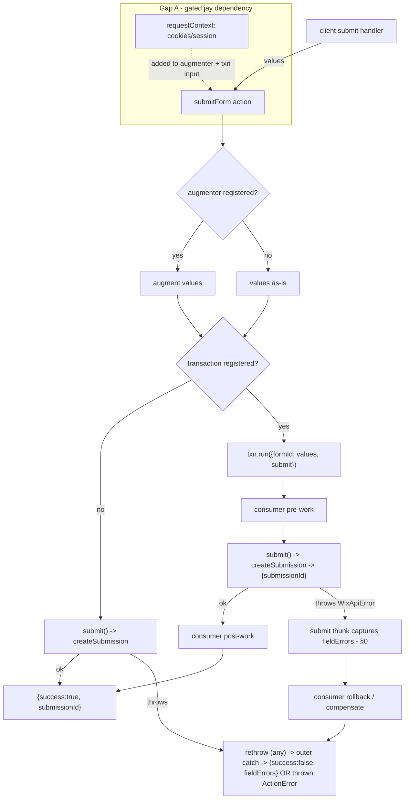

# 40 - Server-Side Form Transactions and Request Context for wix-forms

Status: Design — development-ready (awaiting approval)

Extends **DL#39 (General Forms Infrastructure)**, specifically its Capability 4b — the optional, pre-submit, values-only **submission augmenter** (`WIX_FORMS_SUBMISSION_AUGMENTER`, resolved in `submitForm` via a `hasService` guard, shallow-merged over the DOM values; `lib/services/wix-forms-submission-augmenter.ts`, `lib/actions/forms-actions.ts:14-34`). DL#40 covers the two things a larger **server-side transaction** needs that the augmenter structurally cannot express. Described generically for any Jay project; names no downstream site.

## Decisions for the Implementer (TL;DR)

- **Phase 0 (prerequisite — verified blocker): per-field submission errors are currently dropped in transport. Fix the error contract FIRST.** A `WixApiError` thrown by the `submitForm` handler never reaches the browser as a `WixApiError`: the action transport flattens any throw to `{ code, message, isActionError }` (**no `responseBody`**) and the client reconstructs it as a generic `ActionError`. So `wix-form.ts`'s `error instanceof WixApiError` check is never true, `parseSubmissionFieldErrors(error.responseBody)` is **dead code**, and every server rejection becomes a single generic status message — per-field submission errors inherited from DL#39 are silently dropped. **Fix:** `submitForm` catches `WixApiError` **server-side**, runs `parseSubmissionFieldErrors` there, and returns a **structured result** — `{ success: true; submissionId } | { success: false; fieldErrors }` — that the client maps; generic/unexpected failures still throw (→ status message). This is the contract Gap B's failure semantics build on, so it lands before the transaction. (Verification + citations: §0, Q2.)
- **Two independent gaps, two different verdicts. Keep them separate.**
  - **Gap B — a transaction around the submission (before / submit / on-error / after): PLUGIN-ONLY. Ships now.** It is the direct generalization of DL#39's already-shipped augmenter: the **same** `createJayService` + `hasService`/`getService` optional-service-marker pattern, proven plugin-only by the DL#39 Phase-7 spike. No jay change. Builds on the Phase-0 error contract.
  - **Gap A — trustworthy request context (authenticated session / access token / cookies) at submit time: NEEDS A JAY CHANGE (flagged, gated).** jay does **not** surface request context to an action handler today. A spoofable plugin-only shim exists (the client passes its own identity in the action `input`) but must never be presented as authenticated. Any *trusted* identity-derived server logic waits on a small jay public-surface addition, raised as its own DL in the jay repo.
- **Gap B — the transactional-submit service (`WIX_FORMS_SUBMISSION_TRANSACTION`).** A new optional service marker, modeled exactly on `WIX_FORMS_SUBMISSION_AUGMENTER`. A project registers a service into it from its own `init`; `submitForm` resolves it with a `hasService` guard. When present, the plugin hands it the final values **and a `submit` thunk** that performs `createSubmission` and **returns the created submission** (`{ submissionId }`, so post-work/compensation can reference it); the service runs the consumer's transaction: do pre-work → `const submission = await submit()` inside the consumer's `try` → on failure **roll back / compensate and rethrow (any throw fails the submit)** → on success do post-work. When absent, `submitForm` calls `createSubmission` directly — **identical to DL#39**. Simple forms keep working with zero config.
- **Why a wrapping `submit` thunk, not three fire-and-forget hooks (beforeSubmit/afterSubmit/onSubmitError).** Rollback needs the error **and** the pre-work handle **and** the submit call in **one** `try/catch` scope. A single `run({ formId, values, submit })` expresses before+submit+on-error+after in the consumer's own control flow; three separate hooks force the consumer to stash state across callbacks to correlate a failure with what to undo. The thunk form is simpler *and* strictly more expressive for the transaction use case (§Null hypothesis, §Design B).
- **Why not "consumer-owned submit" (plugin collects+validates+exposes, consumer's own action does `createSubmission`).** It discards the plugin's submit wiring (honeypot guard, the server-side per-field error mapping of §0, the `isSubmitted`/reset flow) and makes every transactional consumer re-implement submit. Kept only as the documented escape hatch for a consumer that genuinely needs total control; **not** the default (§Null hypothesis).
- **Gap A — the finding (traced to real code).** A jay action handler's signature is `(input, ...services) => Promise<O>` (`@jay-framework/fullstack-component` `makeJayAction().withHandler(...)`). It receives only the **client-sent JSON input** plus **globally-registered singleton services** — no request context. Request `RequestQuery`/`RequestCookies` are threaded by jay into the **fast render phase only** (`RenderFast` props are `PropsT & RequestQuery & RequestCookies`); `PageProps` is `{ language, url }`. The consumed jay server packages build an action's `input` from the request **body (POST) / query (GET)** and do **not** merge the request's `Cookie` header or headers into it — even though the browser *does* send cookies with the action fetch. And `WIX_CLIENT_SERVICE` is a **singleton** built from `ServerAuthConfig` (`apiKey` / `app` / `visitor`) — site/app/anonymous identity, **not** the signed-in member; member tokens live only **client-side** on `WIX_CLIENT_CONTEXT` (`getTokens`/`setTokens`). So the plugin's `submitForm` cannot see the authenticated caller. **Gap A is a jay dependency.** (Deciding evidence in §Prior Art → *What jay gives an action handler*.)
- **Gap A — the smallest jay ask (gated; recommend, don't build).** The cookies that identify the caller are **already on the wire** at the action endpoint — jay simply doesn't surface them. The minimal public-surface ask is therefore: *let an action handler read the current request's cookies (and query).* Recommended shape: a request-scoped accessor, e.g. `getRequestContext(): { cookies, query }`, that an action handler may call (backward compatible — existing handlers untouched; no signature change). Alternative: pass request context to the handler as an argument, mirroring `RenderFast`. The exact shape is **jay's** call; this DL records the requirement locally and specifies only the minimal contract. **Raised as its own DL against the jay repo; nothing in DL#40's plugin scope depends on it.**
- **Gaps A and B are orthogonal and compose.** Gap B ships plugin-only today and works for any transaction whose pre/post work does **not** need the authenticated caller (keyed by a form value or a page-provided id — see DL#39 Cap 4a hidden `control`). When Gap A later lands in jay, the **same** transaction (and augmenter) input gains a `requestContext` field with zero change to the mechanism. Do not block Gap B on Gap A.
- **Baseline assumption — DL#39 lands as designed.** DL#39 is *Approved — implementation in progress* (not yet shipped). DL#40 treats DL#39's submission augmenter and its `submitForm` chain as the baseline it extends. In particular, **Gap B's "byte-identical when unregistered" claim is relative to that DL#39 baseline**: with no augmenter and no transaction service registered, `submitForm` must match whatever DL#39 ships, not today's pre-DL#39 code. If DL#39's augmenter resolution changes during its implementation, re-check that baseline before implementing Gap B.
- **Backward compatibility with DL#39:** no augmenter and no transaction service registered → `submitForm` behaves exactly as DL#39 (augment-if-present, then `createSubmission`). All new surface is opt-in and inert when unused.
- **jay-feedback:** one agent-kit addition (extend `agent-kit/plugin/rich-forms.md` — register a transaction service in `init`, the submit/rollback contract, the Gap-A trust caveat); **no new plugin validator** (server-side registration isn't a jay-html concern); the Gap-A framework change is the gated jay dependency. Priority order holds: validation (n/a) → agent-kit (yes) → framework (only the gated jay ask).

---

## Background

DL#39 turned wix-forms into general forms infrastructure over DL#38's per-form contracts. Its Capability 4b added the one server-side extension point that exists today: the **submission augmenter**.

- The plugin exports `WIX_FORMS_SUBMISSION_AUGMENTER = createJayService<SubmissionAugmenter>('WixFormsSubmissionAugmenter')` (`lib/services/wix-forms-submission-augmenter.ts:33-35`).
- Its input is exactly `{ formId, values }` (`SubmissionAugmentInput`, `:18-22`); `augment(input) => Promise<Record<string, FieldValue>>` returns a **partial values map** (`:24-31`).
- `submitForm` resolves it **before** `createSubmission` with a non-throwing guard and shallow-merges the result **over** the DOM values (server wins): `hasService(...) ? { ...input.values, ...(await getService(...).augment({ formId, values })) } : input.values` (`lib/actions/forms-actions.ts:22-31`).
- The DL#39 Phase-7 spike confirmed (code-level) this is **plugin-only**: a `makeJayAction().withHandler()` handler resolves its services at request time against the same module-global service registry that `hasService`/`getService` read, so a direct `getService` call inside the handler resolves identically (`lib/services/wix-forms-submission-augmenter.ts:9-12`).

The submit chain the augmenter sits in (five typed layers, all keyed by field `target`):

1. the value store → `readFormValues(): Record<string, FieldValue>` (`lib/components/wix-form.ts:115-117`), called from the submit handler (`:196`, `submitForm({ formId, values })` at `:217`);
2. the `submitForm` action input `{ formId?: string; values: Record<string, FieldValue> }` (`lib/actions/forms-actions.ts:17`);
3. the service interface `WixFormsService.createSubmission(formId, values: Record<string, FieldValue>)` (`lib/services/wix-forms-service-marker.ts:17`);
4. the service impl `createSubmission` → `createFormSubmission` (`lib/services/wix-forms-service.ts:74-79`);
5. the Wix API wrapper `createFormSubmission` → `wixFetch(client, '/forms/v4/submissions', { method:'POST', body:{ submission:{ formId, submissions } } })` (`lib/wix-apis/create-submission.ts:17-31`).

## Problem

Some forms' submission participates in a larger **server-side transaction** that DL#39's pre-submit, values-only augmenter cannot express. Two concrete gaps:

**A. Request context at submit time.** The augmenter (and the whole `submitForm` action) receives only `{ formId, values }` — no authenticated session, access token, or cookies. So the plugin cannot **attribute a submission to the signed-in user** or run any **identity-derived server logic** (authorize by role, look up the caller's record, stamp the member id server-side rather than trusting a client-sent value). DL#39 does member *prefill* **client-side** precisely because the member token lives in the browser; the server submit path has no equivalent.

**B. A transaction around the submission (before / after / on-error).** A consumer needs to **write a related record BEFORE the Wix form submission and roll it back if the submission fails** (or run compensating logic). The augmenter runs **only before** `createSubmission` and returns values — it has **no post-submit hook, no failure hook, and no handle on the submit call** to wrap it in a `try/catch`. A values transform cannot own a transaction.

Each gap, hand-rolled per project, means abandoning the plugin's submit entirely and re-implementing `createSubmission` wiring — losing the honeypot, the per-field error mapping, and the confirmation/reset flow DL#39 provides.

**C. (Discovered during review) Per-field submission errors are already dead on the current submit path.** DL#39's `wix-form.ts` maps per-field submission errors only when the caught value is `instanceof WixApiError`, reading `error.responseBody`. But the action transport never delivers a `WixApiError` to the browser (verified in §0): it flattens any thrown error to `{ code, message, isActionError }` and the client reconstructs a generic `ActionError` with no `responseBody`. So that branch never runs — every server rejection surfaces as a single generic status message. This must be fixed (Phase 0, §0) **before** Gap B, because Gap B's failure semantics were specified around that same (broken) assumption.

## Prior Art / Adjacent Mechanisms

### DL#39's augmenter + the optional-service-marker pattern — the template to generalize
The augmenter is the proven, in-plugin precedent: an **optional service marker** (`createJayService`) a project registers into from its own `init`, resolved at submit time with a non-throwing `hasService` guard (`lib/services/wix-forms-submission-augmenter.ts`; `lib/actions/forms-actions.ts:22-30`). It **partially** solves Gap B — it is the right *registration + resolution* mechanism — but it is structurally a **pre-submit values transform**: its input carries no `submit` handle and it returns before `createSubmission`, so it cannot wrap the call, cannot see a failure, and cannot run post-submit work. Gap B reuses its pattern; it does not reuse the augmenter itself.

### Other wix-* plugins expose server services the same way
Every wix-* server capability is a `createJayService` marker registered in the package's init and resolved via `getService`/`hasService` from `@jay-framework/stack-server-runtime` — e.g. `WIX_FORMS_SERVICE` (`lib/services/wix-forms-service-marker.ts:20`, registered at `lib/services/wix-forms-service.ts:82`) and `WIX_CLIENT_SERVICE` (`@jay-framework/wix-server-client`). This is the sanctioned extension surface; Gap B stays inside it. Services are **global singletons** (not per-request), which matters for Gap A below.

### What jay gives an action handler (the Gap-A deciding evidence)
Verified against the `@jay-framework/*` packages this workspace consumes. Cited as **public surface** (API names + signatures), per the directional cross-repo rule — not upstream file paths.

- **The handler gets input + services only.** `@jay-framework/fullstack-component` — `makeJayAction(name).withServices(...).withHandler(handler)` where `handler: (input: I, ...services: Services) => Promise<O>`. There is **no** request-context parameter and **no** request-context among the injectables. (`makeJayQuery`, streaming actions, and CLI commands share the shape; webhooks get `(event, invalidate, ...services)`.)
- **Request context reaches the fast render phase, not actions.** `RenderFast`'s props are `PropsT & RequestQuery & RequestCookies` (`RequestQuery = { query: Record<string,string> }`, `RequestCookies = { cookies: Record<string,string> }`), and those interfaces are documented "available in the fast phase only." `PageProps` itself is just `{ language, url }`. Actions are a **separate transport** and receive none of it.
- **The action transport delivers only the client's JSON.** In the consumed jay server packages, an action request's `input` is built from the request **body** (POST) or **query string** (GET) and handed to `registry.execute(actionName, input)` → `handler(input, ...services)`. The request's `Cookie` header is parsed for **page** requests (and passed to fast render) but is **not** merged into an action's `input`, and there is no request-scoped global (AsyncLocalStorage) set during action dispatch that a plugin could read. **The browser does send cookies with the action fetch** (same-origin) — jay just doesn't surface them to the handler.
- **The server Wix client is site identity, not the member.** `@jay-framework/wix-server-client` — `WIX_CLIENT_SERVICE` is a **singleton** created once from `ServerAuthConfig` (`{ kind:'apiKey' } | { kind:'app' } | { kind:'visitor' }`). It carries site / app / anonymous-visitor identity. Member tokens live **client-side** on `WIX_CLIENT_CONTEXT` (`getTokens()` / `setTokens()`), which is why DL#39's member prefill runs in the interactive (client) phase.

**Conclusion:** no existing jay public surface lets an action handler obtain the authenticated caller's session/token/cookies. **Gap A requires a jay change** (smallest ask in §Design A).

### null hypothesis (per gap)

| Gap | Could an existing primitive already do it? | Verdict |
|---|---|---|
| B (transaction) | DL#39 augmenter — **partially**: right registration/resolution pattern, but it is a pre-submit values transform with no `submit` handle, no failure/post hook; cannot own a `try/catch`/rollback | New `WIX_FORMS_SUBMISSION_TRANSACTION` marker reusing the augmenter pattern + a `submit` thunk |
| B (shape) | three hooks (before/after/onError) | **Rejected** — rollback needs error+pre-work+submit in one scope; a single wrapping `run({...,submit})` is simpler and more expressive |
| B (ownership) | consumer-owned submit (plugin exposes values, consumer's action submits) | **Rejected as default** — loses honeypot/error-mapping/reset; kept as a documented escape hatch |
| A (request context) | action handler args / injected services / a request-scoped global | **None** — handler gets `(input, ...services)`; request context reaches fast render only; cookies not surfaced to actions → **jay change** |
| A (plugin-only shim) | client passes member id/token in the action `input` | **Spoofable** — usable only for non-authoritative personalization, never trusted attribution/authorization |

## Questions and Answers

**Q1 — Augmenter and transaction service both registered: what order runs?**
A: Augment first (it produces the final values), then the transaction wraps `createSubmission` over those values. So `submitForm`: resolve augmenter → `values = {...values, ...augment}` → if a transaction service is registered, `await txn.run({ formId, values, submit })` else `await createSubmission(formId, values)`. The augmenter stays a pure values transform; the transaction owns the write. **Answered.**

**Q2 — How does a transaction signal failure so the user sees an error (not a false success)? And how do per-field submission errors reach the user?**

A — two separate mechanisms, now cleanly split (this is the core of Phase 0, §0):

1. **Failing the submit: rethrow.** The `submit` thunk rejects when `createSubmission` fails; the consumer's `run` catches it, runs compensation, and **rethrows — any throw aborts the submit.** The consumer does **not** need to preserve the error *type*; it just has to throw. A `run` that returns normally reports success.

2. **Per-field errors: delivered by the plugin's structured result, not by the thrown error.** Why the old answer ("rethrow the original `WixApiError`") cannot work — **verified against the real transport (§0):** the action transport flattens any thrown error to `{ code, message, isActionError }` and the client reconstructs a generic `ActionError` with **no `responseBody`**, so `error instanceof WixApiError` on the client is **never** true and `parseSubmissionFieldErrors(error.responseBody)` is dead code. The fix moves field-error extraction **server-side**: the `submit` thunk catches the `WixApiError` at the source (before the transport can erase `responseBody`), runs `parseSubmissionFieldErrors`, and `submitForm` returns `{ success: false, fieldErrors }`. The client reads `result.fieldErrors` and calls `setErrorByTarget`.

Because extraction happens inside the `submit` thunk (where the value is still a real `WixApiError`), per-field mapping survives **regardless of what the consumer's `run` rethrows** — the consumer can wrap or replace the error freely and still get correct per-field feedback. Generic/non-field failures (e.g. a 403, a network/timeout error, the consumer throwing before `submit()`) are **not** in the structured result — they propagate as a thrown `ActionError` and the client's `catch` maps them to `setStatusMessage(describeSubmitError(error))`, exactly as today. **A transaction that swallows the `submit()` error (or never calls `submit()`) does NOT produce a false confirmation:** the `!submission` guard in `submitForm` (§0) converts a `run()` that returned without a successful submit into a **failed** submit, so the client shows a status message, not a confirmation. Swallowing the error still leaves any compensation to the consumer, but the user never sees a false success. **Answered.**

**Q3 — Does Gap B need Gap A?**
A: No, not in general. Gap B is independently useful whenever the pre/post work keys off a **form value** or a **page-provided id** (DL#39 Cap 4a hidden `control`), which are already in `values`. Gap B needs Gap A only when the server work is **identity-derived** (attribute to / authorize the signed-in caller). They ship on separate timelines; the transaction `run` input gains a `requestContext` field only once Gap A lands in jay. **Answered.**

**Q4 — Is there any plugin-only path for Gap A at all?**
A: Only an **untrusted** one: the interactive component already reads the member client-side for prefill (`getMyMember`, DL#39 Cap 2) and could pass a member id/token in the `submitForm` `input`. But the server cannot verify it — a crafted request can claim any identity. Acceptable only for **non-authoritative personalization** (e.g. a "submitted by" display value), never for attribution that grants access or integrity. Trusted attribution waits on the jay change. **This must be labeled loudly in the agent-kit guide.** **Answered.**

**Q5 — Why not make `submit` idempotent / give the transaction a rollback of the Wix submission itself?**
A: Out of scope. The Wix `/forms/v4/submissions` POST is a single external write with no two-phase-commit surface the plugin controls; "transaction" here means the **consumer's own** related work is wrapped around the submit with compensation, not a distributed transaction across Wix. If `createSubmission` succeeds but the consumer's post-work fails, compensation is the consumer's responsibility — and it genuinely **has the submission result** to compensate against: `submit()` returns the created submission (`{ submissionId }`, §Design B), so post-work can reference or delete it. (Phase 0 also makes `createSubmission`/`createFormSubmission` return the created submission's id, which the POST response already carries — a MUST-VERIFY against the live API, like the existing encoding note in `create-submission.ts`.) **Answered** (also §Scope pre-mortem).

**Q6 — Does Gap B touch the five-layer submit type chain (DL#39 4c)?**
A: Gap B (the transaction) wraps the **action-level** call only; `values` stays `Record<string, FieldValue>`. But **Phase 0** (§0) does change the chain's **return** type: `createSubmission`/`createFormSubmission` go from `Promise<void>` to `Promise<SubmissionResult>` (`{ submissionId }`), and the action returns `SubmitFormResult` instead of `{ success: true }`. The input/value type chain is unchanged; the new types are `SubmissionResult`, `SubmitFormResult`, and the transaction service interface + marker. **Answered.**

## Design

All changes are inside `packages/wix-forms` unless a line is explicitly marked as the gated jay ask. Path convention follows DL#39: paths are relative to `packages/wix-forms/lib/`.

### 0. Fix the error contract — per-field submission errors over the transport (Phase 0, prerequisite)

**Finding (verified against the real transport).** A `WixApiError` thrown by the `submitForm` handler cannot reach the browser as a `WixApiError`:

- **Server flattening.** The action dispatcher's `execute` wraps the handler in a `try/catch`; on throw it returns `{ success: false, error: { code, message, isActionError } }`. Only a throw whose `name === 'ActionError'` keeps its `code`; everything else becomes `{ code: 'INTERNAL_ERROR', message, isActionError: false }`. **No property beyond `code`/`message` is serialized — `responseBody` is dropped.** (`@jay-framework/stack-server-runtime`, action `execute`; `WixApiError` isn't even shaped like the `{ code, message }` guard — it carries `status`/`path`/`responseBody`/`name: 'WixApiError'` and no `code` — so it always lands in the `INTERNAL_ERROR` branch.)
- **Client reconstruction.** The action caller does `throw new ActionError(data.error.code, data.error.message)` — a generic `ActionError` (never a `WixApiError`), with **no `responseBody`**. (`@jay-framework/stack-client-runtime`, the action-caller fetch wrapper.)
- **Consequence.** In `components/wix-form.ts`, `error instanceof WixApiError` is never true, so `parseSubmissionFieldErrors(error.responseBody)` is **dead code**. Every server submission rejection becomes a single generic status message; per-field violations are lost.

**Fix — map per-field errors server-side and return a structured result.** Extract field errors at the one point where the value is still a real `WixApiError` (inside the `submit` thunk, before the transport erases `responseBody`), and return a discriminated result instead of relying on a surviving thrown type.

New types. `SubmissionResult` is a **shared type** and lives in `lib/types.ts` (beside `FieldValue`), because the service layer (`createSubmission`/`createFormSubmission`) now returns it and the service layer must **not** depend on the action layer. The action-only `SubmitFormResult` lives with the action in `actions/forms-actions.ts`:

```ts
// lib/types.ts — shared across the service, action, and transaction layers
/** The outcome of a created Wix form submission. */
export interface SubmissionResult {
  submissionId: string;
}
```

```ts
// lib/actions/forms-actions.ts — the action's own result type
/**
 * Result of the submitForm action. A per-field validation rejection is a STRUCTURED
 * failure (not a thrown error) because the action transport cannot carry a WixApiError
 * (with its responseBody) to the browser — see §0. Generic/unexpected failures are NOT
 * represented here; they throw and surface as a status message on the client.
 */
export type SubmitFormResult =
  | { success: true; submissionId: string }
  | { success: false; fieldErrors: Record<string, string> };
```

`submitForm` (`actions/forms-actions.ts`) — add `WixApiError` + `parseSubmissionFieldErrors` imports; wrap `createSubmission` so field errors are captured at the source:

```ts
const values = /* augmenter merge, unchanged */;

let fieldErrors: Record<string, string> | undefined;
let submission: SubmissionResult | undefined;

const submit = async (): Promise<SubmissionResult> => {
  try {
    submission = await forms.createSubmission(formId, values); // now returns { submissionId }
    return submission;
  } catch (error) {
    if (error instanceof WixApiError) {
      const parsed = parseSubmissionFieldErrors(error.responseBody);
      if (Object.keys(parsed).length) fieldErrors = parsed;
    }
    throw error; // fail the submit; the transaction's run (if any) compensates
  }
};

try {
  if (hasService(WIX_FORMS_SUBMISSION_TRANSACTION)) {
    await getService(WIX_FORMS_SUBMISSION_TRANSACTION).run({ formId, values, submit });
  } else {
    await submit();
  }
} catch (error) {
  if (fieldErrors) return { success: false, fieldErrors }; // per-field violations, captured in submit()
  throw error; // generic failure → transport → client status message
}

// run() may return normally without a successful submit() (swallowed error, or never
// called): convert that false-success case to a FAILED submit, never a false confirmation.
if (!submission) {
  throw new Error('Submission transaction completed without a successful submit()');
}

return { success: true, submissionId: submission.submissionId };
```

Client consumption (`components/wix-form.ts` submit handler) — replace the `instanceof WixApiError` catch branch with reading the structured result; `parseSubmissionFieldErrors` is no longer imported here (it moves to the action):

```ts
setIsSubmitting(true);
try {
  const result = await submitForm({ formId: carryForward.formId, values: submissionValues });
  if (result.success) {
    setIsSubmitted(true);              // confirmation echoes the store (Q2)
  } else {
    setErrorByTarget(result.fieldErrors); // per-field messages from the server
  }
} catch (error) {
  // transport/unexpected failure (network, timeout, 403, non-field Wix error)
  setStatusMessage(describeSubmitError(error));
} finally {
  setIsSubmitting(false);
}
```

- `describeSubmitError` stays (for the thrown generic path); its `403` detection still works because the flattened `message` is `"Wix API 403: /forms/v4/submissions"`.
- `createSubmission` / `createFormSubmission` now return `SubmissionResult` (from `lib/types.ts`; the POST response carries the created submission id); currently they return `void`. This is the only change to the five-layer submit chain and is a MUST-VERIFY against the live API (done at the **start** of Phase 0 — Gap B's post-work/compensation relies on the id).
- **The false-success case is guarded, not papered over.** With the `if (!submission) throw` guard above, a `run()` that returns normally without a successful `submit()` (swallowed error, or never called) becomes a **failed** submit — the client shows a status message, never a false confirmation with an empty id. On the success path `submission` is guaranteed set, so `{ success: true, submissionId: submission.submissionId }` always carries a real id. **MUST-VERIFY against the live API:** confirm the `/forms/v4/submissions` response actually carries the created submission id and shape the parsing to it; a missing id there is a parsing/verification failure to fix loudly, never to ship.
- **Two layers of `success`, no collision.** The transport-level envelope `success` (jay sets `{ success: true, data }` when it wraps a handler's **returned** value) is distinct from the app-level `SubmitFormResult.success`. They do not collide because only **thrown** errors become the transport's error envelope (`{ success: false, error }`): a returned `{ success: false, fieldErrors }` is a normal return value, so it rides through intact as the envelope's `data` and the client reads `data.success` / `data.fieldErrors` from it. The app-level `success: false` therefore never reaches the client as a transport failure.

### A. Request context at submit time (gated — needs jay)

**Finding (restated):** jay does not expose request context to an action handler (§Prior Art). Gap A cannot be solved plugin-only with any trust.

**The smallest jay ask (public surface; recommend, do not build here):** surface the current request's already-received cookies (and query) to an action handler. Two candidate shapes; the choice is jay's:

- **(Recommended) a request-scoped accessor** usable inside a handler, e.g. `getRequestContext(): { cookies: Record<string,string>; query: Record<string,string> }` exported from `@jay-framework/stack-server-runtime`, populated per request by the action transport. Backward compatible: existing handlers are untouched; a handler opts in by calling it. It cannot be a normal service (jay services are global singletons, not per-request — §Prior Art), so jay backs it with request-scoped storage.
- **(Alternative) an argument on the handler**, mirroring `RenderFast`'s `props & RequestQuery & RequestCookies`. More consistent with the render phases but a signature change to every handler, so less backward compatible.

**How the plugin would consume it once it exists (no change to the mechanism below):** `submitForm` reads the request context, builds a **member-scoped** Wix client server-side from the caller's cookies/tokens (via `@jay-framework/wix-server-client`'s existing client/auth surface), and passes a `requestContext` field into both the augmenter input (`SubmissionAugmentInput`) and the transaction input (`SubmissionTransactionInput`). Until then, those inputs carry `{ formId, values }` only, exactly as today.

**Interim plugin-only option (untrusted, opt-in, clearly labeled):** a project that only needs **non-authoritative** identity can have its client pass a value in the submit `input` (e.g. via the interactive component's member prefill, which already reads the member client-side — DL#39 Cap 2) and treat it as display-only. The DL does **not** add a dedicated surface for this — it is just an ordinary field value — to avoid implying it is trusted.

> **Boundary:** Gap A is the **only** item in DL#40 that may touch jay. It is raised as its **own** DL in the jay repo (jay stays on `main`; this workspace assumes no jay change). All of §Design B ships without it.

### B. Transaction around the submission (plugin-only — ships now)

A new optional service marker, modeled on the augmenter.

**New file `services/wix-forms-submission-transaction.ts`:**

```ts
import { createJayService } from '@jay-framework/fullstack-component';
import type { FieldValue } from '../types.js';
import type { SubmissionResult } from '../types.js'; // { submissionId } — §0

export interface SubmissionTransactionInput {
  formId: string;
  /** The final submission values (after any augmenter), keyed by field target. */
  values: Record<string, FieldValue>;
  /**
   * Perform the Wix form submission. Call exactly once, inside your transaction's
   * try-block. Resolves with the created submission ({ submissionId }) so post-work /
   * compensation can reference it. Rejects if the Wix API rejects the submission —
   * catch it, compensate, and rethrow to fail the submit. (Per-field submission errors
   * are extracted server-side and returned to the client regardless of what you rethrow
   * — see §0; you do NOT need to preserve the error type.)
   */
  submit(): Promise<SubmissionResult>;
  // Gap A (gated): a `requestContext` field is added here once jay surfaces it.
}

export interface SubmissionTransaction {
  /**
   * Run the consumer's transaction around the form submission. Typical shape:
   *   const record = await writeRelatedRecord(...);        // before
   *   let submission;
   *   try { submission = await input.submit(); }           // the Wix submission
   *   catch (e) { await rollback(record); throw e; }       // compensate + FAIL the submit
   *   await finalize(record, submission.submissionId);     // after (success)
   * MUST rethrow to fail the submission — ANY throw aborts and surfaces as a failed
   * submit. Returning normally reports success to the user. You do NOT need to preserve
   * the thrown error's type: per-field submission errors are mapped server-side (§0) and
   * delivered to the client in the action's structured result, not via your thrown error.
   */
  run(input: SubmissionTransactionInput): Promise<void>;
}

export const WIX_FORMS_SUBMISSION_TRANSACTION =
  createJayService<SubmissionTransaction>('WixFormsSubmissionTransaction');
```

**`submitForm` change (`actions/forms-actions.ts`)** — gate the `submit` thunk defined in §0 behind the transaction, after the augmenter. (The full handler, including the field-error-capturing `submit` thunk and the structured `SubmitFormResult`, is in §0; this is the transaction-gating slice of it.)

```ts
// ...augmenter resolution produces `values`; `submit` is the §0 thunk that performs
//    createSubmission, captures field errors on WixApiError, and returns { submissionId }...
try {
  if (hasService(WIX_FORMS_SUBMISSION_TRANSACTION)) {
    await getService(WIX_FORMS_SUBMISSION_TRANSACTION).run({ formId, values, submit });
  } else {
    await submit();
  }
} catch (error) {
  if (fieldErrors) return { success: false, fieldErrors };
  throw error;
}
// run() returned without a successful submit() (swallowed / never called) → fail the submit (§0 guard).
if (!submission) {
  throw new Error('Submission transaction completed without a successful submit()');
}
return { success: true, submissionId: submission.submissionId };
```

- `hasService`/`getService` are already imported here (`forms-actions.ts:2`); the Phase-7 spike already proved they resolve inside this handler. **No jay change.**
- **Default path:** no transaction service → `submit()` directly. The only behavior change vs DL#39 is the Phase-0 error contract (§0): success returns `{ success: true, submissionId }` and a per-field rejection returns `{ success: false, fieldErrors }` instead of throwing. Values/honeypot/confirmation flow are unchanged.
- **The `submit` thunk preserves the plugin's submit** (same `forms.createSubmission` → `createFormSubmission` → `/forms/v4/submissions`) and now returns `{ submissionId }`. Honeypot (client-side, `wix-form.ts:191-194`) and the confirmation/reset flow are untouched; per-field error mapping is the server-side §0 path.
- **Failure semantics:** a transaction fails the submit by **rethrowing — any throw aborts.** The rejection propagates out of `run`; `submitForm`'s outer `catch` then (a) returns `{ success: false, fieldErrors }` if the `submit()` call captured per-field violations (regardless of what `run` rethrew — capture happens inside the `submit` thunk, §0), else (b) rethrows, and the client maps the generic `ActionError` to a status message. The consumer therefore does **not** need to preserve the error type. A consumer that **swallows** the `submit()` error (or never calls `submit()`) does **not** cause a false confirmation: the `!submission` guard (§0) turns a `run()` that returned without a successful submit into a failed submit, so the client shows a status message. Swallowing still leaves any compensation to the consumer, but the user is never shown a false success (Q2).

**Export** `WIX_FORMS_SUBMISSION_TRANSACTION`, `SubmissionTransaction`, `SubmissionTransactionInput`, `SubmissionResult`, and `SubmitFormResult` from `index.ts` beside the augmenter exports.

### Diagram



### Examples

✅ Transaction with rollback (consumer, in its own `init`):
```ts
registerService(WIX_FORMS_SUBMISSION_TRANSACTION, {
  async run({ values, submit }) {
    const record = await relatedStore.create(deriveFrom(values));     // BEFORE
    try {
      const submission = await submit();                             // the Wix submission -> { submissionId }
      await relatedStore.link(record.id, submission.submissionId);   // AFTER (success) — uses the result
    } catch (err) {
      await relatedStore.delete(record.id);                          // ROLL BACK
      throw err;                                                     // FAIL the submit (any throw works; per-field errors are mapped server-side, §0)
    }
  },
});
```

❌ Swallowing the error (still a bug — compensation is skipped):
```ts
try { await submit(); } catch { /* ignored */ }   // BUG: run() returns without a successful submit
// The plugin's `!submission` guard (§0) converts this to a FAILED submit (status message),
// so the user is NOT shown a false confirmation — but any related record still needs compensation here.
```

❌ Relying on an un-gated "signed-in member" server-side (Gap A not yet in jay):
```ts
// input has no authenticated session; a member id in `values` is client-supplied and spoofable.
// Do NOT authorize or attribute on it until jay surfaces request context.
```

## Implementation Plan

**Phase 0 — Fix the error contract (prerequisite; §0).** **First, verify the submission id.** `createFormSubmission` returns `Promise<void>` today, so returning `{ submissionId }` depends on the live `/forms/v4/submissions` response shape — a MUST-VERIFY done at the **start** of Phase 0 (before the error-contract work), because Gap B's post-work/compensation relies on the id. Confirm a non-empty id is always present on success; a missing id is a parsing/verification failure to fix loudly, never to ship. Then reproduce the dead per-field mapping with a **failing test first, written at the `submitForm` action boundary** — the true bug locus and the only place the node test harness can exercise. (The test env is node; the repo convention tests pure functions and action boundaries, not DOM components, and `setErrorByTarget` lives inside the interactive `WixFormInteractive` component in `components/wix-form.ts`, which has no test harness — so the repro must not assert on it.) Mock `WIX_FORMS_SERVICE` so `createSubmission` rejects with a field-violation `WixApiError` (its `responseBody` carrying the per-field violations), then assert the **correct** behavior: `submitForm({ formId, values })` **returns** `{ success: false, fieldErrors: { … } }` with the exact expected per-field errors. Expect it to fail red against today's code — today `submitForm` lets the error throw and returns no structured result (no `fieldErrors` branch). Then implement the fix: add `SubmissionResult` + `SubmitFormResult` types; make `createSubmission`/`createFormSubmission` return `{ submissionId }`; in `submitForm`, wrap `createSubmission` in the field-error-capturing `submit` thunk and return the structured result. Make the red test go green (runnable in the node harness, no false green). The client-side mapping (`result.fieldErrors` → `setErrorByTarget` in `components/wix-form.ts`, dropping the dead `instanceof WixApiError` branch and its `parseSubmissionFieldErrors` import) is a **separate, trivial change** not covered by the node-harness repro; if it warrants its own test, extract the `result → { confirmation | per-field errors }` decision into a **pure mapper** and unit-test that in node. Additional action-boundary unit tests (correct expectations first, no false green): success → `submitForm` returns `{ success: true, submissionId }`; a non-field `WixApiError` (e.g. 403) → `submitForm` **throws** (no structured result), so the client later shows a status message, not a field error.

**Phase 1 — Transaction service (Gap B, plugin-only; builds on Phase 0).** Add `services/wix-forms-submission-transaction.ts` (marker + interfaces). Wire the `hasService`-gated `run({ formId, values, submit })` into `submitForm` after the augmenter (`actions/forms-actions.ts`). Export from `index.ts`. Unit-test the action's branch selection with a fake service (correct expectations first, no false green): (a) no service → `submit()` runs `createSubmission` and the action returns `{ success: true, submissionId }`; (b) service present → `run` is called with `{ formId, values, submit }`, and calling `submit()` triggers `createSubmission` and resolves with `{ submissionId }`; (c) **`submit()` is NOT called when the consumer's pre-work throws** — assert no `createSubmission` call is made and the error propagates out of `submitForm` (thrown, no `{ success }`); (d) a `run` that rethrows after `submit()` rejected with a field-violation `WixApiError` → the action returns `{ success: false, fieldErrors }` regardless of whether `run` rethrew the original or a wrapped error; (e) a `run` that swallows the `submit()` error (or never calls `submit()`) → the action **throws** (the `!submission` guard converts it to a failed submit), **not** `{ success: true }`. Write the correct expectation first (no false green): assert `submitForm` rejects, so the client later shows a status message rather than a false confirmation (Q2).

**Phase 2 — agent-kit.** Extend `agent-kit/plugin/rich-forms.md`: registering a transaction service in `init` (same pattern as the augmenter), the before/submit/on-error/after shape, **rethrow-to-fail** (any throw aborts the submit; the consumer does **not** need to preserve the error type — per-field submission errors are mapped server-side and delivered in the action's structured result, §0/Q2), that `submit()` returns the created submission (`{ submissionId }`) for post-work/compensation, that **swallowing the `submit()` error still leaves compensation to the consumer but no longer shows the user a false confirmation** (the plugin's `!submission` guard converts it to a failed submit — §0), the augmenter-then-transaction order (Q1), and the **Gap-A trust caveat** (Q4) — no trusted identity server-side until jay surfaces request context; a client-passed identity is display-only.

**Phase 3 — Gap A (gated jay dependency, NOT built here).** Raise a jay-repo DL for the smallest public-surface ask (§Design A): a request-scoped `getRequestContext()` (recommended) or a handler argument. Once available: thread `requestContext` into `SubmissionAugmentInput` and `SubmissionTransactionInput`, and build a member-scoped server client in `submitForm`. Ships in a follow-up; Phases 1–2 do not depend on it.

## Trade-offs

- **(+/−)** Phase 0 fixes a real DL#39 bug (per-field submission errors were dropped in transport) but changes the `submitForm` action **return** type (`{ success: true }` → `SubmitFormResult`) and `createSubmission`'s return (`void` → `{ submissionId }`). Since DL#39 is still in progress and nothing external consumes `submitForm` yet, this is a contract improvement, not a break to shipped code — but it is a larger change than Gap B alone.
- **(+)** Gap B reuses the exact proven augmenter pattern — minimal new surface (one marker, two interfaces, the transaction-gating slice of `submitForm`), no jay change, composes with the augmenter, and keeps DL#39's default behavior (modulo the Phase-0 result shape).
- **(+)** The `submit`-thunk wrapper gives before/submit/on-error/after in one scope — the natural shape for rollback — instead of three correlated callbacks.
- **(−)** Gap A is a genuine jay dependency; trustworthy identity-derived submit logic is blocked until that lands. Mitigated by shipping Gap B independently and documenting the spoofable interim path as display-only.
- **(−)** The transaction runs with the **site** Wix client (singleton), so any Wix API calls the consumer's pre/post work makes are site-scoped, not member-scoped, until Gap A. A consumer that needs member-scoped writes must wait for Gap A.
- **(+)** A buggy transaction service that swallows the `submit()` error (or never calls it) no longer produces a false-success confirmation: the `!submission` guard (§0) converts it to a failed submit, so the user sees a status message. The consumer is still responsible for compensating its own related work, but the plugin guarantees the user is never shown a false confirmation.
- **(−)** `submit()` is a plain thunk; calling it more than once would **double-submit** (two `createSubmission` POSTs). It is meant to be called exactly once, guarded **only by documentation** (the interface JSDoc) — consistent with the augmenter's doc-only guardrails. The plugin does not enforce call-once. Acceptable, but called out.
- **(−)** "Transaction" is the consumer's own compensation, not a distributed transaction with Wix (Q5). A post-work failure after a successful `createSubmission` leaves the Wix submission stored; the consumer owns that reconciliation.

## Verification Criteria

- [ ] **(Phase 0, bug-repro — action boundary)** With `WIX_FORMS_SERVICE` mocked so `createSubmission` rejects with a field-violation `WixApiError`, `submitForm({ formId, values })` **returns** `{ success: false, fieldErrors: { … } }` with the correct per-field errors — the reproduction test (node harness, no DOM) is red against today's code (which lets the error throw with no structured result) and green after the fix.
- [ ] **(Phase 0, client mapping — separate concern)** The client maps `result.fieldErrors` → `setErrorByTarget` (and a success result → confirmation) in `components/wix-form.ts`, dropping the dead `instanceof WixApiError` branch. This is a trivial client change outside the node-harness repro; if tested, the mapper is extracted as a pure function and unit-tested in node.
- [ ] **(Phase 0)** `submitForm` returns a structured result: success → `{ success: true, submissionId }` (client shows confirmation); a field-violation rejection → `{ success: false, fieldErrors }` (client maps to fields). A non-field failure (e.g. 403, network) still **throws** and the client shows a status message (`describeSubmitError`).
- [ ] With **no** transaction service registered, `submitForm` runs `submit()` directly; a DL#39 form still submits + confirms (only the result shape changes, per Phase 0).
- [ ] With a transaction service registered, `run` is invoked with `{ formId, values, submit }`; calling `submit()` performs `createSubmission` and resolves with `{ submissionId }`; the submission is **not** sent unless `submit()` is called.
- [ ] `submit()` is **not** called when the consumer's pre-work throws: no `createSubmission` is issued and the error propagates out of `submitForm`.
- [ ] A `run` that rethrows after a field-violation `submit()` rejection yields `{ success: false, fieldErrors }` **regardless of whether it rethrew the original or a wrapped error** (per-field mapping is captured server-side in the `submit` thunk, §0).
- [ ] A `run` that returns normally **after a successful `submit()`** yields `{ success: true, submissionId }` and the client shows the confirmation.
- [ ] A `run` that returns normally **without a successful `submit()`** (swallowed error, or never called) makes `submitForm` **throw** (the `!submission` guard), so the client shows a status message — never a false confirmation.
- [ ] Augmenter + transaction together: values are augmented first, then wrapped (ordering unit test).
- [ ] `WIX_FORMS_SUBMISSION_TRANSACTION`, its interfaces, `SubmissionResult`, and `SubmitFormResult` are exported; `npm run build` ends in a passing `validate-plugin`; `jay` is untouched by Phases 0–2.
- [ ] agent-kit `rich-forms.md` documents registration, rethrow-to-fail (any throw aborts; the consumer need not preserve the error type — per-field errors are mapped server-side), `submit()` returning the submission, order, and the Gap-A trust caveat.
- [ ] Gap A is recorded as a gated jay-repo DL; no DL#40 plugin code imports an unavailable jay API.

## Scope Pre-mortem (what this will NOT handle)

- **Building the Gap-A jay change here** — it is a separate jay-repo DL; DL#40 only specifies the minimal ask and consumes it later.
- **A trusted plugin-only identity path** — impossible without jay (§Prior Art); the interim client-passed identity is explicitly untrusted/display-only.
- **Distributed / two-phase transactions across Wix** — the Wix submission is a single external write; "transaction" means the consumer's own compensation around it (Q5).
- **Multiple transaction services / a pipeline of wrappers** — one optional service, like the augmenter. Compose inside a single registered service if needed.
- **Post-work failure after a successful submission** — the Wix submission stays stored; reconciliation is the consumer's (documented).
- **Client-side transaction / optimistic UI around submit** — out of scope; this is a server-side action concern.

## Agent Feedback Loop (jay-feedback — definition of done)

Order: validation → agent-kit → framework.

- **Validation (plugin `JayHtmlValidatorFn`): none new.** Registering a transaction service is server-side wiring in a project's `init`, not a jay-html binding — there is no page markup to statically check (unlike DL#39's `.control`/`memberPrefill` checks). Nothing deterministic to add.
- **agent-kit: yes.** Extend `agent-kit/plugin/rich-forms.md` (Phase 2) — the transaction registration pattern, the `submit`-thunk/rollback contract (`submit()` returns the created submission), **rethrow-to-fail** (any throw aborts; the consumer need not preserve the error type — per-field submission errors are mapped server-side and delivered in the action's structured result, §0), augmenter-then-transaction order, and the Gap-A trust caveat.
- **Framework: the gated jay ask only** (Gap A). Everything else is plugin-only.

## Jay Dependency (explicitly flagged — Gap A only)

Gap B is fully plugin-level. Gap A is a jay change and the **only** item that may touch jay:

- **What:** let an action handler read the current request's cookies (and query) — recommended as a request-scoped `getRequestContext()` from `@jay-framework/stack-server-runtime`, or a handler argument mirroring `RenderFast`'s `RequestQuery & RequestCookies`.
- **Why it is not plugin-level:** the handler signature is `(input, ...services)`; request context is threaded only into the fast render phase; the action transport builds `input` from the request body/query and does not surface the (already-received) Cookie header; and `WIX_CLIENT_SERVICE` is a site-identity singleton, not the member (§Prior Art). A plugin cannot obtain the authenticated caller from inside its own action.
- **Boundary:** raised as its own DL against the `jay` repo; this workspace assumes no jay change, and DL#40's plugin scope (Gap B + agent-kit) ships independently.
