# 44 - Checkbox-Group Multiselect and Native Submit Guard

Status: Implemented — browser and live Wix checks passed 2026-11-10; chip example fixed (compile check red until the jay boolean-attribute fix); Safari not covered

Builds on **DL#40** (per-form contracts, repeated `options` sub-contract), **DL#41** (value store §0, Capability 4c non-string fields, Capability 5 `control`, Addendum A "submit runs from the `<form>`'s `submit` event"), **DL#42** (server-side submit hook) and **DL#45** (locale-neutral submit outcome; unchanged here). Package: `@jay-framework/wix-forms`; paths are relative to `packages/wix-forms/` unless stated. jay is referenced only through its public packages (`@jay-framework/component`, `@jay-framework/runtime`, `@jay-framework/reactive`, `@jay-framework/stack-client-runtime`, all 0.25.5 as installed), cited by built file and line.

## Decisions for the Implementer (TL;DR)

- **The native submit guard on main is a no-op and must be fixed (Problem 2).** `wireNativeFormSubmit` runs inside a construction-time `createEffect` (`lib/components/wix-form.ts:183-186`). In jay 0.25.5 that effect runs synchronously while the interactive constructor runs, before any ref is bound, and never re-runs, so `refs.submitButton.exec$` resolves `undefined` and no `submit` listener is attached. Because the submit-button click now returns early for in-form buttons (`wix-form.ts:244-248`, `isFormSubmitter` `:392-395`), **a wired submit click inside a `<form>` performs the browser's GET navigation** — a regression versus the earlier click-`preventDefault`. Evidence: §Prior Art "jay timing".
- **Fix, minimal and on top of current code:** install the guard (a) once **after construction**, via the existing `afterRemount` microtask (`wix-form.ts:371-373`) — by then hydration/render has bound the refs synchronously — (b) **after every reset re-mount**, inside `clearNativeInputsAfterRemount`'s microtask (`wix-form.ts:228-234`), because the re-shown branch may hold a new `<form>` node, and (c) **from the submit-button click itself**, using the form returned by a new `owningSubmitForm(target)` helper that `isFormSubmitter` also uses (a listener added during click dispatch runs for the `submit` event the button's activation behaviour fires afterwards). The construction microtask (a) covers every fresh-load path; the click install (c) is only a fallback for a `<form>` created later (not by reset), so keep it to the few lines in §4. All three go through one idempotent `guardNativeFormSubmit(form, submit)` (the existing `WeakSet`, extracted to a small module so it is unit-testable). `submit`, `submitFlight` and `runFormSubmit` (`lib/components/form-submit-execution.ts`) are kept unchanged. The guard's `createEffect` call is deleted; the effect keeps only the seed.
- **New contract surface: one per-option interactive ref, `options.toggle`, only on multiselect fields.** `{ tag: toggle, type: interactive, elementType: HTMLInputElement }` inside the repeated `options` sub-contract (`lib/generators/contract-utils.ts:116-135`, after `selected` at `:131-133`). A page binds `<input type="checkbox" ref="contact.interests.options.toggle">` inside `forEach="contact.interests.options"`. A single `select` does not get it. Verified by asserting on the **parsed contract** (no generated `.d.ts`: wix-forms never compiles its contracts to types), see Phase 3.
- **The toggle handler reads the option from the jay event's `viewState`, never from the DOM.** A ref inside `forEach` is a collection ref; jay delivers `{ event, viewState, coordinate }` where `viewState` is that item (`{ value, label, selected }`) (`@jay-framework/runtime` `dist/index.js:1113-1116` `HTMLElementRefImpl` event wrapper, `EVENT_TRAP` `:1144-1155`). `event.target.checked` gives the new state.
- **The store keeps `string[]`.** New pure `toggleSelection(field, { current, optionValue, checked }): string[]` in `lib/components/submission-values.ts` (option order, de-duplicated, unknown values dropped). `projectSubmissionValues` (`submission-values.ts:31-40`), `validateFormField` and the per-option `selected` (`lib/components/form-view-state.ts:55-66`) need no change.
- **Reflect store → checkboxes** in `reflectToInput` (`wix-form.ts:140-153`): a multiselect branch over `options.toggle.map(...)` that sets `checked`, as a separate statement **outside** the `input?.exec$` callback (a chip page has no `input`). Reset already calls `reflectToInput` after re-mount (`clearNativeInputsAfterRemount`, `:228-234`).
- **Focus-first-invalid-field covers chip groups.** `focusFirstFieldInput` (`wix-form.ts:376-389`) matches a field that binds `refs.<field>.input` **or**, for a multiselect, `refs.<field>.options.toggle`; for the latter it focuses the first bound checkbox through `refs.<field>.options.toggle.find(() => true)?.exec$(el => el.focus())` (a collection ref has only `map`/`find`, no `exec$`; `find` returns the per-item ref, which has `exec$`). "First" is the first bound element in insertion order, which is form order on a fresh render. Keeps DL#41 Addendum A's behaviour for the page shape this log recommends (§3).
- **`<select multiple>` via `input` is unchanged** (`readNativeValue`, `:468-471`).
- **Backward compatible.** The new `toggle` tag appears only in regenerated multiselect contracts; existing pages (`<select multiple>` via `input`, `control`) behave as before, and no ViewState shape changes.
- **Delivery order: Phase 1 (the guard fix) ships first, as its own commit and PR with its own approval**, ahead of Phases 2–5. It is a live regression on `main` and does not depend on the checkbox feature. The Phase 1 PR also carries validator rule 3 (the missing-`submitButton` warning, which covers the guard's remaining gap, Q9) and the DL#41 Implementation Results "on ship" line. The design text is unchanged; only the delivery order is split.
- **The guard finds the `<form>` only through `refs.submitButton`** (`exec$` → `button.form`). A `<form>` holding a key's field refs but no `ref="<key>.submitButton"` (plain button, Enter-only) stays unguarded and does a GET navigation; this is a stated gap, surfaced by a new validator **warning** (Q9), not fixed at runtime.
- **jay-feedback:** three validator rules (`options.toggle` on a field whose `options` has no `toggle` → error via a check on the segment after `options` (the fourth ref part, `<key>.<field>.options.<child>`); `.control` inside `forEach` over a multiselect's `options` → warning; a key's refs inside a `<form>` with no `<key>.submitButton` ref → warning) + `rich-forms.md` §4b checkbox-chip example. No framework change. See §jay-feedback.
- **Deferred to the effort's final end-to-end pass (not a phase here):** browser proof (`/demo-feature`) and the live Wix check that closes DL#41 MUST-VERIFY #1 (Wix accepts `string[]`/boolean). Marked *pending* in §Verification.

## Background

DL#41 4c made checkbox (boolean) and multiselect (`string[]`) first-class in the value store. A multiselect exposes a repeated `options` sub-contract `{ value, label, selected }` (`contract-utils.ts:116-135`); every field also gets `input` and `control` channels (`contract-utils.ts:86-89`). The guide shows only `<select multiple>` (`agent-kit/plugin/rich-forms.md:88-102`). Designers draw multi-choice as checkbox chips, not a list box.

DL#41 Addendum A moved submit onto the `<form>`'s `submit` event (Enter, `requestSubmit()`, password-manager detection), and the click now submits only when no form owns the button. The listener is attached by `wireNativeFormSubmit` (`wix-form.ts:407-417`, doc comment `:399-406`, `wiredForms` `:397`) from the construction-time effect (`:183-186`). DL#41's Implementation Results already record that the same mount-time effect can run before hydration binds control elements (hence the submit-time seed, `wix-form.ts:270-273`); this log confirms the same defect hits the guard and is total, not intermittent.

## Problem

1. **No way to bind a checkbox group to a multiselect.** `input` reads `selectedOptions` (`wix-form.ts:468-471`), meaningless on a checkbox. `control` reads one `data-value` string (`readControlValue`, `:477-485`) and **replaces** the slot (`handleControl`, `:161-167`), so each chip click overwrites the array with a scalar. The submission carries a string, every `selected` goes false (`form-view-state.ts:56`, `Array.isArray`), and a required-multiselect check sees a non-array.
2. **A wired submit button inside a `<form>` reloads the page.** No `submit` listener is ever attached (see Prior Art), and the click handler deliberately does not `preventDefault` for in-form submit buttons (`wix-form.ts:245`). The browser submits the form natively: GET navigation to the same URL with field values in the query string, before the async plugin submit could run. Enter in a field and `requestSubmit()` do the same. The guide (`rich-forms.md:42-55`) documents the intended behaviour, so pages built from it hit this.

## Prior Art / Adjacent Mechanisms

**jay timing (public built source, 0.25.5) — why main's guard never attaches:**

- `@jay-framework/component` `dist/index.js:43-61` `createEffect`: registers a reaction keyed on `mountedSignal`; with `lastMounted=false` and `mounted()` true it calls `effect()` immediately. `@jay-framework/reactive` `dist/index.js:103-112` `createReaction` runs the reaction synchronously on creation. `mountedSignal` starts `true` (`component/dist/index.js:206`).
- `component/dist/index.js:216-243` `makeJayComponent`: `preRender` creates refs (`:216`), then `comp(...)` — the interactive constructor — runs (`:222`), and only afterwards the render reaction creates the element (`renderWithContexts`, `:235`). For a jay-stack page, `@jay-framework/stack-client-runtime` `dist/index.js:255-279` runs each headless part's `comp` (our `WixFormInteractive`) inside that `comp`, and its hydrating `preRender` (`:312-324`) renders on the first render call.
- `@jay-framework/runtime` `dist/index.js:377-389` `withHydrationRootContext` (and `:319-336` `withRootContext`) call `element.mount()` at the end of render; each ref's `mount` is pushed by `mkRef` (`:408-413`) and is `parentCollection.addRef(this)` (`:1069-1071`). So refs join their collection only at render-time mount.
- `runtime/dist/index.js:1012-1016` `HTMLElementRefsImpl.exec$`: with no element in the set, `return Promise.resolve(void 0)` — **it does not queue until bound.** (`HTMLElementRefImpl.exec$`, `:1120-1129`, likewise resolves `undefined` when `this.element` is unset.)
- The effect body reads no signal, and `mkMounts`' (`@jay-framework/component`) `mount()` sets `mounted` to `true` again (`component/dist/index.js:182-196`) — no change, so the effect **never re-runs**. Conclusion: at construction time the `exec$` sees an empty set; the guard is never installed. The DL#41 re-QA finding holds for this jay version.
- By contrast, **event registration** at construction is safe: `PrivateRefs.addEventListener` stores listeners and `PrivateRefs.addRef` replays them on bind (`runtime/dist/index.js:927-937`), and `HTMLElementRefImpl.set` attaches them to the element (`:1089-1094`). And everything from `comp()` to `element.mount()` is synchronous, so a microtask queued in the constructor runs after refs are bound — the existing `afterRemount` (`wix-form.ts:371-373`) relies on exactly this for reset.

**Shipped wix plugins — same ref shape, same event payload (solves: refs nested under repeated sub-contracts on headless part refs, reading the item's `viewState`):**

- `packages/wix-stores/lib/components/product-page.ts:698`: `refs.options.choices.choiceButton.onclick(({ event, viewState, coordinate }) => …)` — a ref two levels under repeated sub-contracts, reading `viewState`; the same shape as `refs.<field>.options.toggle.onchange`.
- `packages/wix-stores/lib/components/product-search.ts:949`: `refs.filters.priceRange.minPrice.oninput(…)` — a three-level ref under a non-repeated parent.
- `packages/wix-bookings/lib/components/booking-flow.ts:241`: `refs.formFields.formInputs.map((input, field) => input.exec$(…))` — the `map(publicApi, viewState)` signature §3's reflect and the focus fallback rely on.

**wix-forms mechanisms:** `control` channel (scalar by design, DL#41 Cap 5); `input` channel (one native element, kind-specific read); repeated `options` sub-contract (DL#40 §3; nested `selected` variant confirmed by DL#41 MUST-VERIFY #2); jay collection refs `map`/`find` give per-item public APIs with `exec$` (`HTMLElementRefsImpl.map`/`find`, `runtime/dist/index.js:976-985`); `submitFlight` + `runFormSubmit` already make the API call single-flight (`isSubmitting` set synchronously at its start, `form-submit-execution.ts:25-28`); bindings validator field-sub-tag check (the third ref part, `<key>.<field>.<tag>`) (`lib/validators/wix-form-bindings.ts:213-228`) and `closestAncestor` (`:129-134`).

## Questions and Answers

- **Q1. Null hypothesis — does anything existing already do multiselect checkboxes?** No. `control` would need a second meaning (toggle vs replace) keyed on field kind and still read `data-value` from the DOM; `input` is a single `HTMLSelectElement` ref and cannot sit in a collection context without its type lying. A ref inside the repeated `options` item is the smallest addition, and jay already hands the item's view state to its handler.
- **Q2. Null hypothesis — is main's guard effective, so the submit half can be dropped?** No (Prior Art, jay timing). Kept.
- **Q3. Why three install points (construction microtask, reset microtask, click), not just one?** The construction microtask covers a fresh load for every path (click, Enter, `requestSubmit()`). Reset (or any conditional) can re-create the `<form>` node; the reset path already runs `clearNativeInputsAfterRemount`'s microtask after the branch re-mounts and the refs re-bind (`wix-form.ts:228-234`), so the guard is installed there too and Enter/`requestSubmit()` after a reset are covered without waiting for a click. The click install covers any other later-created `<form>` (a conditional flip not driven by reset) without relying on a lifecycle hook. All three go through the WeakSet, so a reused node is never guarded twice.
- **Q4. Does a `submit` listener added during the click handler see this click's submit?** Yes: the form submission is the button's activation behaviour, which runs after the `click` event dispatch finishes; the listener is on the form by then. Verified in the deferred browser pass (item c).
- **Q5. Double submit?** Covered today: `submit()` awaits only the seed, then validates synchronously and enters `runFormSubmit`, which sets `isSubmitting(true)` before its first await (`form-submit-execution.ts:25-28`). Two overlapping submits both run `seedControlsIntoStore` (`wix-form.ts:273`); that is harmless (it re-reads the same `data-value`s and `seedControlValues` skips dirty targets). Only the second `runFormSubmit` returns early at `:25`, so one API request is sent. No new guard.
- **Q6. Name of the toggle ref?** `toggle` states the action; `checkbox` would encode an element type. Chosen: `toggle`.
- **Q7. Does `selected` update without extra code?** Yes, `render` passes `valueByTarget: values()` (`wix-form.ts:335`) and `form-view-state.ts:62-64` recomputes it. The DOM `checked` *property* after reset is not guaranteed by a `checked="{selected}"` attribute on reused nodes (DL#41 reset bug), hence the explicit reflect.
- **Q8. Validator: flag `.control` inside `forEach` over a multiselect's `options`?** Yes — it is the silent-scalar bug of Problem 1 and is visible in the element tree.
- **Q9. Validator for the guard?** Yes. All three install points locate the `<form>` through the submit button (`refs.submitButton.exec$` → `button.form`, or the clicked button's `form`). Once installed, every `submit` of that form (wired or unwired button, Enter, `requestSubmit()`) reaches the listener — but a page whose `<form>` holds a key's field refs and **no** `ref="<key>.submitButton"` (a plain `<button>`, or Enter-to-submit only) never installs it, and the browser performs the GET navigation. Validation first: a bindings-validator **warning** for exactly that shape (§jay-feedback rule 3), suggesting `ref="<key>.submitButton"`. *Alternative considered:* also install from field refs (`input`'s `element.form`). Rejected: it covers only fields bound through `input` (a chip-only or `control`-only form still has no element with `.form` reachable from refs), adds a per-field `exec$` fan-out at three install points, and still leaves a gap; the warning is deterministic and points at the one-attribute fix. **Remaining gap:** a page that ignores the warning (or forms the validator cannot see, e.g. a `<form>` outside the jay-html) still navigates.
- **Q10. Does Wix accept `string[]`/boolean?** Open — DL#41 MUST-VERIFY #1; deferred to the final end-to-end pass. Fallback stays DL#41's serialize-at-boundary in `lib/wix-apis/create-submission.ts`.

## Design

### 1. Contract (`contract-utils.ts` `optionsSubContract`)

Inside the existing `if (field.inputType === 'multiselect')` (`:131-133`), after `selected`:

```yaml
- { tag: toggle, type: interactive, elementType: HTMLInputElement }
```

### 2. Pure seam (`submission-values.ts`)

```ts
/** Next multiselect selection after one option is checked or unchecked, in option order. */
export function toggleSelection(
    field: FormFieldView,
    change: { current: FieldValue; optionValue: string; checked: boolean },
): string[]
```

Rules: start from `current` if it is an array, else `[]`; add or remove `optionValue`; drop values not in `field.options`; return in `field.options` order, without duplicates.

### 3. Multiselect wiring (`wix-form.ts`)

- `FieldEventHandlers` (`:342-346`) gains `onOptionToggle(field, change: { optionValue: string; checked: boolean })`.
- `wireFieldEvents` (`:349-364`), behind `if (field.inputType === 'multiselect')` (the same discriminator the contract uses, so no other field kind is wired even if a page binds the ref):
  `fieldRef.options?.toggle?.onchange(({ event, viewState }) => handlers.onOptionToggle(field, { optionValue: viewState.value, checked: (event.target as HTMLInputElement).checked }))`.
- `handleOptionToggle(field, change)`: `dirtyTargets.add(field.target)`; `setFieldValue(field.target, toggleSelection(field, { current: values()[field.target], ...change }))`; `validateField(field)` (a chip change is a commit, like `control`).
- `reflectToInput` multiselect branch (also behind `field.inputType === 'multiselect'`), after the `input?.exec$` call: `refs[tag]?.options?.toggle?.map((option, item) => void option.exec$((element) => { element.checked = selected.includes(item.value); }))`. Idempotent for a toggle-origin change. `map` covers bound items only, which is everything rendered. Reset uses the existing microtask (`:228-234`).
- **Focus fallback** in `focusFirstFieldInput` (`:376-389`, today it matches only fields with a bound `refs.<field>.input`). Matching rule: a field qualifies when it is not hidden, `matches(field)`, and it has either `refs[tag].input` **or** (`field.inputType === 'multiselect'` and `refs[tag].options?.toggle`). Focus target: `input` when present, else `refs[tag].options.toggle.find(() => true)?.exec$(element => element.focus())`. A collection ref (`HTMLElementCollectionRefImpl` extends `PrivateCollectionRefs`, `runtime/dist/index.js:976-998`) has only `map` and `find`, no `exec$` (that is on the single-element `HTMLElementRefsImpl`, `:1012-1016`, not used here). `find` walks the bound refs and returns the first match's `getPublicAPI()` (`:982-985`), a per-item `HTMLElementRefImpl` proxy whose `exec$` runs the handler on its element (`:1117-1129`). The `map` equivalent (`map(ref => ref)[0]?.exec$(…)`, `:977-980`) would also work but builds the whole array. "First" means the first in insertion order of the bound elements (`elements` is a `Set`, filled by `addRef` on mount, `:927-933`), which is form order on a fresh render; after a re-render that adds options it may not be. Without this, a failed submit with an empty required chip group skips it (focus moves to the next invalid field, or nowhere), breaking DL#41 Addendum A. Doc comment updated to "binds a native `input` or a multiselect's `options.toggle`". `resetForm` also uses this function (`wix-form.ts:200`, `() => true`), so after a reset focus lands on the first chip when the chip group is the first field — intended: it is the first field.

### 4. Native submit guard (`lib/components/form-submit-guard.ts`, new, + `wix-form.ts`)

```ts
const guardedForms = new WeakSet<HTMLFormElement>();

/** Route the form's native `submit` to the plugin and cancel the page-reloading GET. Idempotent per form. */
export function guardNativeFormSubmit(
    form: HTMLFormElement | null | undefined,
    submit: () => Promise<void>,
): void {
    if (!form || guardedForms.has(form)) return;
    guardedForms.add(form);
    form.addEventListener('submit', (event) => {
        event.preventDefault();
        void submit();
    });
}
```

`wix-form.ts` changes:

- `wireNativeFormSubmit` (`:407-417`; `wiredForms` `WeakSet` at `:397`) keeps its `exec$` read and calls `guardNativeFormSubmit(button.form, submit)`; the `WeakSet` moves into the new module. Its doc comment (`:399-406`) is rewritten: drop "Must run on mount" and "the WeakSet keeps effect re-runs from attaching a second listener" (there is no effect any more); say instead that it must run after the refs are bound (a microtask after construction or after a re-mount) and that the WeakSet makes the three install points idempotent per `<form>` node.
- The `createEffect` (`:183-186`) drops `wireNativeFormSubmit`; it keeps `seedControlsIntoStore` (harmless; the submit-time seed is the guarantee). Its comment (`:178-182`, which today claims both the guard and the seed "run here, on mount, where the elements exist") is rewritten: the effect runs synchronously at construction, before refs bind, so its `exec$` sees nothing; the seed is kept only as a best effort, and the guard is installed from microtasks and the click.
- After the effect: `afterRemount(() => wireNativeFormSubmit(refs, submit));` — runs after the synchronous render has bound the refs.
- `clearNativeInputsAfterRemount` (`:228-234`): inside its existing `afterRemount` callback, after the reflect loop, call `wireNativeFormSubmit(refs, submit)`. Reset can re-create the `<form>` node (conditional branch), which would otherwise stay unguarded until the next click; a reused node is a WeakSet no-op.
- Submit-button click (`:244-248`): extract `owningSubmitForm(target: EventTarget | null): HTMLFormElement | undefined` (the `closest('button')` + `type === 'submit'` + `form` logic now inside `isFormSubmitter`, `:392-395`); `isFormSubmitter` becomes `!!owningSubmitForm(target)`. The click handler does `const form = owningSubmitForm(event.target); if (form) { guardNativeFormSubmit(form, submit); return; }` (no `preventDefault`, so the native `submit` still fires and is handled). **Chosen over the jay ref's own element** (`refs.submitButton.exec$`): `exec$` on the collection ref returns its *first* bound element (`runtime/dist/index.js:1012-1016`), not necessarily the clicked one, and it would install through a Promise executor rather than plainly in the handler; `owningSubmitForm` reads the same node the submit/no-submit decision reads, synchronously, and keeps the one `closest` call inside a typed helper instead of an `as` cast at the call site.

```mermaid
sequenceDiagram
    participant Ctor as WixFormInteractive (constructor)
    participant Jay as jay render + mount
    participant MT as microtask
    participant Form as <form>
    Ctor->>Ctor: wire events (deferred listeners)
    Ctor->>MT: afterRemount(wireNativeFormSubmit)
    Jay->>Jay: element.mount() → refs addRef
    MT->>Form: exec$(button) → guardNativeFormSubmit
    Note over Ctor,Form: reset → branch re-mounts → clearNativeInputsAfterRemount microtask → wireNativeFormSubmit (new node guarded, reused node no-op)
    Note over Form: click / Enter / requestSubmit → submit → preventDefault + plugin submit
```

Known limit (unchanged from main, out of scope): two `wix-form` instances inside one `<form>` — only the first registers a listener.



## Implementation Plan

Each phase writes its tests red first, then ends green (`yarn test` in `packages/wix-forms`).

**Delivery order:** Phase 1 is a standalone bug fix. It ships first as its own commit and PR, with its own approval, ahead of Phases 2–5 (the checkbox feature), which follow as a second PR built on top of it. The Phase 1 PR includes validator rule 3 (missing-`submitButton` warning, with its existing-test fixture updates) and the DL#41 Implementation Results "on ship" line; Phase 5 keeps rules 1, 2 and the guide. Phase 4's tests reuse the Phase 1 harness, so the second PR starts from the merged Phase 1.

1. **Phase 1 — submit guard (bug fix).**
   - Red: `test/form-submit-guard.test.ts` — fake form (`addEventListener` stub): one listener for repeated calls on one form; `submit` event calls `preventDefault` then `submit`; `null`/`undefined` form is a no-op.
   - Red bug-repro: `test/wix-form-native-submit.test.ts`, *"should attach the form submit listener once the submit button ref is bound"*, with a doc comment pointing at this log's Problem 2 (expected: a `submit` listener on the owning form; actual on main: none). DOM-free harness, mirroring how jay builds a page:
     - **Fakes:** `fakeForm = { addEventListener: vi.fn() }`; `fakeButton = { form: fakeForm, type: 'submit', addEventListener: vi.fn(), removeEventListener: vi.fn() }`.
     - **`preRender(options)`:** `const [refManager, [submitButton]] = ReferencesManager.for(options, ['submitButton'], [], [], [])` (`@jay-framework/runtime`, `dist/index.js:1310-1316`; the returned entry is a ref *factory* that needs a construction context, `:1231-1240`). `render(viewState)` = `ConstructContext.withRootContext(viewState, refManager, () => { const ref = submitButton(); ref.set(fakeButton); return { mount: () => ref.mount(), update: () => {}, unmount: () => ref.unmount() }; })` (`:319-336`; `withRootContext` calls the fake element's `mount`, which runs `ref.mount()` → `addRef`, `:1069-1071`, `:927-933`). Return `[refManager.getPublicAPI(), render]` (`:1285-1288`). The refs shape is therefore `{ submitButton }` at the part root, which is what `WixFormInteractive` reads (`refs.submitButton`) for an unkeyed part (stack-client-runtime `partRefs = part.key ? refs[part.key] : refs`, `dist/index.js:264`).
     - **Comp with contexts:** `makeJayComponent(preRender, (props, refs) => wixForm.comp(props, refs, fastViewState, carryForward))` with no context markers, where `fastViewState` is the fast view state turned into `{ key: createSignal(value) }` (the same shape `makeSignals` builds, `@jay-framework/stack-client-runtime` `dist/index.js:242-247`, used at `:268`) and `carryForward` is a hand-built `WixFormCarryForward` with one **optional** (`required: false`) text field, so Phase 4 test (a) is never stopped by client validation of that field; field `target`s map to ref tags via `contractTagName` (the multiselect `interests` → `refs.interests`) — exactly the `partContexts = [partFastViewState, partCarryForward]` order of `:270-274`. `wixForm.comp` is the function stored by `withInteractive` (`@jay-framework/fullstack-component` `dist/index.js:116-119`).
     - **Act/assert:** instantiate the component, `await Promise.resolve()` (one microtask), assert `fakeForm.addEventListener` was called once with `'submit'`.
     - **Against main it fails red:** the only install is the construction-time effect, which runs before `withRootContext` mounts the ref, so `exec$` resolves `undefined` and `addEventListener` is never called. Run it on the unchanged code and record the red result before Phase 1 green.
     - **Import-time risk:** no node test has imported `wix-form.ts` before. It imports `submitForm` from `../actions/forms-actions.js` and `ensureSessionFresh` from `@jay-framework/wix-server-client/client` (`wix-form.ts:26,28`), which may pull in Wix SDK / browser globals at import. Likely fix: `vi.mock('../actions/forms-actions.js')` and `vi.mock('@jay-framework/wix-server-client/client')` at the top of the test file.
     - If the harness still proves impractical — an import-time failure the mocks above do not fix, or an unforeseen DOM dependency during render — record the exact blocker, keep the unit tests, and rely on the deferred browser item (c).
   - Red, second bug-repro in the same file, *"should guard the new form after a reset re-mount"* (also fails on main: no install point re-runs after a re-mount): extend the harness with a `resetButton` ref (`ReferencesManager.for(options, ['submitButton', 'resetButton'], …)`) and a fake reset button whose `addEventListener` records its listener. In the fake `render`, assign the created submit-button ref to an outer `let submitRef` so the test can reach it. After the first microtask, call the recorded `click` listener with `{ target: fakeResetButton, preventDefault: vi.fn() }` (the reset handler calls `event.preventDefault()`, `wix-form.ts:236-237`); then, **synchronously, before any `await`**, `submitRef.unmount()`, `submitRef.set(newFakeButton)` (where `newFakeButton.form` is a **new** fake form), `submitRef.mount()` — so the reset's `afterRemount` microtask, queued by the click, sees the swapped button; only then `await Promise.resolve()` and assert the new form's `addEventListener` was called once with `'submit'` and the first form's was not called again. The `resetButton` ref must be **created and bound in `render`**, not only declared in `ReferencesManager.for`: inside `withRootContext`, `const resetRef = resetButton(); resetRef.set(fakeResetButton);` and include `resetRef.mount()`/`resetRef.unmount()` in the fake element's `mount`/`unmount`, otherwise `refs.resetButton.onclick` has no element and the reset listener is never recorded.
   - Red: validator rule 3 (§jay-feedback) tests in `test/wix-form-bindings-validator.test.ts`, plus the `<button ref="contact.submitButton">` additions to existing fixtures listed there → implement in `wix-form-bindings.ts`.
   - On ship: append the DL#41 Implementation Results line (§jay-feedback "On ship").
   - Green: §4 changes, including the rewritten comments at `wix-form.ts:178-182` and the `wireNativeFormSubmit` doc comment at `:399-406` (both currently state the stale "runs on mount / effect re-runs" model); both bug-repro cases go green. Update `rich-forms.md` §1 only if wording changes (behaviour now matches it).
2. **Phase 2 — pure function.** `toggleSelection` cases in `test/submission-values.test.ts` (add, remove, option order, unknown value, non-array current, duplicate add) → implement.
3. **Phase 3 — contract.** The `choices` fixture today has a checkbox (`consent`) and a multiselect (`interests`) but **no single `select`**, so add one: a `country` single-select field to `choicesForm` in `test/form-contract-generator.test.ts` (`:100-125`) and its hand-written expected block (with `options` but no `toggle`) to `test/fixtures/form-contract-generator/choices.jay-contract`; add the hand-written `toggle` line after `selected` in `interests.options`. The existing *"checkbox … multiselect via options.selected"* test asserts the fixture as a whole; with `country` added it no longer tests only checkbox/multiselect, so rename it to *"should model a checkbox as a boolean value variant, a multiselect via options.selected and options.toggle, and a single select via options without toggle"* (it compares the whole `choices.jay-contract` fixture). Honesty note: the `country` addition passes against current code (it pins the no-`toggle` rule); only the `toggle` line goes red. Red, then `contract-utils.ts`. No type-level test: wix-forms never generates a `.d.ts` from a contract (fixtures are `.jay-contract` only, and `parseContract` is untyped here, `form-contract-generator.test.ts:177`). Instead a parsed-contract case next to the existing one (`:131`): `checkValidationErrors(parseContract(contract.yaml, …))`, find `interests` → `options` and assert a child `expect.objectContaining({ tag: 'toggle', type: [ContractTagType.interactive], elementType: ['HTMLInputElement'] })` — `parseTag` stores `type` as an array of `ContractTagType` (`parseType`) and `elementType` as an array from `parseElementType`'s `split("|")` (`@jay-framework/compiler-jay-html`), and assert `country` → `options` has no `toggle` child. This also catches a malformed tag the YAML string comparison would accept.
4. **Phase 4 — component wiring.** Red first, in `test/wix-form-native-submit.test.ts`'s harness (Phase 1) or a sibling `test/wix-form-multiselect.test.ts` reusing it:
   - **Harness extension:** carry-forward gains a required multiselect `interests` with options `a`, `b`, `c`. The ref tree is built from nested child managers (`ReferencesManager.for(options, elem, elemCollection, comp, compCollection, childRefManagers)`, `runtime/dist/index.js:1310-1316`; `mkRefs` uses `childRefManagers` as the named children and the public API calls each child's `getPublicAPI()`, `:1241-1255`):
     - `const [optionsManager, [toggle]] = ReferencesManager.for(options, [], ['toggle'], [], [])` — `toggle` in the **elemCollection** slot, so it is an `HTMLElementCollectionRefImpl` (`:1294-1300`).
     - `const [interestsManager] = ReferencesManager.for(options, [], [], [], [], { options: optionsManager })`.
     - `const [refManager, [submitButton, resetButton]] = ReferencesManager.for(options, ['submitButton', 'resetButton'], [], [], [], { interests: interestsManager })`.
     - Public API: `refs.interests.options.toggle`.
   - **Per-item refs:** in jay, a `forEach` item gets its own construction context from `ConstructContext.forItem(childViewState, id)` (`:233-246`), entered by `mkUpdateCollection` with `withContext(CONSTRUCTION_CONTEXT_MARKER, parentContext.forItem(item, id), …)` (`:631-634`); the ref factory then reads `currData` (the item) from it (`:1231-1240`). `CONSTRUCTION_CONTEXT_MARKER` is not exported, so the harness cannot enter that context directly. It does what the factory does with an item `currData`: `optionsManager.get('toggle').mkManagedRef(option, ['interests', option.value, 'toggle'], options?.eventWrapper ?? defaultEventWrapper)` (`get`, `:1256-1258`; `mkManagedRef`, `:988-995`; `defaultEventWrapper` exported). Each item ref's `viewState` is then the option item `{ value, label, selected }`, as `forItem` would give. `set` it to a fake checkbox `{ checked: false, focus: vi.fn(), addEventListener: vi.fn() /* records listener */, removeEventListener: vi.fn() }` and `mount`/`unmount` it with the fake element, like the submit ref. `vi.mock('../actions/forms-actions.js')` exposes the `submitForm` mock.
   - **Triggering submit (tests a, c):** after the first microtask, call the `submit` listener recorded on the Phase 1 fake form (`fakeForm.addEventListener.mock.calls.find(([type]) => type === 'submit')[1]`) with `{ preventDefault: vi.fn() }`. The listener calls `void submit()`, which awaits `seedControlsIntoStore` and then `runFormSubmit`, so one microtask is not enough: flush with `await vi.waitFor(() => expect(…))` (or `await new Promise((resolve) => setTimeout(resolve))`) before asserting. Mocks: `vi.mock('../actions/forms-actions.js')` with `submitForm` resolving `{ success: true }`, and `vi.mock('@jay-framework/wix-server-client/client')` with `ensureSessionFresh`/session sync resolving `undefined`.
   - (a) *"should submit the toggled options as a string array in option order"*: fire the recorded `change` listener for `c` then `a` with `{ target: { checked: true } }`, invoke the recorded form `submit` listener → `submitForm` mock receives `interests: ['a', 'c']`.
   - (b) *"should uncheck every chip after reset"*: toggle `a`, set the fake's `checked = true`, click reset, `await` the microtask → every fake checkbox's `checked === false`, and the first fake checkbox's `focus` was called (reset runs `focusFirstFieldInput(…, () => true)`, `wix-form.ts:200`, and the harness's text field has no bound `input`, so the first chip is the first focusable field — §3).
   - (c) *"should focus the first chip when a required multiselect fails on submit"*: invoke the recorded form `submit` listener with no selection → its event's `preventDefault` was called and the first fake checkbox's `focus` was called once.
   - Then green: §3 in `wix-form.ts`. Together they pin the `options.toggle` ref shape, the `viewState` payload, the reflect and the focus fallback; browser items (a), (d) remain the end-to-end proof.
5. **Phase 5 — validator + guide.** §jay-feedback rules 1 and 2 (rule 3 shipped in Phase 1) in `test/wix-form-bindings-validator.test.ts` → `wix-form-bindings.ts`; `rich-forms.md` §4b example. The guide's ✅ chip example is proven two ways, **both mandatory**: (1) added verbatim as a bindings-validator test case against the `choices` contract, expecting no findings (ref rules only — it never compiles expressions); and (2) **compiled with jay** (`@jay-framework/compiler-jay-html`, already a wix-forms dependency, against the same contract), expecting no compile errors. **Entry points (both required):** `parseJayFile(html, filename, fixtureDir, {}, resolver, projectRoot)` (`compiler-jay-html` `dist/index.js:20087`) only parses the file and its imports — body bindings are resolved during code generation — so asserting on it alone is a **false green**; the test must then call `generateElementFile(parsed.val, <importerMode>)` (`:23091`) and assert its `.validations` is empty. The guide snippet is a fragment, so the test wraps it in a full document: one `<script type="application/jay-data">` (required by `parseYaml`), `<script type="application/jay-headless" contract="./choices.jay-contract" key="contact">` (loaded through `loadContract`), and a `<body>`. (2) is what catches binding-scope mistakes such as a field binding inside `forEach` that needs `$parent.` (Examples). Red first: run (2) on the example before the `$parent.` fix (or with `{contact.interests.invalid}`) and see "data field not found".

## Examples

✅ Checkbox-chip group (visually-hidden input, not `display:none`, so it stays focusable)
```html
<style>
  /* Visually hidden but focusable and clickable through its <label> — never display:none. */
  .sr-only { position: absolute; width: 1px; height: 1px; margin: -1px; padding: 0;
             overflow: hidden; clip: rect(0 0 0 0); white-space: nowrap; border: 0; }
</style>
<form novalidate>
<fieldset aria-describedby="contact-interests-error">
  <legend>{contact.interests.label}<span if="contact.interests.required"> (required)</span></legend>
  <label forEach="contact.interests.options" trackBy="value" class="chip {selected ? on}">
    <input type="checkbox" class="sr-only" ref="contact.interests.options.toggle" value="{value}" checked="{selected}" aria-invalid="{$parent.contact.interests.invalid}" /> {label}
  </label>
  <span id="contact-interests-error" class="error" aria-live="polite">{contact.interests.error}</span>
</fieldset>
<label><input type="checkbox" ref="contact.consent.input" /> I agree</label>
<button ref="contact.submitButton">Send</button>
</form>
```
- Inside `forEach="contact.interests.options"`, bindings are relative to the **option** (`{value}`, `{label}`, `{selected}`); reach the field with `$parent.` (`{$parent.contact.interests.invalid}`). A plain `{contact.interests.invalid}` there fails to compile ("data field not found").
- `aria-invalid` sits on each chip `<input>`, not the `<fieldset>`: ARIA 1.2 does not support `aria-invalid` on the `group` role, so assistive tech may ignore it there. `aria-describedby` on the fieldset is fine.
- The `<form>` follows `rich-forms.md` §1; with the wired `submitButton` inside it, rule 3 stays silent (the Phase 5 bindings-validator case checks that).
✅ `<select multiple ref="contact.interests.input">` with `<option forEach=… selected="{selected}">` (unchanged).

❌ `<input type="checkbox" forEach="contact.interests.options" ref="contact.interests.control" data-value="{value}">` — submits the last clicked value as a string (validator warning).
❌ `ref="contact.country.options.toggle"` on a single `select` — no such tag (validator error).

## Trade-offs

- **+1 contract tag per multiselect** vs overloading `control`: explicit, typed, reads the item from jay view state. Cost: one more tag to learn (guide + validator).
- **Microtask install** vs a jay "after mount" hook: works today with no upstream change and matches the existing `afterRemount` reasoning; it depends on render-and-mount being synchronous after construction (true in 0.25.5, Prior Art). The click install is the fallback if that ever changes for clicks. Adopt a jay hook if one appears. Aside: `@jay-framework/component` `mkMounts` (0.25.5, `dist/index.js:185`) tests `if (mounted)` (the signal getter, always truthy) rather than `mounted()`, so its reaction tracks nothing; if jay changes that, mount timing could shift — the Phase 1 harness tests would catch it.
- **Explicit reflect** duplicates `checked="{selected}"`; kept because reset reuses cached nodes.

## Verification Criteria

- Unit (this slice; the click install point has no unit test, see browser item c): guard module tests; guard bug-repro (or its recorded fallback); `toggleSelection`; Phase 4 wiring tests (payload order, reset unchecks, focus fallback); generator fixture (with the new single `select`) + parsed-contract assertion on `options.toggle` (present for multiselect, absent for single select); validator rules (incl. the missing-`submitButton` warning) — each red first, then green. `npm run build` and `build:check-types` clean in `packages/wix-forms`.
- **Pending — final end-to-end pass (browser, `/demo-feature`):** (a) chip clicks toggle `selected` styling and the payload holds `interests: ["a","c"]` in option order; (b) opt-in submits `true`/`false`; (c) — the only coverage of install point (c), the click, which has no unit test — fresh load, click the wired submit button inside `<form>`: URL unchanged (no query string), plugin submit runs; then Enter in a field and `form.requestSubmit()` behave the same; two rapid Enters on a valid form send one request; (d) reset unchecks all chips, and Enter in a field after reset still submits without navigation; (e) a `<select multiple>` page still submits an array.
- **Pending — final end-to-end pass (live Wix, closes DL#41 MUST-VERIFY #1):** a submission through the DL#42 hook succeeds and the dashboard shows the array and the boolean; otherwise apply the serialize-at-boundary fallback.

## Scope Pre-mortem

- *Reset (or a conditional) re-creates the `<form>` node* → the reset microtask (`clearNativeInputsAfterRemount`) re-installs the guard; the Phase 1 re-mount case and browser item (d) check it.
- *The `<form>` has no `<key>.submitButton` ref (plain button / Enter only)* → guard never installs, page navigates on submit; mitigated only by the jay-feedback rule 3 warning, not at runtime (Q9).
- *A `<form>` appears through a conditional not driven by reset* → the click install covers clicks; Enter/`requestSubmit()` on such a form before any click stays a gap; browser item (c) checks the fresh-load path.
- *A chip-only required multiselect is skipped by focus-first-invalid* → §3 focus fallback; Phase 4 test (c).
- *Phase 1 harness needs a DOM* → fallback stated in Phase 1; no jsdom dependency added in this slice.
- *`options.toggle` generated with the wrong type/element type, or on a single select* → caught by the Phase 3 parsed-contract assertion.
- *Chip inputs hidden with `display:none`* → not focusable; guide shows sr-only clipping and a wrapping `<label>`.
- *Wix rejects arrays* → DL#41 fallback (deferred pass).
- Out of scope: radio groups (served by `control`), min/max selection counts, two instances in one `<form>`, member prefill (DL#41 deferred).

## jay-feedback

Priority: validation → agent-kit → framework.

- **Validation (yes), in `detectUnknownRefFieldTags` (`wix-form-bindings.ts:173-230`):**
  - Today `subTagsByField` holds one level (`:181-186`) and the ref is split into three parts (`:197`). Also record, per field, the child tags of a sub-tag that has `tags` (`options` → `{ value, label, selected, toggle }`), and split a fourth part.
  - (1) **error:** `ref="<key>.<field>.options.<child>"` (the fourth ref part) where `<child>` is not a child of that field's `options` (e.g. `toggle` on a single `select`). If nested tags are unavailable, skip silently (same gate as the second-segment check, `:217-218`).
  - (2) **warning:** `ref="<key>.<field>.control"` on an element whose own `forEach`, or an ancestor's (`parentNode` walk, as `closestAncestor` does), equals `<key>.<field>.options` exactly, when that field's `options` children include `toggle`. Suggests `options.toggle`. It matches only the **absolute** form `forEach="<key>.<field>.options"` (how pages and the guides write a headless key's loop, e.g. `rich-forms.md:99`, `per-form-contracts.md:83`); a relative path (a `forEach` nested in another `forEach`, written against the outer item, e.g. `forEach="quickOption.choices"` in the store examples) or any other spelling is not matched, and the rule stays silent (a missed warning, never a false one).
  - (3) **warning:** an element with `ref="<key>.…"` (any `<key>` in the per-form import keys) whose `closestAncestor(el, 'form')` (`:129-134`) is a `<form>` that contains no descendant with `ref="<key>.submitButton"`. Message: the form's native submit is not intercepted and reloads the page; suggestion: add `ref="<key>.submitButton"` to the form's submit button. One finding per (form, key), not per ref. Known false positive (accepted, suppressible): a submit button outside the `<form>` associated through `form="<id>"` is not a descendant, so the rule warns although `button.form` would resolve and the guard would install.
  - The second-segment suggestion copy (`:224-225`) also mentions `.options.toggle` for multi-choice checkboxes.
  - Tests: each rule fires and stays silent on the ✅ examples; nested-tags-unavailable stays silent. Rule 3: *warns when a `<form>` holds `contact.name.input` but no `contact.submitButton`*; *silent when the `<form>` contains `ref="contact.submitButton"`*; *silent when the key's refs have no enclosing `<form>`* (the click path submits); one warning for several refs in the same form.
  - **Existing tests:** rule 3 would add a warning to existing `test/wix-form-bindings-validator.test.ts` cases that wrap key refs in a `<form>` without a submit button and assert with exact `toEqual`. The rule: **every `<form>` fixture holding a `contact.*` ref and no `contact.submitButton`** (at `34be8e2` these include `:68-72`, `:141-145`, `:157-160`, `:166-169`, `:179-190` "should accept the accessible pattern", `:193`, `:204`, `:216-223`; `:52-56` has no ref and is unaffected — re-check by running the suite after adding rule 3). Plan: add `<button ref="contact.submitButton">Send</button>` inside each such fixture's `<form>` so each test keeps testing only its own rule; their expected findings are **not** changed.
- **Agent-kit (yes):** `rich-forms.md` §4b — add the checkbox-chip example (with its `.sr-only` CSS) and the lines "multi-choice checkboxes bind `options.toggle`; `control` is single-value" and "inside `forEach` over `options`, bindings are relative to the option; reach the field with `$parent.`". §1 already describes the (now working) native submit; no page code is needed for it.
- **Framework (no):** recorded only — a supported after-mount hook in `@jay-framework/component` would let the guard and the hidden-control seed run at mount without a microtask.
- **On ship (with the Phase 1 PR):** append one line to DL#41 Implementation Results: the mount-time guard from Addendum A never attached (construction-time effect); fixed by DL#44.

## Implementation Results

### Phase 1 — submit guard (bug fix)

- Shipped as designed: `lib/components/form-submit-guard.ts` (`guardNativeFormSubmit`, the WeakSet moved there); `wix-form.ts` installs the guard from the construction microtask, the reset re-mount microtask and the submit click (`owningSubmitForm`), and the effect keeps only the seed. Both stale comments were rewritten. Validator rule 3 is in `wix-form-bindings.ts` (`detectUnguardedForms`), and the DL#41 "on ship" line is appended.
- Red first: both bug-repros failed on the unchanged code ("expected [] to have a length of 1"; no `submit` listener on load or after the reset re-mount). The guard unit test failed because the module did not exist. Rule 3's two warning cases failed before the rule.
- **Deviation — the harness needs a vitest project without the jay-stack plugin.** Under vitest the package's `vite.config.ts` runs `jayStackCompiler`, whose SSR code split replaces `withInteractive(...)` with `withInteractiveMark()`, so `wixForm.comp` was the builder's default no-op. A custom environment with `viteEnvironment: 'client'` / `transformMode: 'web'` did not change the transform. Fix: `vite.config.ts` defines two projects, `unit` (extends the config, plugin included) and `interactive` (no plugins) for `test/**/*.interactive.test.ts`. The bug-repro file is therefore `test/wix-form-native-submit.interactive.test.ts`, and the harness is shared in `test/support/wix-form-harness.ts` for Phase 4. `wix-form.ts` imports no jay-html, so it needs no jay compilation.
- **Deviation — `isFormSubmitter` removed**, not kept as `!!owningSubmitForm(target)`: the click handler was its only caller.
- **Addition — `rich-forms.md` §1** now says the submit button inside the `<form>` must carry `ref="<key>.submitButton"`, because rule 3's warning sends authors there.
- Existing validator tests: exactly the 8 listed fixtures gained `<button ref="contact.submitButton">Send</button>`; no expected finding changed.
- Tests: wix-forms 175/175 (unit 173, interactive 2; +5 guard, +2 bug-repro, +4 rule 3). `build:check-types` clean; `build` + `validate-plugin` green. Browser item (c) remains for the final end-to-end pass.

### Phases 2–5 — checkbox-chip multiselect (branch `wix-forms-step-8`)

- **Phase 2:** `toggleSelection(field, { current, optionValue, checked })` in `lib/components/submission-values.ts`, with its argument named `OptionToggle`. Six cases (eight runs) were red first.
- **Phase 3:** `optionsSubContract` emits `{ tag: toggle, type: interactive, elementType: HTMLInputElement }` after `selected`, for a multiselect only. The `choices` fixture gained a single-select `country`, and the test was renamed as planned. A parsed-contract test asserts `toggle` on `interests.options` and its absence on `country.options`. Both tests were red first; the `country` block alone passes on the old code, as the plan notes.
- **Phase 4:** implemented as §3 describes: `onOptionToggle`/`handleOptionToggle`, the toggle `onchange` wiring behind `inputType === 'multiselect'`, the multiselect reflect over `options.toggle.map`, and the focus fallback.
  - The focus fallback is a small `focusableRef(refs, field)` helper: `input`, else `options.toggle.find(() => true)`.
  - The Phase 1 harness gained an optional `chipField` that builds `refs.<field>.options.toggle` from nested `ReferencesManager`s, with per-item refs made by `mkManagedRef(item, …)`.
  - Tests (a), (b) and (c) are in `test/wix-form-multiselect.interactive.test.ts`. All three were red first ("no change listener registered" / focus not called).
- **Phase 5:** validator rules 1 and 2 in `wix-form-bindings.ts`.
  - The per-import tag info is now built once (`collectFormImportInfo`), adding `optionTagsByField`.
  - Rule 1 checks the fourth ref segment under `options`.
  - Rule 2 (`detectScalarControlOverOptions`) matches the element's own `forEach` or an ancestor's.
  - The second-segment suggestion now mentions `.options.toggle`.
  - Three rule cases were red first; the silent cases (✅ example, nested tags unavailable, `.control` outside the loop) passed before and after.
- **Guide:** `rich-forms.md` §4b has the checkbox-chip example and the `$parent.` / `aria-invalid` / sr-only notes.
  - **Deviation:** the example lives once, in `test/fixtures/checkbox-chips/chip-group.jay-html.fragment`. A test asserts the guide contains it verbatim, so the validator case and the compile case test exactly what the guide shows.
- **Mandatory jay compile (`test/rich-forms-chip-example.test.ts`):** runs `parseJayFile` and then `generateElementFile(…, RuntimeMode.MainTrusted)` against `choices.jay-contract`. The example compiles with no validations. Without `$parent.`, jay reports `the data field [contact.interests.invalid] not found in Jay data`, and the test asserts that message.
  - Finding: jay accepts an unknown `options.bogus` ref without complaint. Rule 1 is the only check for it.
- Tests: wix-forms 196/196 (+8 `toggleSelection`, +1 generator, +3 interactive, +6 validator, +3 compile/guide). `build:check-types` clean; `build` and `validate-plugin` green.
- **Still pending** (final end-to-end pass, unchanged): browser items (a)–(e) and the live Wix check that closes DL#41 MUST-VERIFY #1.

### Code review fix (`wix-forms-step-8`)

- **Bug:** `focusableRef` returned the field's `input` ref whenever it existed. Every generated multiselect contract has `input`, and a chip page never binds it, so focus on a failed submit or reset called `exec$` on an unbound ref and did nothing. The harness had hidden this because its chip field had no `input` ref.
- **Fix:** a multiselect focuses its first bound chip (`options.toggle.find(() => true)`) if one exists, and falls back to `input` (`<select multiple>`). The harness chip field now also carries an unbound `input` ref, like a generated contract. With that change, Phase 4 tests (b) and (c) went red on the old code and green after the fix.
- Known limit, unchanged: a non-multiselect field whose `input` exists in the refs but is unbound still qualifies for focus.
- Tests: wix-forms 196/196; `build:check-types` clean.

## QA Results and Fixes (2026-11-10)

End-to-end QA run 2026-11-10 (local builds of `main`, fresh `create jay` project, throwaway headless Wix site; Chromium recorded, Firefox for the cookie check).

- **Browser items a–e passed:** chips submit in option order (`["News","Events"]`); consent submits boolean `true`; a wired submit inside `<form>` does not navigate, double Enter sends one request, `form.requestSubmit()` works; Enter with empty required chips focuses the first chip; reset unchecks all chips and focuses the first field. Live Wix accepts the `string[]`.
- **Bug — the §4b chip example started every chip checked.** `checked="{selected}"` renders `checked="false"`, which is checked; the first click inverted the selection. The unit tests (fake DOM) and the "compiles" test could not catch it. **Fix (guide):** `checked="selected"` (jay's boolean condition syntax), plus a note that the store starts empty and wix-forms reflects `checked` itself on toggle and reset. Fixture `chip-group.jay-html.fragment` updated (verbatim test green). Grep of every wix guide/example/agent-kit for `checked="{` / `selected="{` / `disabled="{`: no other occurrence.
- **Red until jay:** the strengthened compile test asserts `checked: ba(vs1 => vs1.selected)`. jay 0.26.0's boolean-attribute set lacks `checked`, so `checked="selected"` still compiles to the string `'selected'`. The test stays red until the jay fix (add `checked` to boolean attributes; render boolean conditions for headless data in SSR) is synced in. Until then the QA workaround — omit the `checked` binding — is the safe page pattern.

**Re-check on the fix branches (2026-11-10, video `qa-09`):** with jay `wix-forms-step-11` the guide's exact chip pattern (`checked="selected"`) renders unchecked in SSR, the DOM `checked` follows each click, the payload is `["News","Events"]` in option order, and focus moves to the confirmation after a successful submit. wix-forms 252/252.
