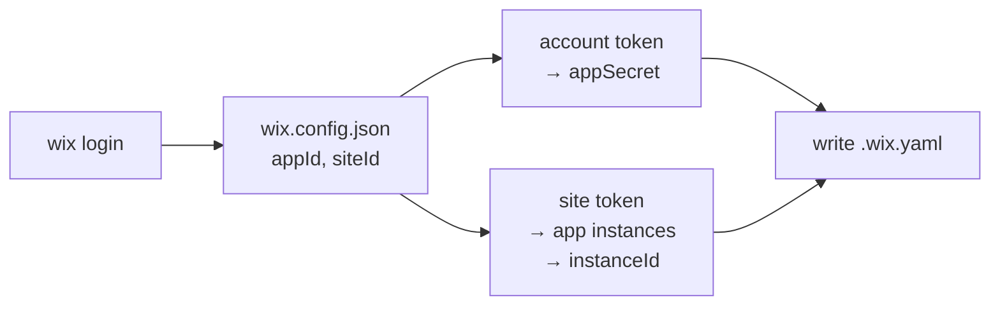

# 47 - Site-Scoped App Strategy

## Background

DL #29 added `appStrategy` (`appId` + `appSecret`) as an alternative to `apiKeyStrategy` in `config/.wix.yaml`. Setup writes it automatically: `wix.config.json` gives `appId`, and the Dev Center API gives `appSecret` (`lib/setup.ts`).

The app in question is the **headless companion app**: `npm create @wix/new init` creates it and installs it on one headless site. An API key authenticates as the Wix user's account and can reach every site of that account. An app token can only reach the sites the app is installed on, here a single site. That makes `appStrategy` the safer default for a headless project.

No example uses `appStrategy` today. Every `examples/*/config/.wix.yaml` uses `apiKeyStrategy`.

## Problem

1. **`appStrategy` does not authenticate.** `@wix/sdk` 1.21.5 `AppStrategy.getAuthHeaders()` needs a `refreshToken`, `instanceId` or `accessToken`. With only `appId` + `appSecret` it throws `Missing refresh token or instance ID` on the first request. Wix mints an app access token with `POST https://www.wixapis.com/oauth2/token` and `{grant_type: client_credentials, client_id, client_secret, instance_id}`. The token is scoped by **instance id**, not site id.
2. **No site id.** `appStrategy` has no `siteId`. DL #38 `resolveDashboardSiteId` falls back to `wix.config.json`, which may not exist where the server runs.
3. **Setup ignores the site.** Setup checks `wix.config.json.siteId` but never writes it, and never resolves the app's instance on that site.

## Questions and Answers

1. **Is `siteId` enough to authenticate?**
   - No. The OAuth token endpoint takes `instance_id`. The SDK has no `siteId` option on `AppStrategy`. We store both: `siteId` identifies the site (dashboard URLs, logs), and `instanceId` authenticates.
2. **How does setup find the `instanceId`?**
   - `npx @wix/cli@latest token --site <siteId>` gives a site-scoped Wix user token. `GET https://www.wixapis.com/apps-installer-service/v1/app-instances` with that token lists the site's app instances (`{id, appDefId}`). The instance whose `appDefId === appId` is the companion app's instance. Source: Wix recipe _List Installed Apps on a Site_. An account token returns an empty list, so the call must use the site token.
3. **What about existing `appStrategy` configs without `siteId`/`instanceId`?**
   - They never worked (Problem 1), so nothing depends on them. The loader requires both fields. Setup's `hasValidCredentials` treats such a file as incomplete and regenerates it.
4. **Which example gets converted?**
   - `examples/store-light`: it already has a `wix.config.json` with the companion `appId` and `siteId`.

## Design

### Config shape (`config/.wix.yaml`)

```yaml
appStrategy:
  appId: '99c53b0c-…'
  appSecret: '…'
  siteId: '88dfc801-…'
  instanceId: '…'
oauthStrategy:
  clientId: '99c53b0c-…' # same as appId
```

### Types (`lib/config-loader.ts`)

```typescript
export interface AppConfig {
  appId: string;
  appSecret: string;
  siteId: string;
  instanceId: string;
}
```

All four fields are required non-empty strings.

### Client (`lib/wix-client-service.ts`)

```typescript
AppStrategy({ appId, appSecret, instanceId });
```

### Dashboard site id (`lib/actions/get-dashboard-url.ts`)

The config's site id is `apiKey.siteId` or `app.siteId`. `wix.config.json` is the fallback for visitor-only configs.

### Setup (`lib/setup.ts`)



- `hasValidCredentials` requires `appId`, `appSecret`, `siteId` and `instanceId` for `appStrategy`.
- `fetchAppInstanceId(siteToken, appId)` fails with a clear message when the app is not installed on the site.

## Implementation Plan

1. Tests: loader accepts a full `appStrategy` and rejects one missing `siteId`/`instanceId`. The dashboard site id comes from `appStrategy.siteId`.
2. `config-loader.ts`: add and validate `siteId`, `instanceId`.
3. `wix-client-service.ts`: pass `instanceId`.
4. `get-dashboard-url.ts`: read the site id from either strategy.
5. `setup.ts`: site token, instance lookup, write `siteId` + `instanceId`, stricter validity check.
6. Convert `examples/store-light`: run setup, then check a page that reads the catalog server-side.

## Verification Criteria

- `yarn test` in `packages/wix-server-client` passes.
- `store-light` setup writes `appStrategy` with all four fields and no `apiKeyStrategy`.
- `store-light` dev server renders the product list. That proves server-side catalog reads run on the app token.

## Trade-offs

- **Store `instanceId` vs. resolve it at startup:** resolving at startup would need a Wix user token on the server, which defeats the point. Storing it is a one-time setup cost. The instance id is stable across uninstall/reinstall (App Installations API docs).
- **App permissions:** the app token can only do what the companion app's permission scopes allow. An API key has every permission. A call that worked with the API key may fail with 403 until the scope is added to the app in Dev Center.

## Implementation Results (2026-11-11)

Phases 1–5 done in `packages/wix-server-client`:

- `config-loader.ts`: `AppConfig` gains required `siteId` and `instanceId`.
- `wix-client-service.ts`: `AppStrategy({ appId, appSecret, instanceId })`.
- `actions/get-dashboard-url.ts`: `configSiteId()` reads `apiKey.siteId` or `app.siteId`.
- `setup.ts`: `getWixToken(projectRoot, siteId?)` runs `wix token --site <siteId>`. `fetchAppInstanceId` matches `appDefId === appId` in the Apps Installer list. `hasValidCredentials` requires all four `appStrategy` fields.
- Tests: `config-loader.test.ts` (full app strategy; missing `siteId`/`instanceId` rejected), `get-dashboard-url.test.ts` (app `siteId` wins over `wix.config.json`). 74/74 passing, `tsc` clean, package builds.

**Not verified yet:** the live setup flow (`token --site` and the Apps Installer call) and Phase 6. The agent sandbox has no network, and `@wix/cli@1.2.9` declares Node ≥ 24 (local is 22.23.1).

Phase 6 steps for `examples/store-light`. Its `config/.wix.yaml` is untracked, so the conversion is a local step:

1. `mv config/.wix.yaml config/.wix.yaml.apikey.bak`. Setup returns `configured` while a valid `apiKeyStrategy` file exists.
2. `npx jay-stack-cli setup --interactive`
3. `npm run dev`, then open the products page.

### Deviations

- The request was "add `siteId`". `instanceId` was added too, because `AppStrategy` cannot authenticate without it (Problem 1).

## Follow-up: store-light setup run (2026-11-11)

`jay-stack-cli setup --interactive` in `store-light` wrote a working `appStrategy` (instance `2d2ae2f9…` on site `88dfc801…`). Two other plugins failed:

| Plugin     | Symptom                          | Cause                                                                                                                                                               |
| ---------- | -------------------------------- | ------------------------------------------------------------------------------------------------------------------------------------------------------------------- |
| wix-deploy | `API key required`               | Setup wrote `apiKeyStrategy.siteId` into `.wix.yaml` and required `apiKeyStrategy.apiKey`. The extra block also breaks `loadConfig` (`not both`).                   |
| wix-stores | `WixStoresService not available` | Setup read its own service. jay `run-setup.ts` runs a plugin's init only after that plugin's setup returns `configured`, so the service never exists at that point. |

Also found: npx calls went to `registry.npmjs.org` because the repo `.npmrc` set `registry=`. It now lives in `.yarnrc.yml` as `npmPublishRegistry` (wix, jay, aiditor).

### Changes

- `wix-server-client/lib/wix-cli.ts` (new, exported from `./tools`): `ensureWixLogin`, `getWixToken(projectRoot, siteId?)`, `listSiteAppInstances`, `installSiteApp`. `setup.ts` uses them. The npx calls use `--yes`.
- `wix-deploy/lib/setup.ts`: no `.wix.yaml` writes, no API-key check. It uses `WIX_CLIENT_SERVICE`, which handles both strategies. Returns `needs-config` when the service is missing.
- `wix-stores/lib/setup.ts`: uses `WIX_CLIENT_SERVICE`. In interactive setup it installs Wix Stores (`appDefId 215238eb-…`) on the `wix.config.json` site when missing, via `POST /apps-installer-service/v1/app-instance/install` with the site-scoped CLI token. The install API accepts only a Wix user or an API-key admin, not an app token.
- `examples/store-light/config/.wix.yaml` (untracked): removed the `apiKeyStrategy` block that wix-deploy had added.

Tests: wix-server-client 74/74, wix-stores 42/42, wix-deploy 8/8. Type checks and builds clean. The setup handlers have no unit tests (they shell out to the Wix CLI). The install path is not verified live.

### Open

- Once Stores is installed, catalog reads use the companion app's permission scopes. A 403 there means a Stores scope is missing on the app in Dev Center.
- wix-deploy creates `jay-backend-files` as the app. Not verified with an app token.
- `wix-stores-v1/lib/setup.ts:58` reads its own service the same way, so it has the same failure.

### Wix Stores install → 428 (2026-11-11)

The first install run failed its catalog check: `Wix API 428: /stores/v3/products/search`. Afterwards `GET /stores/v3/provision/version` on site `88dfc801…` returned `V3_CATALOG`, which matches `@jay-framework/wix-stores`. So the versions don't conflict. Likely cause (not confirmed): the catalog was not provisioned yet when setup called it right after the install. Setup now polls `provision/version` with the site token after an install (up to 60 s), and maps a 428 to "catalog not ready yet, re-run setup". It is not known whether `provision/version` reports a version before product search stops answering 428.

### Shared app install with a login precondition (2026-11-11)

Installing a Wix app is a setup need that other plugins will share, and it needs a Wix user (the CLI login). So it lives in wix-server-client:

- `ensureWixLogin(projectRoot, interactive = true)` checks once per process. Without `interactive`, a missing login throws (`Run: jay-stack-cli setup --interactive`) instead of opening a browser.
- `ensureSiteAppInstalled(projectRoot, appDefId, { appName, interactive })`, exported from `./tools`: reads `siteId` from `wix.config.json`, checks the login, gets the site token, lists the site's apps and installs the app when missing. Returns `{ status: 'present' | 'installed', siteToken }`.
- wix-stores setup checks the catalog first and calls `ensureSiteAppInstalled` only when that check fails. A site that already has Stores needs no Wix login for setup. After an install it waits for the catalog and checks again.

Tests: wix-server-client 74/74, wix-stores 42/42. Builds clean. Not verified live.
