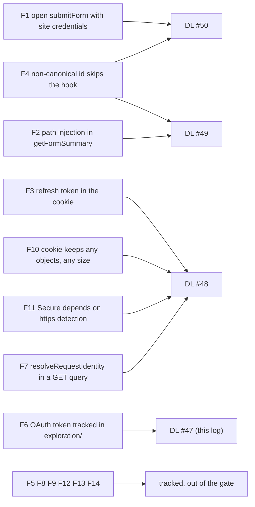
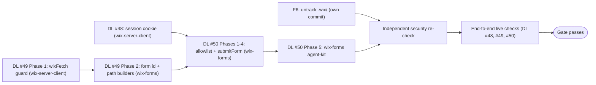

# 47 - wix-forms Release Security Gate

Status: Design

The umbrella for the security pass that must succeed before any `@jay-framework/wix-*` publish. The design is split by domain:

| Log | Domain | Package |
| --- | --- | --- |
| **DL #48** — [wix-server-client Session Cookie Hardening](./48%20-%20wix-server-client%20session%20cookie%20hardening.md) | `wix_session` contents, cap, `Secure`, migration, F7 guide line | `@jay-framework/wix-server-client` |
| **DL #49** — [Wix API Path Safety](./49%20-%20wix%20api%20path%20safety.md) | `wixFetch` path guard, canonical form id, `getFormSummary` / `getFormSchema` | wix-server-client, wix-forms |
| **DL #50** — [wix-forms Submit Access Policy](./50%20-%20wix-forms%20submit%20access%20policy.md) | allowlist, cookie-less refusal, canonical hook matching, `PERMISSION`, honeypot guide | `@jay-framework/wix-forms` |

This log keeps what spans them: the finding map, the shared decisions, the accepted residual risks, F6, the out-of-gate list, the order, and the final re-check. Paths are relative to the repo root. jay is referenced only through its public surface (`@jay-framework/fullstack-component`).

## Background

The release gate (no `@jay-framework/wix-*` publish until a security review of the integrated result passes) failed on 2026-11-09. Input: the final security review of the integrated plugin (wix `main` `69eaf3e`), findings F1–F14, and the release-security decisions agreed for this pass. The gate closes the **blocking** findings (F1–F4, F6, the F7 guide line) and bundles F10/F11 with F3. Every finding is described here or in its log, so the set stands on its own. DL#43 had already fixed the silent server-side token renewal, so an expired session is never posted as the site.

## Findings → logs

_F4 is split: DL #49 defines `canonicalFormId`, DL #50 uses it in `selectHook` and the allowlist._

## Shared decisions

- **One canonical form id across logs.** `canonicalFormId` (trim, GUID check, lowercase) is defined in DL #49 §2 and is the only way a form id is compared or put in a Wix path, in DL #49 (path segments) and DL #50 (request id, hook keys, configured and listed ids).
- **Site credentials are never used for an anonymous request unless the site owner opted in** (a `{ as: 'site' }` hook, DL #50). Unsafe paths are refused before credentials are read (DL #49).
- **Fail closed.** An allowlist load failure refuses (DL #50); an unsafe path throws (DL #49); a malformed or oversized cookie reads as no session (DL #48).
- **Runtime warnings replace validators** where the mistake lives in project TypeScript (non-GUID hook keys and `formIds` entries, DL #50). No `jay-stack validate` rule in this repo.
- **Red-first tests in every phase**, expected values set to the correct behaviour, never copied from output.
- **Corrections to earlier logs are made by note** in the log that owns them (DL #48 §4 for DL#42's cookie; DL #50 §4 for DL#41/42/43/45), never by editing those logs.

## Accepted residual risks

A re-review must not re-flag these.

| # | Risk | Why accepted | Log |
| --- | --- | --- | --- |
| 1 | A script can mint a visitor token through the public OAuth client, sync it, and submit allowlisted forms as that visitor, with no server rate limit. | Spam control belongs to Wix (per-visitor limits / captcha, unmeasured, DL#43 V5), the edge, or the form's hook. A visitor session proves a browser session, not a person. | DL #50 |
| 2 | Allowlist membership of a known GUID is readable from the reason code or timing. | Ids are random 128-bit GUIDs, and every placed form already ships its id to the browser. | DL #50 Q3 |
| 3 | `getFormSummary` returns the field schema (labels, types) of any form GUID on the site and costs one Wix call per anonymous request. | wix-bookings needs it; retired by the bookings Phase 2 query. | DL #49 Q5 |
| 4 | The honeypot is browser-only; there is no server-side honeypot. | The gate's threat is a direct action call, which simply omits the field. | DL #50 Q8 |
| 5 | A `{ as: 'site' }` hook posts as the site for any caller, cookie or not, bypassing the form's Wix submitter restriction (members-only) and possibly captcha. | The owner opted in. The guide warns and recommends requiring `client` before forcing the site. | DL #50 Q12 |

## F6: untrack the committed OAuth data

An expired OAuth token and account ids are committed under `exploration/wix-baas-deploy/.wix/`. Fix: `git rm --cached -r exploration/wix-baas-deploy/.wix` as **its own commit**, in parallel with everything else; `.gitignore:6` already lists `.wix`. The commit message states that the token is expired and that a history purge is the repo owner's decision. A **history purge is the repo owner's ops decision, outside the gate**.

## Out of the gate (tracked, not designed)

| Finding / item | What it is | Owner |
| --- | --- | --- |
| F5 | Token-info calls have no cache and no limit: each cookie-carrying hooked submit or `syncSession` costs one outbound call. | wix |
| F8 | Raw internal error messages reach anonymous callers. | jay |
| F9 | Visitors see backend configuration hints and raw Wix errors (`loadError`, wix-bookings). | wix |
| F12 | The token-info response body is read outside its 5 s timeout. | wix |
| F13 | A malformed `Cookie` header crashes the request (cookie parsing). | jay |
| F14 | Form names are written unquoted into generated contract YAML. | wix |
| Also | The action body-size cap, a server-side honeypot, the bookings Phase 2 query (DL #49 §4), rate limiting / CAPTCHA, an abort signal for `wixFetch`, encoding the wix-stores / wix-bookings path ids, the `__Host-` cookie prefix (DL #48 Q2). | wix / jay |

The jay items (a `jay-stack validate` warning for `makeJayQuery().withRequest()`, generic production `INTERNAL_ERROR` messages, safe cookie parsing, a body-size cap, possibly the request protocol/host on `ActionRequest`) go to a **separate jay design log**.

## Implementation order

_DL #48 and DL #49 Phase 1 run in parallel; F6 runs alongside everything. The gate passes only after both the re-check and the live checks._

## Final step: independent security re-check

An independent reviewer re-checks F1–F4, F3/F10/F11, the F7 line and F6 on the implementing branch against DL #48–#50. It confirms that the five accepted residual risks above are recorded as accepted. The gate passes only on its approval and after the end-to-end checks of each log:

| Check | Log |
| --- | --- |
| Real visitors can still submit after cookie-less submits are refused (fresh profile, first load). | DL #50 |
| The bookings participant form still loads after the F2 hardening; record its namespace. | DL #49 |
| `http://localhost` in Chrome, Firefox and Safari keeps the `Secure` cookie (a browser failure is recorded, not blocking); record `127.0.0.1`. | DL #48 |
| A signed-in member keeps `wix_session`; record its encoded length; the submit posts as the member. | DL #48 |

## jay-feedback (summary)

Priority: validation → agent-kit → framework.

- **Validation:** none in this repo; the guarantees are runtime, and hooks / `formIds` live in TypeScript or config. The substitute is the one-time runtime warnings (DL #50). The deterministic form of F7, a `jay-stack validate` warning for `makeJayQuery().withRequest()`, belongs to the separate jay log.
- **Agent-kit (yes):** DL #48 (`wix-request-session.md`: F7 line, cookie description, `Secure` dev hosts); DL #50 (`rich-forms.md` §4a honeypot and §7 session / allowlist / hooks / `{ as: 'site' }` / `ensureSessionFresh()`, `user-visible-messages.md` `PERMISSION`, `formIds` as the runtime allowlist). DL #49: none.
- **Framework (jay, separate log):** generic production `INTERNAL_ERROR` messages (F8), safe cookie parsing (F13), an action body-size cap, and possibly the request protocol/host on `ActionRequest`. Nothing in wix's framework layer.
