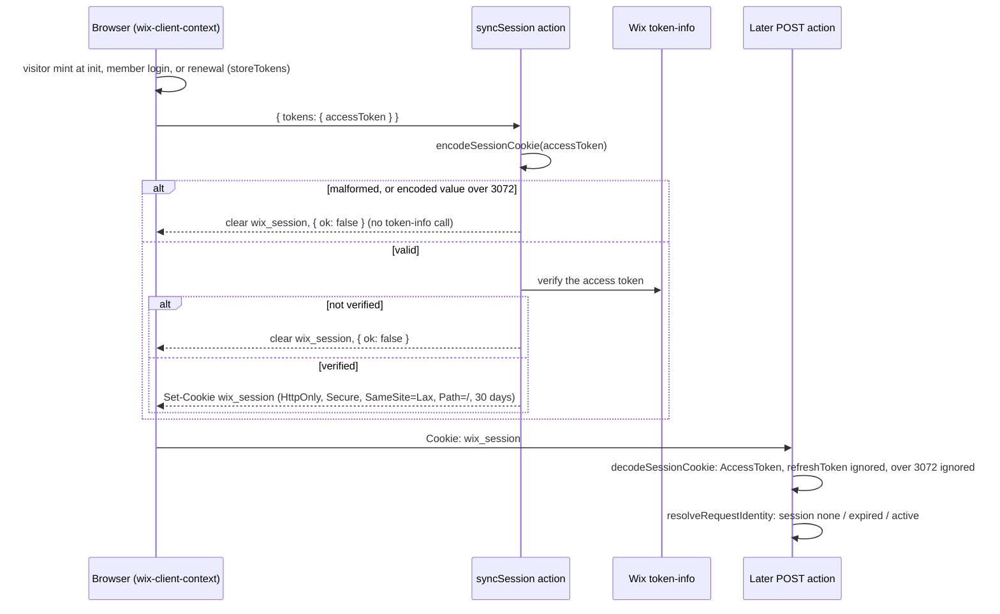

# 48 - wix-server-client Session Cookie Hardening

Status: Implemented — live checks passed 2026-11-10 (Chromium localhost + 127.0.0.1, Firefox localhost; member cookie 1671 chars); Safari pending

Part of the wix-forms release security gate (**DL #47**, the umbrella). Closes **F3** (refresh token in the cookie), **F10** (the cookie keeps whatever the browser sent, at any size), **F11** (`Secure` depends on jay seeing https) and adds the **F7** guide line. Builds on **DL#42** (`wix_session`, `syncSession`, `resolveRequestIdentity`) and **DL#43** (headers-only caller client, `session: 'none' | 'active' | 'expired'`). Package: `@jay-framework/wix-server-client`; wix-forms and wix-data are readers of the cookie. Paths are relative to `packages/`. jay is referenced only through the public surface of `@jay-framework/fullstack-component` (`makeJayAction`, `makeJayQuery`, `.withRequest()`, `ActionRequest`, `CookieOptions`).

## Decisions for the Implementer (TL;DR)

- **`wix_session` holds the access token only (F3, F10).** Cookie JSON `{ accessToken: { value, expiresAt } }`, rebuilt from a type-checked `AccessToken` (`@wix/sdk`'s own type). A refresh token on read is ignored. The browser stops sending the refresh token to `syncSession`.
- **The cap bounds the encoded cookie value.** `MAX_SESSION_COOKIE_LENGTH = 3072` is the length of the base64url string written to `Set-Cookie`, not of the token value. An encoded value over the cap is refused on write and ignored on read.
- **`syncSession` refuses junk before token-info.** A malformed or oversized token clears the cookie and answers `{ ok: false }` without an outbound call.
- **`Secure` always, no localhost exception (settled, approved; Q2).** `SESSION_COOKIE_OPTIONS.secure = true` for every request. Plain-http development works only on `http://localhost` (per MDN) or over https; a LAN IP or custom host over http never keeps the session. This applies to every `wix_session` reader (wix-forms and wix-data `asCaller`). The `__Host-` prefix is deferred.
- **A browser that drops the cookie on `http://localhost` does not block the release (Q6).** It is recorded and documented in the guide ("use https in that browser"). Production is https.
- **Migration is free.** DL#42 measured an access token at about 1070 characters and an old two-token cookie at about 1828 encoded characters; both fit the cap. Old cookies `{ accessToken, refreshToken }` decode to their access token (same JSON key); the next `syncSession` (any access-token change, or `ensureSessionFresh()` before a submit) rewrites them. No version field.
- **Guide (`wix-server-client/agent-kit/plugin/wix-request-session.md`):** the F7 line "use `resolveRequestIdentity` only in POST actions (`makeJayAction`), never in `makeJayQuery`", the corrected cookie description, and the `Secure` dev-host rule.
- **Order:** first, in parallel with DL #49 Phase 1. DL #50 is built after this log, and its migration test (`run-submission.test.ts:569-596`) reads an old-format cookie through this decoder.

## Background

DL#42 Q22 stored both tokens in `wix_session` "so a later server refresh stays possible". DL#43 then removed server-side renewal (headers-only caller client, `wix-server-client/lib/session/request-identity.ts:78-88`), so the server reads only the access token (`request-identity.ts:51-64`). The refresh token in the cookie has no reader left.

The cookie's lifecycle after this log:



_The browser keeps the refresh token; the server only ever stores and reads `{ value, expiresAt }`._

## Problem

The cookie stores the refresh token (`session-cookie.ts:28-31`), though the server reads only the access token (`request-identity.ts:51-64`). It also keeps whatever objects the browser sent (F10), at any size, and `Secure` depends on jay seeing https (`session-cookie.ts:13-23`, F11). Separately, nothing tells plugin authors that `resolveRequestIdentity` is unsafe in a GET query (F7): `wix_session` is `SameSite=Lax`, so it rides on cross-site GET navigations.

## Prior Art / Adjacent Mechanisms

- **`AccessToken`** (`{ value: string; expiresAt: number }`) is exported by `@wix/sdk` (`build/auth/oauth2/types.d.ts:28-30`, re-exported from the package root).
- **jay `CookieOptions.secure`** (public type of `@jay-framework/fullstack-component` 0.25.5): "Default: true when the request is https". An explicit `secure: true` is honoured. The public `ActionRequest` type exposes cookies, `setCookie` and `clearCookie` only: no host or protocol.
- **`wix_session` readers** (grep 2026-11-09): only wix-forms (`wix-forms/lib/actions/forms-actions.ts:24`) and wix-data (`wix-data/lib/services/wix-data-service.ts`, `asCaller`), both through `resolveRequestIdentity`.
- **DL#42 sizes** (Implementation Results): access token about 1070 characters, refresh token about 206, old cookie value (base64url JSON of both) about 1828; access-token lifetime 4 h.
- **Browser sync** (`wix-server-client/lib/wix-client-context.ts:70-89`): `syncSessionCookie` sends the tokens (`:78`) and retries only when `syncSession` rejects; a resolved `{ ok: false }` counts as synced.

## Questions and Answers

- **Q1 (was #47 Q8). Cookie shape and migration?** `{ accessToken: { value, expiresAt } }` keeps the old top-level key, so the decoder reads old and new cookies the same way and ignores `refreshToken`. A bare `{ value, expiresAt }` would need a second decode branch for no gain. Old cookies fit the cap (DL#42: about 1828 characters).
- **Q2 (was #47 Q9). `Secure` "except on localhost"?** The server cannot see the host through jay's public `ActionRequest`, and adding a dev-mode signal (env var or config flag) would be new surface.
  **Answer (settled, approved): `secure: true` always, with no localhost exception.**
  - _Source:_ MDN `Set-Cookie`: "Insecure sites (`http:`) cannot set cookies with the `Secure` attribute. The `https:` requirements are ignored when the `Secure` attribute is set by localhost." MDN gives no per-browser versions. So `http://localhost` is expected to work, and Chrome, Firefox and Safari are each verified live (Verification Criteria). If a browser drops the cookie there, the dev symptom is a generic submit failure (L9, DL #50) in that browser only (Q6).
  - _Other dev hosts:_ plain-http development on any host other than `localhost` (a LAN IP for phone testing, a custom `.test` host; `127.0.0.1` is checked live) never keeps `wix_session` in any browser. Dev must use `http://localhost` or https. The guide says so.
  - _Blast radius:_ every `wix_session` reader is affected, not only forms: without the cookie a wix-forms submit is refused (L9, DL #50) and wix-data `asCaller` throws its `NoCallerSessionError`.
  - _`__Host-` prefix: deferred._ The options already meet its rules (`Secure`, `Path=/`, no `Domain`); its extra guarantee is that a subdomain or an http response cannot set or overwrite the cookie. It renames the cookie, so `resolveRequestIdentity` would need a dual read of the old and new names plus a clear of the old one, and MDN's localhost exception is stated for `Secure`, not for prefixed names: a second dev unknown. Tracked with the jay items (DL #47).
- **Q3 (was #47 Q10). `Max-Age` without a refresh token?** Unchanged (30 days). The cookie outliving its access token is deliberate: an expired cookie reads as `session: 'expired'` (precise "refresh the page" copy, DL#43) instead of `'none'` (generic refusal). The comment at `session-cookie.ts:13-17` is rewritten with this reason.
- **Q4 (was #47 Q11). Why also stop sending the refresh token from the browser?** The server ignores it, so the network and server memory should not see it. One line in `syncSessionCookie` (`wix-client-context.ts:78`): send `{ tokens: { accessToken } }`. `SyncSessionInput` becomes `{ tokens: Pick<Tokens, 'accessToken'> } | { clear: true }`; old cached bundles that still send both tokens are accepted (the extra field is ignored).
- **Q5. What does the cap measure, and what if a real token exceeds it?** The encoded cookie value. An access-only cookie is about 1490 encoded characters (base64url of the ~1070-character token plus its JSON), so the headroom is about 2x. DL#42 did not record whether the measured token was a visitor's or a member's, so a member cookie is measured live (end-to-end check 2). If a token ever exceeded the cap, `syncSession` would answer `{ ok: false }`, which the browser treats as synced, so that caller would be cookie-less until the access token changes (up to 4 h): wix-forms submits refused (L9, generic copy) and wix-data `asCaller` throwing. No design change; the live check guards it.
- **Q6. What happens to the gate if one browser drops the `Secure` cookie on `http://localhost`?** The failure is recorded in Implementation Results and documented in `wix-request-session.md` ("in <browser>, develop over https"). It does not block the release: production is https, and the gate is about production behaviour.

## Design

### Cookie contents, before and after

|                                                         | Before (DL#42)                                           | After                                                         |
| ------------------------------------------------------- | -------------------------------------------------------- | ------------------------------------------------------------- |
| JSON                                                    | `{ accessToken, refreshToken }`, the SDK objects as sent | `{ accessToken: { value, expiresAt } }`                       |
| Refresh token                                           | stored                                                   | never stored; the browser stops sending it                    |
| Extra fields                                            | kept (F10)                                               | dropped (`toAccessToken` rebuilds the object)                 |
| Size                                                    | unbounded (F10)                                          | encoded value ≤ 3072, else refused on write / ignored on read |
| `Secure`                                                | only when jay sees https (F11)                           | always                                                        |
| `HttpOnly`, `SameSite=Lax`, `Path=/`, `Max-Age` 30 days | as is                                                    | unchanged                                                     |
| Typical encoded length                                  | about 1828                                               | about 1490                                                    |

### 1. `lib/session/session-cookie.ts`

```ts
import type { AccessToken } from '@wix/sdk';

/** Max length of the encoded cookie value. DL#42 measured ~1070 characters for an access token and ~1828 for an old two-token cookie. */
export const MAX_SESSION_COOKIE_LENGTH = 3072;

export const SESSION_COOKIE_OPTIONS: CookieOptions = {
  httpOnly: true,
  secure: true,
  sameSite: 'Lax',
  path: '/',
  maxAge: THIRTY_DAYS_IN_SECONDS,
};

/** The cookie value for an access token; undefined when the token is malformed or the encoded value is too long. */
export function encodeSessionCookie(accessToken: unknown): string | undefined;

/** The access token in a cookie value (a refresh token is ignored); undefined when missing, malformed or too long. */
export function decodeSessionCookie(value: string | undefined): AccessToken | undefined;
```

- Both use one private `toAccessToken(raw: unknown): AccessToken | undefined`: `value` a non-empty string, `expiresAt` a finite number, rebuilt as a fresh `{ value, expiresAt }` (no other fields survive).
- `encodeSessionCookie` measures the encoded string; `decodeSessionCookie` refuses a value longer than the cap before decoding it.
- Module comment (`session-cookie.ts:1-4`): value is base64url JSON of `{ accessToken }`; the refresh token stays in the browser.
- The `Max-Age` comment (`:13-17`) gets Q3's reason.

### 2. `syncSession` (`lib/actions/session-actions.ts:31-43`) and the browser

- `const cookieValue = encodeSessionCookie(input.tokens?.accessToken)`. If `undefined`, clear the cookie and return `{ ok: false }` **before** token-info (junk costs no outbound call). Otherwise verify as today, then `setCookie(WIX_SESSION_COOKIE, cookieValue, SESSION_COOKIE_OPTIONS)`.
- `lib/actions/sync-session.jay-action` description: "Mirror the browser's Wix access token into the httpOnly wix_session cookie after verifying it with token-info, or clear it."
- Browser: `syncSessionCookie` sends `{ tokens: { accessToken: tokens.accessToken } }` (`wix-client-context.ts:78`).

### 3. `resolveRequestIdentity` (`lib/session/request-identity.ts:51-64`)

Reads `accessToken.value` / `accessToken.expiresAt` from the decoded `AccessToken`; behaviour unchanged.

### 4. Correction to an earlier log (by this note, not by editing it)

- DL#42 Q22 and Implementation Results: "Value: base64url JSON of `{ accessToken, refreshToken }`, so a later server refresh stays possible" and "the `wix_session` value stores the SDK's `accessToken` / `refreshToken` objects". **Superseded:** the access token only, as `{ accessToken: { value, expiresAt } }`, `Secure`, encoded value capped at 3072 characters.

## Implementation Plan

Red first in every phase: write the test with the correct expected behaviour, run it against the unchanged code, record the red result, then implement.

**Phase 1: new tests (red).** `test/session/session.test.ts` and a new `test/session/session-cookie.test.ts`:

- encode→decode round-trips `{ value, expiresAt }` only, and the decoded JSON has no `refreshToken`;
- an old `{ accessToken, refreshToken }` cookie decodes to its access token;
- extra fields on `accessToken` are dropped;
- `undefined` for a non-string value, an empty value, a non-finite `expiresAt`, and an **encoded cookie value** over 3072 characters, both directions (`encodeSessionCookie` of a token whose encoding exceeds 3072; `decodeSessionCookie` of a 3073-character value);
- `SESSION_COOKIE_OPTIONS.secure === true`;
- `syncSession` with an oversized or malformed token → `{ ok: false }`, cookie cleared, token-info not called.

**Phase 2: existing tests that change** (expected values updated to the new correct behaviour, not to the code's output):

- `session.test.ts:49-66`: the expected cookie becomes `encodeSessionCookie(tokens.accessToken)` and the options gain `secure: true` (`:62`). `tokensFor` (`:14-19`) keeps the refresh token as the browser's input shape.
- `session.test.ts:128-170`: cookies built with `encodeSessionCookie(tokens.accessToken)`.
- `caller-client.test.ts:30-36` `cookiesWithExpiry(unknown)`: build the cookie as raw base64url JSON, because the decoder test needs a non-finite `expiresAt`, which `encodeSessionCookie` now refuses.
- `wix-client-context.test.ts:123`, `:147-153` (`ensureSessionFresh`, which expects `memberTokens(…)` including `refreshToken`) and `:201`: `syncSession` is called with `{ tokens: { accessToken } }`.

**Phase 3: implement** §1–§3.

**Phase 4: guide** (`agent-kit/plugin/wix-request-session.md`):

- §"Reading it in an action": "Use `resolveRequestIdentity` only in POST actions (`makeJayAction`), never in `makeJayQuery`: `wix_session` is `SameSite=Lax`, so it rides on cross-site GET navigations."
- Correct the cookie description (access token only, `Secure`).
- "`wix_session` is `Secure`: develop on `http://localhost` or over https. Over plain http on any other host (a LAN IP, a custom `.test` host) the session is never kept, and every caller-session feature (form submits, wix-data `asCaller`) behaves as signed-out." Plus one line per browser that fails end-to-end check 1 (Q6).

**Phase 5: build and test.** `npm run build`, `build:check-types` and the tests in `packages/wix-server-client`. **Also the tests in `packages/wix-data`**: the decoder changed, and `wix-data/test/as-caller.test.ts:28-34` builds old-format `{ accessToken, refreshToken }` cookies by hand. They must stay green unchanged (the migration read).

## Examples

✅ A server action that reads the session: `makeJayAction('site.save').withRequest()…resolveRequestIdentity(request.cookies)`.
❌ The same in `makeJayQuery(...)`: a cross-site GET navigation carries the `Lax` cookie.
✅ Old cookie `base64url({"accessToken":{…},"refreshToken":{…}})` → decodes to `{ value, expiresAt }`; rewritten on the next sync.
❌ `syncSession({ tokens: { accessToken: { value: '', expiresAt: NaN } } })` → `{ ok: false }`, cookie cleared, no token-info call.

## Trade-offs

- **`Secure` always** (Q2, settled): closes F11 without new surface. Costs: plain-http dev works only on `localhost` (per-browser behaviour verified live), and LAN-IP or custom-host http dev loses the session for every `wix_session` feature.
- **`__Host-` prefix deferred** (Q2): it would stop a subdomain or http response from planting the cookie. Not adopted because the rename needs a dual read and an old-cookie clear, and its localhost behaviour is a second dev unknown.
- **Same top-level key, no version field** (Q1): one decode path for old and new cookies. Cost: none measured.
- **30-day `Max-Age` kept** (Q3): an expired cookie gives precise copy. Cost: the cookie outlives its token.

## Verification Criteria

- **Unit** (each red first, then green): encode/decode without the refresh token; the migration read; an oversized encoded value refused both ways; `secure: true`; `syncSession` refusing junk before token-info; wix-data's old-format cookie tests green unchanged.
- Build, type check and tests clean in wix-server-client; wix-data tests green.
- **End-to-end, live, before release:**
  1. _Local dev over `http://localhost` in Chrome, Firefox and Safari (Q2)._ In each browser: `wix_session` is set with `Secure`, and a visitor submit succeeds. Also record what `http://127.0.0.1` does. A browser that fails is recorded and documented (Q6); it does not block the release.
  2. _A signed-in member keeps a session (Q5)._ Sign in as a member, confirm `wix_session` is set, record its encoded length (expected well under 3072), and confirm a form submit posts as the member.

## Scope Pre-mortem

- _A dev browser over http drops the cookie_ → submits refused (L9) in that browser only; end-to-end check 1 records it; guide line (Q6).
- _Plain-http dev on a LAN IP or custom host_ → no session in any browser; submits refused, wix-data `asCaller` throws. Documented in `wix-request-session.md` (Phase 4); use `localhost` or https.
- _A token encodes over the cap_ → that caller is cookie-less until the token changes (Q5); end-to-end check 2 measures a member cookie.
- _Old browsers keep sending the refresh token_ → ignored on the server; nothing stored.
- Scope creep refused: the `__Host-` prefix, a token-info cache (F5), a dev-mode flag.

## jay-feedback

- **Validation:** none in this repo; the F7 rule is code in project TypeScript. Its deterministic form is a `jay-stack validate` warning for `makeJayQuery().withRequest()`, which belongs to jay (separate jay design log, DL #47).
- **Agent-kit (yes):** the F7 sentence, the corrected cookie description and the `Secure` dev-host rule in `wix-request-session.md`.
- **Framework (jay, separate log):** possibly the request protocol/host on `ActionRequest`, and the `__Host-` prefix with the jay items. Nothing in wix's framework layer.

## Open Questions

- **OQ-1 (closed, was #47 OQ-1):** `Secure` unconditionally instead of "except on localhost"? **Answer: approved. `secure: true` always, no localhost exception** (Q2). Browser behaviour over `http://localhost` is verified live in Chrome, Firefox and Safari (end-to-end check 1).

## Implementation Results

Implemented per the plan, Phases 1–5. Paths relative to `packages/wix-server-client/`.

**Changed:** `lib/session/session-cookie.ts` (`MAX_SESSION_COOKIE_LENGTH`, `secure: true`, `encodeSessionCookie(unknown)` / `decodeSessionCookie` → `AccessToken`, private `toAccessToken`, rewritten module and `Max-Age` comments); `lib/actions/session-actions.ts` (encode before token-info, `SyncSessionInput` uses `Pick<Tokens, 'accessToken'>`); `lib/actions/sync-session.jay-action` (description); `lib/session/request-identity.ts` (reads the decoded `AccessToken`); `lib/wix-client-context.ts` (sends `{ tokens: { accessToken } }`); `agent-kit/plugin/wix-request-session.md` (F7 line, cookie description, `Secure` dev-host rule). Tests: new `test/session/session-cookie.test.ts`; `test/session/session.test.ts`, `test/session/caller-client.test.ts`, `test/wix-client-context.test.ts` updated per Phase 2.

**Red → green:**

- Phase 1/2 against unchanged code: 17 failed / 65 passed in wix-server-client (all 10 new cookie tests, the 4 changed `session.test.ts` cases, the 3 changed `wix-client-context.test.ts` cases).
- The new `syncSession` junk cases: the first malformed input (`value: ''`) passed on the old code, because `verifyAccessToken` already refuses an empty token without a fetch. Replaced by `{ value: 'member-access', expiresAt: NaN }`, which the old code sent to token-info: both junk cases (oversized, malformed) then red.
- After Phase 3: wix-server-client **82/82**, `build:check-types` clean, `npm run build` (including `validate-plugin`) clean.
- wix-data **9/9**, unchanged (old-format `{ accessToken, refreshToken }` cookies in `as-caller.test.ts` decode: the migration read); `tsc` clean once `wix-utils` was built (its missing dist was the only error, unrelated).
- wix-forms (also a reader) **196/196**, unchanged.

**Deviations:**

- `caller-client.test.ts`: the now-unused `Tokens` import was removed; the raw cookie keeps `REFRESH_TOKEN`, so those decoder tests also exercise the old format.
- `syncSession` short-circuits with `cookieValue && await verifyAccessToken(...)` rather than an early `if` return; both junk and unverified tokens share one clear-and-`{ ok: false }` branch. Behaviour as designed.

**Pending (live, before release):** end-to-end check 1 (`http://localhost` in Chrome, Firefox, Safari; also `127.0.0.1`) and check 2 (member cookie encoded length, member submit). Not run in this session; the guide gains a per-browser line only if check 1 finds a failing browser (Q6).

**Deviation (post-review): the migration requirement is dropped.** The session cookie was never released (no published package carries it), so no site holds an old `{ accessToken, refreshToken }` cookie. Removed: the old-cookie decode test, the "old cached bundles" comment on `SyncSessionInput`, and the old-cookie size from the `MAX_SESSION_COOKIE_LENGTH` comment. The hand-built cookies in `caller-client.test.ts` and wix-data's `as-caller.test.ts` now use the new `{ accessToken }` shape. No decoder logic changed: it never read the refresh token.

## Live Checks Results (2026-11-10)

End-to-end QA run 2026-11-10 (local builds of `main`, fresh `create jay` project, throwaway headless Wix site; Chromium recorded, Firefox for the cookie check).

- Fresh visitor gets `wix_session` — HttpOnly, SameSite=Lax, **Secure on `http://localhost`** — 1150 chars: Chromium ✅, Firefox ✅ (submit succeeded).
- Chromium on `http://127.0.0.1`: the Secure cookie is kept and the submit succeeds (Playwright's `cookies(url)` hides it; the unfiltered list shows it).
- Member cookie: **1671** encoded chars (< 3072 cap), Secure, HttpOnly (Q5).
- Safari: not covered (no Safari automation).

## Setup fixes from QA (2026-11-10)

- An unparsable `config/.wix.yaml` was treated as "no credentials" and setup ran `npx @wix/cli@latest login` (which fails below Node 24). Setup now returns `error` with the file path and the YAML error, and makes no CLI call.
- `appStrategy { appId, appSecret }` (the shape setup writes) was reported "connected", but `@wix/sdk` AppStrategy throws "Missing refresh token or instance ID" on `getAuthHeaders()`. Setup now calls `getAuthHeaders()` (`lib/server-auth.ts` `verifyServerAuth`, sharing the strategy builder with the service) and returns `error` naming `apiKeyStrategy` (the supported headless server credential) or `appStrategy.instanceId` (now read from the config and passed to AppStrategy). The setup that writes `appStrategy` therefore now reports the failure rather than "connected"; fetching the `instanceId` automatically was not attempted.
- Dependent plugins: `serverClientSetupBlocker(initError)` (exported) returns `needs-config` "skipped: wix-server-client not configured" when no Wix client is registered, replacing the "Service … not found" symptom in wix-forms, wix-bookings and wix-data setup.
- README: Node ≥ 24 for the Wix CLI login, the emailed verification code for API keys, the member sign-up reCAPTCHA.
- Tests: `test/setup.test.ts` (parse error, appStrategy without instance: red → green; apiKey connected), `test/setup-dependency.test.ts`. wix-server-client 99/99.
