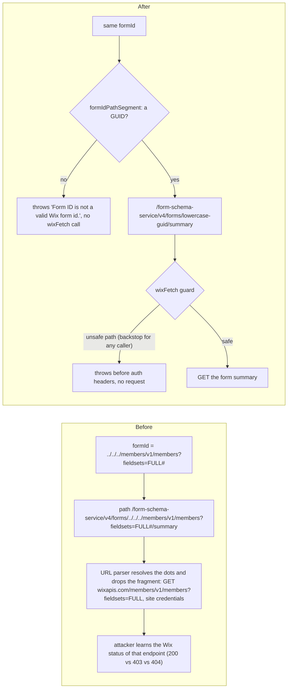

# 49 - Wix API Path Safety

Status: Design

Part of the wix-forms release security gate (**DL #47**, the umbrella). Closes **F2** (path injection in the public `getFormSummary` query) and defines the **canonical form id** that DL #50 uses to close **F4**. Packages: `@jay-framework/wix-server-client` (the `wixFetch` guard, for every plugin) and `@jay-framework/wix-forms` (the form-id helper and its two path builders); wix-bookings is read as a consumer only. Paths are relative to `packages/`.

## Decisions for the Implementer (TL;DR)

- **`wixFetch` path guard (every plugin).** `wix-server-client/lib/wix-fetch.ts` refuses, before reading any auth headers, a `path` that does not start with `/`, contains `#` or an ASCII control character anywhere, or contains `..` or `%2e` (any case) before the first `?`. Query strings stay allowed. Every `wixFetch(` call site in `packages/*` was checked: **none breaks** (§Prior Art).
- **One canonical form id.** New `canonicalFormId(raw: unknown): string | undefined` (`wix-forms/lib/utils/form-id.ts`): trim, GUID check, lowercase. Its path-segment helper `formIdPathSegment(formId)` throws for a non-GUID and URI-encodes. Every form id the server compares or puts in a Wix path goes through `canonicalFormId`: here the `getFormSummary` / `getFormSchema` path segment; in DL #50 the `submitForm` request id, each hook key, each configured `formIds` entry and each listed form id.
- **`getFormSummary`: GUID check + `encodeURIComponent` + the guard. No allowlist** on this query: wix-bookings passes a booking service's own form id (`wix-bookings/lib/utils/format.ts:51`, `wix-bookings/lib/components/booking-flow.ts:219`) whose Wix namespace is unmeasured (OQ-1). The same GUID check + encoding applies to `getFormSchema` (`wix-forms/lib/wix-apis/get-form.ts:57`), as defense in depth.
- **No interim generic-error shim** for the invalid-id error text (Q4).
- **Phase 2 of the bookings fix is tracked, not part of the gate:** a bookings-owned server query that resolves the form id from the service id, then deprecating the public `getFormSummary` query.
- **Accepted residual risk (DL #47 risk 3):** `getFormSummary` returns the field schema (labels, types) of any form GUID on the site and costs one Wix call per anonymous request, until the bookings Phase 2 query replaces it.
- **Order:** Phase 1 (wix-server-client) in parallel with DL #48; Phase 2 (wix-forms) after Phase 1 is built. DL #50 starts after Phase 2, because it uses `canonicalFormId`.

## Background

`getFormSummary` is a public, unauthenticated GET query (`wix-forms/lib/actions/forms-actions.ts:9-14`). wix-bookings calls it from the browser to load a booking service's participant form. Its handler (`wix-forms/lib/services/wix-forms-service.ts:56-68`) calls `getFormSummary(wixClient, formId)` with the site client, and returns only the projected `formSummary.fields`. `wixFetch` concatenates the path onto `https://www.wixapis.com` (`wix-server-client/lib/wix-fetch.ts:37`) and adds the site's auth headers (`:35`).

## Problem

`getFormSummary` interpolates `formId` into a path (`wix-forms/lib/wix-apis/get-form-summary.ts:25`). `../../../members/v1/members?fieldsets=FULL%23` reaches another Wix GET endpoint with the site's credentials, and the error message `Wix API <status>: <path>` (`wix-fetch.ts:128`) is a status oracle.


_Before, a crafted form id reaches any Wix GET endpoint with the site's credentials. After, the path builder refuses it, and the guard refuses any traversal that a caller forgot to encode._

## Prior Art / Adjacent Mechanisms

- **No existing helper canonicalises or validates form ids** (Q1).
- **Already encoded path ids:** `wix-bookings/lib/contexts/wix-bookings-context.ts` (`/ecom/v1/orders/${encodeURIComponent(orderId)}`), `wix-pro-gallery/lib/wix-apis/get-gallery.ts` (`encodeURIComponent(galleryId)`).
- **`wixFetch` is also exported for the browser** (`wix-server-client/lib/index.client.ts:17`, used by wix-bookings and wix-members client code); the guard runs there too, harmlessly.

**`wixFetch(` call sites, all in `packages/*` (grep 2026-11-09).** Every path starts with `/`. None contains `#`, a control character, `..` or `%2e`.

| Kind | Call sites | Effect of the guard |
| --- | --- | --- |
| Encoded, or a `URLSearchParams` / `encodeURIComponent` query | wix-bookings orders, wix-pro-gallery, wix-stores `query-schemas.ts` (`?fqdn=…`), `get-product.ts` / `get-product-by-slug.ts` / wix-stores-v1 `get-product.ts` (query via `URLSearchParams`), wix-forms `list-forms.ts` (`?…`) | none |
| **Unencoded ids in the path portion** | wix-stores `get-product.ts`, `get-product-by-slug.ts` (`${slug}`), `get-category.ts`, `list-customizations.ts`; wix-stores-v1 `get-product.ts`; wix-bookings `calculate-cart.ts`, `get-checkout-url.ts`, `place-order.ts` (`${cartId}`); wix-forms `get-form.ts`, `get-form-summary.ts` | none for real Wix ids and slugs (they never contain `..`, `#` or `%2e`); a traversal through any of them is now refused. Encoding the wix-stores / wix-bookings segments is outside this gate (tracked). |
| Static paths | wix-cart, wix-members `'/members/v1/members/my?fieldsets=FULL'`, wix-bookings `'/_api/…?fields=…&fields=…'`, the rest | none |

## Questions and Answers

- **Q1 (was #47 Q1). Null hypothesis: does an existing helper canonicalise or validate form ids?** No. Ids are compared as raw strings (`wix-forms/lib/submission/run-submission.ts:125-126`) and interpolated raw (`get-form.ts:57`, `get-form-summary.ts:25`). One `canonicalFormId` replaces those. It returns `string | undefined` rather than throwing because four of its five callers branch on it (reject, skip a key, drop a config entry, drop a listed form; DL #50); the two path builders throw on `undefined`.
- **Q2 (was #47 Q12). Why guard rules beyond `..`, `%2e`, `#`?** Two cheap additions close bypasses of the agreed rule. (a) The URL parser strips ASCII tab and newline, so `.\t.` becomes `..` after the check. (b) A path not starting with `/` changes the host (`@evil.example`, `.evil.example`) because the path is concatenated onto `https://www.wixapis.com`. Both are now refused; no call site is affected.
- **Q3 (was #47 Q13). Why refuse, not encode, in `wixFetch`?** `wixFetch` cannot tell a path separator from an id's characters; only the caller knows the segments. The guard is a backstop; callers encode.
- **Q4 (was #47 Q16). What happens to the `getFormSummary` error text for an invalid id?** The path builder throws `Error('Form ID is not a valid Wix form id.')`. jay returns that text (F8, tracked for jay), and wix-bookings shows it (`booking-flow.ts:228-231`, F9). The text is ours and reveals nothing; no shim.
- **Q5. Why no allowlist on `getFormSummary`?** wix-bookings passes the booking service's participant form id, and that form's Wix namespace is unmeasured (OQ-1). An allowlist of the wix-forms namespace (DL #50) could break every booking flow. The GUID check and the guard close the injection; the schema read stays an accepted residual risk (DL #47 risk 3) until the bookings Phase 2 query replaces this one.

## Design

### 1. `wix-server-client`: path guard (`lib/wix-fetch.ts`)

```ts
/** Throws when `path` could leave the intended Wix endpoint. Called first in wixFetch. */
function assertSafeWixPath(path: string): void;
```

Refuses when `!path.startsWith('/')`, or `/[\u0000-\u001f\u007f#]/` matches anywhere, or the part before the first `?` matches `/\.\.|%2e/i`. The error message does not echo the path: `wixFetch: refused an unsafe request path (it must start with "/" and contain no dot-segments, "%2e", "#" or control characters)`. It runs before `authHeadersFor`, so a refused call reads no credentials and makes no request.

### 2. `wix-forms`: form id (`lib/utils/form-id.ts`, new)

```ts
const GUID = /^[0-9a-f]{8}-[0-9a-f]{4}-[0-9a-f]{4}-[0-9a-f]{4}-[0-9a-f]{12}$/i;

/** The lowercase GUID form of a Wix form id; undefined when `raw` is not a GUID string. */
export function canonicalFormId(raw: unknown): string | undefined;

/** The canonical id, URI-encoded for a Wix path; throws when it is not a form id. */
export function formIdPathSegment(formId: string): string;
```

`canonicalFormId` trims, then tests `GUID` (no `m` flag, so no trailing-newline gap), then lowercases.

### 3. `wix-forms`: path builders

`formIdPathSegment` is used by `get-form-summary.ts:25` and `get-form.ts:57` (`/form-schema-service/v4/forms/${formIdPathSegment(formId)}…`). The encoding is a no-op for a canonical GUID, but it keeps the path builder correct on its own. `getFormSummary` in `forms-actions.ts:9-14` is unchanged; the check sits in the path builder.

### 4. Tracked follow-up (not designed): bookings Phase 2

A wix-bookings server query that takes the booking service id and resolves its participant form id on the server, then deprecating the public `getFormSummary` query. It retires residual risk 3. Not in the gate.

## Implementation Plan

Red first in every phase: write the test with the correct expected behaviour, run it against the unchanged code, record the red result, then implement.

**Phase 1: wix-server-client guard.**
1. `test/wix-fetch.test.ts`: refused, with `fetch` and `getAuthHeaders` never called: `/a/../b`, `/a/%2E%2e/b`, `/a/%2e/b`, `/a#x`, `/a?b=c#d`, `/a/.\t./b`, `/a\nb`, `@evil.example/x`, `.evil.example/x`. Allowed: `/a?b=c`, `/a?q=a..b` (dots after `?`), `/members/v1/members/my?fieldsets=FULL`.
2. Implement §1.
3. `npm run build`, `build:check-types` and the tests in `packages/wix-server-client`.

**Phase 2: wix-forms form id and path builders** (after Phase 1 is built; sync is via the Yarn workspace dependency).
1. `test/form-id.test.ts`: upper case and padded GUIDs canonicalise; `'form-1'`, `''`, `'../x'`, `'%2e%2e'`, numbers and objects → `undefined`; `formIdPathSegment` throws on a non-GUID.
2. A new `test/get-form-summary.test.ts` (mocks `wixFetch`): `getFormSummary(client, '../../../members/v1/members?x=1#')` rejects and `wixFetch` is not called; `getFormSummary(client, '<UPPER-CASE GUID>')` calls `wixFetch` with `/form-schema-service/v4/forms/<lowercase guid>/summary`. **No allowlist assertion** (`isSubmittableForm`, DL #50, is never consulted by this path). The same two cases for `getFormSchema` in a new `test/get-form.test.ts`.
3. Implement §2–§3.
4. `npm run build`, `build:check-types`, `validate-plugin` and the tests in `packages/wix-forms`; the wix-bookings tests (it consumes `getFormSummary`); root `yarn test`.

## Examples

✅ `wixFetch(client, '/progallery/v2/galleries/abc?offset=0&limit=50')`.
❌ `wixFetch(client, \`/stores/v3/products/slug/${'../x'}\`)` throws before reading credentials.
✅ `wixFetch(client, '/a?q=a..b')`: dots after `?` are query.
❌ `GET …/wixForms.getFormSummary?formId=../../../members/v1/members` → rejected before any Wix call.
✅ `getFormSummary(client, '3F2A9C1E-5B7D-4E8F-9A0B-1C2D3E4F5A6B')` → `/form-schema-service/v4/forms/3f2a9c1e-5b7d-4e8f-9a0b-1c2d3e4f5a6b/summary`.

## Trade-offs

- **No allowlist on `getFormSummary`** (Q5): wix-bookings keeps working. Cost: accepted residual risk 3 (DL #47), until the bookings Phase 2 query replaces this one.
- **Refuse in `wixFetch`, encode in callers** (Q3): a backstop that cannot mis-encode a separator. Cost: a caller that forgets to encode gets an error instead of a working call.
- **Unencoded wix-stores / wix-bookings ids left as is:** the guard closes traversal through them; encoding them is outside the gate. Cost: a malformed id there throws instead of 404ing.
- **No shim for the invalid-id text** (Q4): our own text reveals nothing. Cost: bookings shows a technical message for an invalid id (F9, tracked).

## Verification Criteria

- **Unit** (each red first, then green): the `wixFetch` guard; `canonicalFormId` / `formIdPathSegment`; the `getFormSummary` / `getFormSchema` traversal rejected and a valid GUID encoded (no allowlist assertion).
- Build, type check and `validate-plugin` clean in wix-server-client and wix-forms; wix-bookings and root `yarn test` green.
- **Manual** (`curl` without a cookie against a dev server): `getFormSummary?formId=../x` → error, with no Wix call in the server log.
- **End-to-end, live, before release:** *The bookings participant form still loads after the F2 hardening.* Open a booking flow whose service has a participant form. Expected: its fields render, which confirms that booking participant form ids are GUIDs (OQ-1: record the form's namespace).

## Scope Pre-mortem

- *Booking participant forms are not GUIDs* → `getFormSummary` would reject them: the end-to-end check catches it before release. Fall back to "reject only `/`, `?`, `#`, `%` and dots" if so.
- *A wix-stores slug or id contains `..` or `#`* → the guard throws for that product; not expected for Wix ids (§Prior Art); visible in logs.
- *A browser caller of `wixFetch` builds an odd path* → the guard throws there too; every current call site passes (§Prior Art).
- Scope creep refused: an allowlist on `getFormSummary`, the bookings Phase 2 query, encoding the wix-stores / wix-bookings path ids, an abort signal in `wixFetch`.

## jay-feedback

- **Validation:** none. The guard and the GUID check are runtime guarantees, not authoring mistakes visible in jay-html.
- **Agent-kit:** none in the gate. The guard is a backstop, and its error message states the rule (§1).
- **Framework:** nothing in jay or in wix's framework layer.

## Open Questions

- **OQ-1 (was #47 OQ-2; measure before any allowlist on `getFormSummary`):** which Wix namespace do booking-service participant forms live in, and are their ids GUIDs? Measured in the end-to-end check. Until then `getFormSummary` keeps no allowlist, and the bookings Phase 2 query (outside the gate) is the long-term fix.
