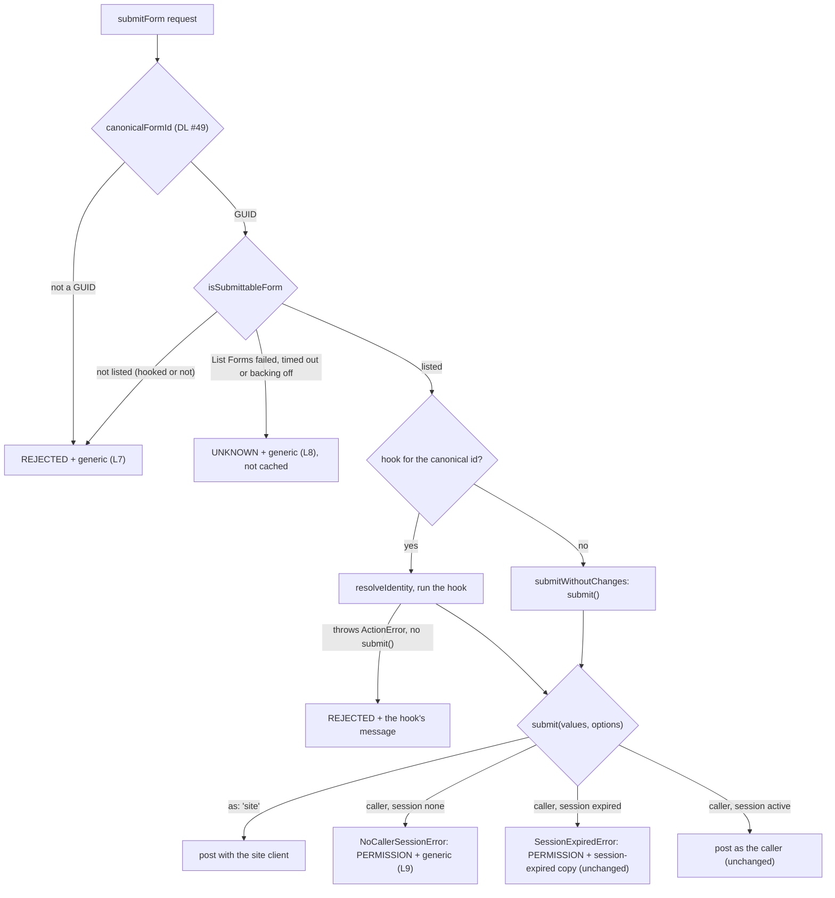

# 50 - wix-forms Submit Access Policy

Status: Implemented — curl and live end-to-end checks passed 2026-11-10

Part of the wix-forms release security gate (**DL #47**, the umbrella). Closes **F1** (`submitForm` is an open write endpoint with site credentials) and **F4** (a non-canonical id skips the hook), rewords the honeypot guide and redefines `PERMISSION`. Builds on **DL#40** (per-form contracts, `config/.wix-forms.yaml`), **DL#41** (honeypot, submit chain), **DL#42** (submit hooks), **DL#43** (headers-only caller client, `{ as: 'site' }`, `session: 'none' | 'active' | 'expired'`) and **DL#45** (`SubmitFailure` reasons). Uses **DL #49 §2** (`canonicalFormId`); comes after DL #48 and DL #49. Package: `@jay-framework/wix-forms`. Paths are relative to `packages/wix-forms/` unless they name another package.

## Decisions for the Implementer (TL;DR)

- **`submitForm` accepts only submittable forms (F1, F4).** The allowlist is `config.formIds` (canonicalised) when set; otherwise the ids of the namespace's **enabled** forms from one List Forms call (same namespace as contract generation, `lib/services/wix-forms-service.ts:21-38`), **always `enabled` at runtime, even when `include` is `all`/`disabled`** (that flag is for agent-kit generation). Loaded lazily on the first submit and cached for the process. Concurrent first callers share one in-flight promise. Configured `formIds` are **not** intersected with enabled forms (Q2). A configured list whose every entry is invalid stays configured mode with an empty set (Q11).
- **The allowlist state belongs to each check.** `loading` and `retryAfterMs` are closure state of the check returned by `createSubmittableFormCheck`, not module state, so services with different configs, and test cases, never share a cache or a backoff.
- **The allowlist load is bounded and fails closed (Q9).** A List Forms failure, or a load slower than `ALLOWLIST_LOAD_TIMEOUT_MS = 10_000`, answers `UNKNOWN`, is **not cached**, and opens an `ALLOWLIST_RETRY_BACKOFF_MS = 15_000` window in which every check fails closed without calling Wix. An empty list is cached and logged once.
- **A hook does not make a form submittable.** A hooked form outside the allowlist is refused (`REJECTED`) before its hook runs or identity is resolved.
- **An allowlist rejection has Wix's 404 shape, but it is observable (Q3).** Unknown or non-GUID id → `{ success: false, reason: REJECTED, message: SUBMIT_FAILED_MESSAGE }`, the result a nonexistent form already gets from Wix (404 → `REJECTED`, `lib/submission/run-submission.ts:231-236`). No Wix call, no token-info call. Logged server-side (L7) with the canonical id, or `'<not a form id>'`. Membership of a known GUID is readable: accepted residual risk 2 (DL #47).
- **`selectHook` compares canonically (F4).** Both the request id and each hook key go through `canonicalFormId` (DL #49 §2); non-GUID keys never match, and each one is warned about once at runtime (Q10). No validator, no naming convention.
- **No session cookie → no post, unless the hook says `{ as: 'site' }` (F1).** The refusal lives inside `submit()` (`createSubmitAttempt`, `run-submission.ts:151-183`), next to the existing expired-session check, because only the hook's `submit` call reveals `{ as: 'site' }`. A refused `submit()` rejects with a new `NoCallerSessionError`; the result is `{ success: false, reason: PERMISSION, message: SUBMIT_FAILED_MESSAGE }`, logged as L9. An unhooked form with no cookie is refused.
- **A `{ as: 'site' }` hook still posts with the site client for any caller, cookie or not (Q12).** That is the owner's opt-in and accepted residual risk 5 (DL #47). The guide warns that it opts the form out of Wix's submitter restriction for scripts too, and recommends requiring `client` before forcing the site.
- **Direct callers:** project code that calls `submitForm` itself must `await ensureSessionFresh()` first (guide).
- **`PERMISSION` now covers three causes** (Wix 401/403, an expired session, no cookie); docs say page copy must not assume sign-in (Q6).
- **Guides:** `agent-kit/plugin/rich-forms.md` §4a reworded (the honeypot stops naive DOM-filling bots, it is not spam protection) and §7 updated (cookie-less refusal, allowlist, hooks do not make a form submittable, hook keys in any case, the `{ as: 'site' }` warning, `ensureSessionFresh()` for direct callers); `user-visible-messages.md` redefines `PERMISSION`; `formIds` documented as the runtime allowlist too.
- **Accepted residual risks here** (listed in DL #47): 1 (minted visitor token), 2 (membership readable), 4 (browser-only honeypot), 5 (`{ as: 'site' }` hooks accept cookie-less posts).

## Background

DL#43 already fixed the silent server-side token renewal (headers-only caller client, `wix-server-client/lib/session/request-identity.ts:78-88`), so an expired session is never posted as the site (`run-submission.ts:162-168`).

Real visitors always carry `wix_session`: `oauthStrategy.clientId` is required by config (`wix-server-client/lib/config-loader.ts:91-99`), the browser context mints visitor tokens at init when none are stored (`wix-server-client/lib/wix-client-context.ts:180-184`), `storeTokens` syncs them, and the `wixForm` component awaits `ensureSessionFresh()` before `submitForm` (`wix-client-context.ts:99-111`, `lib/components/form-submit-execution.ts:31-35`). So refusing cookie-less posts blocks scripts without blocking pages.

## Problem

1. **`submitForm` is an open write endpoint with site credentials.** `curl -X POST /_jay/actions/wixForms.submitForm -d '{"formId":"…"}'` with no cookie: `session: 'none'` → `asCaller = false` (`run-submission.ts:162`) → `authorization = undefined` (`:169`) → `wixFetch` sends the site's auth headers (`wix-server-client/lib/wix-fetch.ts:61-62`). Any string reaches Wix as the form id (`lib/actions/forms-actions.ts:31`, `wix-forms-service.ts:70-75`), including disabled forms.
2. **Hook selection is an exact string match** (`run-submission.ts:125-127`); a hooked form's id in another case skips the hook's checks while still posting.

## Prior Art / Adjacent Mechanisms

- **Form enumeration:** `listForms(client, { namespace, formIds, include })` (`lib/wix-apis/list-forms.ts:47-63`), cursor-paged, `include` → `enabled=true` by default (`:79-86`). The service caches a successful build-time list in `listCache` (`wix-forms-service.ts:16-39`) but has no in-flight sharing and applies `config.include`; the runtime allowlist needs `enabled` regardless, so it calls `listForms` itself.
- **No request timeout in `wixFetch`:** `WixFetchOptions` has no signal (`wix-server-client/lib/wix-fetch.ts:19-27`), and `fetch` is called without one (`:37-44`). The allowlist bounds its own wait (§1).
- **Config:** `loadWixFormsConfig` (`lib/config-loader.ts:36-47`); `formIds` is today documented as a generation filter only (`config-loader.ts:6-11,15`, `setup.ts:32-45`, `agent-kit/plugin/wix-forms-setup.md:27,119`). `provideWixFormsService` runs at server init (`init.ts:12`) and also at setup / agent-kit time.
- **Refusal next to expiry:** `createSubmitAttempt.submit` already fails a caller post with `SessionExpiredError` without posting (`run-submission.ts:162-168`), mapped to `PERMISSION` (`:241-247`). The no-session refusal copies that shape.
- **Same concept elsewhere:** wix-data's `NoCallerSessionError` (`wix-data/lib/services/wix-data-service.ts:73-82`) refuses an `asCaller` call without a session instead of using the site. wix-forms does not depend on wix-data, so it gets its own class. The **name is shared on purpose** (same meaning); the **shape differs on purpose**: wix-forms' constructor takes the form id (its message names the form), wix-data's a `reason: 'none' | 'expired'`. A project importing both aliases one, and an `instanceof` check must use the class of the package that threw.
- **A hook's own rejection:** a hook that throws an `ActionError` without calling `submit()` answers `{ success: false, reason: REJECTED, message: <its message> }` (`run-submission.ts:215-217`). The hardened `{ as: 'site' }` hook (Q12) uses it.

## Questions and Answers

- **Q1 (was #47 Q2). Null hypothesis: can the service's `listForms()` be the allowlist?** No: it applies `config.include` and `config.formIds` (generation semantics), projects fields the allowlist does not need, and has no in-flight sharing. The allowlist calls `wix-apis/list-forms.ts` with `{ namespace, include: 'enabled' }` and keeps a `Set` of canonical ids.
- **Q2 (was #47 Q3). Are configured `formIds` intersected with the enabled forms?** No. Configured ids are the owner's explicit list: they are the allowlist verbatim (canonicalised; a non-GUID entry is dropped with one warning). The set is built when the service is provided, so the warning shows at setup / agent-kit time as well as at server start; that is intended, because agent-kit time is where the author reads it. Intersecting would put a List Forms call (and its fail-closed outage) on the request path of sites that configured ids precisely to avoid enumeration. A configured id that is disabled in Wix stays allowlisted; Wix's own handling of a disabled form decides (unmeasured; the end-to-end checks do not cover it).
- **Q3 (was #47 Q4). What does an allowlist rejection return, and what does it reveal?** `REJECTED` + `SUBMIT_FAILED_MESSAGE`, the shape of Wix's 404 for a nonexistent form today. It does **not** hide membership. The allowlist must run before the cookie-less refusal (so an unlisted id never reaches identity, a hook or Wix), so for a caller who already holds a GUID:
  - without a cookie, a listed unhooked GUID answers `PERMISSION` (L9) and an unlisted one `REJECTED` (L7);
  - with a cookie, an unlisted id is answered at once, a listed id after a Wix round trip.

  **Decision: accept it as a residual risk.** Form ids are random 128-bit GUIDs, so the endpoint cannot be used to enumerate them, and every form placed on a page already ships its id to the browser (`carryForward.formId`, `lib/components/wix-form.ts:326`). Learning that a known id is submittable tells an attacker nothing a page visitor cannot see. Unifying the answers instead is in Trade-offs. A List Forms failure returns `UNKNOWN` + `SUBMIT_FAILED_MESSAGE` (a server fault, not about the id). No result names the list.

- **Q4 (was #47 Q5). Cache lifetime?** The process. A form enabled after the server started is refused until a restart. Accepted: a new form also needs a regenerated contract, which means a rebuild and redeploy. A form disabled after start stays allowlisted until restart (Wix still decides on its side).
- **Q5 (was #47 Q6). Why refuse inside `submit()`, not at the top of `runSubmission`?** Only the hook's `submit(values, { as: 'site' })` call shows the opt-in. Refusing up front would break exactly the `{ as: 'site' }` forms this log keeps working. Consequence (unchanged from today): a hook runs for cookie-less requests with `caller: undefined`; the hook guide already says inputs are untrusted (`lib/services/wix-forms-submit-hooks.ts:15-17`).
- **Q6 (was #47 Q7). Which copy for a cookie-less refusal?** `reason: PERMISSION` (agreed), with the generic `SUBMIT_FAILED_MESSAGE`. "Please sign in" is wrong for a visitor, and "your session expired" is wrong for a script. The rare real visitor without a cookie (cookies blocked, a sync failure, a token-info outage) sees the generic message; the server logs L9 with the form id. So `PERMISSION` now covers three causes (Wix 401/403, an expired session, no cookie), and the docs that define it say page copy must not assume sign-in (§3, Phase 5).
- **Q7 (was #47 Q14). Two hook keys that canonicalise to the same id?** The first in `Object.keys` order wins. `Object.keys` lists own properties only, so the prototype-key protection of `Object.hasOwn` (`run-submission.ts:124-126`) is kept. A non-GUID key (such as the illustrative `'contact-us'` in DL#43 §Examples) never matched a real request before either; the guide now says keys are the form's id, in any case.
- **Q8 (was #47 Q15). Honeypot?** Only `rich-forms.md` §4a is reworded; no action-schema change, no server-side honeypot in the gate. Rationale: the threat F1 describes is a script calling the action directly, and such a script simply omits the honeypot field, so a server check adds nothing against it. The bots a honeypot does catch (ones that fill every DOM input and submit through the page) are already stopped by the browser check. A server-side honeypot would need an action-schema change for no gain against the gate's threat; it is tracked (DL #47).
- **Q9 (was #47 Q17). How is the allowlist load bounded?** Three rules, all fail-closed:
  - _Bounded wait:_ each load races a 10 s timer. `wixFetch` has no abort signal (`wix-fetch.ts:19-27`), so a timed-out List Forms request is abandoned, not cancelled, and its late result is discarded. Adding a signal to `wixFetch` is out of the gate.
  - _Retry backoff:_ after a failure or a timeout, checks fail closed for 15 s without calling Wix. Without it, any anonymous junk GUID could start a full, cursor-paged List Forms call with site credentials on every request during an outage. With it, an instance makes at most one load per 25 s (10 s timeout + 15 s backoff) while Wix is failing.
  - _Empty list:_ a successful empty list is a real answer (a site with no enabled forms, or a wrong `namespace`). It is cached, and one `console.warn` names the namespace, so every submit being `REJECTED` is visible in the log.
- **Q10 (was #47 Q18). A hook keyed by a non-GUID: warn at runtime?** Yes. After the gate a mis-keyed `{ as: 'site' }` hook leaves a members-only form refused for cookie-less callers with only L9 in the log. `selectHook` warns once per hooks object (a module `WeakSet`) for each key `canonicalFormId` rejects: `[wix-forms] submit hook key "<key>" is not a form id and never matches; key hooks by the form's id`. It is the cheapest deterministic feedback available: hooks are registered in TypeScript at runtime, so no `jay-stack validate` rule can see them.
- **Q11. What if every configured `formIds` entry is invalid?** The mode follows the raw config: a non-empty `config.formIds` is configured mode, however many entries survive canonicalisation. If none survives, the set is empty and every submit is `REJECTED`, with one warning per dropped entry and one more: `[wix-forms] formIds has no valid form id: every submission is refused`. It never falls back to list mode: the owner asked for an explicit list, and enumerating the namespace would widen it.
- **Q12. Does a `{ as: 'site' }` hook keep a cookie-less site-credential path?** Yes, by design. An allowlisted form whose hook calls `submit(…, { as: 'site' })` accepts a `curl` with no cookie and posts it with the site's credentials, which bypasses the form's own Wix submitter restriction (members-only) and possibly Wix's captcha (unmeasured, DL#43 V5). The owner opted in, so it stays; it is accepted residual risk 5 (DL #47). The zero-cost hardening is the recommended form for members-only forms that visitors must submit: require `client` before forcing the site. `client` is set only for an active session, so a cookie-less (or expired) request is refused with the hook's own `ActionError` (`REJECTED` + its message), while a page visitor still posts as the site. A script that mints a visitor token still gets through (residual risk 1). The unconditional one-liner stays for forms that are truly public.

## Design

### Decision flow of `submitForm`



_The allowlist runs before the session refusal, so for a known GUID without a cookie the reason (R1 vs R3) shows whether it is listed: accepted residual risk 2. A post's own result (success, `VALIDATION`, Wix 401/403/404/500) is mapped as today._

### Outcomes by request

| Request                     | Unlisted or non-GUID id | Listed, no hook                    | Listed, hook calls `submit()`                                | Listed, hook `submit(…, { as: 'site' })` | Listed, hook requires `client`, then `{ as: 'site' }` |
| --------------------------- | ----------------------- | ---------------------------------- | ------------------------------------------------------------ | ---------------------------------------- | ----------------------------------------------------- |
| No cookie (a script)        | `REJECTED`, generic, L7 | `PERMISSION`, generic, L9          | `PERMISSION`, generic, L9 (hook sees `NoCallerSessionError`) | **site post** (risk 5)                   | `REJECTED`, the hook's message                        |
| Visitor, active             | `REJECTED`, L7          | post as the visitor                | post as the visitor                                          | site post                                | site post                                             |
| Member, active              | `REJECTED`, L7          | post as the member                 | post as the member                                           | site post                                | site post                                             |
| Expired cookie              | `REJECTED`, L7          | `PERMISSION`, session-expired copy | `PERMISSION`, session-expired copy                           | site post                                | `REJECTED`, the hook's message                        |
| Any, while List Forms fails | `UNKNOWN`, generic, L8  | same                               | same                                                         | same                                     | same                                                  |

_Unlisted ids never reach identity, a hook or Wix. A minted visitor token is an "active visitor" (risk 1)._

### 1. Allowlist (`lib/services/submittable-forms.ts`, new; wired in `wix-forms-service.ts`)

```ts
export const ALLOWLIST_LOAD_TIMEOUT_MS = 10_000;
export const ALLOWLIST_RETRY_BACKOFF_MS = 15_000;

export interface SubmittableFormsSource {
  namespace: string; // named in the empty-list warning
  configuredFormIds: readonly string[];
  listEnabledFormIds(): Promise<string[]>;
}

/** A check for canonical form ids. Configured ids win; otherwise one shared, success-only cached list. Each check owns its own cache and backoff. */
export function createSubmittableFormCheck(
  source: SubmittableFormsSource,
): (canonicalId: string) => Promise<boolean>;
```

| Mode       | When                          | Behaviour                                                                                                                                                                                                                                                                                                                                                                                                                                    |
| ---------- | ----------------------------- | -------------------------------------------------------------------------------------------------------------------------------------------------------------------------------------------------------------------------------------------------------------------------------------------------------------------------------------------------------------------------------------------------------------------------------------------- |
| Configured | `configuredFormIds` non-empty | A `Set` built when `createSubmittableFormCheck` is called: each id canonicalised; a non-GUID entry dropped with one `console.warn`: `[wix-forms] formIds entry "<entry>" is not a form id; it is ignored`. No network. If no entry survives: empty set plus `[wix-forms] formIds has no valid form id: every submission is refused` (Q11). Because the service is also provided at setup / agent-kit time, the warnings show there too (Q2). |
| List       | otherwise                     | The algorithm below.                                                                                                                                                                                                                                                                                                                                                                                                                         |

**List mode**, with closure state of each check returned by `createSubmittableFormCheck` (`loading?: Promise<Set<string>>`, `retryAfterMs?: number`; never module state):

1. If `Date.now() < retryAfterMs`, reject with `Error('submittable forms are unavailable (retrying after a failed load)')` without calling the source.
2. Otherwise `loading ??= withTimeout(source.listEnabledFormIds(), ALLOWLIST_LOAD_TIMEOUT_MS).then(toCanonicalSet, onLoadFailure)`. `onLoadFailure` sets `loading = undefined` and `retryAfterMs = Date.now() + ALLOWLIST_RETRY_BACKOFF_MS`, then rethrows.
3. Await `loading` and test `has(canonicalId)`. Concurrent first callers share `loading`.

- `toCanonicalSet` warns once when the set is empty: `[wix-forms] no enabled forms in namespace "<namespace>": every submission is refused until restart`.

Wiring:

- `WixFormsService` (`wix-forms-service-marker.ts`) gains `isSubmittableForm(formId: string): Promise<boolean>`. `provideWixFormsService` builds the check with `listEnabledFormIds: async () => (await listForms(wixClient, { namespace: config.namespace, include: 'enabled' })).map((form) => form.id)`.
- `WixFormsService.createSubmission` (server-side project code) is not gated: no allowlist, no cookie-less refusal. Only the public `submitForm` action is.

### 2. `submitForm` (`lib/submission/run-submission.ts`, `lib/actions/forms-actions.ts`)

- `SubmitDeps` gains `isSubmittableForm(formId: string): Promise<boolean>`. `forms-actions.ts` passes `(formId) => forms.isSubmittableForm(formId)` and keeps `hook: selectHook(hooks, input.formId)`.
- `runSubmission` starts with `const formId = canonicalFormId(request.formId)`. If `undefined` → L7 with `formId: '<not a form id>'` → `REJECTED`. Then `await deps.isSubmittableForm(formId)`: if it throws → L8 → `UNKNOWN`; if false → L7 → `REJECTED`. Only then the existing flow, with the canonical `formId` everywhere (the hook input, posting, logs). **This runs before `deps.hook` is used:** a hooked form outside the allowlist is refused without running its hook or resolving identity. Registering a hook does not make a form submittable.
- `selectHook(hooks, rawFormId)`: first, when `hooks` is defined, warns once per `hooks` object about non-GUID keys (Q10); the `WeakSet` must skip `hooks === undefined` (`WeakSet.add(undefined)` throws, and the tests call `selectHook(undefined, …)`). Then `const id = canonicalFormId(rawFormId)`; return `hooks[key]` for the first `key` of `Object.keys(hooks ?? {})` with `canonicalFormId(key) === id`, else `undefined` (also when `id` is `undefined`).
- `createSubmitAttempt.submit` (`:161-170`) becomes:

```ts
attempt.state = 'pending';
const asCaller = options?.as !== 'site';
if (asCaller && callerSession.session === 'none') {
  return failAttempt(new NoCallerSessionError(formId)); // state 'failed', postedAs 'caller'
}
if (asCaller && isCallerSessionExpired(callerSession)) {
  return failAttempt(new SessionExpiredError(formId));
}
const authorization = asCaller ? callerSession.authorization : undefined;
attempt.postedAs = asCaller ? 'caller' : 'site';
```

(`failAttempt` is the existing four lines at `:164-167`, extracted.) An `'active'` session always has `authorization`, which `runSubmission` already enforces at `:82-84`. A hook that catches the refusal cannot then fall back to `{ as: 'site' }`: the attempt is consumed (`:152`).

- `failedSubmissionResult` (`:239-266`): `NoCallerSessionError` → L9 → `{ success: false, reason: PERMISSION, message: SUBMIT_FAILED_MESSAGE }`, checked before the field-error branch, like `SessionExpiredError`.
- `NoCallerSessionError` goes in `wix-forms-submit-hooks.ts` next to `SessionExpiredError` (`:60-66`), exported from `lib/index.ts`. Message: `submit() did not post form "<id>": the request has no session cookie; use { as: 'site' } to post as the site`.
- New log lines (form id only, as `logFailure` does today): **L7** `refused a submission for a form that is not submittable`, **L8** `could not load the submittable forms`, **L9** `refused a submission without a session cookie`.

### 3. Doc comments (exact text)

| Where                                                                           | New text                                                                                                                                                                                                                                                                                                                                                                                                                                                                                     |
| ------------------------------------------------------------------------------- | -------------------------------------------------------------------------------------------------------------------------------------------------------------------------------------------------------------------------------------------------------------------------------------------------------------------------------------------------------------------------------------------------------------------------------------------------------------------------------------------- |
| `SubmitHookInput.submit` (`wix-forms-submit-hooks.ts:25-31`)                    | "Submit to Wix, at most once, before the hook settles. `values` replaces the submitted values (default: `input.values`). Posts as the caller when the request has a session; without a session cookie it is refused, unless `{ as: 'site' }` forces the site. Rejects when Wix rejects, with `SessionExpiredError` when a caller post's session expired, with `NoCallerSessionError` when the request has no session cookie, or with `SubmitIgnoredError` when ignored. Await or return it." |
| `SubmitOptions.as` (`:36`)                                                      | "Default: the caller; refused without a session cookie. `'site'` posts with the site's credentials for any caller, with or without a cookie."                                                                                                                                                                                                                                                                                                                                                |
| `SubmitAttempt.postedAs` (`run-submission.ts:131`)                              | "Set synchronously with state = 'pending'. 'site' only when forced with `{ as: 'site' }`."                                                                                                                                                                                                                                                                                                                                                                                                   |
| `SubmitFailure.PERMISSION` (`lib/components/submit-outcome.ts:31`, new comment) | "Wix denied the caller (401 / 403), the caller's session expired, or the request had no session cookie. Page copy must not assume sign-in."                                                                                                                                                                                                                                                                                                                                                  |
| `run-submission.ts:242`                                                         | "An expired session: the page can ask the user to refresh." (was "the page can ask the user to sign in")                                                                                                                                                                                                                                                                                                                                                                                     |
| `WixFormsConfig` module comment (`config-loader.ts:6-11`)                       | "Wix Forms config: per-form contract generation and, through `formIds`, the runtime submit allowlist. Absent config → generate every enabled form in the default namespace, and accept submissions for those forms."                                                                                                                                                                                                                                                                         |
| `WixFormsConfig.formIds` (`config-loader.ts:15`)                                | "Optional form ids: restricts generation to these forms and is the runtime submit allowlist (`submitForm` refuses other forms)."                                                                                                                                                                                                                                                                                                                                                             |
| `WixFormsConfig.include` (`config-loader.ts:17`)                                | "Which forms to enumerate for generation. Default: `enabled`. The runtime allowlist always uses enabled forms."                                                                                                                                                                                                                                                                                                                                                                              |

Unchanged on purpose: `SUBMIT_NOT_ALLOWED_MESSAGE`'s comment (`submit-outcome.ts:10`; that copy is still used only for a caller 403), and the three low-level post comments, which stay true because they describe `createSubmission` itself, not the action: `SubmitDeps.createSubmission` (`run-submission.ts:46`), `lib/wix-apis/create-submission.ts:9-10` and `WixFormsService.createSubmission` (`wix-forms-service-marker.ts:18-19`, ungated).

### 4. Corrections to earlier logs (by this note, not by editing them)

- DL#42/DL#43 and `rich-forms.md` §7: "without a session it posts as the site" / "postedAs is 'site' with no session". **Superseded:** without a session cookie `submit()` is refused unless the hook passes `{ as: 'site' }`.
- DL#45 outcome table: `PERMISSION` = "Wix answered 401 / 403". **Superseded:** also an expired session and a cookie-less refusal (Q6).
- DL#41 §4a / `rich-forms.md`: the honeypot as "spam protection". **Superseded:** it stops naive DOM-filling bots only.

## Implementation Plan

Red first in every phase: write the test with the correct expected behaviour, run it against the unchanged code, record the red result, then implement. Starts after DL #48 and DL #49 are built (sync is via the Yarn workspace dependency).

**Phase 1: allowlist.**

1. `test/submittable-forms.test.ts` (pure module, fake timers; each case builds its own check):
   - Configured ids: no list call, case-insensitive match, a non-GUID entry dropped with one warning. All entries invalid (`['form-1']`): no list call, every id → false, the entry warning plus the "no valid form id" warning (Q11).
   - List mode: an unknown id → false; a wrong-case id (already canonicalised by the caller) → true; **two concurrent first calls → one `listEnabledFormIds` call**.
   - **Failure:** a List Forms failure rejects and is not cached; a check within 15 s rejects **without** calling the source; after 15 s a check lists again and can succeed.
   - **Timeout:** a source that never settles → the check rejects after 10 s, and the backoff applies as for a failure.
   - **Empty list:** cached (a second check does not list again), every id → false, one warning naming the namespace.
   - **Per-check state:** a failing check's backoff does not affect a second check built from another source.
2. `test/wix-forms-service.test.ts`: `isSubmittableForm` calls `listForms` with `{ namespace, include: 'enabled' }` even when `config.include` is `'all'`. Note: `:51-62` (`formIds: ['missing-id']`) now also logs the "not a form id" warning; its `stringContaining('formIds')` assertion still holds.
3. Implement §1.

**Phase 2: `submitForm`.** `test/submission/run-submission.test.ts`:

- **New, red:**
  - An unknown id → `REJECTED` + generic, no post, no `resolveIdentity`, log L7. A non-GUID id → the same, logged as `'<not a form id>'`. `isSubmittableForm` rejecting → `UNKNOWN`, L8, no post.
  - **A hooked form outside the allowlist → `REJECTED`, L7; the hook is not called and `resolveIdentity` is not called.**
  - **Q3 pin (accepted order):** without a cookie, an unlisted GUID → `REJECTED` (L7) and `isSubmittableForm` was called; a listed unhooked GUID → `PERMISSION` (L9). The allowlist runs before the session refusal.
  - A wrong-case id of a hooked form runs the hook and posts the canonical id.
  - **No cookie, no hook → `PERMISSION` + generic, no post, L9.** No cookie with a hook that calls `submit()` → the same, and the hook sees a `NoCallerSessionError` rejection.
  - **A visitor cookie → posts with the caller's authorization.** **A hook's `{ as: 'site' }` without a cookie → posts with the site client** (`authorizations: [undefined]`).
  - `createSubmitAttempt` with `{ session: 'none' }` → state `failed`, `NoCallerSessionError`, no post.
- `selectHook`: an upper-case request id selects a lower-case key and vice versa; the prototype-key cases (`:371-376`) still give `undefined`; a non-GUID key warns once across two calls with the same hooks object; `selectHook(undefined, …)` does not throw.
- **Harness changes** (`:85-113`):
  - `FORM_ID` (`:43`) becomes a lowercase GUID.
  - `deps` gains `isSubmittableForm: async () => true`.
  - The default session (`:96`, today `{ session: 'none' }`, which now refuses every post) becomes `activeSession()`, the real-browser shape. Tests that pass no `session` and assert nothing about who posts keep their expectations: V1 (`:124-160`), V2 (`:162-194`; field errors are mapped before the caller/site branch), V4 (`:258-295`), V5 `:298-313`, `:333-354`, `:356-367`, and V6 (`:370-417`).
  - New option `forceSite: true`, defined exactly. With `options.hook`, the harness passes the hook an input whose `submit(values, opts)` calls the real `submit(values, { ...opts, as: 'site' })`. Without `options.hook`, it installs `({ submit }) => submit(undefined, { as: 'site' })`. So `deps.hook` is set and `resolveIdentity` runs; none of the tests below asserts on `resolveIdentity`. The wrapper must return the real `submit()` promise as is, not from an `async` wrapper: a second promise would turn V5 `:315-331` (`void submit()`, then no unhandled rejection) red.
- **Existing tests that move, exhaustively** (each still tests the site path, which `{ as: 'site' }` is now the only way to reach):
  - `forceSite: true`: V3 `:197-214` (site 401/403/500/network → L4) and `:216-229` (parity hooks, site 403 → L4); V5 `:315-331` (un-awaited `submit()` with a site 403 → `PERMISSION` + generic); `:656-668` (the `'site'` row: replace `{ session: 'none' }` with `forceSite`); `:670-679` (403 on a site post).
  - Replaced by the new refusal tests: `:451-456` ("site client when there is no session") and `:715-721` (`postedAs 'site' with no session`).
  - `:569-596` does not use the harness: its deps are `identitySubmitDeps(identity)` plus an inline `createSubmission` (`:583-590`). It gains `isSubmittableForm: async () => true`; its hand-built old-format cookie (`:571-576`) keeps proving the migration read (DL #48).
- **No other test may gain `forceSite`.** A test that fails after the default change and is not listed above is fixed to the correct active-session expectation, or reported in Implementation Results. It is never forced onto the site path to pass. Implementation Results lists every `forceSite` test with one line on why the site path is still the behaviour under test.
- Implement §2.

**Phase 3: docs in code.** §3's doc comments. `setup.ts:32-45` `CONFIG_TEMPLATE`: `formIds` also limits which forms accept submissions at runtime; `include` affects generation only.

**Phase 4: build and test.** `npm run build`, `build:check-types`, `validate-plugin` and the tests in `packages/wix-forms`; root `yarn test`.

**Phase 5: agent-kit** (`agent-kit/plugin/`).

- `rich-forms.md` §4a: the heading drops "spam protection". New text: "The honeypot stops naive bots that fill every input in the DOM. It is not spam protection: it runs in the browser only, and a script that calls the action directly skips it. For spam control, use Wix's form settings, your edge, or a submit hook." The note at `:44` is adjusted to match.
- `rich-forms.md` §7 "Who the submission posts as":
  - It posts as the caller with an active `wix_session`. **Without a session cookie the submission is refused** (`submitFailure: PERMISSION`, generic message), unless the hook calls `submit(values, { as: 'site' })`.
  - "A `{ as: 'site' }` hook posts with the site's credentials for every caller, cookie or not, scripts included: it opts the form out of Wix's submitter restriction (such as members-only). For a members-only form that visitors must submit, require a session first (`if (!client) throw new ActionError(…)`, then `submit(undefined, { as: 'site' })`). Use the unconditional one-liner only for a form that is truly public."
  - Only forms in `formIds`, or else the namespace's enabled forms, accept submissions. **Registering a hook does not make a form submittable:** a hooked form outside that list is refused before its hook runs. A form created after deploy is refused until restart.
  - Hook keys are the form id, in any case; a non-GUID key never matches and is warned about once.
  - "If you call `submitForm` yourself (not through the `wixForm` component), `await ensureSessionFresh()` from `@jay-framework/wix-server-client/client` first. On a new visitor's first page the session sync may still be in flight, and a submit without the cookie is refused."
  - `:302` "so it can write its own sign-in copy" becomes "so it can write its own copy; `PERMISSION` does not always mean signed out".
  - The F1 residual-risk sentence: a visitor session proves a browser session, not a person; rate-limit in the hook or at the edge.
- `user-visible-messages.md`: the `PERMISSION` row (`:30`) becomes "Wix denied the caller (401 / 403), the session expired, or the request had no session cookie". The example (`:45`) drops sign-in copy for neutral copy: `Impossible d'envoyer ce formulaire. Actualisez la page et réessayez.`
- `wix-forms-setup.md:11` (the `submitForm` line) gains the `ensureSessionFresh()` sentence. `wix-forms-setup.md:27,119` and `per-form-contracts.md:11`: `formIds` is also the runtime submit allowlist.

## Examples

✅ Members-only form that visitors must submit, recommended form (a cookie-less script is refused, a page visitor posts as the site):

```ts
registerService(WIX_FORMS_SUBMIT_HOOKS, {
  '3f2a9c1e-5b7d-4e8f-9a0b-1c2d3e4f5a6b': async ({ client, submit }) => {
    if (!client)
      throw new ActionError(
        'NO_SESSION',
        'This form could not be sent. Refresh the page and try again.',
      );
    return submit(undefined, { as: 'site' });
  },
});
```

✅ A truly public form: `'<form id>': ({ submit }) => submit(undefined, { as: 'site' })`. It posts as the site for every caller, cookie or not (residual risk 5).
✅ The same key in upper case also matches (`canonicalFormId`).
❌ `'contact-us': …` never matches (a hook key must be the form's id) and logs one warning.
❌ The same hook for a form in another namespace, or not in configured `formIds`: refused (`REJECTED`) before the hook runs.
❌ `curl -X POST /_jay/actions/wixForms.submitForm -d '{"formId":"<unhooked form>","values":{}}'` (no cookie) → `{ success: false, reason: "PERMISSION", message: "<generic>" }`, nothing posted.
✅ Project code calling the action directly: `await ensureSessionFresh(); await submitForm({ formId, values });`.

## Trade-offs

- **Lazy, process-lifetime allowlist** vs a TTL or an init-time load: no work for sites that never submit, no List Forms call at boot, and no stale-refresh logic. Cost: a restart is needed after enabling a new form (Q4).
- **Bounded load with a fixed backoff** (Q9) vs unbounded retries: junk requests cannot drive repeated List Forms calls, and a hanging call cannot hold submits forever. Cost: after a transient failure, submits are refused for up to 15 s; a timed-out request keeps running in the background (no abort in `wixFetch`).
- **Caching an empty list** vs treating it as a failure: a site with no enabled forms is a real state; a wrong `namespace` is a config error that a restart after the fix clears. Cost: a wrong namespace refuses everything until restart, made visible by one warning.
- **Configured ids not intersected** (Q2): no request-path dependency on List Forms. Cost: a disabled-but-configured form is left to Wix.
- **All-invalid `formIds` stays configured** (Q11) vs falling back to list mode: never widens the owner's list. Cost: a typo refuses every submit, made visible by warnings.
- **Allowlist before the session refusal, membership observable** (Q3, chosen) vs **refusing cookie-less unhooked requests first**, so a listed and an unlisted GUID both answer `PERMISSION` without a cookie. The alternative was not taken because it only moves the oracle: the answer then depends on whether the id is hooked, timing still differs with a cookie, and it needs the hook map before the allowlist plus a second refusal point outside `submit()`. That is more surface for no real gain, given that ids are unguessable and already public on pages.
- **Refusal in `submit()`** (Q5): keeps `{ as: 'site' }` working. Cost: a hook still runs for cookie-less requests (unchanged; hooks treat input as untrusted).
- **`{ as: 'site' }` left unconditional, hardening recommended** (Q12) vs requiring a cookie for every site post: keeps truly public forms working. Cost: residual risk 5 for owners who skip the recommended form.
- **Generic copy for a cookie-less refusal** (Q6): no misleading "sign in". Cost: a cookie-blocked real visitor gets no specific hint; the server log has it.
- **One-time runtime warning for non-GUID hook keys** (Q10) vs nothing: cheap, deterministic, and visible in dev. Cost: one module `WeakSet`.

## Verification Criteria

- **Unit** (each red first, then green):
  - The allowlist: unknown id, wrong case, a List Forms failure not cached, the 15 s backoff, the 10 s timeout, an empty list cached with one warning, a concurrent first load = one list call, `enabled` even when `include: 'all'`, all-invalid `formIds` → empty set, per-check state.
  - `submitForm`: no cookie → `PERMISSION`; a visitor cookie → caller post; a hook's `{ as: 'site' }` without a cookie → site post; an unknown id → `REJECTED` with no Wix or token-info call; a hooked form outside the allowlist → `REJECTED`, hook not run; the Q3 order pin; the non-GUID hook-key warning.
  - Build, type check and `validate-plugin` clean in wix-forms; root `yarn test` green.
- **Manual** (`curl` without a cookie against a dev server): `submitForm` for an unhooked allowlisted form → `PERMISSION`; a random GUID → `REJECTED`, with no Create Submission and no token-info call in the server log (in list mode the first submit after start makes one List Forms call).
- **End-to-end, live, before release:** _Real visitors can still submit after cookie-less submits are refused (F1)._ On a dev or deployed site, a fresh browser profile with no cookies opens a page with an unhooked allowlisted form and submits it on first load. Expected: `wix_session` is set, the submit succeeds, Wix records a visitor submitter, and the server log has no L9. (The member and localhost cookie checks are in DL #48.)

## Scope Pre-mortem

- _Real visitors are refused because the cookie never sets_ (cookies blocked, token-info outage, a dev browser over http) → the end-to-end check here and DL #48's localhost check; L9 logs show it; generic copy.
- _Project code calls `submitForm` directly on a new visitor's first page_ and races the init sync → refused (L9). The guide tells it to `await ensureSessionFresh()` first.
- _A hooked form is outside the allowlist_ (another namespace, not in configured `formIds`, disabled) → refused before its hook (L7). Documented in §7.
- _A site that relies on a non-GUID or wrong-case hook key_ → wrong case now matches (better); a non-GUID key never matched a real id before either, and now warns once.
- _A wrong `namespace` yields an empty list_ → every submit `REJECTED`; one warning names the namespace.
- _Every configured `formIds` entry is a typo_ → every submit `REJECTED`; warnings at setup and start (Q11).
- _A form created after deploy is refused_ → L7 names it; restart (Q4); documented in §7.
- _An owner keeps the unconditional `{ as: 'site' }` one-liner on a members-only form_ → scripts post as the site (risk 5); the §7 warning and the recommended example.
- Scope creep refused: rate limiting, CAPTCHA, a server honeypot, a token-info cache (F5), an abort signal in `wixFetch`.

## jay-feedback

- **Validation: no `jay-stack validate` rule in this repo.** The allowlist and the cookie-less refusal are runtime guarantees, not authoring mistakes visible in jay-html. A validator rule for hook keys is not possible: hooks are registered in TypeScript at runtime, and the bindings validator reads jay-html only. The deterministic substitute is the one-time runtime warning for a non-GUID hook key (Q10) and for a non-GUID `formIds` entry (Q2, Q11).
- **Agent-kit (yes):** the honeypot rewording and the §7 session / allowlist / hook / `{ as: 'site' }` / `ensureSessionFresh()` rules in `rich-forms.md`; the `PERMISSION` meaning in `user-visible-messages.md`; `formIds` as the runtime allowlist in `wix-forms-setup.md` / `per-form-contracts.md`; the F1 residual-risk sentence, so agents do not present a visitor session or the honeypot as spam protection.
- **Framework:** none here; the jay items are listed in DL #47.

## Implementation Results

Implemented 2026-11-09 per the plan, Phases 1–5. Out-of-gate items (rate limiting, a server honeypot, the bookings server query) and DL #47's final security re-check were not started.

**Changed** (paths relative to `packages/wix-forms/`): `lib/services/submittable-forms.ts` (new: `createSubmittableFormCheck`, the two constants, per-check `loading` / `retryAfterMs`); `lib/services/wix-forms-service.ts` and `wix-forms-service-marker.ts` (`isSubmittableForm`, always `include: 'enabled'`); `lib/submission/run-submission.ts` (canonical id first, allowlist before identity and the hook, `selectHook` canonical with the one-time `WeakSet` warning, `NoCallerSessionError` refusal in `submit()`, extracted `failAttempt`, L7/L8/L9); `lib/services/wix-forms-submit-hooks.ts` (`NoCallerSessionError`, §3 doc comments); `lib/index.ts` (export); `lib/actions/forms-actions.ts` (passes `isSubmittableForm`); `lib/components/submit-outcome.ts` (`PERMISSION` comment); `lib/config-loader.ts`, `lib/setup.ts` (`CONFIG_TEMPLATE`); `agent-kit/plugin/rich-forms.md`, `user-visible-messages.md`, `wix-forms-setup.md`, `per-form-contracts.md`. Tests: new `test/submittable-forms.test.ts`; `test/wix-forms-service.test.ts`, `test/submission/run-submission.test.ts`, `test/form-contract-generator.test.ts` (its fake service gains `isSubmittableForm`, a type-only change).

**Red → green:**

- Phase 1: `submittable-forms.test.ts` failed (module missing, 10 cases); the service `isSubmittableForm` case failed (`not a function`). Green after §1: 20/20 in the two files.
- Phase 2: the harness changes and moved tests stayed green on the old code (they pin unchanged paths). Of the new tests, 12 were red on the old code (unknown id, non-GUID id, L8, hooked-outside-allowlist, the Q3 pin, wrong-case hooked id, no cookie unhooked, no cookie hooked, `createSubmitAttempt` with `session: 'none'`, both `selectHook` case directions, the non-GUID key warning). Three new tests passed already because they pin behaviour this log keeps: a visitor cookie posts with the caller's authorization, a hook's `{ as: 'site' }` without a cookie posts with the site client, and `selectHook(undefined, …)` does not throw.
- After §2: wix-forms **239/239** (22 files).

**`forceSite` tests** (each still tests the site path, now reachable only through `{ as: 'site' }`):

- V3 site 401/403/500/network → L4: the generic mapping of a site post's failure.
- V3 parity hooks with a site 403: Wix's outcome decides for a site post whatever the hook does with the rejection.
- V5 un-awaited `submit()` with a site 403: the attempt is awaited with no unhandled rejection; the wrapper returns the real `submit()` promise.
- 428 `SITE_IS_A_TEMPLATE`, the `'site'` row: the generic L4 path for a site post (the `'caller'` row now uses the default active session).
- 403 on a site post: keeps the generic message (not `SUBMIT_NOT_ALLOWED_MESSAGE`).

No other test gained `forceSite`. Removed (replaced by the new refusal tests): "site client when there is no session" and "postedAs 'site' with no session".

**Build and consumers:** `build:check-types` clean; `npm run build` including `validate-plugin` clean; wix-server-client 94/94, wix-bookings 49/49, wix-data 9/9; root `yarn test` green (all packages).

**Deviations:**

- `:569-596` ("a form without a hook does not call token-info") gained `isSubmittableForm` as planned but no longer serves as the old-cookie migration proof: DL #48 dropped its old-cookie migration requirement (that cookie format was never released). The test keeps its hand-built cookie only because `encodeSessionCookie` is not exported; it still proves token-info is not called. No other test was added for the old format.
- `failAttempt` takes the attempt as a parameter (a module function) instead of being a closure; behaviour as designed.
- The harness also gained an `isSubmittableForm` option, so allowlist cases reuse it.
- `CONFIG_TEMPLATE` says `include` "affects generation only (the runtime allowlist never uses it)", because configured `formIds` are not limited to enabled forms (Q2).

**Pending:** the manual `curl` check and the live end-to-end check (a fresh browser submits an unhooked allowlisted form on first load, no L9) before release.

**Post-review additions:** a test that a timed-out allowlist load is retried and succeeds once the backoff has passed (it passed on first run: it pins existing behaviour, `onLoadFailure` already clears the in-flight load); and a line in `wix-forms-setup.md` that `WixFormsService.isSubmittableForm` expects the lowercase GUID. wix-forms 240/240.

## Live Checks Results (2026-11-10)

End-to-end QA run 2026-11-10 (local builds of `main`, fresh `create jay` project, throwaway headless Wix site; Chromium recorded, Firefox for the cookie check).

Curl against the dev server — all passed:

| Check                                  | Result                                                    |
| -------------------------------------- | --------------------------------------------------------- |
| submitForm with no cookie, listed form | `PERMISSION` (`reason:3`), nothing posted, refusal logged |
| Unlisted GUID                          | `REJECTED` (`reason:2`) before any Wix call               |
| Non-GUID `formId` (`../../x`)          | `REJECTED`, logged as `<not a form id>`                   |
| Upper-case listed id                   | canonical match (PERMISSION, not REJECTED)                |
| syncSession junk token                 | `{ok:false}`, no token-info call                          |
| Cross-site POST                        | 403 `CROSS_ORIGIN_REQUEST`                                |

Browser: a real visitor submits after a cookie-less refusal; a member's submit is attributed to `submitter.memberId`.
