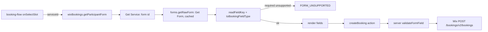

# 51 - Address and Composite Form Fields

Status: Implemented (2026-11-11), Phases 1a, 1b, 2; live checks L1 and L5 passed. Address support shipped in DL #52 (live QA L1–L12 passed 2026-11-17). The release gate was removed on 2026-11-17 by owner decision (see Implementation Results → Release gate removed).

Covers `@jay-framework/wix-forms` and `@jay-framework/wix-bookings`. Builds on DL #40 (per-form contracts), #41 (value store, `FieldValue`, multiselect), #44 (checkbox groups), #45/#46 (outcome enums), #47/#49 (security gate, `getFormSummary`, `canonicalFormId`, path-segment helper), #50 (submit allowlist) and #35 (bookings browser context). jay is used only through its public surface (`makeJayQuery`, contract YAML, `parseContract`, `JayHtmlValidatorFn`). Paths are relative to `packages/` unless stated.

**Dependency (met):** step-11 is merged to `main` (`2adbdcd`). It reads the service's form id from `form.id ?? form._id` (`participantFormId`, `wix-bookings/lib/utils/format.ts:34-37`, used at `:65`), so a custom participant form is loaded. It also treats the all-zero form id as "no form"; Phase 1b reverses that ([§3b](#3b-zero-form-id-reversal-phase-1b)).

## Decisions for the Implementer (TL;DR)

- **Classification is fail-closed and keyed on the observed Get Form tuple.** Only `form.formFields[]` is read (never the old-style `form.fields[]`). The key is `inputOptions.inputType` + `componentType` + `validation.format`, with `identifier` used only to tell long text (`TEXT_AREA`) from short text. One rule: **first matching row of the [classification table](#classification-table) wins.** Anything not in the table is unsupported.
- **Nothing is dropped silently.** Projection returns `{ fields, unsupportedFields }`. Every input field is in `fields`, in `unsupportedFields`, or ignored (display, no target; bookings also ignores hidden).
- **Blocking rule (everywhere):** block only on an unsupported field with `inputOptions.required: true`. An optional unsupported field is left out of the payload with a server/generation warning. Wix accepts a booking that leaves out a required field, address included (Phase 0, F6). It validates an address object per country only when one is sent (F8), and these phases never send the address, so blocking is the only guard.
- **Bookings reads Get Form from Phase 1b** through a new bookings query `wixBookings.getParticipantForm({ serviceId })` and a new forms-service method `WixFormsService.getRawForm(formId)`. The Summary API (no `required`) is deprecated.
- **The all-zero form id is a real form** (the site's default "Booking form", Phase 0, F4). From Phase 1b it is read through `getRawForm` / Get Form like any other id (proven by `default-form.json`). `DEFAULT_PARTICIPANT_FIELDS` is removed. step-11 merged with its zero → `''` mapping; **1b** changes it ([§3b](#3b-zero-form-id-reversal-phase-1b)). It never goes to Get Form Summary.
- **Bookings 1b renders `BOOLEAN` (single checkbox)** through the existing `formInputs` ref (`.checked`). Everything else bookings cannot render stays unsupported.
- **`FORM_UNSUPPORTED`:** new `bookingFailure` member after `UNKNOWN`. Default text: `This booking form has a required field this site cannot show yet: <labels>. Booking is disabled until the site is updated.`, built by `describeUnsupportedForm(labels: string[]): string` in `wix-bookings/lib/utils/booking-outcome.ts`.
- **🚦 Release gate (Q17, decided 2026-11-10: option b).** Phases 1a, 1b and 2 may merge to wix `main`, but **no `@jay-framework/wix-forms` or `@jay-framework/wix-bookings` release ships 1b until the address follow-up log's implementation ships and L6 passes**: a booking succeeds end to end for US, UK, Canada and Israel using Wix's own per-country parts and values. Reason: both the default form and the QA form have a required Address, and Wix shows a required State/Region/Province for US/UK/CA (F7), so 1b alone turns off most bookings. Enforced by a repo-root `RELEASE-BLOCKED.md` (added in 1b, deleted by the follow-up log's implementation after L6) that makes `scripts/publish.cjs` and the publish workflow exit non-zero, so **no package at all** publishes from `main` meanwhile. Hotfix path (the only release path meanwhile): a `hotfix/*` branch cut from tag `pre-dl51-gate` (`origin/main` tagged just before 1b merges; later hotfixes from the latest hotfix tag), deliberately ungated because it predates the gate code, then merged back to `main` right after the release (the merge keeps `RELEASE-BLOCKED.md`).
- **Address (Phase 3) is deferred to a follow-up design log** ([§5](#5-phase-3--deferred-to-a-follow-up-design-log)). Wix's address parts and subdivision lists depend on the country and differ from CLDR (Unicode Common Locale Data Repository) (F7). The QA address probe (F8) showed that Wix accepts only bare subdivision codes from its own list and validates the address per country. The follow-up log builds on F7 and F8; what is still open is listed in §5. In this log the address stays unsupported (row 13) everywhere.
- **Per-form 1a changes** (changelog): number, rating, file, signature, payment, appointment, service picker and enum-less choice fields stop rendering as text; required ones set `loadError`. Date-picker fields keep `'text'`.
- **Phase 0 is done** (live capture 2026-11-10; [Phase 0 results](#phase-0-results-live-2026-11-10)), and so is the QA address probe (F8). Fixtures are in `wix-forms/test/fixtures/form-kinds/`.
- **jay-feedback:** generation warnings, agent-kit updates (validator rule 6 for address part refs moves to the follow-up log). No validation for `FORM_UNSUPPORTED`: it depends on live Wix data.

## Background

wix-bookings shows a service's participant form by calling the public wix-forms query `getFormSummary({ formId })` (`wix-forms/lib/actions/forms-actions.ts:10-16`, called at `wix-bookings/lib/components/booking-flow.ts:219`). That calls Wix `GET /form-schema-service/v4/forms/{id}/summary` (`wix-forms/lib/wix-apis/get-form-summary.ts:21-30`) and projects it with `projectFormSummaryFields` (`wix-forms/lib/utils/project-form-fields.ts:114-132`), which keeps only `STRING`, `EMAIL`, `PHONE`, `NUMBER`, `URL` (`:119-122`) and reads a `required` that the Summary API never returns. Bookings renders every kept field as a text input (the `formFields` sub-contract binds each field to `formInputs`, an `HTMLInputElement`, `booking-flow.jay-contract:99-109`).

Per-form contracts (DL #40) project Get Form with `projectFormFields` (`project-form-fields.ts:79-112`). It iterates `rawForm.fields ?? rawForm.formFields` (`:83`), so today it reads the old-style `fields[]` array (`view.fieldType`, `validation.required`), and `readInputType` (`:58-77`) maps anything it does not recognise to `'text'`.

**QA, 2026-11-10 (live):** custom booking form `bbb199c4-…` on "QA Consultation". Wix shows 7 fields, with First name, Last name, Email and Address required. The bookings flow showed 5, none required. `createBooking` returned 200 without the address, and pay-in-person checkout succeeded.

## Problem

1. **Silent loss (bookings).** Wix's summary _does_ include the address (`type: MULTILINE_ADDRESS`, F3). Our `projectFormSummaryFields` drops it (`:119-122`), and the booking still succeeds.
2. **`required` is always false (bookings).** The Summary API has no `required` (F3), so `Boolean(field.required)` (`:127`) is always `false`.
3. **Wix does not enforce it either** (F6): a booking that leaves out a required field is not rejected, so bookings without the required address are accepted and checked out. A sent address is schema-validated per country (F8), but nothing makes the client send one.
4. **Misrepresentation (per-form).** `readInputType` turns a multi-line address, a file, a rating, etc. into a text input; the value is rejected or lost, and nothing warns at generation time.
5. **No address kind anywhere:** not in `FormFieldInputType` (`wix-forms/lib/types.ts:3-11`), `FieldValue` (`:21`), the contract builders (`wix-forms/lib/generators/contract-utils.ts:21-94`), `forms.yaml` (`buildFormsReference`, `wix-forms/lib/generators/forms-reference.ts:12-50`), validation (`project-form-fields.ts:157-200`), or the bookings contract (`wix-bookings/lib/contracts/booking-flow.jay-contract:99-109`).

## Prior Art / Adjacent Mechanisms

| Mechanism                                                | Where                                                                                                            | Use here                                                                                                   |
| -------------------------------------------------------- | ---------------------------------------------------------------------------------------------------------------- | ---------------------------------------------------------------------------------------------------------- |
| `FieldValue = string \| string[] \| boolean` (DL #41 4c) | `wix-forms/lib/types.ts:21`, `wix-apis/create-submission.ts:21-37`                                               | Widened to `string \| boolean` for bookings (1b); address values are the follow-up log's.                  |
| Repeated `options` sub-contract (DL #40, #41, #44)       | `contract-utils.ts:116-137`                                                                                      | Choice options (1a); address use is the follow-up log's.                                                   |
| Hidden fields marked, not dropped (DL #41 4a)            | `project-form-fields.ts:84-86`                                                                                   | Kept for per-form.                                                                                         |
| `loadError` form tag                                     | `contract-utils.ts:144`                                                                                          | Required unsupported field.                                                                                |
| `bookingFailure` + `describeBookingError` (DL #46)       | `booking-flow.jay-contract:138-142`, `wix-bookings/lib/utils/booking-outcome.ts`                                 | Extended: `FORM_UNSUPPORTED`.                                                                              |
| `getFormSchema` (Get Form call)                          | `wix-forms/lib/wix-apis/get-form.ts`                                                                             | Wrapped by the new `getRawForm`.                                                                           |
| `getBookingServiceById` (POST body, no id in path)       | `wix-bookings/lib/services/create-wix-bookings-service.ts:105`, `wix-bookings/lib/wix-apis/query-services.ts:63` | Resolves the form id; `createBooking` already calls it.                                                    |
| `canonicalFormId` + `formIdPathSegment` (DL #47, #49)    | `wix-forms/lib/utils/form-id.ts`                                                                                 | The form id from the service is canonicalised before Get Form. The all-zero id is a valid GUID and passes. |
| DL #49 §4 / DL #47 residual risk 3                       | DL #49                                                                                                           | Done here (Q3).                                                                                            |
| `wix-forms-bindings` validator (rules 1-5)               | `wix-forms/lib/validators/wix-form-bindings.ts`                                                                  | Unchanged here; an address rule belongs to the follow-up log.                                              |
| `parseSubmissionFieldErrors`                             | `project-form-fields.ts:202-226`                                                                                 | Unchanged here (address folding is the follow-up log's).                                                   |

## Phase 0 results (live, 2026-11-10)

Captured on the Premium test site with the testbed API key: Get Form for the QA booking form, the default form (`00000000-0000-0000-0000-000000000000`), a contact form, and the booking form with six extra kinds added in the dashboard; Get Form Summary for the booking form; and a `createBooking` with an off-list dropdown value. Copied to `wix-forms/test/fixtures/form-kinds/` (see [Fixtures](#fixtures)).

- **F1 Shape.** Each Get Form response carries **both** the documented `formFields[]` and the old-style `fields[]` (`view.fieldType` = identifier, `validation.required`). In `formFields[]`, an input field has only `id`, `hidden`, `identifier`, `fieldType`, `inputOptions`; a display field has `displayOptions` instead of `inputOptions`. `target`, `required`, `inputType` and one `<type>Options` object (holding `componentType`, `validation.format`/`enum`, and a `<component>Options` with `label`) sit under `inputOptions`. Required flags agree between the two arrays in every fixture, so today's per-form `required` works (the earlier "always false on per-form" worry is closed). Display order is `steps[0].layout.large.items[]` (`row`, `column`). Choice values: `stringOptions.validation.enum` / `arrayOptions.validation.items.stringOptions.enum`; they equal the `options[].value` lists in every fixture.
- **F2 Address.** `inputType: ADDRESS`, `addressOptions.componentType: MULTILINE_ADDRESS`, label in `multilineAddressOptions.label`. All eight parts under `addressOptions.validation.fields` are `required: true`, including `addressLine2`, which `multilineAddressOptions.fieldSettings.addressLine2.show: false` hides. `allowedCountries: []`.
- **F3 Summary.** Includes the address as `type: MULTILINE_ADDRESS`; no field has `required`.
- **F4 Default form.** The all-zero id returns 200: "Booking form", namespace `wix.bookings.v2.bookings`, the same 7 fields as the QA form (the QA form is its clone, `sourceFormId` = zero id), targets `first_name`, `last_name`, `phone`, `email`, `address`, `add_your_message`, Address required. No dotted `address.*` targets.
- **F5 Observed tuples** (booking form with all kinds, plus the contact form):

| identifier                                                         | inputType                    | componentType       | format           | required (QA) |
| ------------------------------------------------------------------ | ---------------------------- | ------------------- | ---------------- | ------------- |
| `BOOKINGS_HEADER`, `SUBMIT_BUTTON` (`fieldType: DISPLAY`)          | —                            | —                   | —                | —             |
| `BOOKINGS_FIRST_NAME`, `BOOKINGS_LAST_NAME`, `CONTACTS_FIRST_NAME` | `STRING`                     | `TEXT_INPUT`        | `UNKNOWN_FORMAT` | yes           |
| `BOOKINGS_EMAIL`, `CONTACTS_EMAIL`                                 | `STRING`                     | `TEXT_INPUT`        | `EMAIL`          | yes           |
| `BOOKINGS_PHONE`                                                   | `STRING`                     | `PHONE_INPUT`       | `PHONE`          | no            |
| `TEXT_AREA` (message, long answer)                                 | `STRING`                     | `TEXT_INPUT`        | `UNKNOWN_FORMAT` | no            |
| `BOOKINGS_ADDRESS`                                                 | `ADDRESS`                    | `MULTILINE_ADDRESS` | —                | yes           |
| `CHECKBOX`                                                         | `BOOLEAN`                    | `CHECKBOX`          | —                | contact: yes  |
| `DROPDOWN`                                                         | `STRING`                     | `DROPDOWN`          | `UNKNOWN_FORMAT` | no            |
| `DATE_PICKER`                                                      | `STRING`                     | `DATE_PICKER`       | `DATE`           | no            |
| `CHECKBOX_GROUP`                                                   | `ARRAY` (`itemType: STRING`) | `CHECKBOX_GROUP`    | —                | contact: yes  |
| `FILE_UPLOAD`                                                      | `WIX_FILE`                   | `FILE_UPLOAD`       | —                | no            |

- **F6 Wix Bookings validation.** An off-list dropdown value is rejected (`400 NOT_ALLOWED_VALUE_ERROR`, `allowedValues` listed); the same request with `"Option 1"` returns 200. A required field that is **left out** is not rejected: bookings without the address are accepted and go through checkout. An address that **is** sent is validated per country (F8).
- **F7 Wix-hosted address rendering** (dashboard preview of the QA form, read-only, round 12 review; videos `qa-22*-2026-11-10.webm` in the workspace root). Parts depend on the selected country: none selected → Country/Region, Address, City, Zip; **US** → Address, City, State, Zip (State has 54 options: 50 states, DC, AA/AE/AP Armed Forces; no PR, GU, VI, AS, MP, UM); **UK** → Address, City, Region, Zip (4: ENG, NIR, SCT, WLS); **Canada** → Address, City, Province, Zip (13); **Israel** → Street name, House number, City, Zip, no subdivision. All shown parts are marked required. Option ids end in bare codes (`…option-AL`, `…option-ENG`). Choosing a country made no API request (only `form-multiline-address.chunk.min.js` loaded). Not checked: every other country, and the value Wix submits.
- **F8 QA address probe** (live, 2026-11-10 evening; report `reviews/qa-address-probe-2026-11-11.md`; videos `qa-22*-2026-11-10.webm` and `qa-23-address-probe-live-2026-11-10.webm` in the workspace root; fixtures `address-parts-by-country.json` and `address-create-booking-probe.json`). 16 `POST /bookings/v2/bookings` variants on the QA service, each with a full address:
  - **Subdivision values are bare codes from Wix's own list.** Accepted: `AL`, `AA` (US), `ENG` (GB), `ON` (CA). Rejected with `400 NOT_ALLOWED_VALUE_ERROR`: ISO forms (`US-AL`, `US-AA`, `GB-ENG`, `CA-ON`), a label (`Alabama`), `PR` / `US-PR`, and a bogus `XX`. The accepted set is the list F7 shows, not ISO 3166-2 or CLDR.
  - **A sent address is validated per country** (schema-style, located `fieldName` `address/<part>`). US without `subdivision` → `REQUIRED_VALUE_ERROR` `address/subdivision`. IL with `addressLine` → `REQUIRED_VALUE_ERROR` for `address/streetName` and `address/streetNumber`, plus `UNKNOWN_VALUE_ERROR` "must NOT have additional properties" for `address/addressLine`. IL with `subdivision` → the same `UNKNOWN_VALUE_ERROR` for `address/subdivision`. Leaving the address out entirely is still accepted (F6).
  - **Only the parts Wix shows need to be sent.** US / GB / CA were accepted with `country`, `subdivision`, `city`, `postalCode`, `addressLine` (no `addressLine2`, `streetName`, `streetNumber`); IL with `country`, `city`, `postalCode`, `streetName`, `streetNumber`. F2's flat `required: true` on all eight parts is the union over countries, not per-country truth.
  - **Stored shape (Q10).** Wix copies the address into `booking.contactDetails.fullAddress` and adds `formattedAddress`. US / GB / CA: the bare `subdivision` code, `addressLine`, and `formattedAddress` containing the code (`"600 Dexter Ave, Montgomery, AL, 36104, US"`). IL: `streetAddress: { name, number, apt }`, no `subdivision` (`"Rothschild 1, Tel Aviv, 6100000, IL"`).
  - **Get Form has no per-country data.** Both forms have `allowedCountries: []`, one flat `required` per part, and only `addressLine2.show: false` in `fieldSettings`. The layout (which parts each country shows) lives only in Wix's client bundle.
  - **The `400` lists the allowed codes.** Every `NOT_ALLOWED_VALUE_ERROR` carries `formViolations[].data.allowedValues`, and for US (54), GB (4) and CA (13) it equals the option list Wix's form shows (checked with `jq` against `address-parts-by-country.json`). So the API is a runtime source of a country's **codes** (from an error response), though not of its **layout** or labels. The report's "no per-country data anywhere in the API" holds for Get Form only.
  - Not covered: Wix's own submitted payload (the headless site has no Wix booking page), Create Submission (the per-form path), and network traces for GB, CA and IL (US only).

## Classification table

Input: one `FieldKey` per `formFields[]` entry (below). **First matching row wins, top to bottom; there is no other precedence rule** — except row 3, which is a **modifier, not a terminal row**: per-form sets `hidden` and continues to rows 3a-14; bookings skips the field (`getParticipantForm` checks `key.hidden` before calling `toBookingFieldType`). Unsupported = in `unsupportedFields`; blocks when `required`, otherwise omitted with a warning. `format` missing is read as `UNKNOWN_FORMAT` (the documented default). A row needs every listed key to match exactly.

| #   | Match                                                                                                                                                                       | Per-form 1a (`classifyFormField`)                            | Bookings 1b (`toBookingFieldType`)              | Today                                |
| --- | --------------------------------------------------------------------------------------------------------------------------------------------------------------------------- | ------------------------------------------------------------ | ----------------------------------------------- | ------------------------------------ |
| 1   | `fieldType: DISPLAY`                                                                                                                                                        | ignored                                                      | ignored                                         | absent                               |
| 2   | no `target`                                                                                                                                                                 | ignored; required → generation warning                       | ignored + server warning                        | kept under `id`                      |
| 3   | `hidden: true`                                                                                                                                                              | marked `hidden` (DL #41 4a), then rows 3a-14 decide the kind | ignored + server warning (no `control` channel) | —                                    |
| 3a  | `readOnly: true` (`inputOptions.readOnly`; false/null in every fixture)                                                                                                     | unsupported                                                  | unsupported                                     | rendered editable                    |
| 4   | `STRING` + `TEXT_INPUT` + `UNKNOWN_FORMAT` + identifier `TEXT_AREA`                                                                                                         | `'textarea'`                                                 | `'STRING'`                                      | text                                 |
| 5   | `STRING` + `TEXT_INPUT` + `UNKNOWN_FORMAT`                                                                                                                                  | `'text'`                                                     | `'STRING'`                                      | text                                 |
| 6   | `STRING` + `TEXT_INPUT` + `EMAIL`                                                                                                                                           | `'email'`                                                    | `'EMAIL'`                                       | rendered                             |
| 7   | `STRING` + `TEXT_INPUT` + `URL` (documented format, not observed)                                                                                                           | `'url'`                                                      | `'URL'`                                         | rendered                             |
| 8   | `STRING` + `PHONE_INPUT` + `PHONE`                                                                                                                                          | `'tel'`                                                      | `'PHONE'`                                       | rendered                             |
| 9   | `STRING` + `DROPDOWN` or `RADIO_GROUP` (documented, not observed) + `UNKNOWN_FORMAT` + non-empty enum + no `customOption` (a custom option allows off-enum values → row 14) | `'select'`                                                   | unsupported                                     | free text (Wix rejects off-list, F6) |
| 10  | `STRING` + `DATE_PICKER` + `DATE`                                                                                                                                           | `'text'` (as today; Wix validates `DATE`)                    | unsupported                                     | dropped                              |
| 11  | `BOOLEAN` + `CHECKBOX`                                                                                                                                                      | `'checkbox'`                                                 | `'BOOLEAN'` (`.checked`)                        | dropped                              |
| 12  | `ARRAY` + `CHECKBOX_GROUP` + `itemType` `STRING` + non-empty enum + no `customOption` (as row 9 → row 14)                                                                   | `'multiselect'`                                              | unsupported                                     | dropped                              |
| 13  | `ADDRESS` + `MULTILINE_ADDRESS`                                                                                                                                             | unsupported (until the follow-up log, §5)                    | unsupported (until the follow-up log, §5)       | dropped                              |
| 14  | anything else                                                                                                                                                               | unsupported                                                  | unsupported                                     | varies                               |

Row 14 includes every documented kind not observed here (`NUMBER`, rating, `WIX_FILE`, signature, `PAYMENT`, `SCHEDULING`, `OBJECT`, `PASSWORD`, `SERVICES_DROPDOWN`, `DATE_INPUT`, `TIME_INPUT`, `DATE_TIME`, tags, enum-less choices), a missing `inputType`, and any unknown name. Adding one later is a new row plus a fixture field. `identifier` never makes a field supported on its own: rows 4-5 need `TEXT_INPUT`, so a namespace-specific identifier (`BOOKINGS_*`, `CONTACTS_*`) needs nothing listed.

```ts
// wix-forms/lib/utils/classify-form-field.ts (exported; used by wix-bookings)
export interface FieldKey {
  id: string;
  fieldType: 'INPUT' | 'DISPLAY';
  identifier?: string;
  target?: string;
  hidden: boolean;
  readOnly: boolean; // inputOptions.readOnly ?? false
  customOption: boolean; // customOption != null on stringOptions.dropdownOptions, stringOptions.radioGroupOptions or arrayOptions.checkboxGroupOptions (documented on all three as an object { label?, placeholder? }; Wix enables the custom option when the object is present; the live dropdown and checkbox group in the fixtures carry none)
  required: boolean; // inputOptions.required ?? false
  inputType?: string; // inputOptions.inputType
  componentType?: string; // inputOptions.<type>Options.componentType
  format: string; // <type>Options.validation.format ?? 'UNKNOWN_FORMAT'
  itemType?: string; // arrayOptions.validation.items.itemType
  enumValues: string[]; // stringOptions.validation.enum / arrayOptions.validation.items.stringOptions.enum
  label: string; // <type>Options.<component>Options.label (string or rich content, as today)
}
export function readFieldKey(raw: RawFormField): FieldKey;
export type FieldIgnoreReason = 'display' | 'no-target';
export function ignoreReasonOf(key: FieldKey): FieldIgnoreReason | undefined; // rows 1-2
export function classifyFormField(key: FieldKey): FormFieldInputType | undefined; // rows 4-14; undefined = unsupported
export function wixKindOf(key: FieldKey): string; // "<inputType>/<componentType>[/<format>]"; "/<format>" omitted when UNKNOWN_FORMAT; a missing part reads "?"

// wix-bookings/lib/utils/participant-form.ts
export function toBookingFieldType(key: FieldKey): BookingFormFieldView['type'] | undefined; // rows 4-14

// wix-forms/lib/utils/read-field-view.ts (exported; used by wix-bookings) — non-key view data
export interface FieldViewData {
  placeholder: string; // stringOptions.<component>Options.placeholder ?? ''
  minLength?: number; // stringOptions.validation.minLength
  maxLength?: number; // stringOptions.validation.maxLength
  pattern?: string; // stringOptions.validation.pattern
  options: FormFieldOptionView[]; // key.enumValues, each labelled from the options list
}
export function readFieldView(raw: RawFormField, key: FieldKey): FieldViewData;
```

**Read rules** (`readFieldKey` / `readFieldView`): `<component>Options` = camelCase of `componentType` + `Options` (`TEXT_INPUT` → `textInputOptions`, `PHONE_INPUT` → `phoneInputOptions`, `DATE_PICKER` → `datePickerOptions`, `FILE_UPLOAD` → `fileUploadOptions`, `MULTILINE_ADDRESS` → `multilineAddressOptions`; holds for every fixture kind). `label` falls back to `target`, then `id`, when missing (as today). F5's `—` format means `'UNKNOWN_FORMAT'`.

`readFieldView` paths (under `inputOptions`):

| Member                                | Path                                                                                                                                                                                                          | Fixture evidence                                                                                                    |
| ------------------------------------- | ------------------------------------------------------------------------------------------------------------------------------------------------------------------------------------------------------------- | ------------------------------------------------------------------------------------------------------------------- |
| `placeholder`                         | `stringOptions.<component>Options.placeholder`                                                                                                                                                                | documented; absent from every fixture field (both arrays, checked with `jq`)                                        |
| `minLength` / `maxLength` / `pattern` | `stringOptions.validation.{minLength,maxLength,pattern}`                                                                                                                                                      | documented; absent from every fixture field                                                                         |
| option values                         | `key.enumValues` (Q12)                                                                                                                                                                                        | `DROPDOWN` → `["Option 1","Option 2"]`; contact `CHECKBOX_GROUP` → `["News","Offers","Events"]`                     |
| option labels                         | `stringOptions.dropdownOptions.options[]` / `stringOptions.radioGroupOptions.options[]` / `arrayOptions.checkboxGroupOptions.options[]`, `{ value, label }` matched by `value`; label falls back to the value | `dropdownOptions.options[].label` (all-kinds, contact), `checkboxGroupOptions.options[].label` (all-kinds, contact) |

An options-list entry whose `value` is not in `enumValues` is dropped (the enum is what Wix accepts, F6). `readFieldView` is called only for supported fields; it never affects classification.

`RawFormField` (`wix-apis/get-form.ts:13-47`) is replaced by the documented shape (`id`, `fieldType`, `identifier`, `hidden`, `inputOptions.{target, required, inputType, stringOptions, booleanOptions, arrayOptions, addressOptions, wixFileOptions, numberOptions}`); `GetFormResponse.form` gains `formFields`, `steps`. The old top-level `target` / `view` / `validation` members and `form.fields` are removed. Callers read `readFieldKey(raw)` once per field and pass the key on (plus `readFieldView(raw, key)` for supported fields). `deletedFormFields` is never iterated.

**Field type and options objects (F1 corrected):** an `INPUT` field carries `inputOptions`; a `DISPLAY` field carries `displayOptions` instead (`displayFieldType` + `richContentOptions` / `pageNavigationOptions`) and is never read past row 1. `readFieldKey` maps any `fieldType` other than `'DISPLAY'` (unknown or missing) to `'INPUT'`; with no usable `inputOptions` it lands in row 14 (fail-closed). The contact `CHECKBOX` carries `booleanOptions.validation.enum: [true]`; row 11 ignores the boolean enum.

**Blast radius of Phase 1b** (bookings that flip from booking to `FORM_UNSUPPORTED`): forms with a required field in rows 9, 10, 12, 13, 14. **This includes every form with the default required Address** (F4), so today it is most bookings forms (Q17). Required dropdowns cost little: Wix already rejects a free-text value that is not an option (F6). A required consent checkbox does not flip (row 11).

**Per-form 1a behaviour changes** (changelog): row 14 kinds no longer render as text (required ones set `loadError`); enum-less dropdowns and checkbox groups become unsupported; required untargeted fields warn. Reading `formFields` instead of `fields` changes no `required` value (F1). `placeholder`, `minLength`, `maxLength` and `pattern` are no longer read from old-style `view.placeholder` / `validation.string.*`, only from the `readFieldView` paths; a form that set them only in the old-style array loses them (none of the fixtures sets them in either array). Option labels come from the options list, not `readFieldOptions`.

## Questions and Answers

**Q1. What counts as "supported"?**
A: The projection can render the field and submit the value shape Wix expects for its `inputType`. The [classification table](#classification-table) is the definitive list per consumer.

**Q2. Block on an optional unsupported field?**
A: No. Block only when `required`; omit and warn otherwise. Conditional required (`rules[]`, empty in all fixtures) is not evaluated; accepted gap.

**Q3. Should bookings read Get Form through a bookings-owned query?**
A: Yes, in 1b. `required` exists only there, and it moves the form-id choice to the server (DL #49 §4). DL #47 residual risk 3 (public `getFormSummary`) is retired only when `getFormSummary` is removed (next minor). Cost, accepted: one **uncached** Get Service call per anonymous `getParticipantForm` request (the same amplification class as risk 3, bounded to one call per request); Get Form is cached (§3a).

**Q4. New `bookingFailure` member or reuse `FORM_UNAVAILABLE`?**
A: New `FORM_UNSUPPORTED`: "the site must be updated", not "try again". Appended after `UNKNOWN`.

**Q5. Generation error or warning for an unsupported per-form field?**
A: Warning; an error would stop `jay-stack agent-kit` for the whole site. Runtime `loadError` covers the required case.

**Q6. Which address parts are rendered, and which `required` flags count?**
A: Deferred to the follow-up log (§5). F7 shows the parts depend on the country (Israel shows `streetName` / `streetNumber`, not `addressLine`; US/UK/CA add a subdivision), so a fixed part list is wrong. The round 6-11 answer (one fixed list, street parts "never rendered") is withdrawn.

**Q7. How do whole-field and per-part `required` combine?**
A: Deferred to the follow-up log (§5); which parts are required per country is one of its open questions.

**Q8. Bookings contract for an address?**
A: Deferred to the follow-up log (§5). A per-country part set probably needs a repeated `parts` list on both contracts; the `parseContract` fixture is its first task.

**Q9. Country names?**
A: Deferred to the follow-up log (§5), together with the country list's source.

**Q10. Does Wix Bookings accept the address object and copy it into `contactDetails.fullAddress`?**
A: Yes, for bookings (F8). An address that passes Wix's per-country check is stored in `booking.contactDetails.fullAddress` with a `formattedAddress`. US / GB / CA keep the bare `subdivision` code and `addressLine`; IL stores the street as `streetAddress: { name, number, apt }` with no `subdivision`. Not probed for Create Submission (per-form).

**Q11. Online payment path?**
A: Deferred to the follow-up log (§5); L6 includes one online payment.

**Q12. Which raw shape does Get Form return?**
A: Settled by F1: both arrays are present; we read `formFields[]` only. Its tuple is richer (component, format, identifier), and it is the documented one. **List Forms** (used by `listForms`, `wix-forms-service.ts:46`) also returns `formFields[]`: verified by L0 on 2026-11-10 (identical to the Get Form fixture), so the `getRawForm`-per-id fallback is not needed.

**Q13. `UnsupportedFieldView.required` for summary entries?**
A: `required: boolean | 'unknown'`; the deprecated summary path sets `'unknown'`, which never blocks.

**Q14. Does Phase 2 re-validation add Wix calls?**
A: No extra Get Service call (`createBooking` already calls `getBookingServiceById`, `wix-bookings/lib/services/create-wix-bookings-service.ts:105`); the schema comes from the §3a cache. Fetch failure → `FORM_UNAVAILABLE`, Wix not called.

**Q15. Is `getParticipantForm({ serviceId })` safe as a public query?**
A: `serviceId` goes only into the POST body of `/bookings/v2/services/query`. The form id comes only from the service, passes `canonicalFormId`, and Get Form builds its path with `formIdPathSegment`. The input type is `{ serviceId: string }` only. The result exposes what the Wix-hosted form shows any visitor, plus `required`.

**Q16. Why does the all-zero id go through Get Form?**
A: F4: it is the site's default form, with a required Address. Treating it as "no form" (step-11) renders built-in First/Last/Email and loses the address on every default-form service. Reading it like any form also gives the real targets (`first_name`, … per F4), so `DEFAULT_PARTICIPANT_FIELDS` (`booking-flow.ts:42-46`) goes away. The change ships in 1b, not step-11: until 1b the only reader is `getFormSummary`, and no Summary capture of the zero id exists (step-11's own test says it would fail).

**Q17. How do we release 1b when the default Address is required with a required `subdivision`?**
Options:

- (a) Release 1b as designed: every such form shows `FORM_UNSUPPORTED` until a subdivision follow-up ships. Honest, but turns off most online bookings.
- (b) Hold 1b's release until Phase 3b (withdrawn Phase 3 numbering) plus a subdivision follow-up (ISO 3166-2 per-country data, own log). Bookings keeps losing the address until then.
- (c) In 3b (withdrawn Phase 3 numbering), render `subdivision` as free text when required and let Wix judge it (F6 suggests Wix validates value shapes). Depends on L2, which records whether Wix accepts or rejects a free-text subdivision.
  Recommendation: (b) for the release, and run L2 early (it only needs a `curl`) to see whether (c) is viable. 1a, 1b and 2 can still merge to `main` without a release.
  A (user, 2026-11-10): **(b).** 1a, 1b and 2 may merge to wix `main`. No `@jay-framework/wix-forms` or `@jay-framework/wix-bookings` package is published with 1b until address support works end to end in bookings, **including `subdivision`**. Amended after round 12 (F7): the address work, subdivision included, moves to a follow-up design log (§5), and the gate's exit check is L6. (c) stays open for the follow-up log to decide. Updated after round 13 (F8): what Wix accepts is now known. A free-text subdivision is rejected unless it is a bare code from Wix's list, and the rejection is located (`address/subdivision`) and lists `allowedValues`. So (c) works only if the follow-up log maps Wix's located errors back to the part (via `parseSubmissionFieldErrors`); free text alone would turn most visitor input into a `400`.

**Q18. Where does the subdivision list come from?**
A: The choice of source is deferred to the follow-up log (§5); where Wix keeps them is answered (F8). The round 6-11 answer (a CLDR snapshot) is withdrawn: Wix's lists differ from CLDR (F7). The form schema carries no per-country data, Wix docs document no listing API (checked: Form Schemas, Form Submissions, Create Booking, Locations, eCommerce shipping docs), and choosing a country in the Wix form made no API request: the layout and lists live in Wix's client bundle. The only API that returns codes is Create Booking's `400` (`formViolations[].data.allowedValues`), which gives a country's codes but not its layout or labels. Candidate sources for the follow-up log: a table derived from the committed fixtures (licence/ownership open, §5) or that runtime `allowedValues`.

**Q19. What if the selected country has no subdivisions?**
A: Deferred to the follow-up log (§5). F7: Wix shows no subdivision part for Israel, so the answer must key on Wix's per-country layout.

## Design

### 1. Projection returns both lists (Phase 1a) — `wix-forms/lib/utils/project-form-fields.ts`

```ts
// types.ts
export interface UnsupportedFieldView {
  target: string;
  label: string;
  wixKind: string; // wixKindOf(key), or the Summary type
  required: boolean | 'unknown'; // 'unknown' only from the deprecated Summary path (Q13)
}
export interface ProjectedForm<F> {
  fields: F[];
  unsupportedFields: UnsupportedFieldView[];
}
```

- `projectFormFields(rawForm): ProjectedForm<FormFieldView>` iterates `formFields` only, in layout order (`steps[0].layout.large.items` by `row`, then `column`; fields without a layout item last; layout items whose `fieldId` is not in `formFields[]` are skipped, e.g. `…-000000000011`, the `BOOKINGS_LOGIN_BAR` that exists only in old-style `fields[]` of `booking-form.json` / `default-form.json`). `readFieldKey` → `ignoreReasonOf` → `classifyFormField` → `readFieldView` for supported fields. Callers: `listForms` (`wix-forms-service.ts:46`), `getFormFields` (`:59`). `ListedFormView` (`types.ts:55-59`) gains `unsupportedFields`.
- `getFormFields` and `getFormSummaryFields` (`:60-62, 74-76`) throw only when **both** lists are empty.
- `projectFormSummaryFields(fields): ProjectedForm<FormFieldSummaryView>`: the filter at `:118-122` becomes a partition (kept types as today; others unsupported with `required: 'unknown'`; untargeted ignored, no `?? field.id`). Deprecated in 1b. The service logs once per form id: `[wix-forms] Form <id>: fields not supported and not returned: Multi-line address (MULTILINE_ADDRESS).`

### 2. Per-form contracts fail visibly (Phase 1a) — `wix-forms`

- `form-contract-generator.ts:24-34`: per unsupported field, `console.warn('[wix-forms] Form "<name>": field "<target>" (<label>, <wixKind>) is not supported and was left out of form/<slug>.')`; the contract `description` gains `Unsupported fields left out: <labels>.` Required untargeted field: `[wix-forms] Form "<name>": required field "<label>" has no target in Wix and cannot be submitted.`
- `generators/forms-reference.ts:18-26` (`buildFormsReference`, called from `setup.ts:89`): each form in `forms.yaml` gains `unsupportedFields: [{ target, label, wixKind, required }]`. The fixture test `test/forms-reference.test.ts` with `test/fixtures/forms-reference/expected-forms.yaml` gets a form with an unsupported field and the expected `unsupportedFields` entry, written first (red).
- Runtime: a required unsupported field → slow render (`renderSlowlyChanging`, `wix-forms/lib/components/wix-form.ts:70-88`) sets `loadError` = `This form has a required field this site cannot show: <label>.` **Fail-closed: no fields render next to it** — the view state is `buildFormViewState([], { …, loadError })` and the carry-forward holds `fields: []`, exactly as the existing load-failure branch (`:79-86`) does, so the visitor cannot fill a form that can never submit; `runSubmission` (`submission/run-submission.ts:78-90`) returns `REJECTED` without calling Wix. `SubmitDeps` gains `unsupportedFieldsOf(formId: string): Promise<UnsupportedFieldView[]>`, backed by the `listForms` cache, called after the allowlist check with the canonical id.

### 3. Bookings reads Get Form (Phase 1b, after step-11) — `wix-bookings`

```ts
// wix-forms/lib/services/wix-forms-service.ts — new
/** The unprojected Get Form schema. Canonicalises the id (throws 'Form ID is not a valid Wix form id.'),
 *  throws 'Form schema missing from Wix response' when Wix returns no form. Never throws for "no fields". */
getRawForm(formId: string): Promise<RawForm>; // RawForm = NonNullable<GetFormResponse['form']>
// getFormFields(formId) becomes projectFormFields(await getRawForm(formId)) + the both-empty throw.

// wix-bookings/lib/actions/bookings-actions.ts
export const getParticipantForm = makeJayQuery('wixBookings.getParticipantForm')
    .withServices(WIX_BOOKINGS_SERVICE, WIX_FORMS_SERVICE)
    .withHandler(async ({ serviceId }: { serviceId: string }, bookings, forms):
        Promise<ProjectedForm<BookingFormFieldView>> => bookings.getParticipantForm(serviceId, forms));

// WixBookingsService
getParticipantForm(serviceId: string, forms: WixFormsService): Promise<ProjectedForm<BookingFormFieldView>>;
```

- `getParticipantForm`: `getBookingServiceById` → `participantFormId(service.form)` → `canonicalFormId` (invalid → `FORM_UNAVAILABLE`, no Get Form call) → cached `forms.getRawForm` (§3a) → `readFieldKey` → `ignoreReasonOf` → skip if `key.hidden` (row 3) → `toBookingFieldType` per field, layout order. Hidden fields: `[wix-bookings] Form <id>: hidden field "<label>" is ignored; bookings cannot fill hidden fields.` ("required hidden field" when required). A service with no form at all (`participantFormId` returns `''`) → `FORM_UNAVAILABLE` (the docs say every service has one; never observed otherwise). Failure channel: `getParticipantForm` **throws** on an invalid form id, a missing form (`''`) and a Get Service / Get Form failure (its result type has no failure member); the client's existing catch (`booking-flow.ts:228-232`) maps any throw to `FORM_UNAVAILABLE` (test 8a). Unlike `createBooking` (§4), nothing here is returned as an outcome.
- `BookingFormFieldView` after 1b (`wix-bookings/lib/types.ts`): `{ target; label; type: 'STRING' | 'EMAIL' | 'PHONE' | 'URL' | 'BOOLEAN'; required; longText: boolean } & FieldViewData` (`'NUMBER'` goes: row 14; `longText` is `true` only when the key matched row 4, set by `getParticipantForm`). To call `validateFormField(field: FormFieldView, value)`, bookings maps `type` → `inputType`: `STRING` → `'textarea'` if `view.longText`, else `'text'`; `EMAIL` → `'email'`; `PHONE` → `'tel'`; `URL` → `'url'`; `BOOLEAN` → `'checkbox'`, via `toFormFieldView(view: BookingFormFieldView): FormFieldView` in `participant-form.ts`.
- `BookingFormFieldView.type` gains `'BOOLEAN'`. `readFormValues` (`booking-flow.ts:238-252`) returns `Record<string, string | boolean>` and reads `.checked` for `BOOLEAN`. The `createBooking` input type is written inline twice today (`wix-bookings/lib/actions/bookings-actions.ts:33-46` and `wix-bookings/lib/services/wix-bookings-service-marker.ts:17-30`); 1b extracts it into an exported `CreateBookingInput` in `wix-bookings/lib/types.ts`, used by both files, and its `formValues` widens to `Record<string, string | boolean>` there (address values in the follow-up log).
- `booking-flow.ts:213-227` calls `getParticipantForm({ serviceId: service.id })`; `DEFAULT_PARTICIPANT_FIELDS` and its branch are deleted. A required unsupported entry → `failBooking(FORM_UNSUPPORTED, describeUnsupportedForm(...))`, `setShowForm(false)`. `validateFormSummaryField` is replaced by wix-forms' `validateFormField`.
- Contract `booking-flow.jay-contract:140`: enum gains `FORM_UNSUPPORTED` last.
- Deprecated: `wixForms.getFormSummary`, `projectFormSummaryFields`, `validateFormSummaryField`, `FormFieldSummaryView` (`@deprecated`, one-time server warning, changelog). Removal is a tracked task for the next minor.

✅ `<p if="flow.bookingFailure === FORM_UNSUPPORTED">Online booking is unavailable for this service. Please call us.</p>`
❌ Showing 5 of 7 fields and confirming a booking without the required address (today).

#### 3a. Participant-form cache

Owner: the bookings service instance (shared by `getParticipantForm` and `createBooking`). Key: canonical form id (the all-zero id is its own canonical form). Value: `Promise<RawForm>` (concurrent callers share one call). Time-to-live: `SLOW_RENDER_TTL * 1000` ms (`wix-bookings/lib/slow-render-defaults.ts:9`, which is in seconds). A rejected promise is evicted. Get Service is not cached here.

#### 3b. Zero form id reversal (Phase 1b)

step-11 merged as is (`main` `2adbdcd`): its zero → `''` mapping keeps default-form services on `DEFAULT_PARTICIPANT_FIELDS` and never sends the zero id to Get Form Summary (untested for that id). In the **same 1b change** that removes `DEFAULT_PARTICIPANT_FIELDS` and switches to `getParticipantForm`, these step-11 files change:

- `wix-bookings/lib/utils/format.ts` `participantFormId(form)`: becomes `return form?.id ?? form?._id ?? ''`. Remove `DEFAULT_FORM_ID` and the `id === DEFAULT_FORM_ID ? '' : id` mapping. Doc comments on both: the all-zero id is the site default form, a real form read through Get Form; `''` means the service has no form at all.
- `wix-bookings/test/format.test.ts` (the "should treat the all-zero form id as no form" case and its "Gap/Expected" comment): becomes "zero id → zero id" (test 18).
- `wix-bookings/test/bookings-references.test.ts:22` (`services[1]?.formId` `toBe('')`): flips to the zero id, because `wix-bookings/lib/generators/bookings-references.ts:23` then lists it (correct, it is one).
- `wix-bookings/agent-kit/plugin/wix-bookings-troubleshooting.md` (the "all-zero id … means the site default form: the plugin then shows its …" line): the zero id is the site default "Booking form", read like any form; a required field it cannot show gives `FORM_UNSUPPORTED`.
- Same guide, line "`formId` in `agent-kit/references/wix-bookings/services.yaml` is empty for those default-form services": remove; the zero id is now listed as the form.
- Same guide, line "Fields show `required: false` even when Wix requires them: the Form Summary API does not carry `required`. …": rewrite; bookings reads Get Form, so `required` is real. Keep the point that `createBooking` does not enforce it (Phase 2 re-validates).
- Same guide, line 40, "Bookings loads participant fields via `getFormSummary` from `@jay-framework/wix-forms`:": becomes "via `wixBookings.getParticipantForm` (Get Form)".
- Same guide, the "**Known gap — fields are dropped:** only text, email, phone, number and URL fields are shown. … Do not put address or other non-text fields on a booking form until this is fixed" item (lines 53-56 on `main`; the review cited 49-52): becomes the `FORM_UNSUPPORTED` explanation — a required field bookings cannot show disables booking with `FORM_UNSUPPORTED`; an optional one is left out with a server warning. The follow-up address log then adds address.
- Other step-11 lines that still name `getFormSummary` as the bookings path, rewritten to `wixBookings.getParticipantForm` (Get Form, real `required`): `wix-bookings/agent-kit/plugin/wix-bookings-setup.md:15,133`; `wix-bookings/docs/01-setup-and-troubleshooting.md:12`; `wix-forms/agent-kit/plugin/wix-forms-setup.md:1,10,106-117` (lines 1 and 10 describe `getFormSummary` as the shared participant-schema action for wix-bookings; at 106-117 drop "`required` is always `false`"; mark `getFormSummary` deprecated); `wix-forms/agent-kit/plugin/user-visible-messages.md:70`.

### 4. Server re-validation (Phase 2) — `wix-bookings`

```ts
// WixBookingsService
createBooking(input: CreateBookingInput, forms: WixFormsService): Promise<CreateBookingOutcome>; // CreateBookingInput from 1b (§3); CreateBookingOutcome is the existing type, extended below
// actions/bookings-actions.ts
export const createBooking = makeJayAction('wixBookings.createBooking')
    .withServices(WIX_BOOKINGS_SERVICE, WIX_FORMS_SERVICE)
    .withHandler(async (input: CreateBookingInput, bookings, forms) => bookings.createBooking(input, forms));
```

`createBooking` (`wix-bookings/lib/actions/bookings-actions.ts:29`) runs these checks **in this order**, stopping at the first that fails:

1. **Resolve the form** from the service it already fetches and the §3a cache. Get Service / Get Form failure, a missing service or an invalid form id → `formUnavailable` / `FORM_UNAVAILABLE`.
2. **Any required unsupported field** → `formUnavailable` / `FORM_UNSUPPORTED`. This runs before field validation, so a form with a required address never yields `invalid`, whatever the visitor sent.
3. **`validateFormField` per supported field** → `invalid` with every failing field in `fieldErrors`.
4. **Drop the keys** that are not supported targets (unsupported fields, optional or not, and unknown keys), then call Wix.

Form problems are **returned, never thrown** (a throw reaches `describeBookingError`, which matches message substrings only and would give `UNKNOWN`):

```ts
// wix-bookings/lib/types.ts — CreateBookingOutcome (types.ts:30) gains two members
export type CreateBookingOutcome =
  | { outcome: 'confirmed'; orderId?: string }
  | { outcome: 'redirect'; redirectUrl: string }
  | { outcome: 'invalid'; fieldErrors: Record<string, string> } // key = field target, value = validateFormField message; ≥1 entry
  | {
      outcome: 'formUnavailable';
      failure: 'FORM_UNSUPPORTED' | 'FORM_UNAVAILABLE';
      message: string;
    };
```

- Step 2: `message` = `describeUnsupportedForm(labels)`. Step 1: Get Service / Get Form failure, a missing service (`getBookingServiceById` returns no service, `create-wix-bookings-service.ts:106-113`) or invalid form id → `formUnavailable` / `FORM_UNAVAILABLE`. Wix is not called in either case. Wix errors after validation still throw, as today.
- `create-booking.jay-action` `outputSchema`:

```yaml
outputSchema:
  outcome: enum(confirmed | redirect | invalid | formUnavailable)
  orderId?: string
  redirectUrl?: string
  fieldErrors?: object
  failure?: enum(FORM_UNSUPPORTED | FORM_UNAVAILABLE)
  message?: string
```

- `booking-flow.ts` `onConfirmBooking` (`:254`; `createBooking` call at `:276`, result handling at `:289-298`, which becomes a `switch (result.outcome)`): `redirect` / `confirmed` as today; `invalid` → `failBooking(VALIDATION, fieldErrors[<first target in formFields order that has an entry>])` (bookings `formFields` has no per-field `error` tag today; adding one is out of scope); if no entry's target is in `formFields`, `failBooking(VALIDATION, Object.values(fieldErrors)[0])`; `formUnavailable` → `failBooking(BookingFailure[result.failure], result.message)`, `setShowForm(false)`. Exhaustive (`never` default).

### 5. Phase 3 — deferred to a follow-up design log

Address support (per-form and bookings, subdivision included) is **not designed in this log**. The round 6-11 design (fixed rendered-part list, "street parts never rendered", a CLDR subdivision snapshot, `wixForms.getSubdivisions`, tests 11-15 and 19-22) is withdrawn: it contradicts what Wix's own form does.

**Known (F7, F8):**

- The parts Wix renders depend on the country. Israel: Street name + House number, City, Zip, no subdivision. US / UK / Canada: Address, City, State / Region / Province, Zip.
- Wix's subdivision lists differ from CLDR. US: 50 states + DC + AA/AE/AP (Armed Forces), no territories. UK: 4. Canada: 13. Israel: none.
- The value is the **bare code** (`AL`, `AA`, `ENG`, `ON`). ISO forms (`US-AL`), labels, `PR` / `US-PR` and unknown codes are rejected (F8).
- A left-out required field is not rejected (F6); a sent address is validated per country (F8). Whatever ships must still validate on our server (Phase 2 already does, per supported field), because a client that omits the address passes Wix.

**Probe (done, F8).** It ran Create Booking with 16 address variants and previewed Wix's form for US, UK, Canada and Israel; fixtures `address-parts-by-country.json` and `address-create-booking-probe.json`.

**Answered by the probe:**

1. _Source of the layout and lists:_ not an API and not the form schema; Wix's client bundle holds them. Create Booking's `400` returns a country's allowed codes (`allowedValues`), not its layout.
2. _Subdivision value:_ bare codes from Wix's list are accepted, everything else is rejected with a located error (F8). The address reaches `contactDetails.fullAddress` (Q10).
3. _Required parts per country:_ for US / UK / Canada the shown parts, with `subdivision` required (US checked by a `REQUIRED_VALUE_ERROR`); for Israel `streetName` + `streetNumber`, and `addressLine` / `subdivision` are rejected. An address with only the parts Wix shows is accepted; the unshown parts marked required in F2 need not be sent.

**Still open** (the follow-up log resolves each one, or runs its own probe):

- **Licence / ownership** of a country table taken from Wix's form or bundle.
- **Create Submission** (per-form): acceptance and validation of an address were never probed; F8 covers Create Booking only.
- **Wix's own submitted payload:** not captured, because the headless site has no Wix booking page; adding one is a site-settings change.
- **Network traces** for countries other than the US (UK, Canada and Israel were not traced), and the layout of any country besides US / UK / Canada / Israel.

**Does any of these block writing the follow-up log?** No. Each one is a decision or a live check the follow-up log owns:

- Licence: the log must decide the table's source (fixture-derived table vs runtime `allowedValues` vs Q17 (c)) and record the ownership answer before its implementation starts.
- Create Submission: blocks the log's **per-form** design, not its bookings design; the log's first live check probes it.
- Wix's payload: not needed, since F8 already gives the accepted and stored shapes.
- Other countries: covered by fail-closed handling (a country without a known layout stays unsupported), which the log must state.

Until the follow-up log is implemented, row 13 keeps the address unsupported in both packages, and the release gate stays closed.

### 6. Diagram



## Agent feedback loop (jay-feedback decision)

- **Validation:** none in this log. An address-part ref rule (planned rule 6) belongs to the follow-up log, since the parts are per country.
- **Generation warnings:** unsupported and required untargeted fields (§2).
- **No validation for `FORM_UNSUPPORTED`:** it depends on live Wix data; guides cover it.
- **Agent-kit:** `per-form-contracts.md` (`unsupportedFields`), `wix-forms-setup.md` §"Cross-plugin use" (deprecated `getFormSummary`), `user-visible-messages.md`, `wix-bookings-setup.md` §Outcomes, `wix-bookings-troubleshooting.md` ("FORM_UNSUPPORTED → a required field uses a kind this version can't show; make it optional in the Wix dashboard, or upgrade").

## Implementation Plan

**Merge order:** step-11 (merged, `2adbdcd`) → 1a → 1b (includes §3b) → 2. Then the follow-up address log → its implementation. The QA probe (§5) is done (F8).

**🚦 Release gate (Q17 = b):** 1a, 1b, 2 may merge to wix `main`; **no `@jay-framework/wix-forms` / `@jay-framework/wix-bookings` publish containing 1b until the follow-up address log's implementation is merged and L6 passes.** Enforcement (fail closed, in tooling):

- **Gate file.** The 1b change adds repo-root `RELEASE-BLOCKED.md`: "Publishing is blocked: DL #51 (address fields) gate open until the follow-up address log ships and DL #51 L6 passes." The follow-up implementation deletes it only after L6 passes.
- **`scripts/publish.cjs`** today ends with a bare `main();` and has no `.catch`, so `require`-ing it starts a publish (OTP prompt, then `yarn workspace … npm publish`). 1b changes it:
  - adds and exports `assertReleaseNotBlocked(rootDir: string): void`: **throws** an `Error` naming DL #51 with the file's content when `RELEASE-BLOCKED.md` exists at `rootDir`; never calls `process.exit`;
  - `main()` calls `assertReleaseNotBlocked(path.resolve(__dirname, '..'))` as its first statement (before the OTP prompt and `getPackages()`); never `process.cwd()`, so running from another directory cannot skip it;
  - replaces `main();` with `if (require.main === module) main().catch((err) => { console.error(err.message); process.exit(1); });` and `module.exports = { assertReleaseNotBlocked };`.
- **`.github/workflows/publish.yml`** does not run `publish.cjs` (it runs `yarn workspaces foreach … npm publish`), so add a step before "Publish packages": `node -e "require('./scripts/publish.cjs').assertReleaseNotBlocked(process.cwd())"` (an uncaught throw exits non-zero).
- **Scope:** `publish.cjs` and the workflow publish every package, so while the file exists **no package releases from `main`**, not only wix-forms / wix-bookings.
- **Scope vs L6:** the gate blocks every package, wix-forms included, but its exit check L6 exercises **bookings only** (Create Booking). That is consistent with the gate's reason: only 1b turns bookings off. L6 does **not** show that per-form address submission works: Create Submission with an address was never probed (§5, still open), so the follow-up log needs its own per-form live check and cannot count L6 for it.
- **Accepted bypasses (deliberate acts, not accidents):** a hand-run `npm publish` / `yarn npm publish` / `yarn workspaces foreach … npm publish` in a checkout, and a `publish.yml` run (`workflow_dispatch`) on a ref without the file. Not hooked with a per-package `prepublishOnly`: Yarn 4's `yarn npm publish` does not run `prepublishOnly` (only `prepack`), and a `prepack` hook would also break local `yarn pack` on every package. The gate's job is to stop the normal release paths; the two above are listed in `RELEASE-BLOCKED.md` itself ("do not publish by hand").
- **Test (red first, in 1b before the file is added; local only — no CI workflow runs `yarn test`, only `publish.yml` exists):** `scripts/test/publish-gate.test.cjs`, `node:test`:
  - temp dir with `RELEASE-BLOCKED.md` → `assert.throws(() => assertReleaseNotBlocked(dir), /DL #51/)`; temp dir without it → does not throw.
  - No side effects on `require`: a child process with `PATH=''` runs `process.execPath -e "const m = require('<abs>/scripts/publish.cjs'); console.log(typeof m.assertReleaseNotBlocked)"` → exit 0, stdout `function`, no OTP prompt on stdout.
  - Behaviour: copy `scripts/publish.cjs` into `<tmp>/scripts/`, write `<tmp>/RELEASE-BLOCKED.md`, put a fake `yarn` that writes a marker file in a directory that is the run's whole `PATH` (the real `yarn` is unreachable); `spawnSync(process.execPath, ['<tmp>/scripts/publish.cjs', '123456'], { cwd: os.tmpdir(), env: { PATH: '<fake-yarn-dir>' } })` (cwd ≠ root, proving `__dirname`) → exit 1, stderr matches `/DL #51/`, marker file absent. Without the gate file the same run reaches the fake `yarn` (marker present), proving the test can see a publish.
  - `publish.yml`: a step containing `assertReleaseNotBlocked` appears before the "Publish packages" step.
  - Root `test` script becomes `node --test scripts/test/publish-gate.test.cjs && wsrun -te --report test` (file named explicitly: glob arguments need Node 21+ and `engines.node` is `>=20.0.0`; a bare directory argument fails on Node 22; root `yarn test` today only runs workspaces).

**Hotfixes while the gate is open** are the only way to release:

- **Anchor tag (part of the 1b merge checklist).** The repo has no tags today. Whoever merges 1b tags `origin/main` **immediately before** merging (works for any merge style), then merges:
  `git fetch origin && git tag -a pre-dl51-gate origin/main -m "main before DL #51 release gate" && git push origin pre-dl51-gate`
- **Hotfix branches:** the first is cut from `pre-dl51-gate`; each later one from the latest hotfix release tag, so earlier hotfixes are kept. Each hotfix release is tagged `hotfix-<package>-<version>` and pushed. `git switch -c hotfix/<name> <latest-tag>`.
- **Hotfix releases include 1a** (`pre-dl51-gate` contains it). Their changelog must carry the 1a entry (per-form behaviour and API shape changes). They are **deliberately ungated**: they predate the gate code, so they have no `RELEASE-BLOCKED.md`, no `assertReleaseNotBlocked` in `publish.cjs` and no check step in `publish.yml`. They publish with the old tooling. That is intended — a hotfix is the sanctioned release.
- **Merging back to `main`** right after the release keeps `RELEASE-BLOCKED.md`: the hotfix branch never had the file, so the three-way merge sees no change to it on that side and does not delete it. Expect conflicts in package `version` fields and changelogs; resolve them to the hotfix versions.

**Phase 0 — done** ([results](#phase-0-results-live-2026-11-10), fixtures committed with this log).

**Phase 1a — wix-forms fails visibly:** new `RawFormField`, `readFieldKey`, `classifyFormField`, `readFieldView`, §1, §2, `SubmitDeps.unsupportedFieldsOf`. Live check L0 passed (2026-11-10). Re-export from `wix-forms/lib/index.ts` what wix-bookings uses (`readFieldKey`, `classifyFormField`, `readFieldView` and the `FieldKey`, `RawFormField`, `ProjectedForm` types), so wix-bookings imports `@jay-framework/wix-forms` and never a deep path. Update every `getFormFields` caller for the `ProjectedForm` return: `components/wix-form.ts`, `services/wix-forms-service.ts`, `services/wix-forms-service-marker.ts`, `test/form-contract-generator.test.ts`. Red tests 1-4, 17. Changelog per [Per-form 1a behaviour changes](#classification-table), plus API shape changes: `WixFormsService.getFormFields` returns `ProjectedForm<FormFieldView>`; `listForms` entries (`ListedFormView`) gain `unsupportedFields`; `getFormSummaryFields` returns `ProjectedForm<FormFieldSummaryView>`; the `getFormSummary` query output gains `unsupportedFields` (its `get-form-summary.jay-action` `outputSchema` and `.jay-action.d.ts` updated in 1a).

**Phase 1b — bookings on Get Form:** `getRawForm`, §3, §3a, `lib/actions/get-participant-form.jay-action` (input `serviceId: string`; output `fields`, `unsupportedFields`) + its `.jay-action.d.ts` + `plugin.yaml` `actions:` entry + `wix-bookings/package.json` `exports` entry (like `create-booking.jay-action`), guides in §3b, `toBookingFieldType`, `FORM_UNSUPPORTED`, `BOOLEAN`, deprecations, guides, the zero-id reversal (§3b), the `RELEASE-BLOCKED.md` gate file + publish check + gate test; merge checklist: create and push tag `pre-dl51-gate`. Red tests 5-8, 16, 18.

**Phase 2 — server re-validation:** §4, including the `create-booking.jay-action` `outputSchema` as in §4 (adds `orderId?`, `invalid`, `formUnavailable`, `fieldErrors?`, `failure?`, `message?`). Its `inputSchema` is unchanged: `formValues: object` already exists. Regenerate/update `create-booking.jay-action.d.ts` to match, typing `formValues` as `Record<string, string | boolean>`. Red tests 9, 9b, 10.

**Phase 3 — deferred** (§5): the QA probe is done (F8); next, a follow-up design log through the normal author/review loop, then its implementation, which deletes `RELEASE-BLOCKED.md` after L6. No Phase 3 work starts from this log.

## Verification Criteria

### Fixtures

`wix-forms/test/fixtures/form-kinds/` are live Get Form / Get Form Summary captures from 2026-11-10 (Premium test site): `booking-form.json`, `booking-form-summary.json`, `default-form.json`, `contact-form.json`, `booking-form-all-kinds.json`. They contain no names, emails or phone numbers. Redacted: `form.mediaFolderId` (all-kinds) and `form.extendedFields.namespaces["@forms/form-app"].automationId` (contact), both set to `"REDACTED"`. Every other id is a form, field, step, rule or option id. The off-list dropdown `createBooking` log is not copied (it holds booking contact details and service/schedule ids); F6 summarises it.

QA address probe (F8, 2026-11-10 evening), same folder: `address-parts-by-country.json` (the parts and subdivision codes Wix's form preview shows for none / US / GB / CA / IL) and `address-create-booking-probe.json` (16 Create Booking variants: the address sent, status, Wix's `formViolations`, and the stored `contactDetails.fullAddress` for the 5 accepted ones). The only contact detail is the placeholder email `address.probe@example.com`; the addresses are public landmarks; booking, submission and slot ids are removed. This log's tests do not read them (the address stays unsupported); they are input for the follow-up log.

Unit tests are written red first. Expected values come from F5 and this table, never from current output:

| Fixture field (identifier → target)                   | Per-form 1a                     | Bookings 1b                    |
| ----------------------------------------------------- | ------------------------------- | ------------------------------ |
| `BOOKINGS_HEADER`                                     | ignored                         | ignored                        |
| `BOOKINGS_FIRST_NAME` → `first_name` (required)       | `'text'`                        | `'STRING'`, required           |
| `BOOKINGS_LAST_NAME` → `last_name` (required)         | `'text'`                        | `'STRING'`, required           |
| `BOOKINGS_PHONE` → `phone`                            | `'tel'`                         | `'PHONE'`                      |
| `BOOKINGS_EMAIL` → `email` (required)                 | `'email'`                       | `'EMAIL'`, required            |
| `BOOKINGS_ADDRESS` → `address` (required)             | unsupported, required           | unsupported, required (blocks) |
| `TEXT_AREA` → `add_your_message` / `long_answer_1135` | `'textarea'`                    | `'STRING'`                     |
| `CHECKBOX` → `form_field_e966`                        | `'checkbox'`                    | `'BOOLEAN'`                    |
| `DROPDOWN` → `dropdown_7b7d`                          | `'select'` (Option 1, Option 2) | unsupported, optional          |
| `DATE_PICKER` → `date_picker_99d5`                    | `'text'`                        | unsupported, optional          |
| `CHECKBOX_GROUP` → `multi_choice_acf9`                | `'multiselect'`                 | unsupported, optional          |
| `FILE_UPLOAD` → `file_upload_1ffc`                    | unsupported, optional           | unsupported, optional          |
| contact `SUBMIT_BUTTON`                               | ignored                         | ignored                        |
| contact `CONTACTS_FIRST_NAME` → `first_name_5820`     | `'text'`                        | `'STRING'`                     |
| contact `CONTACTS_EMAIL` → `email_7e06`               | `'email'`                       | `'EMAIL'`                      |
| contact `CHECKBOX_GROUP` → `interests` (required)     | `'multiselect'`, required       | unsupported, required          |
| contact `DROPDOWN` → `country`                        | `'select'`                      | unsupported, optional          |
| contact `CHECKBOX` → `form_field_aa5f` (required)     | `'checkbox'`, required          | `'BOOLEAN'`, required          |

The contact dropdown targeted `country` is a plain dropdown (row 9), unrelated to the address.

1. `projectFormSummaryFields(booking-form-summary.json)`: `fields` = first name, last name, email, phone, message; `unsupportedFields` = Multi-line address with `required: 'unknown'`.
2. `readFieldKey` over every `formFields` entry of the four Get Form fixtures gives the F5 tuple (`—` format = `'UNKNOWN_FORMAT'`); `wixKindOf` gives `ADDRESS/MULTILINE_ADDRESS` and `STRING/TEXT_INPUT/EMAIL`. Hand-written: `readOnly: true` text → unsupported; `RADIO_GROUP`, `DROPDOWN` and `CHECKBOX_GROUP` each with `customOption` → unsupported; `TEXT_INPUT` + enum → `'text'`. `classifyFormField` / `ignoreReasonOf` give the per-form column above. Hand-written additions to the live fields, one per remaining row: hidden text (row 3 → marked `hidden`, `'text'`), untargeted required input (row 2 + warning), `PHONE_INPUT` with `UNKNOWN_FORMAT` (row 14), `TEXT_INPUT` + `URL` (row 7), `RADIO_GROUP` with enum (row 9), `DROPDOWN` with empty enum (row 14), `NUMBER` (row 14), missing `inputType` (row 14), unknown component `FOO` (row 14), identifier `TEXT_AREA` with component `DROPDOWN` and an enum (row 9, not 4). `projectFormFields(booking-form.json)` returns layout order and skips the layout item `…-000000000011` (`BOOKINGS_LOGIN_BAR`, not in `formFields[]`); `fields[]` (old-style) is ignored, and so is a `deletedFormFields` entry. A `DISPLAY` field with `displayOptions` and no `inputOptions` → row 1; a field with `fieldType: 'FOO'` → read as `'INPUT'`, row 14. `readFieldView`: the live `DROPDOWN` gives options `[{ value: 'Option 1', label: 'Option 1' }, { value: 'Option 2', label: 'Option 2' }]`; hand-written copies with `textInputOptions.placeholder: 'Your name'` and `validation.minLength: 2` give `placeholder: 'Your name'`, `minLength: 2`; an options entry outside the enum is dropped; a label differing from its value (`{ value: 'a', label: 'Alpha' }`) is kept. Rich-content label: `readFieldKey(contact CHECKBOX).label === 'I agree to be contacted'`.
3. The generator warns and omits unsupported fields; `forms.yaml` lists them with `required`.
4. A wixForm with a required unsupported field: `loadError` set; `runSubmission` returns `REJECTED`, `createSubmission` spy not called. Optional: submits without the key.
5. `toBookingFieldType` over the same fields: bookings column above. `TEXT_AREA` → `longText: true`, `toFormFieldView` → `'textarea'`; a row-5 text field → `longText: false`, `'text'`. `getParticipantForm` with `booking-form.json` and with `default-form.json` (zero id): Address in `unsupportedFields` with `required: true`, fields in layout order.
6. `booking-flow` with `default-form.json` → `FORM_UNSUPPORTED`, `showForm === false`, message names "Multi-line address"; no built-in field list exists.
7. `booking-flow` with `contact-form.json` minus its checkbox group: required `CHECKBOX` rendered; unchecked → `VALIDATION`; checked → payload `{ form_field_aa5f: true }` (boolean, typed `Record<string, string | boolean>`); optional dropdown key absent.
8. Security: (a) `participantFormId` `../x` → `FORM_UNAVAILABLE`, `getRawForm` spy not called; (b) the query input type accepts only `serviceId` (type test).
9. Fixture: a test-local deep copy of `booking-form.json` with the `BOOKINGS_ADDRESS` field's `inputOptions.required` set to `false`, built in the test (the shared fixture file is not changed). It then has no required unsupported field, so §4 reaches step 3. `createBooking` on it with a missing required `first_name` → `{ outcome: 'invalid', fieldErrors: { first_name: 'First name is required.' } }` (message from `validateFormField`), `createBookingRecord` not called; with valid values, extra keys and an `address` key are dropped from the Wix payload; one Get Service call. Check order (§4): the unmodified `booking-form.json` with a missing `first_name` → `formUnavailable` / `FORM_UNSUPPORTED`, not `invalid`. With `default-form.json` → `{ outcome: 'formUnavailable', failure: 'FORM_UNSUPPORTED' }`, resolves (does not reject). `booking-flow` client: mocked `invalid` → `bookingFailure === VALIDATION`, message = that entry; mocked `invalid` whose only target is not in `formFields` → message = that entry (never empty); mocked `formUnavailable` → `bookingFailure === FORM_UNSUPPORTED`, `showForm === false`; `describeBookingError` not called.
   9b. Cache (fake timers): `getParticipantForm` then `createBooking` → one `getRawForm` call; refetch after `SLOW_RENDER_TTL * 1000` ms and after a failure; the zero id is its own cache key.
10. `createBooking` when Get Form fails, and when `getBookingServiceById` returns no service → resolves `{ outcome: 'formUnavailable', failure: 'FORM_UNAVAILABLE' }`, Wix not called; client → `bookingFailure === FORM_UNAVAILABLE` (not `UNKNOWN`).
    11-15. Withdrawn with the Phase 3 design (§5); the follow-up log defines its own address tests from the QA probe's fixtures.
11. Outcome mapping: `bookingState === FAILED`, `bookingFailure === FORM_UNSUPPORTED`, message from `describeUnsupportedForm`; exhaustive `switch` on `BookingFailure`.
12. `getFormFields` on a form with only unsupported fields returns `{ fields: [], unsupportedFields }`; with neither, it throws.
13. (1b, §3b) `participantFormId({ id: '00000000-0000-0000-0000-000000000000' })` returns that id; `bookings-references.test.ts` lists it as `svc-2`'s form.
    19-22. Withdrawn with the Phase 3 design (§5).

Live checks (Wix VPN, Premium test site, `/demo-feature`):

- **L0 (before 1a merges):** List Forms returns `formFields[]` for the contact form (Q12). **Passed 2026-11-10:** `GET /form-schema-service/v4/forms?namespace=wix.form_app.form` → 200, one form (QA Contact), `formFields[]` with 6 entries, deep-equal to `contact-form.json`'s `form.formFields` (no new fixture needed); `hasNext: false`.
- **L1 (after 1b):** the QA service and a default-form service show `FORM_UNSUPPORTED`, no booking created. A service whose form has only optional unsupported fields plus a required consent checkbox books with `true` in the submission.
- **L2-L4:** folded into the QA probe, now done (F8); what remains is in the follow-up log's own live checks (§5, still open).
- **L5 (after 2):** (a) `curl` `createBooking` (our action) for the QA service, with or without an address → `formUnavailable` / `FORM_UNSUPPORTED` (its address is required and unsupported, §4 step 2), no booking in the dashboard. (b) `curl` `createBooking` for the L1 consent-checkbox service (no required unsupported field) with `first_name` missing → `invalid` naming `first_name`, no booking in the dashboard.
- **L6 (release gate exit, after the follow-up log's implementation ships, `/demo-feature`):** in the browser, a **default-form** service and the QA service each book end to end for **US, UK, Canada and Israel**, using the parts and subdivision values Wix's own form shows for that country (US/UK/CA with a State/Region/Province from Wix's list; Israel with Street name + House number and no subdivision). Pay in person for all four, plus one online payment. The stored booking matches the shape F8 recorded: for US, UK and Canada, `contactDetails.fullAddress` holds the bare `subdivision` code (for example `AL`, `ENG`, `ON`) and `addressLine`, and `formattedAddress` contains that code; for Israel, `fullAddress.streetAddress` holds `{ name, number }` and there is no `subdivision`. Demo video recorded. Only then is `RELEASE-BLOCKED.md` deleted.

## Trade-offs

- **Required-only blocking:** an optional unsupported field is absent for the visitor; the owner is warned in logs, `forms.yaml` and the generator.
- **Conditional required (`rules[]`)** not evaluated.
- **`TEXT_INPUT` with a non-empty enum** (not observed) matches rows 4-5 as free text. Accepted gap: Wix rejects off-enum values (F6), so the failure is visible, not silent.
- **Strict tuples:** a valid Wix kind we have not observed (number, rating, radio without a capture, …) becomes unsupported on per-form pages that render it as text today. Accepted: adding a row is cheap and a test-backed fact; guessing caused six review rounds.
- **Default-form block (Q17):** honest, but large; contained by the release gate (no publish until the follow-up address log ships and L6 passes).
- **Deferring Phase 3:** the gate stays closed longer (a second log comes first; the probe is done, F8), and no package publishes from `main` meanwhile except hotfixes. Accepted: shipping a CLDR-based design would have broken Israeli bookings and forced a part Wix never asks for.
- **Bookings ignores hidden fields** (no `control` channel); each is logged.
- **Removing `getFormSummary`** is breaking for outside callers; one release of deprecation first.

**Null hypothesis per new surface.** `FORM_UNSUPPORTED`: otherwise "try again" for something that never works. `getParticipantForm` / `getRawForm`: otherwise `required` stays unknown. `unsupportedFields`: otherwise silent drop. Bookings `BOOLEAN`: otherwise every required consent checkbox blocks. All kept.

## Wix docs used

- https://dev.wix.com/docs/api-reference/crm/forms/form-schemas/about-form-fields.md
- https://dev.wix.com/docs/api-reference/crm/forms/form-schemas/get-form.md?schema=true
- https://dev.wix.com/docs/api-reference/crm/forms/form-schemas/get-form-summary.md?schema=true
- https://dev.wix.com/docs/api-reference/crm/forms/form-submissions/about-submission-values.md
- https://dev.wix.com/docs/api-reference/business-solutions/bookings/bookings/bookings-writer-v2/create-booking.md?schema=true
- https://dev.wix.com/docs/api-reference/business-solutions/bookings/wix-forms-integration.md
- https://dev.wix.com/docs/api-reference/business-management/locations/introduction.md and …/e-commerce/extensions/shipping-rates/introduction.md (checked for a subdivision-list API: none, Q18)

## Unverified claims (verify live)

Closed by Phase 0: raw shape (F1), Summary type of an address (F3), the QA form's fields (F4/F5), Wix Bookings enum validation (F6), layout order path (F1), `options` vs enum (F1), default form via Get Form and its targets (F4), default-form address exposure (F4), component and identifier names (F5). Dropped with the design they supported: legacy inference (old rows 26/`inferred`), Wix Forms rejecting wrong-typed values, `NUMBER` coercion.

Still open:

1. ~~List Forms returns `formFields[]` (Q12). L0.~~ Verified: L0 passed 2026-11-10.
2. ~~The three Phase 3 open questions and Q10. QA probe.~~ Closed by the QA probe (F8): layout/list source, subdivision value format, required parts per country (US / UK / Canada / Israel) and Q10. Still open from it (licence, Create Submission, Wix's own payload, other countries' network traces): §5, owned by the follow-up log.
3. The address survives the online-payment checkout (Q11). L6.
4. Address rendering for countries other than US/UK/CA/IL (F7 covers only those). Follow-up log.

Closed by F7: the rendered parts for US/UK/CA/IL (old #4), and that Wix's subdivision set is not CLDR's (old #7, #8). Old #5 and #6 (Q7, Q8) moved to the follow-up log.

## Review history

**Round 1 (2026-11-10, NEEDS-WORK)** — `reviews/design-log-review-dl51-round1.md`:

1. Blocking, Phase 1 disables working bookings → dropped "block on any unsupported"; bookings reads the full schema in Phase 1b and blocks only required unsupported fields; `BOOLEAN` rendered; partition table + blast radius + L1 consent check added (Q2, Q3).
2. Blocking, test 1 contradicts QA → QA form table with fixture-filled types; tests 1, 5, 6 derive from it.
3. Blocking, display/deleted/untargeted/unknown unspecified → explicit rows in the partition table (ignored / unsupported; repeater = one entry).
4. Merge order → stated in Implementation Plan; Phase 1 split into 1a (wix-forms, no step-11) and 1b.
5. Q12 can reopen scope → Phase 0 gate added (TL;DR, Q12, Plan).
6. Overloaded `required` → `boolean | 'unknown'` (Q13).
7. Re-validation re-fetch → reuses `getBookingServiceById` result and the form cache; fetch failure → `FORM_UNAVAILABLE` (Q14, test 10).
8. Security of `getParticipantForm` → DL #49 helper, form id only from the service, exposure stated (Q15, test 8).
9. Deprecation → changelog entry in 1b, removal as a tracked task.
10. Over-scoping → `NUMBER` coercion and unbound-part warning moved to a follow-up (Q16).
11. Bookings contract risk → `parseContract` fixture moved to Phase 0; fallback is the default if it fails.
12. Q7 invented → marked inferred; validation follows Wix if L4 disagrees.
13. jay-feedback → line added on why no validation for `FORM_UNSUPPORTED`.
    Also from re-checking the docs: `allowedCountries` limit is 200 (was 20); Get Form shape, `deletedFormFields`, layout order, `rules[]` conditional required, choice enum and date `format` rules, Create Booking `contactDetails` handling and `fullAddress` one-of added.

**Round 2 (2026-11-10, NEEDS-WORK)** — `reviews/design-log-review-dl51-round2.md`:

1. Blocking, table keyed by Summary type → re-keyed on the Get Form tuple with a precedence rule, 25 numbered rows (rating, signature, dates, service picker split out), `classifyFormField` / `toBookingFieldType` / `ignoreReasonOf` / `wixKindOf` signatures, one fixture field per row (tests 2, 5).
2. Action input and wiring → actions add `WIX_FORMS_SERVICE` and pass it to the bookings service; `formValues` widened to `string | boolean`, then `FieldValue` (§3).
3. Shared cache undesigned → §3a: owner bookings service, key canonical form id, `SLOW_RENDER_TTL`, failures not cached, in-flight sharing; test 9b.
4. Default form path → Get Form on the all-zero id like any form, removing `DEFAULT_PARTICIPANT_FIELDS` and the `first_name` mismatch; fallback with documented targets if Phase 0 check P2 fails.
5. `required` fix is a behaviour change → called out in Q12, 1a changelog, L4 sub-check.
6. Enum vs `options` → Q12: values from the enum, labels from `options`; Phase 0 compares them.
7. Required dropdown flip → Phase 0 check P3 (off-enum `curl`); changelog and troubleshooting name dropdowns if Wix accepts them.
8. 1a summary behaviour → services throw only when both lists are empty (test 17); `?? field.id` removal in the 1a changelog.
9. Nested sub-contract fallback → fallback B (no bookings address); Phase 3 split into 3a (per-form) and separable 3b (bookings).
10. Country label locale → computed once on the server in `'en'`, carried in view state; localisation a follow-up (Q9).
11. Outcome mapping exhaustiveness → red test 16 (`FAILED`, message, exhaustive `switch`).

**Round 3 (2026-11-10, NEEDS-WORK)** — `reviews/design-log-review-dl51-round3.md`:

1. Blocking, classifier vs today's raw shape → new Raw shape → classification key section: widened `RawFormField`, `readFieldKey` (documented path first, legacy second, defined legacy inference), per-key path table; Phase 1a no longer waits on Phase 0; gate only if the live shape matches neither (TL;DR, Q12, Plan, test 2, Unverified #12).
2. Enum `STRING` with other component → row 21 covers any component except `SERVICES_DROPDOWN`; row 22 is its `RADIO_GROUP` variant.
3. `serviceId` security claim → Q15 / Prior Art: id goes in a POST body; protection is `canonicalFormId` on the returned form id; path fixed to `wix-apis/query-services.ts`; test 8 split into (a) hostile form id, (b) input type.
4. Unused `forms` parameter in 1b → `createBooking` wiring moved to Phase 2 (§3, §4, Plan).
5. Default form id cache key → test 9b and P2 assert `canonicalFormId` accepts the all-zero id (§3a).
6. `required` source → pinned to `inputOptions.required ?? validation.required ?? false` inside `readFieldKey`. _(superseded by round 4, finding 4: source chosen by shape)_
7. Hidden fields in bookings → server warning (row 4, §3), Trade-offs line updated.
8. `isAddress` without a type member → 3b adds `'ADDRESS'` to `BookingFormFieldView['type']`; row 11 bookings column updated (§5, Plan).

**Round 4 (2026-11-10, NEEDS-WORK)** — `reviews/design-log-review-dl51-round4.md`. Shared cause of rounds 3 and 4: the live raw shape is unknown, and inferring a kind from missing data mis-classifies. Principle adopted: **classification is fail-closed** — supported only on positive evidence (TL;DR).

1. Blocking, legacy fall-through to text in bookings → option b: `FieldKey.inferred`, row 26 (bookings unsupported; per-form keeps `'text'` + generation warning + `kindInferred` in `forms.yaml`, Unverified #13); fixture row; blast radius updated.
2. Repeater vs multi-checkbox → `FieldKey.itemType`; row 12 takes `OBJECT` and non-`STRING` arrays, row 13 `STRING`/missing only.
3. Tags with no enum → row 25 (unsupported), fixture row.
4. `required` contradiction → source chosen by shape; both cases in test 2.
5. `FieldKey.shape` unused → removed from `FieldKey`; local to `readFieldKey`.
6. Default-form `address.*` targets → row 4a (unsupported), P2 sub-check, Unverified #14.
7. Format + enum precedence → row 20 wins, stated with reason; fixture row.
8. Legacy path untested → a live legacy capture becomes a test-2 fixture (Phase 0, test 2).

**Round 5 (2026-11-10, NEEDS-WORK)** — `reviews/design-log-review-dl51-round5.md`:

1. Blocking, legacy evidence list too wide → exact text list (no wildcards); known non-text components route to their own rows in both shapes; enum-less `DROPDOWN` / `RADIO_GROUP` and unknown component names → row 25; `inferred` only with no component, format or enum, so row 26 catches only fields with no component information; row 24 narrowed accordingly; fixture rows in tests 2 and 5.
2. `ignoreReasonOf` cannot see deletion → projection never iterates `deletedFormFields`; `'deleted'` removed from `FieldIgnoreReason`; Summary filter stays in `projectFormSummaryFields`.
3. Inferred bit lost → all classifiers take the `FieldKey` from one `readFieldKey` call.
4. Documented shape without `inputType` → `'UNKNOWN_INPUT_TYPE'` (row 25); fixture row.
5. 1a vs Phase 0 → test 1 uses a hand-written summary fixture; live capture added later.
6. Test 17 → Phase 1a.
7. `runSubmission` source → `SubmitDeps.unsupportedFieldsOf`, backed by the `listForms` cache; test 4 names the mocks.
8. Required untargeted per-form → generation warning (row 3, §2).
9. Round 3 item 6 marked superseded by round 4.

**Round 6 (2026-11-10, NEEDS-WORK)** + **Phase 0 live capture** — `reviews/design-log-review-dl51-round6.md`, fixtures in `wix-forms/test/fixtures/form-kinds/`. Fixture-based rewrite: Phase 0 marked done and its findings recorded as F1-F6. The classification table went from 26 rows to 14, keyed on the observed `formFields[]` tuple. Removed: the legacy-shape column, `inferred` / row 26, `kindInferred`, row 4a (dotted address targets), and every unobserved component name except documented `URL` and `RADIO_GROUP`. Round 6 findings: (1) identifier vs component → component is the key, `identifier` only splits `TEXT_AREA` from short text (rows 4-5); (2) precedence → one rule, table order, phone is row 8 on `PHONE_INPUT` + `PHONE`; (3) raw accessor → `WixFormsService.getRawForm` (§3); (4) unlisted components → row 14, listed; (5) the `fields` key → old-style `fields[]` is present live but ignored, and `formFields[]` is read (F1, Q12, L0); (6) row 26 → gone; (7) `readFormValues` widening → §3, test 7; (8) Unverified #10 → closed by F5. New: the zero id is read as a real form, plus the step-11 change (§3b, Q16, test 18); address required parts count only for rendered parts (Q6); the default-form blast radius is an open user decision (Q17).

**User decision (2026-11-10) — Q17 = (b).** Recorded the answer in Q17. Release gate added (TL;DR, Implementation Plan): 1a/1b/2 may merge to `main`; no wix-forms / wix-bookings publish with 1b until 3a, 3b, 3c merge and L6 passes. New Phase 3c / §5b designs `subdivision`: per-country select of ISO 3166-2 codes from a shipped Unicode CLDR snapshot (no Wix list API found; Wix docs say free text is rejected, so option c is dropped), served by `forms.getSubdivisions({ country })`, fail-safe for countries with no entries (Q18, Q19). Tests 19-22, live check L6, Unverified #7, trade-off and docs list updated; test 11's "live fixture → unsupported" superseded by test 20.

**Round 7 (2026-11-10, NEEDS-WORK)** — `reviews/design-log-review-dl51-round7.md`:

1. Blocking, zero id via Summary unproven → option (a): step-11 merges unchanged; the zero-id reversal moves into 1b (§3b renamed, merge order, Plan, test 18) and lists the step-11 files it changes (`format.ts`, `test/format.test.ts`, `test/bookings-references.test.ts`, troubleshooting guide). The "Summary returns 200 / shows the address" claim is removed.
2. Row 3 vs first-match → row 3 stated as a modifier; bookings skips `key.hidden` in `getParticipantForm`.
3. Test 19 count → set-equality with the independently parsed pinned CLDR `US` subgroup; outlying areas included, `US-PR` in L6.
4. Query name → `wixForms.getSubdivisions`.
5. Input safety → `typeof` check, `Map` lookup, server-only import, client-bundle check, bad-input cases in test 19.
6. Licence → Unicode License v3, pinned version recorded, `THIRD_PARTY_NOTICES.md` in package `files` (3c).
7. Country list source → `countries.ts` generated from the same CLDR snapshot; `XK` checked in L6 (Unverified #8).
8. Hidden-but-required parts → explicit L4 acceptance check with fallback.
9. Per-form subdivision re-check → `runSubmission` runs `validateFormField` with `subdivisionsOf`.
10. Release gate → `wix-bookings/UNRELEASED.md` gate note (added in 1b, removed in 3c after L6) plus a `hotfix/*`-from-last-tag path (TL;DR, Plan).
11. Contact-form rows → six rows added to the fixture table.
12. Bookings `parts.required` → kept as `data`, deliberately, matching `formFields.required`.

**Round 8 (2026-11-10, NEEDS-WORK)** — `reviews/design-log-review-dl51-round8.md`:

1. Blocking, gate not enforced → repo-root `RELEASE-BLOCKED.md` (1b adds, 3c deletes after L6); `publish.cjs` exports `assertReleaseNotBlocked` and exits 1 while it exists; `publish.yml` (which does not call `publish.cjs`) gets a step running the same check; gate blocks every package from `main`; red-first `node:test` gate test wired into root `test`. Per-package `UNRELEASED.md` removed.
2. Guide edits → the `services.yaml` empty-`formId` line and the `required: false` / Form Summary line added to §3b.
3. Row 3 → "rows 4-14".
4. `subdivisionsOf` → one signature `(country: string)`; the query handler checks `typeof` on `unknown` first.
5. Test 19 client bundle → client build output must not contain `"Tel Aviv District"`; server output must.
6. Hotfix → same gated tooling (passes, no gate file on the pre-1b tag), merged back to `main` right after release. _(superseded by round 9, finding 2)_

**Round 9 (2026-11-10, NEEDS-WORK)** — `reviews/design-log-review-dl51-round9.md`:

1. Blocking, non-key view data had no source → `readFieldView(raw, key): FieldViewData` with a path table (placeholder, length/pattern, enum values, labels from the options list); option paths checked against the fixtures, placeholder/length paths documented but absent from every fixture; old-style sources listed in the 1a changelog; test 2 cases.
2. Blocking, no tags / "gated" hotfix → tag `pre-dl51-gate` on 1b's first parent, created and pushed by the 1b merger (exact command, 1b checklist); hotfix branches cut from it are deliberately ungated; merging back keeps `RELEASE-BLOCKED.md`; version/changelog conflicts named.
3. Bypasses → listed as accepted (hand-run publish, `workflow_dispatch` on another ref); no `prepublishOnly`, because Yarn 4 `yarn npm publish` skips it and `prepack` would break `yarn pack`.
4. Gate test → `assertReleaseNotBlocked` throws, `main()` exits 1; tests for call order in `publish.cjs` and step order in `publish.yml`; local-only stated.
5. Layout items not in `formFields[]` (`BOOKINGS_LOGIN_BAR`) skipped; test 2.
6. F1 corrected (`displayOptions`); unknown `fieldType` → `'INPUT'` → row 14; boolean enum ignored by row 11; test 2.
7. Citation → `wix-bookings/lib/services/create-wix-bookings-service.ts:105` (Prior Art, Q14).
8. §3b gains troubleshooting line 40 and the "Known gap" item (actually lines 53-56 in the current step-11 file).
9. Test 19 bundle check kept; lazy `await import('./subdivisions.js')` fallback (§5b). Also: `THIRD_PARTY_NOTICES.md` added explicitly to `wix-forms/package.json` `files` in 3c.

**Round 10 (2026-11-10, NEEDS-WORK)** — `reviews/design-log-review-dl51-round10.md`:

1. Blocking, `publish.cjs` has no guard → 1b adds `require.main === module` + `.catch`, exports `assertReleaseNotBlocked`, root from `__dirname`; test: `require` has no side effects.
2. Blocking, no server→client channel → `CreateBookingOutcome` gains `invalid` (`fieldErrors` by target) and `formUnavailable` (`FORM_UNSUPPORTED` / `FORM_UNAVAILABLE`, returned not thrown); `.jay-action` `outputSchema`; `onBook` switch; tests 9, 10 assert client state.
3. Test command → `node --test "scripts/test/*.test.cjs"`.
4. Source-order test → child-process test (fake `yarn`, cwd ≠ root, exit 1, nothing spawned).
5. Hotfix → tag `origin/main` before merging 1b; later hotfixes from the latest hotfix tag; 1a changelog required in hotfix releases.
6. Action metadata → `.jay-action` + `plugin.yaml` + `exports` for `getParticipantForm` (1b), `getSubdivisions` (3c); `get-form-summary` (1a), `create-booking` (2) schemas.
7. `BookingFormFieldView` = base `& FieldViewData`; `toFormFieldView` type mapping.
8. Extra step-11 guide lines listed in §3b.
9. Full paths for `bookings-references.ts:23` / `bookings-references.test.ts:22`.
10. Read rules: `<component>Options` naming, label fallback, `—` = `UNKNOWN_FORMAT`, `wixKindOf` omits it.
11. Bundle check → build-step script on `dist/index.client.js` + chunks vs `dist/index.js`.
12. Country generation moved to 3a.
13. Cache TTL `SLOW_RENDER_TTL * 1000` ms; fake timers.
14. Risk 3 retired only on `getFormSummary` removal; per-request Get Service accepted (Q3).
15. 1a changelog lists the return-shape changes.
16. Row 3a `readOnly` → unsupported; radio `customOption` → row 14; `TEXT_INPUT` + enum recorded as accepted gap.
17. `SubmitDeps.fieldsOf` in 3c.

**Round 11 (2026-11-10, READY-FOR-DEVELOPMENT)** — `reviews/design-log-review-dl51-round11.md`: final review; its 8 non-blocking notes were folded in (`longText` on `BookingFormFieldView`; `process.execPath` + fake-`yarn`-only `PATH`; explicit test file for Node 20; `.jay-action.d.ts` updates and `create-booking` input; missing service → `FORM_UNAVAILABLE`; `describeUnsupportedForm` location/signature; rich-content checkbox label assertion; `invalid` fallback message).

**Round 12 (2026-11-10, CHANGES REQUESTED for Phase 3 only; Phases 0, 1a, 1b, 2 approved as written)** — `reviews/design-log-review-dl51-round12.md`. A read-only preview of Wix's own form showed per-country address layouts and subdivision lists that differ from CLDR (now F7). C1-C3 → the Phase 3a-3c design (fixed part list, CLDR snapshot, `getSubdivisions`, tests 11-15 and 19-22, rule 6) is withdrawn; §5 now states the known facts, the open questions and the QA probe, and Phase 3 moves to a follow-up log written only after the probe. I1 → the release gate stays; L6 rewritten as an achievable exit check (US, UK, Canada, Israel booked end to end with Wix's own parts and values; the IL district and `US-PR` expectations dropped). I2 → row 3 continues to "rows 3a-14" in both places. I3/S1 → F7 added; Unverified list narrowed. TL;DR, Q6-Q11, Q17-Q19, Plan, Trade-offs and Prior Art updated to match. Tests 1-10, 16-18 unchanged and not renumbered.

**Round 13 (2026-11-10, CHANGES REQUESTED; in-scope design unchanged)** — `reviews/design-log-review-dl51-round13.md`, first review after the QA address probe (`reviews/qa-address-probe-2026-11-11.md`, now F8):

1. Blocking C1, L5 / test 9 vs §4 → §4 states the check order (form resolve → `FORM_UNAVAILABLE`; required unsupported → `FORM_UNSUPPORTED`; `validateFormField` → `invalid`; drop unsupported keys). Test 9 names its fixture (a test-local copy of `booking-form.json` with the address `required: false`; shared fixtures unchanged) and asserts the order on the unmodified form. L5 → (a) QA service → `FORM_UNSUPPORTED`, (b) a form with no required unsupported field, `first_name` missing → `invalid`.
2. Blocking C2, log contradicts the probe → F8 added (bare codes, per-country validation, only shown parts needed, stored shape, no per-country data in Get Form); the two probe fixtures added to Fixtures. F6, TL;DR and Problem 3 narrowed (a left-out field is accepted; a sent address is validated per country). Q10 and Q18 closed, Q17 (c) and §5 "Known" updated. §5's precondition replaced by answered / still open (licence, Create Submission, Wix's own payload, non-US network traces) / does-it-block lists. Probe marked done in the Plan, Phase 3, L2-L4, Trade-offs and Unverified #2.
3. I1 → `onBook` (`:290`) replaced by `onConfirmBooking` (`booking-flow.ts:254`; `createBooking` at `:276`, result handling at `:289-298`).
4. S1 → Background citation `project-form-fields.ts:83`.
5. S2 → L6 asserts the stored shape (US/UK/CA bare `subdivision` in `fullAddress` / `formattedAddress`; IL `streetAddress {name, number}`, no subdivision).
6. S3 → checked in `address-create-booking-probe.json`: every `NOT_ALLOWED_VALUE_ERROR` carries `allowedValues`, equal to the form's lists for US (54), GB (4), CA (13). F8 records it as a runtime source of codes, not layout; the "no per-country data in the API" claim narrowed to Get Form.
7. S4 → release gate note: L6 covers bookings only while the gate blocks every package; per-form (Create Submission) address submission was never probed.
   Phases 0, 1a, 1b, 2 and tests 1-10, 16-18 otherwise unchanged and not renumbered.

**Round 14 (2026-11-10, READY-FOR-DEVELOPMENT)** — `reviews/design-log-review-dl51-round14.md`: final review; its 9 non-blocking notes were folded in (1b extracts the inline `createBooking` input into an exported `CreateBookingInput` in `wix-bookings/lib/types.ts`, and §4 returns the existing `CreateBookingOutcome`; Phase 2 `.jay-action` wording: `outputSchema` as in §4, `inputSchema` unchanged, `.d.ts` types `formValues` as `Record<string, string | boolean>`; `getParticipantForm` throws and the client catch at `booking-flow.ts:228-232` maps it to `FORM_UNAVAILABLE`; per-form `loadError` set in `renderSlowlyChanging` (`wix-form.ts:70-88`), fail-closed with `fields: []`; fixture-table note rephrased; Q17 options marked as withdrawn Phase 3 numbering; Background cites `booking-flow.jay-contract:99-109`; `FieldKey.customOption` = `customOption != null` on the dropdown, radio-group or checkbox-group options (all three document it, so rows 9 and 12 both exclude it, fail-closed); `wix-forms-setup.md` lines 1 and 10 added to §3b). Tests 1-10, 16-18 unchanged and not renumbered.

**Post-merge update (2026-11-10)** — step-11 merged to `main` (`2adbdcd`); this branch fast-forwarded onto it. The Dependency note is marked met. Citations moved by the merge were updated: `format.ts:34-37,65`, `forms-actions.ts:10-16`, `get-form-summary.ts:21-30`, `query-services.ts:63`, and the `forms.yaml` builder is now `generators/forms-reference.ts` (`buildFormsReference`), with its fixture test named in §2. The "uncommitted in `wix-qa-fixes`" wording was removed. No design change. L0 then run live and passed (List Forms `formFields[]` = `contact-form.json`); recorded in Q12, L0 and Unverified #1.

**Approved (2026-11-11)** — approved for implementation at design review, after an independent architect pass (two passes; verdict approved for Phases 1a, 1b, 2). Its non-blocking notes folded in: Phase 1a names the `index.ts` re-exports and the `getFormFields` callers; the "L0 before merge" wording marked passed. Whoever runs L1 records the testbed service id used.

## Implementation Results (2026-11-11)

Implemented in the order of the plan, 1a → 1b → 2, each test written with its expected value from this log and run red before the code. Not committed: the merge, the commit and the `pre-dl51-gate` tag are the merger's steps (Implementation Plan, "Anchor tag").

### What changed

- **1a (wix-forms):** `wix-apis/get-form.ts` (documented `formFields[]` shape, `RawForm`, `steps`); new `utils/classify-form-field.ts` (`FieldKey`, `readFieldKey`, `ignoreReasonOf`, `classifyFormField`, `wixKindOf`) and `utils/read-field-view.ts` (`readFieldView`); `utils/project-form-fields.ts` (`projectFormFields` → `ProjectedForm`, layout order, `projectFormSummaryFields` partition); `types.ts` (`UnsupportedFieldView`, `ProjectedForm`, `ListedFormView.unsupportedFields`); `services/wix-forms-service.ts` (both-empty throw, one-time summary log, required-untargeted warning); generator warnings and contract `description`; `forms.yaml` `unsupportedFields`; `wix-form.ts` fail-closed `loadError`; `SubmitDeps.unsupportedFieldsOf` in `runSubmission`; `get-form-summary.jay-action` output; agent-kit `per-form-contracts.md`, `user-visible-messages.md`.
- **1b (wix-bookings + wix-forms):** `WixFormsService.getRawForm`; `wixBookings.getParticipantForm` (`lib/actions/get-participant-form.jay-action`, `plugin.yaml`, `package.json` export); `lib/utils/participant-form.ts` (`toBookingFieldType`, `toFormFieldView`, projection); `lib/services/participant-form-source.ts` (form id from the service, `canonicalFormId`, §3a cache); `BookingFormFieldView` with `BOOLEAN` and `longText`; `CreateBookingInput`; `FORM_UNSUPPORTED` + `describeUnsupportedForm`; `booking-flow.ts` on `getParticipantForm` (`DEFAULT_PARTICIPANT_FIELDS` deleted, `.checked` for `BOOLEAN`); zero-id reversal (§3b) in `format.ts` and its tests; deprecations (`getFormSummary` warns once, `@deprecated` on the summary API); every §3b guide line. **Release gate:** repo-root `RELEASE-BLOCKED.md`, `scripts/publish.cjs` (`assertReleaseNotBlocked`, `require.main` guard, `__dirname` root), `.github/workflows/publish.yml` check step, `scripts/test/publish-gate.test.cjs`, root `test` script.
- **2 (wix-bookings):** `createBooking(input, forms)` runs the §4 checks in order and returns `invalid` / `formUnavailable`; `create-booking.jay-action` `outputSchema` as in §4; `booking-flow.ts` `switch (result.outcome)` with a `never` default; guides (§Outcomes).

### Changelog entries (no CHANGELOG file exists in the repo; these are the texts for the release notes)

- wix-forms: per-form contracts read Get Form's `formFields[]` only. Number, rating, file, signature, payment, appointment, service picker, read-only and enum-less or custom-option choice fields no longer render as text; they are listed in `forms.yaml` `unsupportedFields` and warned about at generation. A form with a required one renders no fields, sets `loadError` and refuses `submitForm`. `placeholder` / length / `pattern` come only from the documented paths; option labels from the options list. API: `WixFormsService.getFormFields` returns `ProjectedForm<FormFieldView>`; `ListedFormView` gains `unsupportedFields`; `getFormSummaryFields` and the `getFormSummary` query return `{ fields, unsupportedFields }`; new `getRawForm`. `getFormSummary`, `projectFormSummaryFields`, `validateFormSummaryField`, `FormFieldSummaryView` are deprecated (removal in the next minor).
- wix-bookings: participant fields come from `wixBookings.getParticipantForm` (Get Form, real `required`); a required field bookings cannot show (address included) gives `FORM_UNSUPPORTED`; single checkboxes render as `BOOLEAN`; the all-zero form id is read as the site default form; `createBooking` re-validates on the server and returns `invalid` / `formUnavailable`.

### Deviations (none changes the design)

1. **Required-untargeted warning location (§2).** The generator only sees `ListedFormView`, so the warning is emitted by `WixFormsService.listForms` (from `requiredUntargetedLabels(rawForm)`), with the text in §2. It fires at agent-kit time and, once per process, at the first runtime listing.
2. **Extra wix-forms exports.** Besides the §1a list, `inLayoutOrder`, `unsupportedFieldOf`, `projectFormFields`, `wixKindOf`, `ignoreReasonOf`, `canonicalFormId` and the `UnsupportedFieldView` / `FieldViewData` / `FormFieldOptionView` types are exported, so bookings reuses the layout order and the unsupported entry instead of copying them. They are exported from the client entry (`index.client.ts`) as well: the bookings client build resolves `@jay-framework/wix-forms` to it. All are pure functions.
3. **Contract `description` quoting.** `Unsupported fields left out: …` contains `: `, which is not valid plain YAML; the generator JSON-quotes the description only when needed (contracts of fully supported forms are byte-identical to before).
4. **`get-form-summary.jay-action`.** The action schema has no unions, so `unsupportedFields[].required` is declared `string` (always `"unknown"`, Q13), with a comment.
5. **`runSubmission` details.** `unsupportedFieldsOf` failing → `UNKNOWN` without posting (new log line, like L8); optional unsupported keys are dropped from the values server-side; a submittable form missing from `listForms` (the generation filter) has no known unsupported fields (`[]`).
6. **Browser context (DL #35).** `WixBookingsContext.createBooking` (static export, the visitor's own client, no server and no forms service) keeps the old signature and books through `createUncheckedBooking` without the §4 checks; its doc comment says to validate on the page. The server action always runs §4.
7. **`getParticipantForm` input check (found live).** A non-string or empty `serviceId` was refused before Wix but as a 500; the query now throws `ActionError` `INVALID_INPUT` (422), as DL #49 does for form ids. Red test first (`participant-form.test.ts`).
8. **Bookings server warnings** (hidden, untargeted) are logged once per message per service instance, since the cached form is projected on every request. Untargeted text: `[wix-bookings] Form <id>: field "<label>" has no target in Wix and is ignored.`
9. **Validation helper.** `participantFieldErrors` (in `participant-form.ts`) runs `validateFormField` per field and is shared by the client check and §4 step 3; `supportedParticipantValues` is step 4. `FORM_UNAVAILABLE` text from `createBooking`: `Could not load the participant form. Please try again later.`
10. **Contract.** `booking-flow` `formFields.type` gained a description naming `BOOLEAN` (render a checkbox); the component maps fields to the contract shape before rendering.
11. **Tests.** wix-bookings' vitest config is split into `unit` and `interactive` projects, like wix-forms, for the new booking-flow harness (`test/support/booking-flow-harness.ts`). Old-style (`fields[]`) projection tests were rewritten to `formFields[]`, and `test/fixtures/rich-text-label-form.json` was converted to the documented shape (its label content is unchanged). Shared `form-kinds` fixtures are untouched; tests deep-copy them (test 9's optional-address copy is built in the test).

### Test results

| Package                                                         | Before  | After                                                                                                |
| --------------------------------------------------------------- | ------- | ---------------------------------------------------------------------------------------------------- |
| wix-forms                                                       | 252/252 | 340/340                                                                                              |
| wix-bookings                                                    | 61/61   | 124/124                                                                                              |
| wix-server-client                                               | 99/99   | 99/99                                                                                                |
| wix-data                                                        | 10/10   | 10/10                                                                                                |
| publish gate (`node --test scripts/test/publish-gate.test.cjs`) | —       | 6/6 (5 red before the gate code; the side-effect test hung on the OTP prompt, as Round 10 predicted) |

Root `yarn test` green (gate test, then 27 workspaces). `yarn build` green. `tsc` clean in wix-forms and wix-bookings; Prettier clean on every changed file. Where the tests are: tests 1-4, 17 in `wix-forms` (`classify-form-field`, `project-form-fields`, `wix-forms-service`, `form-contract-generator`, `forms-reference`, `wix-form-slow-render`, `run-submission`); tests 5-10, 9b, 16, 18 in `wix-bookings` (`participant-form`, `booking-flow.interactive`, `create-booking-validation`, `booking-outcome`, `format`, `bookings-references`).

### Live checks (Premium test site, testbed with these builds, 2026-11-11)

- **L0:** passed earlier (2026-11-10).
- **L1: passed.** QA Consultation in the browser: `FORM_UNSUPPORTED` at the form step, form hidden, message names "Multi-line address", no `createBooking` call (video `dl51-L1-qa-service-2026-11-11.webm`). The default-form services (QA Training Course, a course; Testing Masterclass, a class) have no bookable slots, so their form step cannot be reached in the browser; for them `getParticipantForm` lists the address as required and unsupported, and `createBooking` for Testing Masterclass returns `formUnavailable` / `FORM_UNSUPPORTED` before any Wix booking call. Consent-checkbox service **`754260e2-68a4-4fda-bf7c-31918882f2a0`** ("DL51 Consent Test", created for this check): unchecked → `VALIDATION` (no `createBooking`); checked → "Booking confirmed!", booking `6dddac0d-9132-4323-8a9a-d3f66528d7d2` CONFIRMED, and its Wix form submission holds `dl51_consent: true` and no address (video `dl51-L1-consent-service-2026-11-11.webm`).
- **L5: passed.** (a) `createBooking` for QA Consultation with and without an address → `formUnavailable` / `FORM_UNSUPPORTED`; (b) for `754260e2-…` with `first_name` missing → `invalid`, `{ first_name: "First name is required." }`. A Bookings query of everything created during the run shows only the L1 booking (video `dl51-L5-server-outcomes-2026-11-11.webm`).
- **Per-form regression:** `/contact` on the `formFields[]` projection: client validation, chips in option order, boolean consent, confirmation (video `dl51-contact-per-form-2026-11-11.webm`). The live contact form has no unsupported field (`forms.yaml` `unsupportedFields: []`); a live per-form `loadError` was not exercised (unit test 4 covers it).
- **L2-L4:** folded into the QA probe (F8). **L6: pending** — the follow-up address log's exit check; `RELEASE-BLOCKED.md` stays until it passes.

Test-site resources created for L1/L5 (nothing existing was changed): bookings form `265ec6fb-c8e2-4d78-b5de-b356ac7f309f` "DL51 consent test form" (namespace `wix.bookings.v2.bookings`: the QA form's name, phone and email fields, its address made optional, a required checkbox `dl51_consent`); service `754260e2-…` (free, pay in person, QA Consultation's staff, location, policy and category); the L1 booking above (order `e36372fc-3298-4891-8eee-b039de8f4f52`). Also five empty forms named `probe` … `probe 4` in the same namespace, left by a bisect of a rejected create request; the API key cannot delete forms (403).

### jay-feedback

As decided above: agent-kit guides updated (unsupported fields, `FORM_UNSUPPORTED`, `BOOLEAN`, deprecated `getFormSummary`); no new validation.

### Release gate removed (2026-11-17)

By owner decision, the release gate is removed from the repo instead of being closed through L6: `RELEASE-BLOCKED.md`, `assertReleaseNotBlocked` in `scripts/publish.cjs`, its test (`scripts/test/publish-gate.test.cjs`), the root `test` script entry and the "Check the release gate" step in `.github/workflows/publish.yml` are deleted. DL #52's live QA (L1–L12) covers the address behaviour L6 was meant to check. Nothing now blocks a publish mechanically; the L-drift probe (L12) stays a manual pre-release step (wix-forms CHANGELOG and `wix-forms-setup.md` → Before release).
