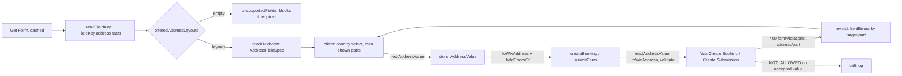

# 52 - Address Fields in wix-forms and wix-bookings

Status: Design

Covers `@jay-framework/wix-forms` and `@jay-framework/wix-bookings`. This is the follow-up log that DL #51 §5 defers to: it designs address support, and its implementation is the one that may delete `RELEASE-BLOCKED.md`. It builds on DL #51's approved types and functions (`FieldKey`, `readFieldKey`, `classifyFormField`, `readFieldView`, `toBookingFieldType`, `ProjectedForm`, `getParticipantForm`, `CreateBookingInput`, `CreateBookingOutcome`, and the §4 check order), plus DL #40 (per-form contracts), DL #41 (value store, `FieldValue`) and DL #44 (multiselect). jay is used only through its public surface (contract YAML, `parseContract`, `JayHtmlValidatorFn`). Paths are relative to `packages/` unless stated. Line citations are to `main` at `2adbdcd`, before DL #51 lands. Where DL #51 replaces a function, this log names the DL #51 function, not the old line.

**Dependency:** DL #51 Phases 1a, 1b and 2 are merged. Every phase here edits code that DL #51 introduces.

## Decisions for the Implementer (TL;DR)

- **Supported countries are fail-closed: US, GB, CA, IL.** These are the four countries with a fixture-backed layout (F7, F8). An address field offers `ADDRESS_LAYOUTS ∩ allowedCountries`, or all four when `allowedCountries` is empty. When that intersection is empty, the field is unsupported (DL #51 row 13 rules). A visitor from any other country cannot enter an address. ⚠️ This needs product approval (**O2**).
- **The per-country table lives in wix-forms:** `wix-forms/lib/address/address-layouts.ts`, exported to wix-bookings. Its contents come from two sources. The layout and labels come from F7 (Wix's form preview). The codes come from F8 (Create Booking's own `allowedValues`). A red-first test asserts the table equals both fixtures. Licence and ownership are an open product item (**O1**). Implementation does not start until O1 is answered.
- **A dynamic part set uses fixed contract tags.** Every country uses a subset of seven fixed parts (`country`, `addressLine`, `streetName`, `streetNumber`, `city`, `subdivision`, `postalCode`). The contract emits that superset once, each part as a non-repeated sub-contract. Every part except `country` has a boolean `shown` variant. A page binds every part and wraps each in `if="….shown"`. There is no repeated `parts` list (Q6).
- **Value format:** `AddressValue = Partial<Record<AddressPart, string>>`, a flat object whose keys are Wix's own part names, exactly as F8 sent them. `FieldValue` widens to `string | string[] | boolean | AddressValue`. `toWixAddress(spec, value)` is the single payload boundary:
  - it sends `country` plus that country's layout parts, trimmed;
  - it never sends a part outside the layout (`subdivision` for IL, `addressLine` for IL, `addressLine2` ever);
  - with no country, it returns `undefined`, and the key is left out of the payload (F6: a left-out address is accepted).
- **Required semantics:**
  - A required address field needs a country.
  - Once a country is chosen, every part in its layout is required (F7: all shown parts are marked required; F8 confirms it for `subdivision`).
  - A schema where any offered layout part has `validation.fields.<part>.required !== true`, or where `fieldSettings` is anything other than `{ addressLine2: { show: false } }`, is **unsupported** (fail-closed: unobserved).
- **Error keys are `<target>/<part>`,** the same string Wix returns as `fieldName` (F8: `address/subdivision`). The client validator, the server validator and Wix's located errors all key part errors this way. There is no translation table.
- **Located Wix errors, bookings:** the new `parseBookingFormViolations(responseBody)` reads `details.validationError.fieldViolations[].data.formViolations[]`, the raw shape of F6's 400. ⚠️ The address 400s were recorded only in flattened form, so LB0 re-captures one raw body and commits it as a fixture. A Create Booking 400 that carries form violations is **returned** as `{ outcome: 'invalid', fieldErrors }`, never thrown. If Wix reports `NOT_ALLOWED_VALUE_ERROR` on a subdivision that our table accepted, the server logs a **table drift** line with Wix's `allowedValues`.
- **Bookings first, per-form gated.** Phases A (shared core) and B (bookings) are designed in full and are the release-gate path. Create Submission with an address was never probed, so Phase F (per-form) starts only after live check **LF0** records Create Submission's accept/reject behaviour and error path. If LF0 differs from Create Booking, per-form stays unsupported and this log gets an addendum. **The gate does not wait for Phase F** (**O3**): row 13 per-form stays "unsupported, fail-visible" (DL #51 1a) until then.
- **Gate exit = L6+** (§Verification). L6+ is DL #51 L6 plus a blank optional address, the negative `curl` mappings, the drift check and the stored shape. Phase B's last step deletes `RELEASE-BLOCKED.md`, and only after L6+ passes.
- **Bookings contract:** a new top-level `address` sub-contract with a `present` variant. The address field is **not** an entry of `formFields`, because it has no single `formInputs` element. A booking form has at most one supported address; a second one is unsupported.
- **jay-feedback:** add wix-forms validator **rule 6** (Phase F), which errors on an unknown ref under an address field and warns on an address part with no bound `input`. Update the agent-kit guides for both plugins. No bookings validator: wix-bookings has none (`wix-bookings/plugin.yaml`), and adding the infrastructure is out of scope.

## Background

DL #51 makes both packages fail visibly on fields they cannot render (row 13: `ADDRESS` + `MULTILINE_ADDRESS` is unsupported everywhere). Phase 1b reads the real `required` flag, so every booking form with the default required Address now shows `FORM_UNSUPPORTED`. That covers the default "Booking form" (F4) and the QA form. The release gate (DL #51 Q17 = b) therefore blocks every publish from `main` until address support ships and L6 passes.

What Wix does, from DL #51 F2, F7 and F8 and the QA probe (`reviews/qa-address-probe-2026-11-11.md`; fixtures `wix-forms/test/fixtures/form-kinds/address-parts-by-country.json` and `address-create-booking-probe.json`):

| Country | Parts Wix shows (all required)                             | Subdivision                                              |
| ------- | ---------------------------------------------------------- | -------------------------------------------------------- |
| US      | Address, City, **State**, Zip / Postal code                | 54 bare codes (50 states, `DC`, `AA` `AE` `AP`; no `PR`) |
| GB      | Address, City, **Region**, Zip / Postal code               | `ENG` `NIR` `SCT` `WLS`                                  |
| CA      | Address, City, **Province**, Zip / Postal code             | 13 bare codes                                            |
| IL      | **Street name**, **House number**, City, Zip / Postal code | none                                                     |

- Wix validates a sent address per country and returns located errors (`address/<part>`). A `NOT_ALLOWED_VALUE_ERROR` lists `allowedValues`, and they equal the preview's list for US, GB and CA.
- Wix accepts an address that is left out entirely.
- Get Form has no per-country data. It carries `allowedCountries: []`, a flat `required: true` on all eight parts, and `fieldSettings.addressLine2.show: false` (`booking-form.json`, the `BOOKINGS_ADDRESS` field).
- Wix stores the address in `contactDetails.fullAddress`:
  - US/GB/CA keep the bare `subdivision` code and `addressLine`;
  - IL stores the street as `streetAddress: { name, number, apt }`.

Raw wire shape of a Create Booking form violation, from F6's off-list dropdown 400 (captured 2026-11-10, response body; DL #51 summarises it as F6):

```json
{
  "message": "Validation failed: …",
  "details": {
    "validationError": {
      "fieldViolations": [
        {
          "ruleName": "NOT_ALLOWED_VALUE_ERROR",
          "data": {
            "allowedValues": ["Option 1", "Option 2"],
            "formViolations": [
              {
                "fieldName": "dropdown_7b7d",
                "description": "must be equal to one of the allowed values",
                "ruleName": "NOT_ALLOWED_VALUE_ERROR",
                "data": { "allowedValues": ["Option 1", "Option 2"] }
              }
            ]
          },
          "violatedRule": "OTHER"
        }
      ]
    }
  }
}
```

The probe fixture stores the address cases' `formViolations` without that envelope. Assuming the envelope is the same for address errors is reasonable, but it is ⚠️ unverified (LB0).

## Problem

1. **No address anywhere:**
   - `FormFieldInputType` (`wix-forms/lib/types.ts:3-11`) and `FieldValue` (`:21`) have no address kind;
   - the contract builders (`wix-forms/lib/generators/contract-utils.ts:21-94`), the view state (`components/form-view-state.ts:46-72`) and the submission projection (`components/submission-values.ts:31-40`) have no address case;
   - the bookings contract (`wix-bookings/lib/contracts/booking-flow.jay-contract:99-109`) has a single `formInputs: HTMLInputElement` per field.
2. **The part set depends on the country, and jay contract tags are fixed.** A page cannot render a field whose sub-tags appear and disappear at runtime unless every possible tag is in the contract.
3. **Wix rejects nearly everything a visitor would type for a subdivision** (a label, an ISO code), so the subdivision must be a choice from Wix's own list. No API serves that list (F8).
4. **Wix's located errors are lost:**
   - `createBookingRecord` (`wix-bookings/lib/wix-apis/create-booking.ts:8-16`) throws a `WixApiError` (`wix-server-client/lib/wix-fetch.ts:145-154`), which becomes `describeBookingError` → `UNKNOWN` (`wix-bookings/lib/utils/booking-outcome.ts:32-59`), so a visitor sees "Booking failed";
   - `parseSubmissionFieldErrors` (`wix-forms/lib/utils/project-form-fields.ts:202-226`) reads `errors[].errorPath`, a Create Submission shape, not `formViolations[].fieldName`.
5. **The release gate is closed** until bookings can take an address for US, UK, Canada and Israel (DL #51 L6).

## Prior Art / Adjacent Mechanisms

| Mechanism                                                                         | Where                                                                                                               | Use here                                                                                                                                                                                                                                                                                    |
| --------------------------------------------------------------------------------- | ------------------------------------------------------------------------------------------------------------------- | ------------------------------------------------------------------------------------------------------------------------------------------------------------------------------------------------------------------------------------------------------------------------------------------- |
| Classification key + view data split (DL #51)                                     | `FieldKey` / `readFieldKey` / `readFieldView` in `wix-forms/lib/utils/classify-form-field.ts`, `read-field-view.ts` | **Extended.** `FieldKey.address` carries the schema facts that classification needs; `FieldViewData.address` carries the offered layouts. Row 13 becomes conditional.                                                                                                                       |
| `ProjectedForm` / `unsupportedFields` (DL #51 §1)                                 | `wix-forms/lib/types.ts`                                                                                            | **Reused.** An address that fails the support rule stays in `unsupportedFields`, and the DL #51 blocking rule applies unchanged.                                                                                                                                                            |
| Per-form field sub-contract (DL #40 §3)                                           | `contract-utils.ts:67-94` (`fieldTag`)                                                                              | **Pattern reused.** The address gets its own builder `addressFieldTag`, because it has no single `input` element.                                                                                                                                                                           |
| Repeated `options` sub-contract (DL #40, #41, #44)                                | `contract-utils.ts:116-137`                                                                                         | **Reused** for the country and subdivision lists (`value` = code, `label`).                                                                                                                                                                                                                 |
| Value store keyed by target (DL #41 §0) and the `FieldValue` widening (DL #41 4c) | `wix-form.ts:115`, `submission-values.ts`, `types.ts:21`                                                            | **Extended the same way 4c did:** one new member (`AddressValue`), widened through every layer the value crosses (store → action → service → wrapper).                                                                                                                                      |
| Per-option `selected` variant and chip `toggle` (DL #44)                          | `contract-utils.ts:132-135`                                                                                         | Precedent for a variant nested inside a sub-contract. The address adds a third nesting level (form → address → subdivision → options). ⚠️ That is not shown in the repo (checked: no contract nests a non-repeated sub-contract inside one), so a `parseContract` fixture comes first (A6). |
| `validateFormField` (DL #41 4c)                                                   | `project-form-fields.ts:157-200`                                                                                    | Its address branch returns the first part message. The new `fieldErrorsOf` returns every part's message.                                                                                                                                                                                    |
| `presentSubmitRejection`                                                          | `components/submit-outcome.ts:58-78`                                                                                | **Extended:** `<target>/<part>` keys go to that part's error. Today an unknown key falls through to `statusMessage` (`:69-71`).                                                                                                                                                             |
| `CreateBookingOutcome.invalid` + §4 check order (DL #51 Phase 2)                  | `wix-bookings/lib/types.ts`                                                                                         | **Reused:** the address validates in step 3, and Wix's own form violations become `invalid` too (new step 5).                                                                                                                                                                               |
| `allowedValues` in a 400 (F8)                                                     | Create Booking                                                                                                      | **Drift detector only** (Q3), not a data source.                                                                                                                                                                                                                                            |
| CLDR / ISO 3166-2 snapshot                                                        | DL #51 rounds 6-11 (withdrawn)                                                                                      | **Rejected:** Wix's sets differ (F7, F8).                                                                                                                                                                                                                                                   |

**Null hypothesis per new surface.**

- `AddressValue`: no existing `FieldValue` member can carry several named strings, and Wix wants an object (F8).
- `ADDRESS_LAYOUTS`: Get Form carries no layout (F8) and no API serves one.
- `shown` variant: without it a page cannot hide parts that are absent for a country, and every page would hard-code the layout itself.
- `parseBookingFormViolations`: the existing parser reads a different path.
- Bookings `address` sub-contract: the `formFields` item has one `HTMLInputElement`.
- Rule 6: core grafts unknown `ref=` sub-tags silently (`wix-forms/lib/validators/wix-form-bindings.ts:10-13`).

Every other piece reuses what is there.

## Questions and Answers

**Q1. Which countries are supported?**
A: US, GB, CA, IL, fail-closed, as DL #51 §5 prefers. A field offers `ADDRESS_LAYOUTS` filtered by `allowedCountries` when that list is non-empty. A field that offers none is unsupported. A country is added later as a new table entry plus a fixture row plus a live check. ⚠️ Turning off online booking for visitors from other countries on forms with a required address is a product decision (**O2**).

**Q2. Where does the table live, and who owns it?**
A: In `wix-forms/lib/address/address-layouts.ts`. Address is a Wix Forms field kind, and wix-bookings already depends on wix-forms. Its contents:

- country codes, from what F8 sent and Wix accepted;
- layouts, part labels and US subdivision labels, from F7's preview;
- subdivision codes, from F8's `allowedValues` (Wix's public API answer);
- GB and CA subdivision labels: the fixture records codes only, so ⚠️ LA0 records Wix's labels into `address-parts-by-country.json` first.

No code or data is copied from Wix's client bundle. The codes are public standards (USPS abbreviations, the ISO 3166-2 suffixes). Wix's _selection_ (no US territories) is observed behaviour. **O1, open for product approval:**

- (a) Is shipping this derived table in a public package acceptable?
- (b) The owner is the wix-forms maintainers. They update the table when the drift log fires or the drift check fails.

**Q3. Why not read `allowedValues` at runtime instead of shipping a table?**
A:

- It costs a deliberately failing Create Booking per country, per cache period.
- It gives codes only: no layout, no labels.
- Create Submission's equivalent is unknown.

It is kept as a **drift detector**: a server log at runtime, and a manual check before release (L-drift).

**Q4. Free-text subdivision and rely on Wix (DL #51 Q17 c)?**
A: Rejected. Visitors type labels ("Alabama"), and Wix rejects every one (F8). The located error would turn most submissions into a correction loop.

**Q5. How does a dynamic part set fit fixed contract tags?**
A: The part universe is fixed: Wix's `validation.fields` has eight keys (F2). `addressLine2` is never shown (`show: false`; any other setting is unsupported), which leaves seven. The contract emits each offered part once as a non-repeated sub-contract. Every part but `country` has a `shown` variant that the component sets from the selected country's layout. The per-form generator emits only the union of the offered layouts, so an `allowedCountries: ['US']` form gets no `streetName` / `streetNumber` tags. Bookings' static contract always has all seven.

**Q6. Why not a repeated `parts` list (the DL #51 Q8 guess)?**
A: Four reasons:

- A repeated item has one `elementType`, but country and subdivision are `<select>` and the other parts are `<input>`.
- Each part needs its own `autocomplete` token (`postal-code`, `address-level1`, …). In a list the designer cannot write it statically.
- Validator rule 6 can check coverage tag by tag.
- Designers place Street name and House number side by side, which they cannot do in a uniform loop.

The cost is an `if` per part. That cost is accepted.

**Q7. What value format is sent?**
A: The flat object F8 accepted: `{ country, subdivision?, city, postalCode, addressLine? | streetName? + streetNumber? }`, with values as strings, country as ISO 3166-1 alpha-2 (`US`, `GB`, `CA`, `IL`), and subdivision as the bare code. Wix builds `streetAddress` and `formattedAddress` itself (F8 stored shape).

**Q8. How do whole-field and per-part `required` combine (DL #51 Q7)?**
A:

- Field `required: true`: a country must be chosen.
- With a country chosen, every layout part is required, whether the field is required or not. A partial address is rejected by Wix (F8 case 9), so "optional" means "all or nothing".
- An optional field with no country is left out of the payload.
- A `validation.fields.<part>.required` other than `true` on an offered layout part is unobserved, so the field is unsupported, with the reason in the warning.

**Q9. Country and part labels (DL #51 Q9)?**
A: They are English defaults in the table: "United States", "United Kingdom", "Canada", "Israel" (⚠️ Wix's exact country labels were not recorded; LA0 records them), plus F7's part labels. Pages that need other copy branch on the option `value` (the code), following the DL #45 locale-neutral pattern. Localisation is out of scope.

**Q10. A country with no subdivision (DL #51 Q19)?**
A: IL's layout has no `subdivision`, so `subdivision.shown` is `false` and `toWixAddress` never sends one. Wix rejects it otherwise (F8 case 12).

**Q11. Online payment (DL #51 Q11)?**
A: The address goes into `createBookingRecord`'s `formSubmission` (`wix-bookings/lib/services/create-wix-bookings-service.ts:140-147`) before the cart is created (`:150`), so the payment path never sees it. ⚠️ L6+ includes one online payment and checks the stored `fullAddress`.

**Q12. How do Wix's located errors map back to parts?**
A:

- Bookings: `parseBookingFormViolations` → `fieldName` is already `<target>/<part>` (F8) → the message comes from `ruleName` and the part label (§4).
- Per-form: `parseSubmissionFieldErrors`'s `errorPath`. ⚠️ Its form for an address part is unknown. LF0 records it, and `normalizeErrorPath` maps `address.subdivision` or `address/subdivision` to `address/subdivision`. If LF0 shows something else, Phase F stops for an addendum.

**Q13. Per-form (Create Submission) scope?**
A: Designed here (§5) but gated behind LF0, which is a live probe. LF0 needs a site change: adding an address field to a QA contact form. That needs approval (**O3**). The release gate does not wait for Phase F.

**Q14. Bookings contract shape?**
A: A top-level `address` sub-contract (§3) with `present`, `label`, `required`, `error`, `invalid` and the seven parts. The address is not an item of `formFields`. A second supported address field on one booking form is unsupported (fail-closed, rare; DL #51 blocking rule).

**Q15. Initial country?**
A: None, unless the field offers exactly one country, which is then preselected. With no country, only the `country` part shows. Guessing a country from the locale is out of scope.

**Q16. Which DL #51 tests change expectations?**
A: These encode "address unsupported", which this log changes on purpose:

- Phase B flips DL #51 tests 5, 6 and 9 for the address (bookings);
- Phase F flips the per-form "unsupported, required" row of the fixture table (tests 2-4).

The new expectations come from F7 and F8, not from current output. They are rewritten red first.

**Q17. Are `autocompleteEnabled` and `showCountryFlags` honoured?**
A: No. Wix's own autocomplete is a UI feature of its client and does not change the submitted shape. Both are ignored, and the agent-kit guide recommends the browser's `autocomplete` tokens instead.

### Open items for product approval

- **O1** Licence and ownership of `ADDRESS_LAYOUTS` (Q2). It blocks the start of implementation.
- **O2** Four supported countries only. Visitors elsewhere cannot book online when the address is required (Q1).
- **O3** Per-form address is gated behind LF0, which needs an address field added to a QA contact form, and the release gate does not wait for it (Q13).

## Design

### 1. Shared address core (Phase A) — `wix-forms/lib/address/`

```ts
// address/address-types.ts
export type AddressPart =
  | 'country'
  | 'addressLine'
  | 'streetName'
  | 'streetNumber'
  | 'city'
  | 'subdivision'
  | 'postalCode';
export type LayoutPart = Exclude<AddressPart, 'country'>;
/** The store and payload value of an address field (Q7). Keys are Wix's part names. */
export type AddressValue = Partial<Record<AddressPart, string>>;
export interface AddressOption {
  value: string;
  label: string;
} // value = code (F8)
export interface AddressCountryLayout {
  country: string; // 'US' | 'GB' | 'CA' | 'IL'
  label: string; // English default (Q9)
  parts: LayoutPart[]; // in Wix's display order (F7); all required
  partLabels: Partial<Record<LayoutPart, string>>; // overrides of ADDRESS_PART_LABELS, e.g. subdivision: 'State'
  subdivisions: AddressOption[]; // [] when `parts` has no 'subdivision'
}
/** The layouts one field offers, in table order (Q1). */
export interface AddressFieldSpec {
  countries: AddressCountryLayout[];
}
/** Raw schema facts classification needs (read by readFieldKey for inputType ADDRESS). */
export interface AddressSchemaFacts {
  allowedCountries: string[]; // addressOptions.validation.allowedCountries ?? []
  partRequired: Record<string, boolean | undefined>; // addressOptions.validation.fields.<part>.required
  fieldSettings: Record<string, { show?: boolean }>; // multilineAddressOptions.fieldSettings ?? {}
}

// address/address-layouts.ts — data only, client-safe
export const ADDRESS_PART_LABELS: Record<AddressPart, string>;
// country 'Country/Region', addressLine 'Address', streetName 'Street name', streetNumber 'House number',
// city 'City', subdivision 'State/Region', postalCode 'Zip / Postal code' (F7)
export const ADDRESS_LAYOUTS: readonly AddressCountryLayout[]; // US, GB, CA, IL
// US: ['addressLine','city','subdivision','postalCode'], subdivision 'State', 54 options
// GB: same parts, 'Region', ENG NIR SCT WLS · CA: same parts, 'Province', 13 · IL: ['streetName','streetNumber','city','postalCode'], []

// address/address-support.ts
/** The supported layouts this field offers; [] means unsupported (row 13). */
export function offeredAddressLayouts(facts: AddressSchemaFacts): AddressCountryLayout[];
/** Why a field is unsupported, for the generation/server warning; undefined when supported. */
export function addressUnsupportedReason(facts: AddressSchemaFacts): string | undefined;

// address/address-value.ts — pure, client-safe
export function layoutOf(
  spec: AddressFieldSpec,
  country: string | undefined,
): AddressCountryLayout | undefined;
/** Next store value after one part changes; a country change clears a subdivision not in the new list. */
export function nextAddressValue(
  spec: AddressFieldSpec,
  current: AddressValue,
  part: AddressPart,
  value: string,
): AddressValue;
/** The payload boundary (Q7): country + its layout parts, trimmed; undefined when no country. */
export function toWixAddress(spec: AddressFieldSpec, value: AddressValue): AddressValue | undefined;
/** Per-part messages, keyed by part. Runs on toWixAddress's output. */
export function validateAddressValue(
  spec: AddressFieldSpec,
  value: AddressValue,
  required: boolean,
): Partial<Record<AddressPart, string>>;
/** Untrusted input → only own string-valued AddressPart keys (server side). */
export function readAddressValue(raw: unknown): AddressValue;
export function addressErrorKey(target: string, part: AddressPart): string; // `${target}/${part}`
export function splitErrorKey(key: string): { target: string; part?: AddressPart };
export function isAddressValue(value: FieldValue): value is AddressValue; // a plain object, not an array
```

**Support rule** (`offeredAddressLayouts`; every step fail-closed):

1. Candidates: `ADDRESS_LAYOUTS` filtered by `allowedCountries` when that list is non-empty (codes compared upper-case).
2. If `fieldSettings` is not exactly `{ addressLine2: { show: false } }` (other members of that entry ignored) → `[]`. Reason: `"address settings this site cannot show (<keys>)"`.
3. For each part in the union of the candidates' `parts`, plus `country`: if `partRequired[part] !== true` → `[]`. Reason: `"address part <part> is optional in Wix; not supported"`.
4. Otherwise, the candidates (`[]` → reason `"no supported country (supported: US, GB, CA, IL)"`).

**Validation messages** (`validateAddressValue`, English defaults, exported from `address/address-messages.ts`):

- country missing on a required field: `Country/Region is required.`;
- country not offered: `Choose a country from the list.`;
- a layout part empty: `<part label> is required.`;
- subdivision not in the layout's codes: `Choose a <State|Region|Province> from the list.`

No length or postal-code format checks: Wix's rules are unknown, ⚠️ LB0 probes one bad zip, and a Wix rejection arrives as a located error (§4).

**Wiring into DL #51 types** (`wix-forms/lib/types.ts`, `classify-form-field.ts`, `read-field-view.ts`):

```ts
export type FormFieldInputType = … | 'address';
export type FieldValue = string | string[] | boolean | AddressValue;
export interface FormFieldView { …; address?: AddressFieldSpec }   // set iff inputType === 'address'
// FieldKey (DL #51) gains:
address?: AddressSchemaFacts;            // read only when inputType === 'ADDRESS'
// FieldViewData (DL #51) gains:
address?: AddressFieldSpec;              // { countries: offeredAddressLayouts(key.address) }
/** Every message for one field, keyed by target, or by `<target>/<part>` for an address. */
export function fieldErrorsOf(field: FormFieldView, value: FieldValue): Record<string, string>; // project-form-fields.ts
```

- **Row 13** of DL #51's classification table changes. `ADDRESS` + `MULTILINE_ADDRESS` with `offeredAddressLayouts(key.address).length > 0` and `!key.hidden` gives:
  - per-form: `'address'` (**Phase F**; until then, unsupported as in DL #51);
  - bookings: `'ADDRESS'` (**Phase B**).
- Otherwise the field is unsupported, and `UnsupportedFieldView.wixKind` stays `ADDRESS/MULTILINE_ADDRESS`. The generator and server warnings append `addressUnsupportedReason`.
- A hidden address is unsupported per form, because the `control` channel carries strings only. Bookings already ignores hidden fields (DL #51 row 3).
- `validateFormField` (`project-form-fields.ts:157`) gains an address branch: the first message of `fieldErrorsOf`, or `''`. `validateVisibleFields` (`submission-values.ts:117-128`) switches to `fieldErrorsOf`, so part errors reach their parts.
- **Exports** (`wix-forms/lib/index.ts` and `index.client.ts`; every module above is client-safe): the address types, `ADDRESS_LAYOUTS`, `toWixAddress`, `nextAddressValue`, `validateAddressValue`, `readAddressValue`, `layoutOf`, `addressErrorKey`, `splitErrorKey`, `fieldErrorsOf`. The table is about 75 options, roughly 3 KB.

### 2. Contract YAML — the address part subtree

The bookings contract (§3) and the per-form generator (§5) use the same subtree. Per-form `addressFieldTag(field)` in `contract-utils.ts` emits it for the parts in the union of `field.address.countries[].parts`. `country` is always present. Shown here at field level 1, for a field whose `target` is `address`:

```yaml
- tag: address
  type: sub-contract
  phase: fast+interactive
  description: Multi-line address
  tags:
    - { tag: label, type: data, dataType: string }
    - { tag: required, type: variant, dataType: boolean }
    - { tag: error, type: data, dataType: string } # first part error (summary)
    - { tag: invalid, type: variant, dataType: boolean }
    - tag: country
      type: sub-contract
      tags:
        - { tag: label, type: data, dataType: string }
        - { tag: value, type: data, dataType: string }
        - { tag: error, type: data, dataType: string }
        - { tag: invalid, type: variant, dataType: boolean }
        - { tag: input, type: interactive, elementType: HTMLSelectElement }
        - tag: options
          type: sub-contract
          repeated: true
          trackBy: value
          tags:
            - { tag: value, type: data, dataType: string }
            - { tag: label, type: data, dataType: string }
    - tag: subdivision
      type: sub-contract
      tags:
        - { tag: shown, type: variant, dataType: boolean }
        - { tag: label, type: data, dataType: string } # State / Region / Province
        - { tag: value, type: data, dataType: string }
        - { tag: error, type: data, dataType: string }
        - { tag: invalid, type: variant, dataType: boolean }
        - { tag: input, type: interactive, elementType: HTMLSelectElement }
        - tag: options
          type: sub-contract
          repeated: true
          trackBy: value
          tags:
            - { tag: value, type: data, dataType: string }
            - { tag: label, type: data, dataType: string }
    # addressLine, streetName, streetNumber, city, postalCode — each:
    - tag: city
      type: sub-contract
      tags:
        - { tag: shown, type: variant, dataType: boolean }
        - { tag: label, type: data, dataType: string }
        - { tag: value, type: data, dataType: string }
        - { tag: error, type: data, dataType: string }
        - { tag: invalid, type: variant, dataType: boolean }
        - { tag: input, type: interactive, elementType: HTMLInputElement }
```

- No field-level `input`, `control` or `placeholder`.
- Part tag names are fixed camelCase, under the field, so they never collide with `RESERVED_TAG_NAMES` (`contract-utils.ts:164-176`), which are form-level.
- ⚠️ **A6** proves with `parseContract` that this three-level nesting (form → address → subdivision → options) parses and that the ViewState and Refs types generate. **Fallback** if it does not: hoist the two option lists to `address.countryOptions` / `address.subdivisionOptions`, which is the same depth as today's field-level `options`, and keep everything else.

### 3. Bookings (Phase B) — `wix-bookings`

```ts
// wix-bookings/lib/types.ts (after DL #51 1b)
export interface BookingFormFieldView { …; type: 'STRING' | 'EMAIL' | 'PHONE' | 'URL' | 'BOOLEAN' | 'ADDRESS'; address?: AddressFieldSpec }
export type BookingFormValue = string | boolean | AddressValue;
// CreateBookingInput.formValues: Record<string, BookingFormValue>   (was string | boolean, DL #51)
// wix-apis/create-booking.ts:12  formSubmission: Record<string, BookingFormValue>

// wix-bookings/lib/utils/form-violations.ts (new, server)
export interface FormViolation { fieldName: string; ruleName: string; allowedValues?: string[] }
/** details.validationError.fieldViolations[].data.formViolations[]; [] when absent or unparseable. */
export function parseBookingFormViolations(responseBody: string): FormViolation[];
/** One English message per fieldName; part labels from the field's layout. */
export function violationsToFieldErrors(violations: FormViolation[], fields: BookingFormFieldView[], formValues: Record<string, BookingFormValue>): Record<string, string>;
```

- **`getParticipantForm`** (DL #51 §3): `toBookingFieldType` row 13 → `'ADDRESS'` when supported, and the view carries `address: readFieldView(raw, key).address`. A second supported `ADDRESS` field → `unsupportedFields` (Q14).
- **Contract** `booking-flow.jay-contract`: a new top-level tag after `formFields` (`:99-109`). It is §2's subtree, with all seven parts, `phase: fast+interactive` and a `present` variant:

```yaml
- tag: address
  type: sub-contract
  phase: fast+interactive
  description: The participant form's address, when it has one (branch on present)
  tags:
    - { tag: present, type: variant, dataType: boolean }
    - { tag: label, type: data, dataType: string }
    - { tag: required, type: variant, dataType: boolean }
    - { tag: error, type: data, dataType: string }
    - { tag: invalid, type: variant, dataType: boolean }
    # country, addressLine, streetName, streetNumber, city, subdivision, postalCode — exactly §2
```

- **Client** (`booking-flow.ts`):
  - `onSelectSlot` (`:201-236`, replaced by DL #51 with `getParticipantForm`) sets `formFields` to the non-address entries and `addressField` to the first `ADDRESS` entry.
  - New signals `addressValue: AddressValue` and `addressErrors: Record<string, string>`.
  - Each part's `refs.address.<part>.input` gets `oninput`/`onchange` → `nextAddressValue` and an `onblur` validation.
  - `render` builds `address` from `addressViewState(field, value, errors)`. That function is shared with per-form (it lives in `wix-forms/lib/components/form-view-state.ts` and is exported).
  - `readFormValues` (`:238-252`) adds `formValues[target] = toWixAddress(spec, addressValue())` when defined.
  - Client validation runs `fieldErrorsOf(toFormFieldView(view), value)`. The first message goes to `failBooking(VALIDATION, …)` (as DL #51 §4 does), and part messages go to `addressErrors`.
  - `onBackToServices` (`:307-320`) clears both signals.
- **Server `createBooking`.** DL #51 §4's check order gains steps:
  1. Resolve the form → `FORM_UNAVAILABLE`.
  2. Required unsupported → `FORM_UNSUPPORTED`.
  3. Validate every supported field with `fieldErrorsOf`. An address value is first normalised: `readAddressValue` → `toWixAddress`, so extra parts from an untrusted client are dropped and an empty address is left out. Errors → `invalid` with `<target>/<part>` keys.
  4. Drop unknown keys and call Wix.
  5. **New:** a `WixApiError` with status 400 and `parseBookingFormViolations(body).length > 0` → **return** `{ outcome: 'invalid', fieldErrors: violationsToFieldErrors(…) }`. Every other error still throws, as today.
- **Drift log** (step 5). For `NOT_ALLOWED_VALUE_ERROR` on `<target>/subdivision`, or on `<target>/country`, when step 3 had accepted the value:

  `[wix-bookings] address table drift: Wix rejected <part> "<value>" for <country>; Wix allows [<allowedValues>]. Update ADDRESS_LAYOUTS (DL #52).`

  For `UNKNOWN_VALUE_ERROR` or `REQUIRED_VALUE_ERROR` on an address part: the same line with `layout` instead of the value list. The visitor sees the mapped message. No values beyond the part and the country are logged.

- **Violation messages** (`violationsToFieldErrors`):
  - `REQUIRED_VALUE_ERROR` → `<part label> is required.`;
  - `NOT_ALLOWED_VALUE_ERROR` → `Choose a <part label> from the list.`;
  - `UNKNOWN_VALUE_ERROR` → `This address cannot be accepted for <country label>. Please contact us.`;
  - anything else → `<part label or field label>: please check this value.`

  A non-address `fieldName` (a dropdown, F6) uses the field label.

- **Client outcome** (DL #51 §4 `switch`): `invalid` → `failBooking(VALIDATION, first message in formFields-then-address order)`, and `addressErrors` = its `<target>/…` entries.
- **Action schema** `create-booking.jay-action`: `formValues: object` is unchanged. Its `.d.ts` types `formValues` as `Record<string, string | boolean | AddressValue>`.

✅ `<div if="flow.address.present"> <select ref="flow.address.country.input" autocomplete="country">…</select> <label if="flow.address.subdivision.shown">{flow.address.subdivision.label}<select ref="flow.address.subdivision.input" autocomplete="address-level1"><option forEach="flow.address.subdivision.options" trackBy="value" value="{value}">{label}</option></select></label> … </div>`
❌ A single `<input>` bound in `formFields` for the address, or a free-text State input: Wix rejects "Alabama" (F8).

### 4. Data flow



### 5. Per-form (Phase F, after LF0) — `wix-forms`

- `classifyFormField` row 13 → `'address'` (§1).
- **Generator:**
  - `form-contract-generator.ts:24-34` emits `addressFieldTag(field)` for `inputType === 'address'`;
  - `elementTypeFor` (`contract-utils.ts:21-31`) is not called for address;
  - `forms-reference.ts` `fieldReference` (`:30-43`) gives `{ tag, label, type: 'address', target, required, hidden: false, hasControl: false, valueType: 'address', parts: [<emitted part tags>], countries: [<codes>] }` and no `elementType`.
- **View state** (`form-view-state.ts:46-72`): `fieldToViewState` → `addressViewState(field, value, errorByTarget, invalidByTarget)`:
  - `shown` comes from `layoutOf(field.address, value.country)`;
  - part labels come from the layout;
  - subdivision options come from that layout;
  - errors come from the `<target>/<part>` keys;
  - the field-level `error` is the first part error.
- **Component** (`wix-form.ts`):
  - `wireFieldEvents` (`:396-421`) wires `fieldRef[part]?.input` `oninput`/`onchange` → `setFieldValue(target, nextAddressValue(…))`, and `onblur` → part validation;
  - `reflectToInput` (`:143-167`) sets each part's `.value`;
  - `focusableRef` (`:444-452`) returns the first errored part's input, else `country`;
  - `emptyValueFor` (`submission-values.ts:20-24`) → `{}`;
  - `projectSubmissionValues` (`:31-40`) applies `toWixAddress` and leaves the key out when the result is `undefined`.
- **Errors:**
  - `presentSubmitRejection` (`submit-outcome.ts:64-72`) runs `splitErrorKey`, so a key whose target is a visible address field sets the part error and `invalid`;
  - `parseSubmissionFieldErrors` (`project-form-fields.ts:202-226`) passes each `errorPath` through `normalizeErrorPath(path, addressTargets)` (⚠️ its form comes from LF0).
- **Server** (`run-submission.ts:113-156`):
  - `SubmitDeps` gains `fieldsOf(formId): Promise<FormFieldView[]>`, backed by the same `listForms` cache as DL #51's `unsupportedFieldsOf`;
  - before the hook, each address value is normalised and validated (`readAddressValue` → `toWixAddress` → `validateAddressValue`), and an error returns `{ success: false, reason: VALIDATION, fieldErrors }` without calling Wix.
  - This also strips parts that an untrusted client adds.
- **Value type:** `create-submission.ts:21-37` already takes `FieldValue`, so it gets the widening for free. `submit-form.jay-action` `values: object` is unchanged.

## Implementation Plan

**Before Phase A:** O1 answered.

**Phase A — shared core (wix-forms; no behaviour change, row 13 still unsupported):**

- **LA0 (live, read-only):** open the Wix form preview of the QA form and record into `address-parts-by-country.json`: the GB and CA subdivision labels, the four country labels, and every option list's order. This is a fixture edit with a `_source` note.
- Build `lib/address/*` (§1), the `FieldKey.address` and `FieldViewData.address` reads, `fieldErrorsOf`, the `FieldValue` widening, and the exports.
- Red tests A1-A6.

**Phase B — bookings (the gate path):**

- **LB0 (live, `curl`, first task):** send Create Booking with US `subdivision: "XX"`, IL with `addressLine`, US with `postalCode: "ABC"`, and US with a 300-character `city`. Commit the four **response bodies** (no request bodies, no contact data) as `wix-bookings/test/fixtures/address/create-booking-400-*.json`. Also commit F6's dropdown 400 response body as `create-booking-400-dropdown.json`. If the envelope differs from F6's, `parseBookingFormViolations` follows the captured shape. Record whether the zip and length cases are rejected, and where.
- Then: row 13 `'ADDRESS'`, the `address` contract tag, the client wiring, server steps 3 and 5, the drift log, `form-violations.ts`, and the widened types and `.d.ts`.
- Update the DL #51 bookings tests that encode "address unsupported" (Q16), red first with the new expectations.
- Guides (§Agent feedback loop).
- Red tests B1-B6.
- **L6+** passes → delete `RELEASE-BLOCKED.md` in its own commit, which cites the L6+ demo video.

**Phase F0 — LF0 (live; needs O3 approval for the site change):** on a QA contact form with a required Multi-line address, send Create Submission with the 16 F8 variants. Record the status, error body and stored submission to `wix-forms/test/fixtures/form-kinds/address-create-submission-probe.json`. Phase F proceeds only if:

- the accepted and rejected sets equal F8's;
- the error path locates the part.

Otherwise, write an addendum to this log before any per-form code.

**Phase F — per-form:** §5, validator rule 6, guides, and the per-form rows of DL #51's fixture table flipped red first. Red tests F1-F7, then LF1.

## Examples

✅ US visitor: the store holds `{ country: 'US', addressLine: '600 Dexter Ave', city: 'Montgomery', subdivision: 'AL', postalCode: '36104', streetName: 'left over' }`. The payload is `{ country: 'US', addressLine: '600 Dexter Ave', city: 'Montgomery', subdivision: 'AL', postalCode: '36104' }`, which is F8 case 1.

✅ The visitor switches US → IL. `nextAddressValue` clears `subdivision`, `subdivision.shown` and `addressLine.shown` become `false`, and `streetName.shown` and `streetNumber.shown` become `true`.

✅ The field is optional and the visitor picks no country. `address` is absent from `formSubmission`, and Wix accepts the booking (F6).

❌ `subdivision: 'US-AL'` or `'Alabama'`: Wix rejects it (F8), and our `<select>` never produces it. Server step 3 catches a hand-crafted one: `{ 'address/subdivision': 'Choose a State from the list.' }`.

❌ Sending all eight parts because Get Form marks them all required (F2). IL then fails with `UNKNOWN_VALUE_ERROR` (F8 case 10).

❌ A page binding `ref="form.address.state.input"`. That is an unknown part, so rule 6 reports an error.

## Trade-offs

- **Four countries only** (fail-closed). A visitor elsewhere cannot complete a form with a required address (**O2**). The benefit: nothing ships that Wix would reject.
- **A table derived from Wix behaviour.** It can drift silently in what Wix accepts. Mitigations: the runtime drift log, the L-drift check before release, and located errors so that a drift costs one correction and not a dead end. The licence question is **O1**.
- **Fixed superset contract.** Each part needs an `if`, so pages are a bit more verbose. In exchange, contracts are typed and validatable.
- **English labels and messages.** This follows today's `validateFormField` messages. Per-part locale-neutral enums are not added (DL #45 covers the form-level outcome).
- **"Optional" means all or nothing** once a country is chosen. This follows Wix (F8 case 9).
- **Strict schema support** (`fieldSettings`, per-part `required`). An owner who changes the address settings in the dashboard gets "unsupported" until the change is probed. This is the same trade as DL #51's strict tuples.
- **Per-form after the gate.** Releases can resume before per-form address works. Per-form address stays fail-visible (DL #51 1a) in the meantime.

## Verification Criteria

Unit tests are written red first, and their expected values come from the fixtures, never from current output. "Row N" means the row number in the probe report's Create Booking table (§3 of the report). The fixture's `cases[]` has the same 16 cases in a different order, so tests match them by `case` name.

- **A1** `ADDRESS_LAYOUTS` equals `address-parts-by-country.json` for US, GB, CA and IL. Each preview label maps to a part: `Address` → `addressLine`, `Street name` → `streetName`, `House number` → `streetNumber`, `City` → `city`, `State` / `Region` / `Province` → `subdivision`, `Zip / Postal code` → `postalCode`. The test compares parts, their order, `subdivisionLabel`, codes and their order, and the labels (the US labels today; GB, CA and country labels after LA0).
- **A2** For every `NOT_ALLOWED_VALUE_ERROR` case in `address-create-booking-probe.json`, the set of `formViolations[].data.allowedValues` equals the table's subdivision codes for that country (US 54, GB 4, CA 13).
- **A3** `toWixAddress` over a store value built from each **accepted** probe case (rows 1, 7, 11, 13, 15), with an unrelated part added, deep-equals that case's `sentAddress`. Row 12's address (IL + `subdivision`) normalises to row 11's. An empty country gives `undefined`.
- **A4** For each **rejected** probe case, `validateAddressValue(toWixAddress(…))` has, for every rejected part, an error keyed by that case's `formViolations[].fieldName`: subdivision for rows 2-6 and 8; subdivision for row 9; `streetName` and `streetNumber` for row 10. (Row 10's `UNKNOWN_VALUE_ERROR` on `addressLine` cannot occur after normalisation, which the test asserts.)
- **A5** `readFieldKey` + `offeredAddressLayouts`:
  - `booking-form.json` and `default-form.json` → US, GB, CA, IL;
  - hand-written copies:
    - `allowedCountries: ['FR']` → `[]`, with the reason naming the supported list;
    - `['us', 'FR']` → US;
    - `addressLine2.show: true` → `[]`;
    - `fieldSettings: {}` → `[]`;
    - `fields.city.required: false` → `[]`;
    - `fields.subdivision` missing with `allowedCountries: ['IL']` → IL (no subdivision in that layout);
    - the same with `['US']` → `[]`;
    - `hidden: true` → per-form unsupported.
- **A6** `parseContract` over the expected YAML fixtures `test/fixtures/address/address-field-all.yaml` (four countries) and `address-field-us.yaml` (no street parts), written first. They parse, and the generated ViewState has `address.subdivision.options[]` and `address.city.shown`. On failure, apply §2's fallback and record it.
- **B1** `parseBookingFormViolations` over `create-booking-400-dropdown.json` gives `[{ fieldName: 'dropdown_7b7d', ruleName: 'NOT_ALLOWED_VALUE_ERROR', allowedValues: ['Option 1', 'Option 2'] }]`. Over LB0's US and IL bodies, it gives the fixture's `fieldName`s. Over `'{}'` and `'not json'` it gives `[]`.
- **B2** `getParticipantForm` with `booking-form.json` and with `default-form.json`: the address is in `fields` with `type: 'ADDRESS'` and four layouts, and `unsupportedFields` is empty. With a copy carrying two address fields, the second is in `unsupportedFields`. (This replaces DL #51 tests 5 and 6's address expectation.)
- **B3** `booking-flow` with `default-form.json`:
  - no `FORM_UNSUPPORTED`;
  - `address.present`, and `formFields` has no address entry;
  - choosing `US` gives `subdivision.shown` with 54 options labelled as in the fixture;
  - then `IL` gives `subdivision.shown === false`, `streetName.shown`, and the subdivision value is cleared;
  - a confirm with a missing city gives `bookingFailure === VALIDATION` and `address.city.error === 'City is required.'`.
- **B4** Server `createBooking` with a `default-form.json` service:
  - a valid IL value plus a stray `addressLine` → the Wix spy's `formSubmission.address` deep-equals F8 row 11's `sentAddress`;
  - `subdivision: 'US-AL'` → `invalid`, `{ 'address/subdivision': 'Choose a State from the list.' }`, Wix not called;
  - a mocked Wix 400 with LB0's body → resolves `invalid` keyed by `address/…` (does not reject), and `describeBookingError` is not called;
  - a mocked `NOT_ALLOWED_VALUE_ERROR` on an `AL` we accepted → one drift `console.error` naming `US` and the allowed list.
- **B5** `booking-flow.jay-contract` parses. Its `address` subtree, minus `present`, equals `addressFieldTag` for all seven parts (both parsed, tag trees compared).
- **B6** An optional address left blank → no `address` key in the Wix payload, and the booking proceeds.
- **F1-F7 (Phase F):**
  - F1: `projectFormFields(booking-form.json)` → `'address'` with its spec;
  - F2: view-state `shown` and options per country;
  - F3: `projectSubmissionValues` uses `toWixAddress` and leaves out an empty address;
  - F4: `presentSubmitRejection` with `address/subdivision` → a part error, not `statusMessage`;
  - F5: `parseSubmissionFieldErrors` over LF0's body → `address/<part>`;
  - F6: `forms.yaml` lists `parts` and `countries`;
  - F7: rule 6 (unknown part ref → error; an unbound part input → warning; a fully bound page → clean).

**Live checks** (Wix VPN, Premium test site, `/demo-feature`). They **replace and extend DL #51 L6 as the gate exit**:

- **LA0, LB0, LF0:** as in the Implementation Plan.
- **L6+** (after Phase B, before deleting `RELEASE-BLOCKED.md`):
  1. In the browser, a default-form service and the QA service each book end to end for US, GB, CA and IL, using only the page's selects and inputs (DL #51 L6). Pay in person for all eight, plus one online payment (US).
  2. Each stored `contactDetails.fullAddress` matches F8:
     - US/GB/CA have a bare `subdivision` and `addressLine`, and `formattedAddress` contains the code;
     - IL has `streetAddress { name, number }` and no `subdivision`.
  3. A service whose address is optional books with the address left blank, and the booking has no address.
  4. `curl` our `createBooking` with `subdivision: 'XX'` → `invalid` on `address/subdivision`; with IL + `addressLine` only → `invalid` on `address/streetName` and `address/streetNumber`. No booking is created.
  5. **L-drift:** for US, GB and CA, a direct Wix Create Booking with `subdivision: 'XX'`. Its `allowedValues` must equal `ADDRESS_LAYOUTS` (no booking results). This repeats before every release that ships the table, and whenever the drift log fires.
  6. A demo video is recorded to the workspace root.

  Only then is `RELEASE-BLOCKED.md` deleted.

- **LF1** (after Phase F): a per-form page submits US and IL addresses, and the submission shows in the Wix dashboard. A bad subdivision sent by `curl` → `VALIDATION` with the part error.

## Scope Pre-mortem (what this will not handle)

- Countries beyond US, GB, CA and IL; the "none selected" layout; `addressLine2` shown.
- Localised country, part or subdivision labels.
- Wix's Google autocomplete, `showCountryFlags`, and custom part labels in `fieldSettings` (ignored, Q17).
- Prefill or `control` for an address (DL #41 Cap 2 and 4a carry strings); a hidden address.
- More than one address on a booking form.
- Conditional `rules[]` (as DL #51).
- Postal-code or length rules beyond what Wix's located errors report (LB0 records them).
- Wix's own submitted payload (never captured; F8's accepted shape stands in).
- Cancelling the probe bookings that LB0 and L6+ create. They are listed in the QA report for manual cleanup.

## Agent feedback loop (jay-feedback decision)

- **Validation, yes: wix-forms rule 6** (`wix-forms/lib/validators/wix-form-bindings.ts`, Phase F):
  - (a) **error**: a `ref="<key>.<addressField>.<x>…"` where `<x>` is not a part tag of that field's contract, or the ref names a part's child that does not exist;
  - (b) **warning**: an emitted part whose `input` ref is not bound on the page ("Israel needs streetName and streetNumber; bind every part and wrap it in `if=…shown`").

  Both are deterministic from the contract and the page, which is the same data that rules 2 and 5 use.

- **No bookings validator:** wix-bookings registers none (`wix-bookings/plugin.yaml`). The booking-flow contract's `address` description and the setup guide carry the rule instead. Adding validator infrastructure to wix-bookings is a separate change.
- **Agent-kit:**
  - wix-forms `per-form-contracts.md`: the address subtree, `shown`, error keys;
  - wix-forms `rich-forms.md`: the markup pattern, with `autocomplete` tokens `country`, `address-line1`, `address-level2`, `address-level1`, `postal-code`; selects for country and subdivision;
  - wix-forms `user-visible-messages.md`: address messages;
  - wix-bookings `wix-bookings-setup.md`: an `address` section like the ✅ example;
  - wix-bookings `wix-bookings-troubleshooting.md`:
    - "country not listed" → only US, GB, CA and IL;
    - "address table drift" log → update `ADDRESS_LAYOUTS`;
    - an address shown as unsupported → the dashboard settings changed (`fieldSettings`, optional parts, or `allowedCountries` outside the four);
  - replace DL #51's `FORM_UNSUPPORTED` address wording.
- **No framework change:** everything is contract modelling over existing jay primitives (A6 confirms the nesting).
