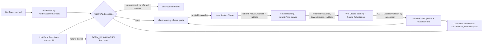

# 52 - Address Fields in wix-forms and wix-bookings

Status: [Implemented — pending live QA L1–L12] (revision 4; implementation 2026-11-16)

Covers `@jay-framework/wix-forms` and `@jay-framework/wix-bookings`. This is the follow-up log that DL #51 §5 defers to. It designs address support for **both** bookings (Create Booking) and per-form submission (Create Submission), and its last implementation step deletes `RELEASE-BLOCKED.md`. It builds on DL #51 (implemented: `FieldKey`, `readFieldKey`, `classifyFormField`, `readFieldView`, `toBookingFieldType`, `ProjectedForm`, `getParticipantForm`, the §4 check order), DL #40 (per-form contracts), DL #41 (value store, `FieldValue`), DL #44 (multiselect), DL #45/#46 (locale-neutral outcomes) and DL #55 (Wix validation parity, `parseSubmissionViolations`, the `defaultPhoneCountry` config precedent). jay is used only through its public surface (contract YAML, `parseContract`, `JayHtmlValidatorFn`, `plugin.yaml` `validators:`). Paths are relative to `packages/` unless stated. Line citations are to the branch `form-address-fields` with DL #51 applied (`eb3b756`).

## Decisions for the Implementer (TL;DR)

- **Layouts are fetched, not hand-owned.** wix-forms reads Wix's public **List Form Templates** API at runtime: `GET https://www.wixapis.com/form-template-service/v2/templates?namespace=wix.form_platform.form&templateIds=<id>&…` with all 12 address template ids, always passed explicitly. The response lists each id twice, so it is de-duplicated by `id`. A visitor token works (live probes on a QA site). Each template gives the parts, their order, `required`, `hidden`, `maxLength` / `pattern`, and, for some countries, the subdivision codes.
- **The one hard-coded table** is `country → templateId` (`COUNTRY_TEMPLATE_IDS`, 66 entries, public ids). Every other country uses `MLA_COMMON`. It is **derived from live Create Submission probes**, and its fixture is committed as `wix-forms/test/fixtures/address/country-template-map.json` (§Country map provenance). A red-first test pins the table to the fixture. L12 re-probes all 247 countries live before each release and diffs the result against the fixture. When Wix requires a part that the chosen layout hides, the part is **revealed at runtime** (Q17), so a wrong or stale map entry costs one correction, not a dead end.
- **Cache: per server process, success-only, TTL 1 h, shared in-flight promise, 30 s retry backoff after a failure.** This is the pattern of `wix-bookings/lib/services/participant-form-source.ts:29-44` and `wix-forms/lib/services/submittable-forms.ts`. **A failure is transient, and it has one outcome everywhere: the form is unavailable.** The source throws `AddressLayoutsUnavailableError`, and it propagates exactly like a failed Get Form (Q3):
  - bookings `getParticipantForm` and `createBooking` → `FORM_UNAVAILABLE` ("Could not load the participant form. Please try again later.", `create-wix-bookings-service.ts:43`);
  - per-form render → the existing load-error state (`wix-form.ts:100-108`, short error TTL);
  - per-form submit → `FORM_UNAVAILABLE`.

  `FORM_UNSUPPORTED` and `unsupportedFields` are reserved for permanent capability gaps. Nothing is submitted with a guessed layout.

- **Countries: all 247 that Wix accepts** (`ADDRESS_COUNTRY_CODES`, fixture `server-allowed-countries.json`, including `AN` and `XK`). A field honours `validation.allowedCountries` (empty means all) and `multilineAddressOptions.defaultCountryConfig`. `COUNTRY` + `countryOptions` preselects that country. `BY_IP` preselects nothing, because geolocation is out of scope (Q9). Country names come from `Intl.DisplayNames(locale, { type: 'region' })`, with locale `en` unless the site sets `address.locale`; a code with no name falls back to the code.
- **Required, per part:** the form's `validation.fields.<part>.required` wins, and the template's `required` is the fallback. The field-level `required` means "a country plus every required part". An **optional** field is left out of the payload when it is **blank**, meaning no part other than `country` has a non-empty value (this covers a preselected country). `addressLine2` is a normal part. It is shown when the template shows it (IL) or when `fieldSettings.addressLine2.show === true`, and it is never required unless the form says so. The old "never send addressLine2" and "unknown `fieldSettings` → unsupported" rules are **dropped**.
- **Subdivision has three cases, decided per country by its template:**
  - **Listed** (US GB CA DE JP BR FR ES AU): a `<select>` of the template's codes.
  - **Unlisted** (the 56 `MLA_COMMON_STATE` countries, for example IT): **free text**. When Wix rejects the value with `NOT_ALLOWED_VALUE_ERROR`, its `params.allowedValues` is mapped back onto the part. The part then switches to a select of those codes, and its stale text value is cleared. The server remembers the codes per country in `LearnedAddressFacts` (owned by `WixFormsService`), so later visitors get the select from the start, in bookings and per form alike (Q6).
  - **None** (COMMON, IL): no subdivision part.
  - No locale dataset and no ISO 3166-2 package is used (Q7).
- **Labels:** the plugin ships English defaults:
  - a part label for each template `identifier`;
  - a subdivision **part** label for each listed country;
  - English **option** names for the codes of the 9 listed countries (`address-labels.ts`; a test pins its key set to the template codes).
  - Everything else (unlisted-country codes) shows its code.
  - The site overrides any of these in `config/.wix-forms.yaml` `address.labels` (Q8). Visitor-facing names are plain geographic names, written for this repo.
- **Contract: fixed superset.** Every country's parts are a subset of eight fixed parts: `country`, `addressLine`, `addressLine2`, `streetName`, `streetNumber`, `city`, `subdivision`, `postalCode`. Each part is a non-repeated sub-contract with `shown`, `required`, `label`, `value`, `error`, `invalid` and `input`. `subdivision` additionally has a `listed` variant, `options` and a `text` input. There is no repeated `parts` list (Q5). **All eight parts are emitted in every address contract**, bookings and per form alike, so a runtime country set or layout change can never show a part that the page has no tag for (§2).
- **Value:** `AddressValue = Partial<Record<AddressPart, string>>`, flat with Wix's own keys. Both Create Booking and Create Submission accept exactly this (live probes). `FieldValue` widens to `string | string[] | boolean | AddressValue`. **`toWixAddress(spec, value)`** is the single payload boundary:
  - it sends `country` (upper-cased) plus the parts the country's layout **shows**, each trimmed and non-empty;
  - it keeps an un-offered country as given (upper-cased), so validation rejects it;
  - it returns `undefined` only when the value has no country **and** no part.
- **Located errors share one key: `<target>/<part>`.** Wix uses this key in both envelopes:
  - Create Booking: `fieldViolations[].data.formViolations[].fieldName`;
  - Create Submission: `fieldViolations[].data.errors[].errorPath`.
  - The client validator, server validator and both parsers key by it.
  - One mapper, `addressMessageFor(spec, value, violation)`, turns a violation into a message.
  - DL #55's `parseSubmissionViolations` is **extended**: it keeps `<target>/<part>` paths and `params.allowedValues`.
  - A new `parseBookingFormViolations` reads the bookings envelope into the same `LocatedViolation` type.
  - A Create Booking 400 with form violations is **returned** as `invalid`, never thrown.
- **One spec after learned facts arrive: `withLearnedFacts(spec, facts)`** (`address-value.ts`, pure, client-safe). It is the only function that merges learned subdivision lists and revealed parts into an `AddressFieldSpec`. Every consumer reads the spec it returns: the view state, `nextAddressValue`, `toWixAddress`, `validateAddressValue` / `fieldErrorsOf`, on the server and on the client, in bookings and per form (§1 "One spec"). The server never caches a spec with facts merged in: it projects per call from the current `LearnedAddressFacts.snapshot()`. Per-form pages receive the snapshot in the **fast** phase, not the slow-render cache, so a learned list reaches the next visitor on the next request (§5).
- **Both phases ship before the gate opens.** Phase F (per-form) is designed fully here and is no longer gated: LF0 answered it.
- **Release gate exit = all of §Verification "Gate exit".** That is the live QA cycle L1–L12, with its prerequisites declared and pre-approved (Q15). The last commit deletes `RELEASE-BLOCKED.md` and cites the QA report and video.
- **jay-feedback:**
  - wix-forms rule 6: an unknown address part ref → **error**. A part without a bound `input`, or a `subdivision` without **both** `input` and `text` bound → **error**. Any part can be shown at runtime (Q17), so a missing input is always a potential dead end.
  - A **new wix-bookings validator** with the same rule, scoped to `booking-flow`'s `address`, sharing the rule's logic exported from wix-forms. The "no address refs bound" check is an **error only when a site service's participant form has an address field** (known from the agent-kit `services.yaml`), nothing when none has one, and a **warning** when it cannot be known. It is suppressible per page (§6).
  - Agent-kit guide updates in both plugins.

## Background

DL #51 makes both packages fail visibly on fields they cannot render (row 13: `ADDRESS` + `MULTILINE_ADDRESS` is unsupported). Every booking form with the default required Address therefore shows `FORM_UNSUPPORTED`, and `RELEASE-BLOCKED.md` blocks every publish from `main` (`scripts/publish.cjs:8-18`) until this log ships.

**What Wix does.** These facts come from live probes on a QA site, 2026-11-11 and 2026-11-16. Fixtures: `wix-forms/test/fixtures/form-kinds/address-parts-by-country.json`, `address-create-booking-probe.json` (DL #51 F7/F8), plus the new ones this log commits (Phase A0).

- **Templates.** List Form Templates returns one `FORM_INPUT` template per country group, named `MLA_<CC>`. Each template `field` carries:
  - `identifier` (`MLA_ADDRESS_LINE`, `MLA_CITY`, …);
  - `inputOptions.target` (the part name);
  - `required` and `hidden`;
  - `stringOptions.validation` (`maxLength`, `pattern`, `enum`);
  - `componentType` (`TEXT_INPUT` / `DROPDOWN`).

  The order is `steps[0].layout.large.items` (row, column, width). All 12 templates were captured raw on 2026-11-16 (Phase A0 `templates-list-response.json`), including FR, ES, AU and COMMON_STATE. Templates carry **no labels**: dropdown option labels equal the codes. Templates are identical across two sites and across `Accept-Language`.

| Template (id)                                             | Countries                    | Parts in order (`*` required in template; `[]` hidden)                              | Subdivision    |
| --------------------------------------------------------- | ---------------------------- | ----------------------------------------------------------------------------------- | -------------- |
| `MLA_COMMON` `0d5dcb6d-1403-4b80-b73e-6d90a2245561`       | every unmapped country (181) | addressLine\*, [addressLine2], city\*, postalCode\*                                 | none           |
| `MLA_COMMON_STATE` `b7b59987-e5c6-4ec7-a4af-f48318a68a5d` | 56 (AE … IT … ZA)            | addressLine\*, [al2], city\*, subdivision\*, postalCode\*                           | empty `enum`   |
| `MLA_US` `ebe1c447-8fd5-4c7a-8cf1-75b94db68698`           | US                           | as COMMON_STATE                                                                     | 54             |
| `MLA_GB` `3d059d26-8ce8-48ce-9779-b23e42014454`           | GB                           | as COMMON_STATE                                                                     | 4              |
| `MLA_CA` `2b942888-7d93-41ee-b85c-5705263f9eea`           | CA                           | as COMMON_STATE                                                                     | 13             |
| `MLA_IL` `bc7a8d54-8df3-47cb-bb9b-3338fd6246e5`           | IL                           | streetName\*, streetNumber\*, **addressLine2 shown**, city\*, postalCode (optional) | none           |
| `MLA_DE` `c7bde0e2-187e-44e7-8f51-14162259eb2b`           | DE                           | streetName\*, streetNumber\*, [al2], postalCode\*, city\*, subdivision\*            | 16             |
| `MLA_JP` `e51fc7b5-0c29-40c6-b2e8-58d9fa5e3c29`           | JP                           | postalCode\*, subdivision\*, city\*, addressLine\*, [al2]                           | 47 (`01`–`47`) |
| `MLA_BR` `3160f799-1ade-455b-87f9-128875ec874e`           | BR                           | streetName\*, streetNumber\*, [al2], city\*, subdivision\*, postalCode\*            | 27             |
| `MLA_FR` `fbc1fb24-37bc-4c0f-afa4-35e88a43127d`           | FR                           | addressLine\*, [al2], postalCode\*, city\*, subdivision\*                           | 16             |
| `MLA_ES` `f0e74759-d378-4ae7-9db7-42b4c7d02094`           | ES                           | as COMMON_STATE                                                                     | 19             |
| `MLA_AU` `76f1a42e-b609-4c8b-b41a-7ebf2fbb5a56`           | AU                           | as COMMON_STATE                                                                     | 8              |

- **Per-part limits** (every template, and enforced by the server): `addressLine` maxLength 150; `city` and `addressLine2` maxLength 50; `postalCode` pattern `^.{0,50}$`; `streetName` / `streetNumber` have no limit.
- **Server enforcement.** The server checks:
  - the template;
  - the form's per-part `required` overrides (all `true` on booking forms, so IL's postalCode is required there);
  - `allowedCountries`;
  - "no additional properties" outside the layout, with `addressLine2` always allowed.

  For an `MLA_COMMON_STATE` country it also enforces a list the template does not carry. IT accepts only 20 region codes, and `MI` is rejected. The 400 returns that list in `allowedValues`. FR accepts `IDF` but rejects `FR-IDF`.

- **Countries.** With `allowedCountries: []`, the country `NOT_ALLOWED_VALUE_ERROR` lists exactly 247 codes. With `["US","IL","IT"]`, GB is rejected on `<target>/country` with those three as `allowedValues`.
- **Schema** (public Form Schemas types):
  - `addressOptions.validation.allowedCountries` (max 200);
  - `addressOptions.validation.fields.<part>.required`;
  - `multilineAddressOptions.defaultCountryConfig { type: BY_IP | COUNTRY, countryOptions: "<CC>" }` (a plain string);
  - `multilineAddressOptions.fieldSettings.addressLine2.show`, the only public `fieldSettings` key.
- **Create Submission (LF0).** The probe used a QA form with a required `address` and an optional `address_limited` (`["US","IL","IT"]`, default US), 27 cases, `lf0-create-submission-probe.json`:
  - Create Submission accepts the same flat object as Create Booking, and stores it verbatim.
  - A required address that is left out is rejected with `errorPath: "address"` `REQUIRED_VALUE_ERROR`. A string is rejected with `TYPE_ERROR`.
  - Hidden `addressLine2` is accepted and stored.
  - Envelope (verbatim, `allowedValues` abridged):

```json
{
  "message": "Validation failed: submission Submission doesn't satisfy form requirements",
  "details": {
    "validationError": {
      "fieldViolations": [
        {
          "ruleName": "SUBMISSION_VALIDATION",
          "field": "submission",
          "description": "Submission doesn't satisfy form requirements",
          "data": {
            "errors": [
              {
                "errorPath": "address/subdivision",
                "errorType": "NOT_ALLOWED_VALUE_ERROR",
                "errorMessage": "must be equal to one of the allowed values",
                "params": { "allowedValues": ["AA", "AE", "…"] }
              }
            ]
          },
          "violatedRule": "OTHER"
        }
      ]
    }
  }
}
```

- **Create Booking envelope** (F6's off-list dropdown 400, verbatim, captured 2026-11-10):

```json
{
  "message": "Validation failed: …",
  "details": {
    "validationError": {
      "fieldViolations": [
        {
          "field": "must be equal to one of the allowed values",
          "ruleName": "NOT_ALLOWED_VALUE_ERROR",
          "data": {
            "allowedValues": ["Option 1", "Option 2"],
            "formViolations": [
              {
                "fieldName": "dropdown_7b7d",
                "description": "must be equal to one of the allowed values",
                "ruleName": "NOT_ALLOWED_VALUE_ERROR",
                "data": { "allowedValues": ["Option 1", "Option 2"] }
              }
            ]
          },
          "violatedRule": "OTHER"
        }
      ]
    }
  }
}
```

The address cases in `address-create-booking-probe.json` store `cases[].error.formViolations[]` without that envelope. LB0 captures one raw address 400 to confirm the envelope.

- Wix stores the address in `contactDetails.fullAddress`. US/GB/CA keep a bare `subdivision` and `addressLine`. IL stores `streetAddress { name, number }`.

## Problem

1. **No address anywhere.** `FieldValue` (`wix-forms/lib/types.ts:22`) and `ParticipantFormValue` (`wix-bookings/lib/types.ts:36`) carry strings and booleans only. There is no address contract tag. `classify-form-field.ts:70` leaves `ADDRESS/MULTILINE_ADDRESS` unsupported.
2. **The part set depends on the country, and jay contract tags are fixed.**
3. **Wix's layout and code lists are only in its templates and its 400s.** Get Form carries no per-country data.
4. **Located errors are lost.**
   - Bookings: `createBookingRecord` (`wix-bookings/lib/wix-apis/create-booking.ts:9-17`) throws `WixApiError`, which becomes `UNKNOWN` via `describeBookingError` (`wix-bookings/lib/utils/booking-outcome.ts:32`).
   - Per-form: `parseSubmissionViolations` (`wix-forms/lib/utils/wix-submission-errors.ts:39-50`) keys by `errorPath`, which already is `address/subdivision`. But no field owns that key, so the client drops it to the status message.
5. **The release gate is closed** for every package.

## Prior Art / Adjacent Mechanisms

| Mechanism                                                              | Where                                                                     | Use here                                                                                                                |
| ---------------------------------------------------------------------- | ------------------------------------------------------------------------- | ----------------------------------------------------------------------------------------------------------------------- |
| `FieldKey` / `readFieldKey` / `readFieldView` (DL #51)                 | `classify-form-field.ts:16-60`, `read-field-view.ts:10-18`                | **Extended:** `FieldKey.address` holds the schema facts; `FieldViewData.address` holds the resolved spec.               |
| `ProjectedForm` / `unsupportedFields` (DL #51)                         | `wix-forms/lib/types.ts`, `wix-forms/lib/utils/project-form-fields.ts:92` | **Reused** for "no offered country" only (a permanent gap). "Layouts unavailable" is transient and throws instead (Q3). |
| Raw-form cache with TTL, shared in-flight promise, success-only        | `wix-bookings/lib/services/participant-form-source.ts:29-44`              | **Pattern reused** for the template cache.                                                                              |
| Fail-closed list load with backoff                                     | `wix-forms/lib/services/submittable-forms.ts:1-90`                        | **Pattern reused** (failure not cached, retry backoff, timeout).                                                        |
| `parseSubmissionViolations` (DL #55 P2)                                | `wix-submission-errors.ts:39-74`                                          | **Extended:** keeps `params.allowedValues` and exposes `LocatedViolation[]`.                                            |
| `WixApiError.responseBody` / `instanceof` from `/client`               | `create-wix-bookings-service.ts:2,62`                                     | **Reused** for the Create Booking 400 path (scoped to `createBookingRecord` only).                                      |
| `defaultPhoneCountry` in `config/.wix-forms.yaml` (DL #55 P1c)         | `wix-forms/lib/config-loader.ts:12-29`                                    | **Pattern reused** for `address.locale` / `address.labels`.                                                             |
| Repeated `options` sub-contract (DL #40/#44) and `FormFieldOptionView` | `contract-utils.ts`, `wix-forms/lib/types.ts`                             | **Reused** for country and subdivision options (no new `AddressOption`).                                                |
| Plugin validators (`plugin.yaml` `validators:` + `JayHtmlValidatorFn`) | `wix-forms/plugin.yaml:22-25`, `lib/validators/wix-form-bindings.ts`      | **Reused:** rule 6 in wix-forms; a new one-entry validator in wix-bookings.                                             |
| `Intl.DisplayNames`                                                    | platform                                                                  | Country names, no data shipped.                                                                                         |
| Locale dataset / ISO 3166-2 package                                    | —                                                                         | **Rejected:** not confirmed publicly available; ISO is wrong for IT/FR (Q7).                                            |

**Null hypothesis per new surface:**

| Surface                                                                  | Why an existing primitive does not suffice                                                                                                                                                    |
| ------------------------------------------------------------------------ | --------------------------------------------------------------------------------------------------------------------------------------------------------------------------------------------- |
| `AddressValue`                                                           | No `FieldValue` member carries several named strings, and both Wix APIs want an object.                                                                                                       |
| `listFormTemplates` + `AddressTemplateSource`                            | Get Form has no layout. Templates are the only public source.                                                                                                                                 |
| `COUNTRY_TEMPLATE_IDS`                                                   | No API serves the mapping. It is derived from public Create Submission probes (§Country map provenance) and re-probed by L12.                                                                 |
| `shown` / `required` per part                                            | The parts and their required flags vary by country, and a fixed contract can express that only with variants.                                                                                 |
| `subdivision.listed` + `text`                                            | Unlisted countries need free text, and listed ones need a select (Q6). One `input` with `HTMLSelectElement \| HTMLInputElement` would force pages to bind one ref in two places.              |
| `LocatedViolation` + `parseBookingFormViolations`                        | The bookings envelope is different. The type is shared so that one message mapper serves both APIs.                                                                                           |
| `address-labels.ts`                                                      | Templates and APIs carry no labels.                                                                                                                                                           |
| `LearnedAddressFacts` (`wix-forms/lib/address/learned-address-facts.ts`) | It is the only way an unlisted country gets a select without shipping a dataset, and the only way a stale map entry is corrected at runtime (Q17). No existing cache holds per-country facts. |
| `WIX_FORMS_ADDRESS_TEMPLATES_ORIGIN` (QA-only env)                       | L11 must make the live template fetch fail on a running testbed. The source is created inside `WixFormsService`, so the testbed cannot inject a `fetch` (Q18).                                |
| Bookings validator                                                       | Core grafts unknown `ref=` sub-tags silently, so a page without IL's street parts would be a visitor dead end.                                                                                |

## Questions and Answers

**Q1. Where do layouts come from?** List Form Templates at runtime (TL;DR). A visitor token and an API key both return 200. Always pass the 12 ids: without them, the namespace returns 39 templates, some not address templates. De-duplicate by `id`. The documented path is `/form-template-service/v2/templates`; the docs' curl example shows another host path, which is wrong. There is no hand-owned layout table and no licence question.

**Q2. Which auth?** The same `WixClient` that wix-forms uses for Get Form (`WixFormsService`), which works under both API-key and visitor auth. The docs name scope `SCOPE.FORMS.VIEW-FORM`.

**Q3. Cache and failure?** `createAddressTemplateSource(fetch)` in `wix-forms/lib/services/address-templates.ts`:

- One cache per server process (per `WixFormsService` instance).
- The TTL is 1 h. Templates are identical across sites, so freshness matters only for drift.
- Concurrent callers share one promise. A failure or a 5 s timeout is not cached, and opens a 30 s backoff in which calls fail fast.
- A response that lacks any of the 12 ids, or whose template has no `inputOptions.target` on a field, counts as a **failure**: the layout is not trusted partially.

Failure → `AddressLayoutsUnavailableError` (message "Could not load the address layouts. Please try again later."). It is **thrown, never turned into an unsupported field**, because the cause is transient and FORM_UNSUPPORTED would tell the page author to change the form. It is thrown only when the raw form has an `ADDRESS` field, so forms without one are unaffected. One outcome per caller, all "unavailable":

- `getParticipantForm` (`create-wix-bookings-service.ts:175`) rethrows. The client already maps a throw to `failBooking(FORM_UNAVAILABLE, …)` (`booking-flow.ts:216-227`).
- Server `createBooking` step 1 → `{ failure: 'FORM_UNAVAILABLE' }` (`:105-109`), as for a failed Get Form.
- Per-form render: `getFormFields` throws, so `renderSlowlyChanging` takes its existing load-error branch (`wix-form.ts:100-108`): `loadError` is shown and the short `SLOW_RENDER_ERROR_TTL` lets the next render retry. It is **not** the DL #51 "unsupported" state.
- Per-form submit: `{ success: false, reason: FORM_UNAVAILABLE }`, the DL #53 outcome for a form that could not be loaded.

`ProjectionOptions.addressTemplates` is therefore never absent for a form with an address: the service loads the templates first or throws (§1).

**Q4. Which countries?** `ADDRESS_COUNTRY_CODES` (247) ∩ `allowedCountries`, upper-cased, or all 247 when it is empty. Codes in `allowedCountries` that Wix does not accept are dropped with a generation warning. If nothing remains, the field is unsupported ("no country Wix accepts"). Order: by display name in the configured locale.

**Q5. Why a fixed superset and not a repeated `parts` list?**

- Each part needs its own `autocomplete` token, written statically.
- Rule 6 checks coverage tag by tag.
- Designers place Street name and House number side by side.
- `subdivision` has two inputs.

jay does accept `elementType: A | B` (the contract parser splits on `|`), so element type is **not** a reason.

**Q6. Unlisted subdivisions (56 countries)?** Options weighed:

- (i) free text plus mapping Wix's located error;
- (ii) ship code lists harvested from Wix 400s (a hand-owned table again, which drifts silently, and gives codes without names);
- (iii) a locale dataset (availability unconfirmed).

**Decision: (i), with learning.**

1. The part renders `listed: false`, which is a text input. The placeholder hint is "Region code", overridable.
2. On a 400 `NOT_ALLOWED_VALUE_ERROR` at `<target>/subdivision` for a country whose layout has an unlisted subdivision, the server:
   - calls `learnedFacts.learnSubdivisions(country, allowedValues)` (store below);
   - returns `fieldOptions: { '<target>/subdivision': allowedValues as FormFieldOptionView[] }` with the invalid outcome. Labels come from `address.labels.subdivisions.<CC>`, else the code.
3. The client replaces its spec with `withLearnedFacts(spec, { subdivisionsOf: { <CC>: options } })` (§1 "One spec"), so the part becomes `listed: true` with those options and the next payload and validation use the list. `nextAddressValue` is not involved: the outcome handler (`showBookingOutcome` / `presentSubmitRejection`) sets the store's `subdivision` to `''`, so the stale `MI` is neither shown in the select nor re-sent. The part error reads "Choose a Region from the list.". The page is guaranteed to have both inputs, because rule 6 makes a missing `subdivision.input` or `subdivision.text` an **error** (jay-feedback).
4. Later visitors get the select straight away, because no path serves a spec with stale facts: bookings `getParticipantForm` projects per call with `learnedFacts.snapshot()` (§3), and the per-form **fast** phase, which runs per request and is not behind `SLOW_RENDER_TTL`, adds the current snapshot to the slow-phase spec (§5). L5 (bookings) and L10 (per form) check this with a new browser context.

**The store.** `wix-forms/lib/address/learned-address-facts.ts` (server-only):

```ts
export type CountryCode = string; // ISO-like upper-case code from ADDRESS_COUNTRY_CODES
export interface LearnedAddressFacts {
  subdivisionsOf(country: CountryCode): string[] | undefined;
  learnSubdivisions(country: CountryCode, codes: readonly string[]): void;
  revealedPartsOf(country: CountryCode): LayoutPart[]; // Q17; [] when none
  revealPart(country: CountryCode, part: LayoutPart): void;
  snapshot(): LearnedFactsSnapshot; // every unexpired entry; bounded by the 247 keys
}
// address-types.ts (client-safe, travels in action outputs and the fast-phase carry-forward)
export interface LearnedFactsSnapshot {
  subdivisionsOf?: Record<CountryCode, FormFieldOptionView[]>;
  revealedPartsOf?: Record<CountryCode, LayoutPart[]>;
}
export function createLearnedAddressFacts(options?: { now?: () => number }): LearnedAddressFacts;
```

- **Owner:** one instance per `WixFormsService`, created next to the template source and exposed as `WixFormsService.learnedAddressFacts()`. wix-bookings reaches it through the `WixFormsService` it already resolves for address specs. Bookings and per form therefore share one store per process.
- **Keys:** `CountryCode` everywhere. Writes whose country is not in `ADDRESS_COUNTRY_CODES` are ignored, so the key space is bounded at 247 and no eviction policy is needed beyond the TTL.
- **Validation:** a write is ignored unless every code matches `^[A-Z0-9]{1,3}$` and there are 1–200 codes (the largest server list seen in the probe is SI, with 110). Codes are upper-cased and de-duplicated. `revealPart` accepts only `LayoutPart` values.
- **Expiry:** each country entry expires 1 h after its last write (the template TTL). A read of an expired entry returns `undefined` / `[]` and deletes it.
- **Not persisted.** It is lost on restart (Trade-offs).

The spec takes per-country facts outside `AddressLayout`, so layout keys stay `templateId` (§1: `subdivisionsOf`, `revealedPartsOf`). `snapshot()` turns codes into `FormFieldOptionView`s with the resolved labels (`address.labels.subdivisions.<CC>`, else the code).

Rationale: Wix's own enforced list is the only correct source (ISO is wrong for IT/FR). It costs at most one round trip per country per hour per process, and it never offers a code Wix rejects. A visitor who types a valid code (FR `IDF` style) passes first time. **Option labels for learned codes are the codes**, unless `address.labels.subdivisions.<CC>` names them.

**Q7. Why not ISO 3166-2 or Wix's locale dataset?** Raw ISO 3166-2 offers IT provinces and old FR regions that Wix rejects. A public npm release of Wix's locale dataset is unconfirmed, so it is treated as unusable. Neither is a dependency.

**Q8. Labels?** `wix-forms/lib/address/address-labels.ts` holds:

- `PART_LABELS` by part: Country/Region, Address, Address line 2, Street name, House number, City, State/Region, Zip / Postal code. The F7 preview strings are used where F7 recorded them. "State/Region" and "Address line 2" are **invented fallbacks**.
- `SUBDIVISION_PART_LABELS` by country: US State, GB Region, CA Province, DE State, JP Prefecture, BR State, FR Region, ES Province, AU State.
- `SUBDIVISION_NAMES[CC][code]` for the 9 listed countries: English geographic names written for this repo. Its key set is pinned to the template codes by test A2.

Override: `config/.wix-forms.yaml`:

```yaml
address:
  locale: de # Intl.DisplayNames locale for country names; default en
  labels:
    parts: { postalCode: PLZ }
    subdivisionPart: { US: State }
    subdivisions: { IT: { '25': Lombardia } }
```

Overrides are **merged per key** into the defaults (`{ ...PART_LABELS, ...parts }`, and per country for `subdivisions`). They never replace a whole table, so `subdivisions: { IT: {...} }` leaves the US names intact. The config is read by the existing loader (`wix-forms/lib/config-loader.ts:39`) and applies to both plugins, because bookings resolves address specs through `WixFormsService`. Per-page copy is the page's own (it may ignore `label` and write its own text). Validation messages use the resolved labels.

**Q9. Initial country?**

- `defaultCountryConfig.type === 'COUNTRY'` with an offered `countryOptions` → preselected.
- A single offered country → preselected.
- `BY_IP` → none. Geolocating the request is out of scope, and guessing from `Accept-Language` would be wrong for travellers.

The preselection is applied by `initialAddressValue(spec)` into the **store** at form load. Blank-ness ignores it (TL;DR).

**Q10. Required semantics?**

- Part `p` is required iff `validation.fields.p.required ?? template.required`, and `p` is shown for the chosen country.
- A **required field** needs a country and every required part.
- An **optional field** that is blank is left out.
- An optional field that is not blank needs a country and every required part. Wix agrees: a partial address is rejected.
- `addressLine2` shown via `fieldSettings` is optional unless `validation.fields.addressLine2.required` is `true`.
- Unknown members under `validation.fields.<part>` are ignored. Wix's located errors cover them, and the template already carries the limits.

**Q11. Un-offered or malformed country?**

- `toWixAddress` upper-cases `country` and keeps it even when not offered. `'us'` normalises to `'US'` and is accepted.
- `'FR'` on a US-only field → `{ '<target>/country': 'Choose a country from the list.' }`. Server step 3 rejects it, and Wix is not called.
- A non-string country is dropped by `readAddressValue`.
- `validateAddressValue(spec, value: AddressValue | undefined, required)` accepts `undefined`.

**Q12. Hidden fields and prefill?** A hidden address is unsupported per form, because the `control` channel carries strings. Bookings ignores hidden fields (DL #51 row 3). Prefill is out of scope.

**Q13. A second address on one booking form?** Unsupported (DL #51 blocking rule). Per form, several address fields are supported, since each has its own target.

**Q14. Are `autocompleteEnabled` / `showCountryFlags` honoured?** No. They are Wix client UI features. Pages use browser `autocomplete` tokens instead. `streetName` / `streetNumber` have **no** standard token, so agents must not put `address-line1` on them.

**Q15. Live-check prerequisites?** The QA-site changes below are covered by the approval of this log for implementation; the QA report records that approval by role ("approved by the product owner at design-log approval", with the date), never by name. Each change is restored afterwards, and the restore is part of the check:

- **Optional address:** on the bookings QA site, make the QA service form's address optional in the dashboard for L5, then restore it to required. Per form, the LF0 form already has an optional `address_limited`.
- **Restricted / default country:** use the LF0 form's `address_limited` (`["US","IL","IT"]`, default US). For bookings, set the QA booking form's address to `allowedCountries ["US","IL","IT"]` with default US for L6, then restore it.
- **Pay in person:** switch the QA service to pay in person for the browser bookings, then restore "Entire amount online".
- **Online payment:** the address is written by `createBookingRecord` (`create-wix-bookings-service.ts:250-256`) **before** the cart (`:259`), so payment never reads it. L4 proves that the online-payment path reaches Wix checkout with the booking created and `fullAddress` stored. No card is charged. Completing a payment is **not** a gate step, because it would test Wix checkout, not this change.
- **Pages:** the QA testbed's `/book` page and per-form page get the address markup (task B9/F9). They live in the workspace testbed, not in this repo. The repo's proof is the agent-kit examples and validator tests.
- **All-required probe form (L12):** the forms QA site keeps one form with a single all-countries `address` field whose part overrides (`validation.fields.<part>.required`) are **all** `true`, the form the 2026-11-16 probe used. It must exist before L12 and must not be edited between releases, because the signatures in `country-template-map.json` assume every shown part is required. The QA report records its form id (not committed). If it is missing or changed, L12 is not run until it is recreated with that shape.
- **Cleanup:** bookings and submissions created by checks are listed in the QA report and cancelled or deleted from the dashboard.

**Q16. Which DL #51 tests flip?** Bookings tests 5, 6 and 9 (address now supported), and the per-form "unsupported, required" rows of the fixture table (tests 2-4). They are rewritten red first, from the fixtures.

**Q17. What if Wix requires a part that our layout hides?** This happens when a map entry is wrong or stale: for example, a COMMON_STATE country mapped to COMMON hides `subdivision`, and Wix answers `<target>/subdivision` `REQUIRED_VALUE_ERROR`. **Decision: reveal the part.**

1. The server sees a located `REQUIRED_VALUE_ERROR` on `<target>/<part>` where `<part>` is a `LayoutPart` that `layoutOf(spec, country)` does not show.
2. It calls `learnedFacts.revealPart(country, part)`, logs the drift line (§3), and returns the invalid outcome with `fieldErrors['<target>/<part>'] = '<label> is required.'` and `revealedParts: { '<target>': ['<part>'] }`.
3. The client replaces its spec with `withLearnedFacts(spec, { revealedPartsOf: { <CC>: [part] } })`, so the part is shown (`shown: true`, `required: true`) and the next `toWixAddress` sends it. For `subdivision`, it is `listed: false` (free text) until a NOT_ALLOWED teaches the list (Q6). The visitor fills it and resubmits.
4. Later visitors see the part from the start through the same per-call snapshot as Q6 step 4, and the server's own `toWixAddress` on the next submit keeps it, because the server projects with the current snapshot (§3 step 3, §5). `withLearnedFacts` inserts the part in its fixed superset order (`AddressPart` order), because the template carries no position for it.

This works because every contract carries all eight parts and rule 6 requires every part input to be bound. It costs one correction per country per process per hour, and L12 makes the drift visible before release. **The remaining dead end:** Wix requires a part that is **not** one of the eight (a new `target`). The server cannot reveal it, so the visitor gets the field-level message "This address cannot be accepted for <country name>. Please contact us." on `<target>/country`, and the drift log fires. The pre-mortem and the troubleshooting guide record this. An unknown target in the **template** response already fails closed (Q3).

**Q18. How does L11 force a template failure on a running testbed?** `createAddressTemplateSource({ fetch, origin })` is injectable, and unit test A8 injects a failing `fetch`. The live testbed cannot inject, because `WixFormsService` builds its source at plugin init. So the default factory reads **one QA-only env var**, `WIX_FORMS_ADDRESS_TEMPLATES_ORIGIN`:

- Only the **origin** is overridable (scheme, host, port, parsed with `new URL(v).origin`). The path `/form-template-service/v2/templates`, the namespace and the 12 ids are fixed.
- An invalid value throws at init, naming the variable.
- When it is set, the first fetch logs `[wix-forms] address templates origin overridden to <origin> (QA only)`.
- It is read only in `address-templates.ts`. It is documented in `wix-forms-setup.md` under "QA-only settings" and is not part of `config/.wix-forms.yaml`, so a site cannot set it by accident through config.

L11 sets it to `http://127.0.0.1:9` (closed port), restarts the dev server, checks, then unsets it and restarts again.

## Design

### Country map provenance (B1)

`COUNTRY_TEMPLATE_IDS` is derived only from public API behaviour. No private source is used.

1. **Probe** (2026-11-16, visitor token, QA form with one required, all-countries `address` field whose part overrides are all `required: true`). For each of the 247 codes in `server-allowed-countries.json`, two Create Submission calls:
   - `{ country }` → one `REQUIRED_VALUE_ERROR` per required part, which gives the **required-part set**;
   - `{ country, subdivision: 'XX' }` → `NOT_ALLOWED_VALUE_ERROR` with `params.allowedValues` (a subdivision part exists, with Wix's list) or `UNKNOWN_VALUE_ERROR` (no subdivision part).

   Every probe must be refused. A stored submission is recorded and deleted (none were stored by this probe). **The probe must run as a visitor.** An earlier attempt with a site-admin identity had country-only addresses accepted and stored: required-part validation did not apply to that identity, so its responses say nothing about layouts. The probe script therefore takes a client id and mints an anonymous visitor token, and it aborts if any probe returns 200.

2. **Signature** per country: (required-part set, `NONE` | `LISTED` + sorted `allowedValues`).
3. **Match** against the 12 template layouts (shown parts minus `addressLine2`, because the form makes every shown part required):
   - same part set, no subdivision → COMMON or IL (their part sets differ);
   - same part set, `allowedValues` equal to a template's non-empty `enum` → that template (US, GB, CA, DE, JP, BR, FR, ES, AU; DE and BR share a part set and are told apart by the list);
   - same part set, a list that equals no template `enum` → `MLA_COMMON_STATE` (empty `enum`; the list is Wix's server-side list, e.g. IT's 20 codes).
   - Anything else (no candidate, or more than one) is **unmatched**.
4. **Result:** all 247 countries matched exactly one template, and all 494 probes were refused (no submission stored). Per template: `MLA_COMMON` 181, `MLA_COMMON_STATE` 56, and one each for US, GB, CA, IL, DE, JP, BR, FR, ES, AU. Only four required-part sets occur: {addressLine, city, postalCode} (COMMON), {addressLine, city, subdivision, postalCode} (US GB CA JP FR ES AU and COMMON_STATE), {streetName, streetNumber, city, postalCode} (IL) and {streetName, streetNumber, city, subdivision, postalCode} (DE, BR). Server lists for COMMON_STATE countries run from 4 codes (SZ) to 110 (SI).
5. **Count:** 66 entries in `COUNTRY_TEMPLATE_IDS` (56 COMMON_STATE + 10 own-template countries). An earlier 67-entry summary counted the `COMMON` fallback as a key; COMMON is not a table entry, it is the default for the other 181 countries. 66 + 181 = 247.
6. **Fail closed for unmatched countries:** a code that is a key of the fixture's `unmatchedOrAmbiguous` object (the evidence file's own name) is removed from `ADDRESS_COUNTRY_CODES ∩ allowedCountries` at spec resolution with a generation warning ("country <CC> has no verified address layout"). It is never guessed onto COMMON. A field left with no country is unsupported (Q4). The 2026-11-16 probe has no unmatched country, so the set is empty today. The rule exists so that a future L12 re-probe that finds a new signature fails closed instead of guessing.

**Drift check (L12).** Before every release, the same probe script re-derives the map live and diffs it against the committed fixture, together with the template diff. Any difference blocks the release until the fixture and `COUNTRY_TEMPLATE_IDS` are updated through a red-first test. Between releases, Q17's runtime reveal covers a stale entry.

### 1. Shared address core (Phase A) — `wix-forms/lib/address/`

```ts
// address-types.ts (client-safe)
export type AddressPart =
  | 'country'
  | 'addressLine'
  | 'addressLine2'
  | 'streetName'
  | 'streetNumber'
  | 'city'
  | 'subdivision'
  | 'postalCode';
export type LayoutPart = Exclude<AddressPart, 'country'>;
export type AddressValue = Partial<Record<AddressPart, string>>;
export interface AddressPartSpec {
  part: LayoutPart;
  label: string; // resolved (config > default)
  required: boolean; // form override ?? template
  maxLength?: number; // template
  pattern?: string; // template (postalCode)
}
export interface AddressLayout {
  templateId: string;
  parts: AddressPartSpec[]; // shown parts, in template order
  subdivisionLabel?: string; // when 'subdivision' is a part
  subdivisions?: FormFieldOptionView[]; // listed by the template only; per-country lists are in subdivisionsOf
}
export interface AddressFieldSpec {
  countries: FormFieldOptionView[]; // offered, value = code, label = Intl name
  initialCountry?: string; // Q9
  layouts: Record<string, AddressLayout>; // key: templateId; only the templates used by offered countries
  templateOf: Record<string, string>; // offered CountryCode → templateId; absent → COMMON id
  subdivisionsOf: Record<string, FormFieldOptionView[]>; // CountryCode → learned list (Q6); overrides an unlisted layout
  revealedPartsOf: Record<string, LayoutPart[]>; // CountryCode → parts revealed at runtime (Q17)
}
export interface AddressSchemaFacts {
  // read by readFieldKey for ADDRESS
  allowedCountries: string[];
  partRequired: Partial<Record<LayoutPart, boolean>>;
  showAddressLine2: boolean;
  defaultCountry?: { type: 'BY_IP' | 'COUNTRY'; country?: string };
}

// address-countries.ts (data): ADDRESS_COUNTRY_CODES (247), COUNTRY_TEMPLATE_IDS (66), COMMON_TEMPLATE_ID, ADDRESS_TEMPLATE_IDS (12)
// address-labels.ts (data): PART_LABELS, SUBDIVISION_PART_LABELS, SUBDIVISION_NAMES
// address-templates.ts (server): parseAddressTemplates(json) → Record<templateId, RawAddressTemplate>; de-dupes by id
//   createAddressTemplateSource({ fetch, origin? }) → AddressTemplateSource { load(): Promise<AddressTemplates> } (Q3, Q18)
// learned-address-facts.ts (server): LearnedAddressFacts, createLearnedAddressFacts (Q6)
// address-spec.ts (server): resolveAddressSpec(facts, templates, labels) → AddressFieldSpec | { unsupported: string }
//   the base spec: subdivisionsOf and revealedPartsOf are {}; learned facts are added only by withLearnedFacts

// address-value.ts (pure, client-safe)
export function layoutOf(
  spec: AddressFieldSpec,
  country: string | undefined,
): AddressLayout | undefined; // template layout + subdivisionsOf + revealedPartsOf for that country
export function withLearnedFacts(
  spec: AddressFieldSpec,
  facts: LearnedFactsSnapshot,
): AddressFieldSpec; // the one merge point (below)
export function initialAddressValue(spec: AddressFieldSpec): AddressValue;
export function nextAddressValue(
  spec: AddressFieldSpec,
  current: AddressValue,
  part: AddressPart,
  value: string,
): AddressValue; // country change drops parts not shown and a subdivision not listed
export function isBlankAddress(value: AddressValue): boolean; // no non-empty part except country
export function toWixAddress(spec: AddressFieldSpec, value: AddressValue): AddressValue | undefined;
export function validateAddressValue(
  spec: AddressFieldSpec,
  value: AddressValue | undefined,
  required: boolean,
): Partial<Record<AddressPart, string>>;
export function readAddressValue(raw: unknown): AddressValue; // own string-valued AddressPart keys only
export function addressErrorKey(target: string, part: AddressPart): string; // `${target}/${part}`
export function splitErrorKey(key: string): { target: string; part?: AddressPart };
export function isAddressValue(value: FieldValue): value is AddressValue;
```

`toWixAddress` steps:

1. If `isBlankAddress(value)` and `!value.country`, return `undefined`.
2. `country = value.country?.trim().toUpperCase()`.
3. Take the layout `layoutOf(spec, country)`, which is COMMON for an un-offered code, so validation still runs.
4. Return `{ country, ...each shown part with a trimmed, non-empty value }`.

Optional blank fields are left out by the callers through `isBlankAddress`, before `toWixAddress`.

`validateAddressValue` checks, in order:

1. `undefined` or blank, and the field is optional → `{}`.
2. No country → `Country/Region is required.` (only on `country`).
   A required field that is blank **but has a country** (a preselected one) skips this and goes on to step 4, so the visitor sees each required part's message, not a country message for a country that is already set. LF0 "country only" (US) therefore gives exactly `address/addressLine`, `address/city`, `address/subdivision`, `address/postalCode`, the same four keys Wix returned (A5).
3. Country not offered → `Choose a country from the list.`
4. A required part that is empty → `<label> is required.`
5. A value over `maxLength` → `<label> must be at most <n> characters.`
6. A value that fails `pattern` → `<label> is too long.` This wording is correct only for the pattern `^.{0,50}$`, the only one in all 12 templates. Test A1 pins that every template pattern equals it, so a new pattern fails the build and its message is decided then.
7. A listed subdivision not in the list → `Choose a <subdivisionLabel> from the list.`

The messages are English defaults in `address-messages.ts`, documented in `user-visible-messages.md`.

**Resolving the spec** (`resolveAddressSpec`, fail-closed):

1. Offered = `ADDRESS_COUNTRY_CODES ∩ allowedCountries` (Q4). Empty → `{ unsupported: 'no country Wix accepts' }`.
2. For each used template: parts = the fields with `hidden: false`, plus `addressLine2` when `showAddressLine2`. Keep template order.
3. `required` = `partRequired[part] ?? field.required`.
4. Limits come from `stringOptions.validation`.
5. Subdivisions: a non-empty template `enum` goes on the layout. `subdivisionsOf` and `revealedPartsOf` start empty. Layout keys stay `templateId`.
6. Labels: `config.labels` > `address-labels.ts` > the code.
7. `initialCountry` per Q9.

**One spec: `withLearnedFacts(spec, facts)`.** Pure, returns a new spec, never mutates:

1. For each country in `facts.subdivisionsOf` that is offered **and** whose template has an empty `enum` (unlisted), set `subdivisionsOf[country]` to the list. A list for a listed or un-offered country is ignored.
2. For each country in `facts.revealedPartsOf` that is offered, set `revealedPartsOf[country]` to the union of the existing and new parts.
3. Return `spec` unchanged when nothing applied.

`layoutOf` reads both maps, so the shown parts, `required`, `listed` and the options all follow. Who calls it, and with which facts:

| Path                                                  | Facts                                                                                                                                                   | Where                                                              |
| ----------------------------------------------------- | ------------------------------------------------------------------------------------------------------------------------------------------------------- | ------------------------------------------------------------------ |
| Bookings `getParticipantForm` / `createBooking`       | `forms.learnedAddressFacts().snapshot()`, per call                                                                                                      | `projectParticipantForm` via `ProjectionOptions.learnedFacts` (§3) |
| Per-form server submit                                | the same snapshot, per call                                                                                                                             | `deps.addressFieldsOf` (§5)                                        |
| Per-form render                                       | the same snapshot, taken in the **fast** phase                                                                                                          | `renderFastChanging` (`wix-form.ts:111`, §5)                       |
| Bookings / per-form client after an `invalid` outcome | `{ subdivisionsOf: outcome.fieldOptions, revealedPartsOf: outcome.revealedParts }`, keyed back from `<target>/<part>` to country by the value's country | `showBookingOutcome` / `presentSubmitRejection` (§3, §5)           |

`projectFormFields` applies it when `ProjectionOptions.learnedFacts` is given, after `resolveAddressSpec`. No other function reads `LearnedAddressFacts` or patches a spec, so the client view state, the client payload and validation, and the server payload and validation cannot disagree.

**Wiring into DL #51 types:**

```ts
// wix-forms/lib/types.ts
export type FormFieldInputType = … | 'address';
export type FieldValue = string | string[] | boolean | AddressValue;  // :22
export interface FormFieldView { …; address?: AddressFieldSpec }    // iff inputType === 'address'
// classify-form-field.ts FieldKey (:16) gains  address?: AddressSchemaFacts  (read in readFieldKey :40 when inputType === 'ADDRESS')
// read-field-view.ts FieldViewData (:10) gains  address?: AddressFieldSpec
// project-form-fields.ts
export function fieldErrorsOf(field: FormFieldView, value: FieldValue): Record<string, string>; // keyed by target or `<target>/<part>`
```

- **Row 13**: `ADDRESS` + `MULTILINE_ADDRESS`, not hidden, with a resolved spec → `'address'` (per form) / `'ADDRESS'` (bookings). Otherwise it is unsupported, and the warning carries the reason.
- Spec resolution needs the templates, which are async, and `projectFormFields` (`wix-forms/lib/utils/project-form-fields.ts:35`) is sync. `ProjectionOptions` (`:26`) therefore gains `addressTemplates?: AddressTemplates` and `learnedFacts?: LearnedFactsSnapshot`, loaded by the caller beforehand. The service methods that project (`wix-forms/lib/services/wix-forms-service.ts:18`) load templates only when the raw form has an `ADDRESS` field, so forms without an address make no extra call. A load failure **throws** `AddressLayoutsUnavailableError` from the service method (Q3). Calling `projectFormFields` with an address and without `addressTemplates` is a programming error and throws, so no path turns a transient failure into an unsupported field.
- `validateFormField` (`project-form-fields.ts:171`) gains an address branch (the first message of `fieldErrorsOf`). `checkFormField` (`project-form-fields.ts:176`) is unchanged for other kinds.
- **Exports** (`index.ts`, `index.client.ts`): the types, the `address-value.ts` functions, `fieldErrorsOf`, `addressViewState` (§2), `LocatedViolation`, `addressMessageFor`, and the rule-6 core `checkAddressBindings` (for the bookings validator). Server-only (`index.ts`): `parseBookingFormViolations`, `AddressTemplateSource`, `AddressLayoutsUnavailableError`, `LearnedAddressFacts`, and the `WixFormsService.addressTemplates()` / `learnedAddressFacts()` / `addressFieldsOf()` members. Client-safe (`index.client.ts`) also gets `withLearnedFacts` and `LearnedFactsSnapshot`.

### 2. Contract subtree and view state

Shared by bookings (§3) and per-form (§5). `addressFieldTag(field)` in `contract-utils.ts` emits it with **all eight parts, always**, per form as in bookings' static contract. It is not narrowed to the parts the offered countries use. Why: a per-form contract is a build-time snapshot, and the site owner can widen `allowedCountries` in the dashboard later (for example add IL). A narrowed contract would then lack `streetName`, the page would have no input, and nothing would catch it at build time. With all eight emitted and rule 6 requiring every part input, any later country or a revealed part (Q17) always has an input. The cost is street inputs on a US-only page, hidden by `if="…shown"`.

Defence in depth for contracts generated by an older plugin version: when the runtime spec shows a part whose tag is missing from the loaded contract, the field is unsupported (`address contract is missing part <part>; regenerate contracts`) and a warning is logged. This is a permanent gap until regeneration, so FORM_UNSUPPORTED is correct. Test F1 covers it.

```yaml
- tag: address # the field's target
  type: sub-contract
  phase: fast+interactive
  tags:
    - { tag: label, type: data, dataType: string }
    - { tag: required, type: variant, dataType: boolean }
    - { tag: error, type: data, dataType: string } # first part error
    - { tag: invalid, type: variant, dataType: boolean }
    - tag: country
      type: sub-contract
      tags:
        - { tag: label, type: data, dataType: string }
        - { tag: value, type: data, dataType: string }
        - { tag: error, type: data, dataType: string }
        - { tag: invalid, type: variant, dataType: boolean }
        - { tag: input, type: interactive, elementType: HTMLSelectElement }
        - {
            tag: options,
            type: sub-contract,
            repeated: true,
            trackBy: value,
            tags:
              [
                { tag: value, type: data, dataType: string },
                { tag: label, type: data, dataType: string },
              ],
          }
    - tag: subdivision
      type: sub-contract
      tags:
        - { tag: shown, type: variant, dataType: boolean }
        - { tag: listed, type: variant, dataType: boolean } # select vs free text (Q6)
        - { tag: required, type: variant, dataType: boolean }
        - { tag: label, type: data, dataType: string }
        - { tag: value, type: data, dataType: string }
        - { tag: error, type: data, dataType: string }
        - { tag: invalid, type: variant, dataType: boolean }
        - { tag: input, type: interactive, elementType: HTMLSelectElement }
        - { tag: text, type: interactive, elementType: HTMLInputElement }
        - { tag: options, …as country }
    # addressLine, addressLine2, streetName, streetNumber, city, postalCode — each:
    - tag: city
      type: sub-contract
      tags:
        - { tag: shown, type: variant, dataType: boolean }
        - { tag: required, type: variant, dataType: boolean }
        - { tag: label, type: data, dataType: string }
        - { tag: value, type: data, dataType: string }
        - { tag: error, type: data, dataType: string }
        - { tag: invalid, type: variant, dataType: boolean }
        - { tag: maxLength, type: data, dataType: number }
        - { tag: input, type: interactive, elementType: HTMLInputElement }
```

- Part tags are camelCase under the field, so they never collide with `RESERVED_TAG_NAMES` (form-level).
- jay contracts nest non-repeated sub-contracts inside sub-contracts (jay's contract format doc, "Form Component with Nested Structure"), so the depth is not a risk. **Minimum jay: 0.26.4**, enforced by the runtime dependency ranges `^0.26.4` in `wix-forms/package.json:44-52` (`component`, `fullstack-component`, `runtime`, `stack-*-runtime`), which includes the fix for duplicate sibling `input` ref consts. A6/B5 **compile** a page that binds every part.
- `addressViewState(field, value, errors)` (in `components/form-view-state.ts`, exported) builds the subtree. **`present: false` / no country**: `country.options` = offered countries, `country.value` = `''` (or the initial country), every other part `shown: false` with empty `value`/`error`/`label`, and `subdivision.options` = `[]`.

### 3. Bookings (Phase B) — `wix-bookings`

```ts
// lib/types.ts
export type ParticipantFormValue = string | boolean | AddressValue; // :36
// BookingFormFieldView.type gains 'ADDRESS'; address?: AddressFieldSpec
// CreateBookingOutcome 'invalid' gains  fieldOptions?: Record<string, FormFieldOptionView[]>   (learned lists, Q6)
//                                   and revealedParts?: Record<string, LayoutPart[]>           (target → parts, Q17)
```

- **`toBookingFieldType`** (`participant-form.ts:35`): row 13 → `'ADDRESS'`. **`toFormFieldView`** (`:43`) adds `ADDRESS → 'address'` and copies `address`.
- **`projectParticipantForm`** (`participant-form.ts:67`) receives the templates and `learnedAddressFacts().snapshot()` through `ProjectionOptions`, on **every** call: the source caches the raw form (`participant-form-source.ts:29-44`), never the projection, so each `getParticipantForm` and `createBooking` sees the facts learned so far. `participant-form-source.ts:44` loads the templates with the raw form when the form has an address. A template failure in `getParticipantForm` **rethrows** `AddressLayoutsUnavailableError`, and the client shows `FORM_UNAVAILABLE` (`booking-flow.ts:216-227`), as for a failed Get Form (Q3).
- **Action schemas**: `get-participant-form.jay-action` output `fields[]` gains `type: ADDRESS` and `address: object`. Its `.jay-action.d.ts` types `address?: AddressFieldSpec`. `create-booking.jay-action` `formValues: object` is unchanged, and its `.d.ts` uses the widened `ParticipantFormValue`. The outputs `fieldOptions?: object` and `revealedParts?: object` are added.
- **Contract** `booking-flow.jay-contract`: a new top-level `address` tag after `formFields`. It is §2's subtree with all eight parts plus `{ tag: present, type: variant, dataType: boolean }`.
- **Client** (`components/booking-flow.ts`):
  - `onSelectSlot` (`:203-232`) splits `participantForm.fields` (`:216-223`) into `formFields` (non-address) and `addressField`, and **resets** `addressValue` to `initialAddressValue(spec)` and `addressErrors` to `{}`.
  - New signals `addressField` (the `BookingFormFieldView` whose `address` is **the one spec**), `addressValue`, `addressErrors`. There is no separate options or revealed-parts signal.
  - Part refs: `input` / `text` get `oninput` / `onchange` → `nextAddressValue`, plus an `onblur` part validation.
  - `readFormValues` (`:234-252`) adds `formValues[target] = toWixAddress(addressField().address, addressValue())` unless the field is optional and blank.
  - `onConfirmBooking` (`:253`): client validation via `fieldErrorsOf(toFormFieldView(addressField()), addressValue())`. Part messages go to `addressErrors`, and the first message (formFields first, then address) goes to `failBooking(VALIDATION, …)` (`:163`).
  - `showBookingOutcome` (`:295`) `invalid`: it distributes `<target>/<part>` keys to `addressErrors`, then sets `addressField` to a copy whose `address` is `withLearnedFacts(address, { subdivisionsOf: { [country]: fieldOptions['<target>/subdivision'] }, revealedPartsOf: { [country]: revealedParts['<target>'] } })`, with `country = addressValue().country`, and clears `addressValue.subdivision` when a list was learned (Q6). `addressViewState`, `nextAddressValue`, `readFormValues` and `onConfirmBooking` all read `addressField()`, so the revealed or listed part is shown, validated and sent.
  - `onBackToServices` (`:326`) resets all three signals.
- **Server `createBooking`** (`create-wix-bookings-service.ts:90-124`), in order:
  1. Load service, form and templates. Any failure, including `AddressLayoutsUnavailableError` → `FORM_UNAVAILABLE` (`:105-109`).
  2. Blocking unsupported → `FORM_UNSUPPORTED` (`:111-117`).
  3. `participantFieldErrors` (`:119`, `participant-form.ts:115`) gains the address, using the spec projected in step 1 with the current snapshot (so a part revealed by an earlier 400 is kept by `toWixAddress`): `readAddressValue` → optional and blank → dropped; else `toWixAddress` → `validateAddressValue`. Errors → `invalid`.
  4. `supportedParticipantValues` (`participant-form.ts:130`) puts the normalised address in, and drops unknown keys and parts outside the layout.
  5. **New:** wrap only `createBookingRecord` (`:250-256`) in a `try`. A `WixApiError` with status 400 and `parseBookingFormViolations(error.responseBody).length > 0` → **return** `{ outcome: 'invalid', fieldErrors, fieldOptions, revealedParts }`. Learned subdivisions and revealed parts are written to `LearnedAddressFacts` first (Q6, Q17). Cart and checkout errors (`:259+`) are untouched. Everything else rethrows as today.
- **`parseBookingFormViolations(body): LocatedViolation[]`** (in wix-forms `utils/located-violations.ts`) reads `details.validationError.fieldViolations[].data.formViolations[]`. It **de-duplicates** by `fieldName` + `ruleName` across `fieldViolations` entries, and returns `[]` on bad JSON.
- **Drift log** (one line per process per key): `[wix-forms] address drift: Wix rejected <target>/<part> (<ruleName>) for <country>; layout <templateId>. See "Address drift" in @jay-framework/wix-forms docs/01-setup-and-troubleshooting.md.`. That entry (added by this log, and linked from `wix-bookings-troubleshooting.md`) tells the site operator what to do: run `scripts/address-map-probe.mjs` (L-drift), and report the country, part and rule. B7 asserts the exact line. No visitor values are logged. It fires on `UNKNOWN_VALUE_ERROR`, on `REQUIRED_VALUE_ERROR` for a part our layout did not show (which is also revealed, Q17), and on a located error for a target or part outside the eight (the dead end, Q17). A `NOT_ALLOWED_VALUE_ERROR` on an unlisted subdivision is expected and **not** drift. On a listed one, it is drift.

```ts
// wix-forms/lib/utils/located-violations.ts
export interface LocatedViolation {
  key: string;
  ruleName: string;
  allowedValues?: string[];
  wixMessage?: string;
}
export function parseBookingFormViolations(responseBody: string): LocatedViolation[];
export function submissionLocatedViolations(responseBody: string): LocatedViolation[]; // errors[] → { key: errorPath, ruleName: errorType, allowedValues: params.allowedValues }
export function addressMessageFor(
  field: FormFieldView,
  value: AddressValue,
  violation: LocatedViolation,
): string;
```

`addressMessageFor`:

- `REQUIRED_VALUE_ERROR` → `<label> is required.`;
- `NOT_ALLOWED_VALUE_ERROR` → `Choose a <label> from the list.` (country: `Choose a country from the list.`);
- `MAX_LENGTH_ERROR` → `<label> must be at most <n> characters.`;
- `INVALID_VALUE_FOR_PATTERN_ERROR` → `<label> is too long.`;
- `UNKNOWN_VALUE_ERROR` → `This address cannot be accepted for <country name>. Please contact us.`;
- otherwise → `<label>: please check this value.`

A key with no part (`address` REQUIRED) → the field label message. A non-address key (F6 dropdown) → `<field label>: please check this value.`

✅ booking page:

```html
<div if="flow.address.present" style="display: flex; flex-direction: column">
  <label
    >{flow.address.country.label}
    <select ref="flow.address.country.input" autocomplete="country">
      <option forEach="flow.address.country.options" trackBy="value" value="{value}">
        {label}
      </option>
    </select></label
  >
  <label if="flow.address.streetName.shown" style="order: {flow.address.streetName.order}"
    >{flow.address.streetName.label}<input ref="flow.address.streetName.input"
  /></label>
  <label if="flow.address.streetNumber.shown" style="order: {flow.address.streetNumber.order}"
    >{flow.address.streetNumber.label}<input ref="flow.address.streetNumber.input"
  /></label>
  <label if="flow.address.addressLine.shown" style="order: {flow.address.addressLine.order}"
    >{flow.address.addressLine.label}<input
      ref="flow.address.addressLine.input"
      autocomplete="address-line1"
  /></label>
  <label if="flow.address.addressLine2.shown" style="order: {flow.address.addressLine2.order}"
    >{flow.address.addressLine2.label}<input
      ref="flow.address.addressLine2.input"
      autocomplete="address-line2"
  /></label>
  <label if="flow.address.city.shown" style="order: {flow.address.city.order}"
    >{flow.address.city.label}<input ref="flow.address.city.input" autocomplete="address-level2"
  /></label>
  <label if="flow.address.subdivision.shown" style="order: {flow.address.subdivision.order}"
    >{flow.address.subdivision.label}
    <select
      if="flow.address.subdivision.listed"
      ref="flow.address.subdivision.input"
      autocomplete="address-level1"
    >
      <option forEach="flow.address.subdivision.options" trackBy="value" value="{value}">
        {label}
      </option>
    </select>
    <input
      if="!flow.address.subdivision.listed"
      ref="flow.address.subdivision.text"
      autocomplete="address-level1"
  /></label>
  <label if="flow.address.postalCode.shown" style="order: {flow.address.postalCode.order}"
    >{flow.address.postalCode.label}<input
      ref="flow.address.postalCode.input"
      autocomplete="postal-code"
  /></label>
</div>
```

❌ binding the address as one `formFields` input; ❌ a page without `streetName` / `streetNumber` (an IL visitor would hit "Street name is required." with no input; the bookings validator reports an **error**); ❌ binding only one of `subdivision.input` / `subdivision.text` (error).

### 4. Data flow



### 5. Per-form (Phase F) — `wix-forms`

- `classifyFormField` row 13 → `'address'`.
- **Generator:** `form-contract-generator.ts` emits `addressFieldTag(field)` with all eight parts (§2). Generation loads templates once per run; a failure fails the generation with a clear error, since a contract cannot be emitted from a guess. `forms-reference.ts` `fieldReference` gives `{ type: 'address', target, required, parts: [...], countries: <count or list ≤ 10> }`.
- **View state:** `fieldToViewState` → `addressViewState`.
- **Component** `wix-form.ts`:
  - `wireFieldEvents` wires `input` / `text` per part → `setFieldValue(target, nextAddressValue(…))`;
  - `reflectToInput` sets part `.value`;
  - `focusableRef` returns the first errored part, else `country`;
  - `emptyValueFor` (`components/submission-values.ts:22`) → `initialAddressValue(spec)`;
  - `projectSubmissionValues` (`submission-values.ts:33`) drops optional blank addresses and applies `toWixAddress`;
  - `validateVisibleFields` (`submission-values.ts:155`) uses `fieldErrorsOf`.
  - **One spec on the client:** the interactive component (`wix-form.ts:127`) keeps `addressSpecs: Record<target, AddressFieldSpec>` as a signal, seeded from `carryForward.fields`. A `currentFields()` read returns `carryForward.fields` with each address field's `address` replaced from that signal, and **every** consumer above (view state, `nextAddressValue`, `projectSubmissionValues`, `validateVisibleFields`, `createPageCheckRunner` at `:146`) takes `currentFields()`, never `carryForward.fields` directly. `presentSubmitRejection` updates the signal through `withLearnedFacts` (below).
- **Learned facts reach renders in the fast phase.** `renderSlowlyChanging` (`wix-form.ts:81`) keeps calling `getFormFields` **without** learned facts, so the slow output, cached under `SLOW_RENDER_TTL` 600 s / `SLOW_RENDER_GRACE` 3600 s (`slow-render-defaults.ts:9-10`), holds only the base spec. `renderFastChanging` (`:111`), which runs on every request, gains the `WixFormsService` argument (the builder already declares `withServices(WIX_FORMS_SERVICE)`, `:800`, and jay-stack passes declared services to every server phase) and, when `carryForward.fields` has an address, replaces each spec with `withLearnedFacts(spec, forms.learnedAddressFacts().snapshot())` in both the fast view state and the carry-forward it returns. This is an in-memory read, no network. A later per-form visitor therefore gets a learned select or revealed part on the next request, not after the slow TTL. F2b tests it.
- **Server** (`lib/submission/run-submission.ts`):
  - `SubmitDeps` (`run-submission.ts:56-71`) has no field specs today: its only form-shape dependency is `unsupportedFieldsOf(formId)` (`:69`), wired in `forms-actions.ts:38-42` from the process-lifetime `listForms()` cache (`wix-forms-service.ts:37-55`). That cache is **not** used for specs, because it holds projections frozen at first load. `unsupportedFieldsOf` is unchanged.
  - **New dependency** `addressFieldsOf(formId): Promise<FormFieldView[]>` in `SubmitDeps`, wired in `forms-actions.ts` next to `unsupportedFieldsOf` as `(formId) => forms.addressFieldsOf(formId)`. `WixFormsService.addressFieldsOf` returns `[]` with no network call when the listed form (from `listForms()`) has no address field (`ListedFormView` gains `hasAddress: boolean`). Otherwise it calls `getFormFields(formId, { learnedFacts: learnedAddressFacts().snapshot() })` and returns the address fields. Caching: Get Form is fetched per call, as `getFormFields` does today (`wix-forms-service.ts:68-78`, no raw-form cache); templates come from the 1 h template cache; the projection is **never cached**, so each submit uses the facts learned so far. The cost is one Get Form per submit of a form with an address (Trade-offs).
  - `listForms()` projects with templates too (loaded only when a listed raw form has an `ADDRESS` field; a failure throws, so submit returns `FORM_UNAVAILABLE` and generation fails). It does not pass learned facts: it only needs `unsupportedFields` and `hasAddress`.
  - In `supportedValues` (`:119-149`), each address value goes through `readAddressValue` → blank optional → dropped; otherwise `toWixAddress` → `validateAddressValue`. Errors → `{ success: false, reason: VALIDATION, fieldErrors }` before the hook, with no Wix call.
  - A template failure → `FORM_UNAVAILABLE` (Q3).
  - **Wix 400** (`failedSubmissionResult`, `:394`, `violationsOf` `:444`): `parseSubmissionViolations` is extended. An `errorPath` `<target>/<part>` whose target is an address field becomes a part key with `addressMessageFor`'s text and `FieldRule.SERVER`. `NOT_ALLOWED_VALUE_ERROR` on `<target>/subdivision` feeds `LearnedAddressFacts` and `fieldOptions` (Q6). A `REQUIRED_VALUE_ERROR` on a hidden part feeds `revealPart` and `revealedParts` (Q17). Because the next submit calls `addressFieldsOf` again, the server's `toWixAddress` keeps the revealed part (F5b).
- **Client errors:** `presentSubmitRejection` (`submit-outcome.ts:67`) runs `splitErrorKey`. A part key sets that part's error. For `fieldOptions` / `revealedParts` it sets `addressSpecs[target] = withLearnedFacts(spec, …)` keyed by the stored value's country (as in bookings), and for a learned list sets the store's `subdivision` to `''` through `setFieldValue` (Q6, Q17).
- `submit-form.jay-action` output gains `fieldOptions?: object` and `revealedParts?: object`. `create-submission.ts` already takes `FieldValue`.

### 6. Compatibility

- **Existing booking pages** bind no address refs. A form with a required address previously showed `FORM_UNSUPPORTED`. After this change it shows the form, and confirm fails with "Country/Region is required.", which no control on the page can fix. Mitigations:
  - the bookings validator's **"no address refs"** check (`BOOKINGS-ADDRESS-UNBOUND`) fires only on a page that imports `booking-flow` and binds no `<key>.address.*` ref. Its severity depends on what the site's services need, read from the agent-kit reference `agent-kit/references/wix-bookings/services.yaml` under `ctx.projectRoot`:

    | `services.yaml` says                                                            | Result                                                                                                                                                         |
    | ------------------------------------------------------------------------------- | -------------------------------------------------------------------------------------------------------------------------------------------------------------- |
    | some visible service has `participantFormHasAddress: true`                      | **error**: "Service <name> asks for an address, but this booking-flow page binds no address inputs. Add the address markup (wix-bookings-setup.md → Address)." |
    | every visible service has `participantFormHasAddress: false`                    | no finding                                                                                                                                                     |
    | the file is missing, or a service lacks the flag (generated by an older plugin) | **warning**: "Cannot tell whether any service asks for an address; run `jay-stack agent-kit` to refresh services.yaml."                                        |

    `participantFormHasAddress` is written by `generateWixBookingsAgentKit` (`lib/generate-agent-kit.ts`, `bookings-references.ts:23`): for each service it reads the participant form's raw fields and checks for an `ADDRESS` input (no templates needed). The validator never calls Wix. A page that binds **some** address refs gets rule (a)/(b) errors regardless, since a partial address is always a dead end.

    **Suppression.** Plugin validators receive the page's `<script type="application/jay-validations">` YAML as `ctx.validationOverrides` (jay-stack's `runPluginValidators` passes it unchanged). The validator honours one plugin-namespaced key, for a page that deliberately offers only address-free services:

    ```html
    <script type="application/jay-validations">
      wix-bookings:
        allow-unbound-address: true
    </script>
    ```

    It silences only `BOOKINGS-ADDRESS-UNBOUND` (error or warning) on that page, never rules (a)/(b). Every finding's `suggestion` names this key. `wix-bookings-setup.md` documents it, and B8 tests it.

    So a page that uses `booking-flow` without address markup breaks the build only when a service on the site actually asks for an address, which is exactly when that page would ship a form no visitor can submit;

  - changelog entries for both packages: "booking pages must add the address markup (see wix-bookings-setup.md)";
  - a troubleshooting entry for that symptom.

  Runtime detection of unbound refs is **not** designed: we rely on no jay API that reports whether a ref is bound. The validator is the guard.

- **Semver.** Both packages are at `0.26.4`. This change has two breaking effects: the `FieldValue` widening (submit hooks, DL #42, that narrow on `string | string[] | boolean` must handle objects), and the new build error for booking pages on sites with an address service. Under semver for `0.x`, the minor digit is the breaking slot, so the release is **0.27.0**, not a patch, and consumers on `^0.26.x` do not get it without opting in. The changelog lists both under "Breaking", with the fix for each.
- **`fieldOptions`** is additive.

### 7. Release gate (`RELEASE-BLOCKED.md`)

**Exit criteria:** every Gate-exit check (L1–L12) passes and is recorded in the QA report with its video, all unit tests (A, B, F) are green, and `yarn confirm` passes. Only then does the **last** implementation commit:

- delete `RELEASE-BLOCKED.md`;
- add the L-drift step to a durable release checklist (the `scripts/publish.cjs` header comment plus a "Before release" section in `wix-forms/agent-kit/plugin/wix-forms-setup.md`);
- update DL #51's status ("L6 passed via DL #52 Gate exit") and both index rows.

## Implementation Plan

**Phase A0 — fixtures (first task, no code):** commit to `wix-forms/test/fixtures/address/`:

- `templates-list-response.json`: the raw List Form Templates response for all 12 ids (captured fresh 2026-11-16 as a visitor, duplicates included). It is the only template fixture, and A1/A2 read FR, ES, AU and COMMON_STATE from it like the others;
- `country-template-map.json`: the derived map, `{ _source, probedAt, templateIds, countryTemplateIds, unmatchedOrAmbiguous: { <CC>: { requiredParts, subdivision, candidates } }, perCountry: { <CC>: { requiredParts, subdivision: NONE | LISTED, allowedValues?, template } } }` (`unmatchedOrAmbiguous` is `{}` today), transcribed from the probe evidence (§Country map provenance) with probe ids removed;
- `server-allowed-countries.json`;
- `create-submission-address-probe.json`: the 27 LF0 cases, stripped of form, submission and request ids;
- `create-booking-400-dropdown.json`: F6's body, verbatim, from the 2026-11-10 capture's `== RESPONSE 400` section.

And the probe script `wix-forms/scripts/address-map-probe.mjs` (dev-only, not shipped). It takes `--client-id`, `--form-id`, `--target` and an output path as arguments, and embeds no ids. It runs the §Country map provenance probe and prints the diff against `country-template-map.json` and `templates-list-response.json`. L12 runs it.

Each has a `_source` note ("live probe on a QA site, 2026-11-16"). Before commit, every fixture is stripped of site ids, form ids, submission ids, request ids (`x-wix-request-id`, `requestId`) and the QA site's name; a test (A0) greps the fixture directory for UUID-shaped strings other than the 12 template ids and fails on any. Expected-value fixtures are written by hand from these.

**Phase A — shared core (wix-forms; row 13 still unsupported):**

1. Write the `lib/address/*` data and the pure functions, `address-templates.ts` (fetch, de-dupe, cache, backoff), and `resolveAddressSpec`.
2. Wire `FieldKey.address`, `ProjectionOptions.addressTemplates` and `fieldErrorsOf`, widen `FieldValue`, and add `located-violations.ts`, the `config.address` read and the exports.
3. Red tests A0–A11 → green.

**Phase B-server (bookings):**

1. **LB0** (live, `curl`, first): Create Booking with US `subdivision: "XX"`, IL with `addressLine` only, US `postalCode` 60 chars, US `addressLine` 160 chars. Commit **only 400 bodies** as `wix-bookings/test/fixtures/address/create-booking-400-*.json`. A 200 is recorded in the QA report as `accepted`, with its booking listed for cleanup. Confirm the envelope is F6's; if it differs, the parser follows the capture and this log gets an Implementation-Results note.
2. Row 13 `'ADDRESS'`, `toFormFieldView`, projection with templates, server steps 1–5, learned subdivisions, the drift log, the widened types and action schemas.
3. DL #51 bookings tests 5, 6, 9 flipped red first.
4. B1, B2, B4, B6, B7 green.

**Phase B-client:**

1. Write the contract tag, the `booking-flow.ts` wiring, the `participantFormHasAddress` flag in `services.yaml`, and the bookings validator (`plugin.yaml` `validators:` entry + `validateBookingFlowBindings` export, with the `allow-unbound-address` suppression).
2. Update the guides.
3. B3, B5, B8 green.
4. **B9:** add the address markup (the ✅ example) to the QA testbed `/book` page.

**Phase F — per-form:**

1. Generator, view state, component (including the fast-phase snapshot and `currentFields()`), `addressFieldsOf` in `SubmitDeps` / `forms-actions.ts` / `WixFormsService`, server and 400 mapping (§5), plus rule 6. If the fast-render signature does not receive the declared service, the type check fails and this log gets an Implementation-Results note with the alternative (a `getAddressFacts` action called at interactive start).
2. Flip the DL #51 per-form fixture rows red first.
3. F1–F8 (with F2b, F5b) green.
4. **F9:** a QA testbed per-form page for the LF0 form.

**Phase Q — Gate exit:** apply the Q15 site changes, run L1–L12 (`/demo-feature`), restore the site, record the QA report and video, then the §7 final commit.

## Examples

- ✅ **US.** Store `{ country:'US', addressLine:'600 Dexter Ave', city:'Montgomery', subdivision:'AL', postalCode:'36104', streetName:'left over' }` → payload without `streetName` (LF0 "US valid", 200).
- ✅ **IL.** `{ country:'IL', streetName:'Herzl', streetNumber:'1', addressLine2:'Apt 4', city:'Tel Aviv', postalCode:'6100000' }` is sent as is (LF0 "IL + addressLine2", 200). Switching IL → US drops `streetName`, `streetNumber` and `addressLine2` (hidden for US).
- ✅ **IT.** The visitor types `MI` → Wix 400 NOT_ALLOWED with 20 codes → `address/subdivision`: "Choose a Region from the list.". The part becomes a select of the 20 codes (labels = codes unless configured). The next IT visitor gets the select from the start.
- ✅ **Optional field, default country US, untouched.** The store is `{ country:'US' }`, which is blank → key left out → accepted.
- ❌ `{ country:'FR' }` on `address_limited` → server step 3: `address_limited/country`: "Choose a country from the list."; Wix is not called.
- ❌ `postalCode` of 60 chars → client "Zip / Postal code is too long."; if it is forged past the client, Wix INVALID_VALUE_FOR_PATTERN_ERROR → the same message on the part.
- ❌ `ref="flow.address.state.input"` → bookings validator error (unknown part).

## Trade-offs

- **A runtime dependency on List Form Templates.** It is one cached call per process per hour, and it fails closed. In exchange there is no hand table for 12 layouts, and Wix changes to layouts flow in automatically. The country → template map can still drift, and L-drift plus the drift log cover it.
- **Free text for 56 countries.** The first visitor per country per hour may get one correction. In exchange, no dataset or licence, and never an offer of a code Wix rejects. Codes without names (IT `25`) read poorly unless the site configures names.
- **One Get Form per submit of a form with an address.** `addressFieldsOf` projects per call so the server never strips a revealed part; forms without an address pay nothing. Caching the projection was rejected because it would freeze learned facts.
- **Learned facts live in process memory.** They are lost on restart, and each server instance learns separately, which costs one correction per instance. There is no persistence layer.
- **All eight parts in every contract, and rule 6 errors on any unbound part.** Pages carry inputs they rarely show, and existing booking pages break at build until they add the markup. In exchange, no country change, map drift or revealed part can strand a visitor.
- **English defaults**, with site-level overrides in config. Locale-neutral per-part enums are not added.
- **The fixed superset contract** needs an `if` per part, and both subdivision inputs on the page.
- **The gate waits for per-form too.** That is a longer gate, but it gives one release with both paths proven, and DL #51's "Scope vs L6" gap is closed.

## Verification Criteria

Unit tests are red first, and their expected values come from the fixtures, never from current output.

- **A0** The fixture directory contains no UUID other than the 12 template ids, and no `requestId` key.
- **A1** `parseAddressTemplates(templates-list-response.json)` → 12 unique ids; parts/order/required/limits for **all 12** (COMMON, COMMON_STATE, US, GB, CA, IL, DE, JP, BR, FR, ES, AU) equal a hand-written `expected-layouts.json`. Every `postalCode` pattern equals `^.{0,50}$` (pins step 6's message).
- **A2** `SUBDIVISION_NAMES[CC]` key set equals the template `enum` for each of the 9 listed countries. `COUNTRY_TEMPLATE_IDS` equals `country-template-map.json` `countryTemplateIds` (66 entries, none mapped to COMMON), every id in it is one of the 12, and every fixture `perCountry` signature re-matches to its recorded template with the §provenance rule (so the matcher and the table cannot diverge). `unmatchedOrAmbiguous` is `{}`, and a spec resolved with a fixture copy that lists `ZW` under it does not offer ZW and warns.
- **A3** `resolveAddressSpec`, cases:
  - `booking-form.json` facts → 247 countries, initial none;
  - `allowedCountries ['us','IL','IT','ZZ']` → US, IL, IT (ZZ dropped, with a warning);
  - `['ZZ']` → unsupported;
  - `defaultCountryConfig COUNTRY 'US'` → initial US;
  - `BY_IP` → none;
  - IL with form override `postalCode.required: true` → required, and without the override → optional;
  - `showAddressLine2` → `addressLine2` in US parts, optional;
  - the resolved spec has empty `subdivisionsOf` / `revealedPartsOf`, and IT's layout is free text;
  - `projectFormFields` with `learnedFacts: { subdivisionsOf: { IT: [20 codes] } }` → the address spec deep-equals `withLearnedFacts(base, sameFacts)`;
  - templates absent while the form has an address → `projectFormFields` **throws** (no unsupported field).
- **A4** `toWixAddress` over each **accepted** LF0 case (by `case` name: "US valid", "IL streetName+number", "IL + addressLine2", "FR IDF", "ZW without subdivision"), with an unrelated part added, deep-equals that case's `sent.address`. `'us'` → `'US'`. Un-offered `'FR'` is kept. Blank → `undefined`.
- **A5** `validateAddressValue(toWixAddress(…))` for each **rejected** LF0 case whose rejection is client-detectable gives errors on the same `<part>`s as the case's `errorPath`s, asserted through `fieldErrorsOf` keys `address/<part>`:
  - "US missing subdivision", "US missing postalCode", "US XX", "US US-AL", "country only" (required field, preselected-style `{country:'US'}` → exactly the keys `address/addressLine`, `address/city`, `address/subdivision`, `address/postalCode`, and **no** `address/country`), "parts, no country" (→ only `address/country`), "IL without postalCode", "IL with addressLine" (streetName/streetNumber), "postalCode 60 chars", "addressLine 160 chars", "limited field, GB".
  - Excluded, because they can only be caught by Wix and are tested in A6: "IT MI", "IT XX", "FR FR-IDF".
  - Excluded, because normalisation makes them impossible: "US + streetName" and "ZW with subdivision". The test asserts they normalise to accepted shapes.
- **A6** `submissionLocatedViolations` over every LF0 400 body gives `{ key: errorPath, ruleName: errorType, allowedValues }`, and `addressMessageFor` gives the documented message.
- **A7** `parseBookingFormViolations(create-booking-400-dropdown.json)` → `[{ key:'dropdown_7b7d', ruleName:'NOT_ALLOWED_VALUE_ERROR', allowedValues:['Option 1','Option 2'] }]`. A body repeating the same violation in two `fieldViolations` → one item. `'{}'` and `'not json'` → `[]`.
- **A8** Template source (injected `fetch` and `now`): two concurrent calls → one fetch; a failure is not cached; a call within 30 s of a failure rejects with `AddressLayoutsUnavailableError` without a fetch; the TTL runs from the **successful response**, not the request: a fetch that starts at t=0 and resolves at t=4 s is served from cache at t=3604 s − 1 ms and refetched at t=3604 s; a response missing one id → failure. `origin: 'http://127.0.0.1:9'` → the request URL is `http://127.0.0.1:9/form-template-service/v2/templates?namespace=…` with the 12 ids; an origin with a path (`http://x/y`) uses only `http://x`; an invalid value throws naming `WIX_FORMS_ADDRESS_TEMPLATES_ORIGIN`.
- **A9** `nextAddressValue`: US→IL clears `subdivision`, `addressLine` and hidden `addressLine2`; IL→US clears the street parts.
- **A10** `LearnedAddressFacts` (injected `now`): learn IT 20 codes → `subdivisionsOf('IT')` returns them upper-cased, de-duplicated; `'ZZ'` (not in the 247) → ignored; a code `'TOOLONG'` or 201 codes → whole write ignored; after 1 h → `undefined` and the entry is gone; `revealPart('ZW','subdivision')` → `revealedPartsOf('ZW')` is `['subdivision']`; `revealPart('ZW','state' as any)` → ignored; `snapshot()` holds exactly the unexpired IT list (as options labelled by code, or by `address.labels.subdivisions.IT`) and ZW's revealed part.
- **A11** `withLearnedFacts`: IT list on a base spec → `layoutOf(spec,'IT')` is listed with those 20 options; the input spec is unchanged (no mutation); a list for US (listed) or for an un-offered country → ignored; `revealedPartsOf.ZW = ['subdivision']` → `layoutOf(spec,'ZW')` shows subdivision, required, free text, after `city` (superset order); then `toWixAddress(spec, { country:'ZW', …, subdivision:'HA' })` includes `subdivision`, and `validateAddressValue` with it empty gives `address/subdivision` "State/Region is required."; with the IT list, `validateAddressValue` on `subdivision:'MI'` gives "Choose a Region from the list.".
- **B1** `parseBookingFormViolations` over LB0's bodies → keys `address/subdivision`, `address/streetName`, `address/streetNumber`, `address/postalCode`, `address/addressLine`, as captured.
- **B2** `getParticipantForm` (`booking-form.json`, `default-form.json`) → the address in `fields` as `ADDRESS` with 247 countries, `unsupportedFields` empty. Two address fields → the second unsupported. A template failure → `getParticipantForm` **rejects** with `AddressLayoutsUnavailableError`, and `unsupportedFields` is never populated for it; the client test asserts `FORM_UNAVAILABLE`.
- **B3** `booking-flow` with `default-form.json`:
  - no `FORM_UNSUPPORTED`, `address.present`;
  - US → `subdivision.shown`, `listed`, 54 options with names;
  - IL → `streetName.shown`, `addressLine2.shown`, `subdivision.shown === false`;
  - IT → `listed === false`; then an `invalid` outcome with `fieldOptions['address/subdivision']` (20 codes) → `listed === true`, 20 options, `address.subdivision.value === ''` and the store's `subdivision` is `''` (the typed `MI` is gone); choosing `25` and confirming → the `createBooking` action spy receives `formValues.address.subdivision === '25'`; confirming with none chosen → `VALIDATION` "Choose a Region from the list." from the client, and the spy is not called;
  - an `invalid` outcome with `revealedParts: { address: ['subdivision'] }` for ZW → `subdivision.shown`, `required`, `listed === false`; typing `HA` and confirming → the spy receives `formValues.address` containing `subdivision: 'HA'` (the revealed part is not stripped); confirming with it empty → `address.subdivision.error === 'State/Region is required.'` and the spy is not called;
  - confirm with city empty → `VALIDATION` and `address.city.error === 'City is required.'`;
  - `onSelectSlot` to another service resets the address.
- **B4** Server `createBooking`:
  - IL + stray `addressLine` → the Wix spy payload equals the LF0 IL accepted shape;
  - `'US-AL'` → `invalid` on `address/subdivision`, Wix not called;
  - mocked 400 (LB0 body) → resolves `invalid`, and `describeBookingError` is not called;
  - mocked IT 400 → `fieldOptions['address/subdivision']` has 20 codes, and the next `getParticipantForm` lists IT;
  - a 400 from `createBookingCart` still throws;
  - a template failure → `FORM_UNAVAILABLE`;
  - mocked 400 `address/subdivision` REQUIRED for ZW (COMMON) → `invalid`, `revealedParts.address` = `['subdivision']`, and the next `getParticipantForm` shows ZW with subdivision; a second `createBooking` for ZW with `subdivision: 'HA'` → the Wix spy payload contains `subdivision: 'HA'` (server `toWixAddress` uses the per-call snapshot);
  - after the IT 400, a second `createBooking` with `subdivision: 'MI'` → `invalid` from server step 3 ("Choose a Region from the list.") and Wix is not called; with `'25'` → the Wix spy payload contains `subdivision: '25'`.
- **B5** The contract parses, and `address` minus `present` equals `addressFieldTag` with all parts. A jay-html page with the ✅ markup **compiles** and passes `jay-stack validate`.
- **B6** An optional blank address (with a preselected country) → no `address` key in the payload.
- **B7** Drift log: an `UNKNOWN_VALUE_ERROR` on `address/addressLine` for US logs once, the line equals the documented text including `See "Address drift" in @jay-framework/wix-forms docs/01-setup-and-troubleshooting.md.`, and contains no visitor value. A NOT_ALLOWED on an unlisted subdivision does not log.
- **B8** Bookings validator (fixture `services.yaml` files under a temp `projectRoot`): `state` ref → error; a page missing `streetName.input` → **error**; a page with `subdivision.input` but no `subdivision.text` → **error**; the ✅ page → clean. A page with **no** address refs:
  - a service with `participantFormHasAddress: true` → **error** `BOOKINGS-ADDRESS-UNBOUND` naming that service;
  - all services `false` → no finding (an existing address-free booking page keeps building);
  - no `services.yaml`, or a service without the flag → **warning**;
  - the `true` case plus the `wix-bookings: { allow-unbound-address: true }` block → no finding, and the page **builds** (`jay-stack validate` exit 0); the same block on a page missing `streetName.input` → still an error;
  - `generateWixBookingsAgentKit` with a mocked service whose form has an `ADDRESS` field writes `participantFormHasAddress: true`, and `false` for a form without one.
- **F1–F8:**
  - F1: `projectFormFields` with templates → `'address'`; without templates → throws; a spec part whose tag is missing from the loaded contract → unsupported with `address contract is missing part streetName; regenerate contracts`;
  - F1b: a per-form render whose template load fails → the load-error state (`loadError` = "Could not load the address layouts. Please try again later."), not the unsupported state;
  - F2: view-state per country;
  - F2b: `renderFastChanging` with a slow carry-forward holding the base IT spec, and a store that learned IT's list after the slow render → the fast view state and returned carry-forward show IT `listed === true` with 20 options; with an empty store → unchanged spec;
  - F3: `projectSubmissionValues` drops a blank optional address;
  - F4: `presentSubmitRejection` with `address/subdivision` + `fieldOptions` → part error, `listed === true`, store `subdivision === ''`; choosing `25` and submitting → the `submitForm` action spy receives `values.address.subdivision === '25'`. With `revealedParts: { address: ['subdivision'] }` for ZW → part shown; typing `HA` and submitting → the spy's `values.address` contains `subdivision: 'HA'`;
  - F5: `runSubmission` + a mocked LF0 400 → part keys;
  - F5b: `runSubmission` with a real `LearnedAddressFacts` and `addressFieldsOf` backed by it: a mocked 400 `address/subdivision` REQUIRED for ZW → `revealedParts`; the next `runSubmission` for ZW with `subdivision: 'HA'` → the `createSubmission` spy receives `address.subdivision === 'HA'`. `addressFieldsOf` for a form whose listing has `hasAddress: false` makes no Get Form call;
  - F6: `forms.yaml` lists the parts;
  - F7: rule 6 — unknown part → error; missing any part `input` → error; only one subdivision input → error; the generated contract for a `["US"]` form still has all eight parts;
  - F8: a generated per-form contract + ✅ page compiles.

### Gate exit — live QA cycle (Wix VPN, QA sites, `/demo-feature`, one recorded video)

Prerequisites: Q15 site changes applied, the B9/F9 pages deployed to the testbed. Every booking is made through the page's own controls.

**Process assumption (L5, L10).** Learned facts live in one server process, shared by bookings and per form. The checks run against the testbed's `jay-stack dev` server, which is a single Node process. QA confirms this before L5 (`pgrep -f "jay-stack dev"` → one PID, recorded in the report) and does not restart it between L5's steps. The "later visitor" step uses a **new incognito browser context**, so no client state carries over and the select can come only from the server.

| Check                                  | Steps                                                                                                                                                                                                 | Expected (pass condition)                                                                                                                                                                                                                                                                                                                                                                                                                                                                                      |
| -------------------------------------- | ----------------------------------------------------------------------------------------------------------------------------------------------------------------------------------------------------- | -------------------------------------------------------------------------------------------------------------------------------------------------------------------------------------------------------------------------------------------------------------------------------------------------------------------------------------------------------------------------------------------------------------------------------------------------------------------------------------------------------------- |
| **L1** US (bookings)                   | Book a default-form service: US, addressLine `600 Dexter Ave`, city `Montgomery`, State `AL` from the select, postal `36104`.                                                                         | Booking created. `contactDetails.fullAddress` contains `country: "US"`, `subdivision: "AL"`, `addressLine: "600 Dexter Ave"`, `city: "Montgomery"`, `postalCode: "36104"`; `formattedAddress` contains `AL`. The State select had 54 options.                                                                                                                                                                                                                                                                  |
| **L2** GB, DE, JP (bookings)           | Book each with the first listed subdivision (`ENG`, `BW`, `01`).                                                                                                                                      | Each booking created with that `subdivision`. DE's DOM order is streetName, streetNumber, postalCode, city, subdivision. JP's first shown part is postalCode. Select sizes 4 / 16 / 47.                                                                                                                                                                                                                                                                                                                        |
| **L3** IL (bookings + per form)        | Book IL: street `Herzl`, number `1`, line 2 `Apt 4`, city `Tel Aviv`, postal `6100000`. Submit the same on the per-form page.                                                                         | No subdivision input shown; `addressLine2` shown and not marked required. Booking `fullAddress.streetAddress` = `{ name: "Herzl", number: "1" }`. Submission stored flat: `{ country: "IL", streetName: "Herzl", streetNumber: "1", addressLine2: "Apt 4", city: "Tel Aviv", postalCode: "6100000" }`.                                                                                                                                                                                                         |
| **L4** COMMON (ZW) + online path       | Book ZW: `1 st`, `Harare`, `0000`. Then one US booking (L1 values) on the online-payment service.                                                                                                     | ZW: no subdivision input; booking created with no `subdivision` key. Online: the browser reaches Wix checkout; the booking exists with L1's `fullAddress`. No card is charged.                                                                                                                                                                                                                                                                                                                                 |
| **L5** Empty-list country (IT)         | Confirm one server PID. Book IT with Region typed `MI`. Then pick `25` and confirm. Then a new incognito context opens the booking page and selects IT.                                               | First confirm: the Region error reads exactly "Choose a Region from the list."; the text input is replaced by a select with exactly these 20 codes: `21 23 25 32 34 36 42 45 52 55 57 62 65 67 72 75 77 78 82 88`; its value is empty. Second confirm: booking created with `subdivision: "25"`. Incognito: IT shows the 20-code select immediately, with no text input.                                                                                                                                       |
| **L6** Restricted / default country    | Open the form with `["US","IL","IT"]`, default US. `curl` createBooking with GB.                                                                                                                      | Country select has exactly 3 options, ordered by `en` name: Israel, Italy, United States; `US` preselected. `curl` → `outcome: "invalid"`, `fieldErrors["address/country"]` = "Choose a country from the list."; no booking created.                                                                                                                                                                                                                                                                           |
| **L7** Required parts / optional blank | Optional-address service: confirm with the address untouched (US preselected). Then the required form with only City filled.                                                                          | Untouched: booking created; `contactDetails` has **no** `fullAddress`. City only: `VALIDATION`; part errors on exactly `address/addressLine` ("Address is required."), `address/subdivision` ("State is required."), `address/postalCode` ("Zip / Postal code is required."); no country error.                                                                                                                                                                                                                |
| **L8** Max length / pattern            | Type 160 chars in the address line and 60 in the postal code. Then forge both via `curl`.                                                                                                             | Browser: "Address must be at most 150 characters." and "Zip / Postal code is too long.", no request sent. `curl`: `invalid` with the same two messages on `address/addressLine` / `address/postalCode`.                                                                                                                                                                                                                                                                                                        |
| **L9** Per-form submit                 | Submit US (L1 values) and IL (L3 values) on the LF0 page. `curl` submitForm with `subdivision: "XX"` for US.                                                                                          | Both submissions in the dashboard with the stored objects of L1/L3. `curl` → `{ success: false, reason: "VALIDATION" }`, `fieldErrors["address/subdivision"]` = "Choose a State from the list."; no submission stored.                                                                                                                                                                                                                                                                                         |
| **L10** Located server errors          | Same server PID as L5, not restarted. Per-form page: IT with `MI` (bookings is L5). Then pick `25` and submit. Then a new incognito context opens the per-form page and selects IT.                   | First submit: "Choose a Region from the list." under the subdivision control, form status message empty, the text input replaced by the 20-code select. Second submit: stored with `subdivision: "25"`. Incognito (within the slow-render TTL): IT shows the 20-code select immediately, proving the fast-phase snapshot (§5). If L5 ran first, the per-form page may already show the select on the first attempt (shared store); then the incognito step alone is the pass condition and the report says so. |
| **L11** Template fetch failure         | Set `WIX_FORMS_ADDRESS_TEMPLATES_ORIGIN=http://127.0.0.1:9`, restart. Open the booking page, select the address service; open the per-form page; `curl` submitForm. Unset, restart, wait 30 s, retry. | Booking page: `FORM_UNAVAILABLE` with "Could not load the participant form. Please try again later.". Per-form page: load error "Could not load the address layouts. Please try again later.". `curl` → `reason: "FORM_UNAVAILABLE"`. Log contains the "origin overridden" line once. After unset: both pages render the address.                                                                                                                                                                              |
| **L12** L-drift                        | Run `wix-forms/scripts/address-map-probe.mjs` against the QA form.                                                                                                                                    | Template diff vs `templates-list-response.json` (ignoring order and duplicates): empty. Map diff vs `country-template-map.json`: empty (66 non-COMMON entries, 181 COMMON, same signatures). Every probe refused (0 stored). IL + `subdivision` still `UNKNOWN_VALUE_ERROR`. Repeated before every release (§7).                                                                                                                                                                                               |

Then the Q15 restores are made and recorded. Only after that does §7's final commit run.

## Scope Pre-mortem (what this will not handle)

- Localised subdivision names beyond config. Learned-code names.
- `BY_IP` geolocation.
- Wix autocomplete and `showCountryFlags`.
- Prefill / `control` for an address; a hidden per-form address.
- Two addresses on one booking form.
- Conditional `rules[]`.
- Persistence of learned facts across restarts or across server instances.
- Completing a real online payment.
- Fields Wix may add to templates later (an unknown `target` makes the template response a failure, so it fails closed).
- **A required part outside the eight** in a Create Booking / Create Submission 400 (Q17). The visitor sees "This address cannot be accepted for <country name>. Please contact us." and cannot fix it; the drift log fires and L12 would catch it before release. A part **inside** the eight is revealed at runtime and is not a dead end.
- Countries whose probe signature matched no template (keys of the fixture's `unmatchedOrAmbiguous`) are not offered (§Country map provenance).
- `<target>/<part>` is seen live with targets `address` and `address_limited` (so non-default targets are covered).

## Review history (summary)

Three independent review rounds shaped this log. Each resolution lives in the section named:

- **Live-check prerequisites** (site changes, restores, online payment, pages, cleanup): Q15.
- **Preselected and un-offered countries, blank-ness, `validateAddressValue` signature, per-part errors with only a country set:** Q9–Q11, §1 validate steps 1–2.
- **Bookings binding validator** and **subdivision inputs as errors:** jay-feedback, B8, F7.
- **Missing surfaces** (action schemas, `toFormFieldView`, `present:false` view state, slot reset): §2, §3.
- **Compatibility of existing pages and the `FieldValue` widening:** §6.
- **Compile proof and minimum jay version:** §2, B5, F8.
- **One transient template-failure outcome (`FORM_UNAVAILABLE`):** TL;DR, Q3.
- **Public provenance of the country map, its drift check, and the runtime fallback for a hidden required part:** §Country map provenance, Q17, L12.
- **Learned-facts store ownership, keys, validation and expiry:** Q6.
- **One spec after learned facts (`withLearnedFacts`), per-call server projection (`addressFieldsOf`), fast-phase delivery past the slow-render cache:** §1 "One spec", §3, §5, A11, B3, B4, F2b, F4, F5b, L10.
- **Bookings validator severity by `participantFormHasAddress`, suppression syntax, semver 0.27.0:** §6, B8.
- **QA-only template origin override:** Q18.
- **All eight parts in every contract:** §2.
- **Fixture capture of all 12 templates and per-check expected values:** Phase A0, Gate exit table.

## Agent feedback loop (jay-feedback decision)

- **Validation, yes:**
  - **wix-forms rule 6** (`lib/validators/wix-form-bindings.ts`):
    - (a) **error** on a ref under an address field naming an unknown part or part child;
    - (b) **error** for any of the eight parts with no bound `input`, and for a `subdivision` missing either `input` or `text` ("Israel needs streetName and streetNumber; Italy needs subdivision.text; any country may need any part"). It is an error, not a warning, because every part can be shown at runtime (all eight are always emitted, Q17), so a missing input is a visitor dead end, not a style issue.
  - **wix-bookings `validateBookingFlowBindings`** (new `plugin.yaml` `validators:` entry): the same (a)/(b), scoped to the `booking-flow` key's `address`, plus `BOOKINGS-ADDRESS-UNBOUND` when no address ref is bound: error / nothing / warning by `services.yaml` `participantFormHasAddress`, suppressible with `wix-bookings: { allow-unbound-address: true }` (§6).
  - Both call the exported `checkAddressBindings`. All of it is deterministic from the contract and the page.
- **Agent-kit:**
  - wix-forms `per-form-contracts.md`: the subtree, `shown` / `listed` / `required`, error keys `<target>/<part>`, `fieldOptions`.
  - wix-forms `rich-forms.md`: the ✅ markup, `autocomplete` tokens (no token on street parts), both subdivision inputs.
  - wix-forms `user-visible-messages.md`: address messages and the `address.labels` overrides.
  - wix-forms `wix-forms-setup.md`: `address.locale` / `labels`, and the "Before release: L-drift" section.
  - wix-bookings `wix-bookings-setup.md`: an address section with the ✅ example, the `participantFormHasAddress` flag, and the `allow-unbound-address` suppression block.
  - wix-bookings `wix-bookings-troubleshooting.md`:
    - "Country/Region is required" with no control → add the address markup;
    - `FORM_UNAVAILABLE` / "Could not load the address layouts" → template fetch failing (network/auth, or `WIX_FORMS_ADDRESS_TEMPLATES_ORIGIN` left set);
    - "This address cannot be accepted for <country>" → Wix requires a part outside the eight; run L-drift and report;
    - "address drift" log → run L-drift (links to the wix-forms entry below);
    - `BOOKINGS-ADDRESS-UNBOUND` → add the markup, or refresh `services.yaml`, or suppress for an address-free page.
  - wix-forms `docs/01-setup-and-troubleshooting.md`: an "Address drift" entry (what the log line means, run the probe, what to report); the log line points here.
    - IT shows codes → set `address.labels.subdivisions`.
  - Replace DL #51's `FORM_UNSUPPORTED` address wording in both troubleshooting guides.
- **No framework change:** everything uses existing jay contract primitives.

## Implementation Results

Implemented on `form-address-fields` (local commits only, not pushed). The design above is unchanged; deviations and interpretations are listed here. The live gate (L1–L12) and the §7 final commit are not part of this step: `RELEASE-BLOCKED.md` stays.

### Commits

Phase A0 (fixtures + probe script), A (shared core), B-server, B-client, F (per form), then the release preparation (0.27.0, changelogs, client exports found by the repo build, this section).

### Deviations from the design

1. **Row 13 flips in Phase A, not B/F.** A3 requires `projectFormFields` to resolve an address spec, which needs the row. The DL #51 per-form rows (classification, projection, `listForms`) and bookings tests 5, 6, 9 were rewritten with the new expectations (address supported) in the phase that broke them.
2. **De-duplicating the template response keeps the first _complete_ copy.** The live response lists MLA_FR three times, and one copy has five `UNKNOWN_FIELD_TYPE` fields with no `inputOptions`. Taking "the" copy by id would fail the whole response (Q3). A copy whose every field has a target is used; an id with no such copy is a failure. A1 pins this on the committed capture.
3. **A0 allows the templates' own ids.** The templates response carries field and step UUIDs (needed for layout order). A0 allows the 12 template ids plus the UUIDs found inside `templates-list-response.json`, and fails on any other UUID in the directory; a second check keeps those internal ids out of every other fixture. `createdDate` / `updatedDate` were dropped from that capture.
4. **`addressLine2`'s form override counts only when the form shows the line.** The default booking form says `addressLine2.required: true` with `show: false`, and Create Booking accepted IL without `addressLine2` (`address-create-booking-probe.json`, "IL streetName+streetNumber…", 200). Following Q10 literally would make IL's line 2 required on every booking form, contradicting L3 ("not marked required"). So: shown via `fieldSettings` → override ?? false; shown by the template (IL) → the template's `required` (false).
5. **Subdivision label of the shared unlisted template is "Region".** The log's messages for Italy ("Choose a Region from the list.") need a label that `SUBDIVISION_PART_LABELS` does not give (it has the 9 own-template countries). `MLA_COMMON_STATE` layouts use `Region`; a part revealed on a layout without one uses the part label `State/Region` (A11). `address.labels.subdivisionPart.<CC>` applies to own-template countries only (the shared layout is per template, not per country).
6. **A required, empty subdivision with a _learned_ list reads "Choose a Region from the list."** B3 expects this after the IT correction, while L7 expects "State is required." for an empty US (template) list. `validateAddressValue` therefore uses the "choose from the list" wording only when the country's list was learned.
7. **`AddressFieldSpec` gains `partLabels`.** A revealed part needs a label, and `layoutOf` has no other source for it.
8. **A country change keeps only the parts both layouts show.** A9 expects US→IL to clear `addressLine2`, which IL shows; the value under a part the old layout hid is stale.
9. **Per-form submit with a template failure returns `reason: UNKNOWN`** with the message "Could not load the address layouts. Please try again later.". `SubmitFailure` has no `FORM_UNAVAILABLE` member (DL #53 never defined one), and adding a member would change every generated `submitFailure` enum. L11's `curl` pass condition is therefore `reason: 5` (UNKNOWN) with that message.
10. **F1's "missing part in the loaded contract" uses contract metadata.** The runtime does not see the contract, so the generator writes `metadata.addressParts: { <target>: [the 7 layout parts] }` for forms with an address, and the slow render marks an address unsupported (warning `address contract is missing part <part>; regenerate contracts`) when a part is missing there. A contract from 0.26.x has no metadata entry and therefore fails closed.
11. **`createLearnedAddressFacts({ now, labels })`** (review m3) and **`factsCountry`** in the `invalid` outcome and the submit result (review m7): the server names the country the facts belong to, and the client applies them to that country only.
12. **B1 bodies.** LB0 (live Create Booking captures) was not run in this step. B1 parses the address `formViolations[]` captured live on 2026-11-10 (`address-create-booking-probe.json`) inside F6's verbatim 400 envelope. LB0's raw captures are left to the QA step; if the envelope differs, the parser follows the capture.
13. **The generated `.jay-action.d.ts` omit `object` members** (jay's generator drops them, as it already did for `fieldErrors`), so `address?: AddressFieldSpec` is typed in `lib/types.ts`, not in the action `.d.ts`.
14. **Client entry exports.** The wix-bookings client bundle imports its participant-form utilities and its service (static-export path), so `projectAddressField`, `hasAddressField`, `parseBookingFormViolations` and `mapAddressViolations` are also exported from `@jay-framework/wix-forms/client`. All are pure; the template source and the learned-facts factory stay server-only.
15. **B5/B8/F8 "passes `jay-stack validate`"** is proven by compiling the page with `compiler-jay-html` (parse + generate, no validations) and running the plugin validator on it. The full CLI run on a real project is part of the testbed checks (B9/F9).
16. **A5 includes "IT no subdivision" and "FR subdivision FR-IDF".** Both are client-detectable (IT is required free text; FR's template lists its codes), so they are asserted rather than excluded. Probe case names are the captured ones ("IL valid street", "ZW (COMMON) no subdivision", …).
17. **wix-bookings gains a `@jay-framework/compiler-shared` dependency** (the validator's `walkElements`), already in the lockfile through wix-forms.

### Round-3 review minors

- **m1** `addressFieldsOf` returns `[]` only when the listed form has `hasAddress: false`; a form missing from the listing is projected per call (`hasAddress` is optional, absent = unknown). Test: `WixFormsService.addressFieldsOf` "projects a form that is not listed".
- **m2** A template target outside the eight parts fails the response (`parseAddressTemplates`). Test A1 "fails on a target that is not one of the eight parts".
- **m3** `createLearnedAddressFacts({ labels })`; `snapshot()` names codes from `address.labels.subdivisions`. Test A10.
- **m4** `checkAddressBindings` is exported from `@jay-framework/wix-forms/tools`; `validateBookingFlowBindings` from wix-bookings `lib/tools.ts`, which imports the core from `@jay-framework/wix-forms/tools`.
- **m5** Both packages are 0.27.0 and wix-bookings depends on `@jay-framework/wix-forms` `^0.27.0`. §7 checklist addition: the final commit must keep both versions and that range in step (and the lockfile).
- **m6** A participant form that cannot be read during agent-kit leaves `participantFormHasAddress` out for that service and logs a warning; the validator then warns. Test: `generate-agent-kit` "writes true, false, and no flag when the form cannot be read".
- **m7** The server returns `factsCountry` (target → the submitted country); bookings and per-form clients apply learned facts to that country only. Test B3 "applies learned facts to the country the server names".

### Test results

`yarn confirm` (rebuild of all 27 workspaces, `build:check-types`, every test suite, format) passes.

- wix-forms: 797/797 (665 before; new: A0–A11, F1–F8 with F1b, F2b, F5b, the service `addressFieldsOf` cases; DL #51 rows flipped).
- wix-bookings: 158/158 (124 before; new: B1–B8 and the `participantFormHasAddress` cases; DL #51 tests 5, 6, 9 flipped).
- The other workspaces' suites are unchanged and green.

Red first: A9, B3 (three cases) and F4 failed first and were fixed in code; the expected values of every other new test were written from the fixtures and the log before running, but several passed on their first run because the code had been written in the same phase.

### Pending

- Live QA L1–L12 (Gate exit), LB0's raw Create Booking captures, and the Q15 site changes and restores, by the separate QA step. The B9 `/book` markup and the F9 per-form page (`/address`) are in the workspace testbed, not in this repo.
- §7 final commit (delete `RELEASE-BLOCKED.md`, the L-drift line in the `scripts/publish.cjs` header, DL #51 status) only after the gate passes.

### Live QA fixes (2026-11-16)

The first live QA run (L1–L12 + LB0) found the bugs below. Each got a failing test first (red for the stated reason), then the fix (green). The status stays `[Implemented — pending live QA L1–L12]`: the gate is re-run on these fixes.

| Bug (check)                                                                                    | Test (red → green)                                                                                                                                                                                                                                                                                     | Fix                                                                                                                                                                                                                                                                                                                                                                             | Commit    |
| ---------------------------------------------------------------------------------------------- | ------------------------------------------------------------------------------------------------------------------------------------------------------------------------------------------------------------------------------------------------------------------------------------------------------ | ------------------------------------------------------------------------------------------------------------------------------------------------------------------------------------------------------------------------------------------------------------------------------------------------------------------------------------------------------------------------------- | --------- |
| 1. `parseBookingFormViolations` misses `details.applicationError.data.formViolations` (LB0 IL) | wix-bookings B1 "locates il-addressline-only" (`[]` → 3 keys) and B1b "returns invalid with located IL errors from the applicationError envelope" (thrown → `invalid`); B4 "reveals ZW subdivision…" and B7 drift turned red once their synthetic REQUIRED / UNKNOWN violations used the real envelope | Read both envelopes. LB0's 4 raw bodies are committed as `wix-forms/test/fixtures/address/create-booking-400-<case>.json` (no ids; A0 covers them). `createBooking400` puts REQUIRED / UNKNOWN violations in `applicationError` and the rest in `validationError`, as captured. This supersedes Deviation 12's wrapping                                                         | `4b05605` |
| 2. Part order does not reach the page (L2)                                                     | wix-forms F2c "DE / JP / IL parts sorted by order follow MLA_xx" (`expected-layouts.json`), "a hidden part has order 0"                                                                                                                                                                                | Each layout part gets `order` (`type: data, dataType: number`): its 1-based position in the country's layout, 0 when hidden. Emitted by `layoutPartLines` (per form) and in `booking-flow.jay-contract`. Pages bind `style="order: {…order}"` inside a flex container (the ✅ markup above, both guides, `per-form-contracts.md`). This is a contract addition to §2's tag list | `008f262` |
| 3. Inputs only in legacy `fields[]` (empty `formFields[]`) project silently to nothing (LF0)   | wix-forms "lists the legacy inputs as unsupported at agent-kit generation…" and "marks them unsupported at runtime (getFormFields)…" (`[]` / thrown "no usable input fields" → unsupported + warning); the DL #51 old-style-only row flips                                                             | `projectFormFields` lists each targeted legacy input as unsupported (`wixKind: LEGACY_FIELDS:<format>`) and warns once, naming the cause and the fix (re-create the form in the dashboard). A required one blocks the form (FORM_UNSUPPORTED) as any unsupported field does. Troubleshooting row added                                                                          | `2d679a4` |
| 4. Default country never written to the country `<select>` (L6)                                | wix-bookings "writes the default country to the country select on load" / "…after the form is reset and reopened" (`''` / `IL` → `US`); wix-forms "writes the initial country to the country select" (view state `''` → `US`, DOM `''` → `US`)                                                         | booking-flow reflects `country` too, and `resetAddress` reflects the initial value after the reactive flush (the options exist then). Per form: `addressViewState` falls back to `initialAddressValue(spec)` (§2 "or the initial country"), and mount reflects every address field                                                                                              | `af6e627` |
| 5. Layout failure shows the raw error on `/book` (L11)                                         | wix-bookings "shows the FORM_UNAVAILABLE message, not the raw error"                                                                                                                                                                                                                                   | `FORM_UNAVAILABLE_MESSAGE` moves to `booking-outcome.ts` (client-safe), used by the server outcome and the page; the raw error goes to `console.warn`                                                                                                                                                                                                                           | `d6a7f76` |
| 6. Outside DL #52 (QA note A): a Wix 429 from `place-order` shows "Wix API 429: …"             | wix-bookings "maps a rate-limited place-order to a friendly retry message"                                                                                                                                                                                                                             | `describeBookingError` maps `Wix API 429` to UNKNOWN with "Booking is busy right now. Please wait a minute and try again."                                                                                                                                                                                                                                                      | `7cfc5c2` |

Testbed: per-form QA form "QA Address LF0 v2" (same two fields, in `formFields[]`) replaces LF0 for the per-form checks; LF0 stays as the L12 probe form. The form id is in the QA report, not here. Bug 3's jay-feedback answer: a runtime/agent-kit warning (not a `jay-stack validate` rule; the cause is the Wix form, not the page).
