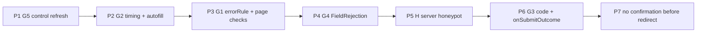

# 53 - Page-Owned Validation, Hook Outcomes and Fresh Control Values for wix-forms

Status: [Implemented] (2026-11-11, on branch `wix-forms-step-13`) — P1–P7 implemented; live browser checks pass (§Live verification); Q5 VoiceOver (Safari) passed 2026-11-11. Q10 answered (a). NVDA is a non-blocking follow-up.

Builds on **DL#41** (value store, `control` channel, live validation, Addendum A accessibility), **DL#42** (submit hooks, `runSubmission`), **DL#45** (outcomes as enum variants, text is a default) and **DL#50** (allowlist, session refusal). Found while moving a downstream site's three production forms (a contact form, a booking form with a slot picker, a unit-enquiry form) onto the plugin. Generic: no site is named. Paths are relative to `packages/wix-forms/` unless stated. jay is referenced only by public surface.

## Decisions for the Implementer (TL;DR)

- **Six gaps, seven phases, tests first.** Order: G5 (a real data bug) → G2 → G1 → G4 → H (server honeypot) → G3 → redirect follow-up. Hard dependencies are listed in §Phase map. No jay change in any phase.
- **G5 — control values refresh.** `seedControlValues` stops skipping targets that are already in the store, and stops skipping empty values. It skips only **dirty** targets and **unbound** controls (an `exec$` that resolved `undefined`). A bound control with `data-value=""` clears the slot. The mount seed moves from the dead construction-time `createEffect` (`lib/components/wix-form.ts:207-209`) to `afterRemount`, and also runs after a reset re-mount; seeded visible fields are reflected into their native input. The submit-time seed (`:316`) stays as the guarantee. No `MutationObserver` (deferred, §Trade-offs). Fixes `rich-forms.md` §2. _(Changed in implementation: a `MutationObserver` was added — see Implementation Results › Shown-vs-sent fix.)_
- **G2 — validation timing: "late to complain, early to forgive".** Blur validates a field only if it is **dirty** (changed since mount/reset) or **already shows an error**. Typing in a field that shows an error re-validates and **clears** the error as soon as the value is valid; it never replaces one error text with another while typing (no live-region chatter). Submit still validates every visible field. Autofill guard: at submit, text-like native inputs are reconciled from the DOM into the store (DOM wins when it differs from the store's value or its empty default; a single `select` only when it also changed from its mount/reset baseline, so untouched fields and selects behave as today), because some browsers autofill without an `input` event. Submit order is fixed: busy flag → reconcile → seed → read → validate. `isSubmitting` is set **before** the first `await` in `submit()` (today it is set only inside `runFormSubmit`). No new tag for announcements: Addendum A's per-field polite region is the announcement, Product decision: ship this default. **Q5 stays open** until VoiceOver and NVDA results are recorded in the live check. Recording them is a verification criterion and a required step before this log can be marked `[Implemented]`. Accessibility is not assumed.
- **H — server-side honeypot (product requirement).** The client short-circuit stays: a bot that fills the page's honeypot never posts (DL#41 Q12 and DL#42's "no POST" demo still hold). The `submitForm` action gains an optional `honeypot?: string` input, separate from `values`. The shipped component **never sends it**. It exists for direct or scripted posts. On the server: with **no hook** registered, a non-empty honeypot is **dropped by default**. With a hook registered, the hook receives `SubmitHookInput.honeypot` (`''` when absent, documented untrusted: absent ≠ human) and decides. A hook drops by returning `{ dropped: true }` without calling `submit()`. A drop settles to a fake success with no Wix call and is logged at info level. Q10 answered: option (a), scripted direct posts (product decision, 2026-11-11).
- **G1 — which rule failed + page-owned rules.** New per-field variant `errorRule: enum (NONE | REQUIRED | MIN_LENGTH | MAX_LENGTH | EMAIL | PHONE | URL | PATTERN | CUSTOM | SERVER)` on every visible field. Members are defined once in `lib/components/field-rule.ts` and rendered by the existing `enumDataType` (as DL#45 does). Built-in messages stay as English defaults in `error`; a page writes its own wording by branching on `errorRule`. Rules one regex cannot express are **page checks**: functions registered per form on a new client context, `WIX_FORMS_CONTEXT.registerFieldChecks(formId, { <target>: check[] })`, run after the built-ins pass, reported as `CUSTOM` with the check's own message. Checks are client-side UX only; the server re-validates in a hook (G4).
- **G4 — a hook can reject per field.** New exported error `FieldRejection(fieldErrors, { code? })`. Thrown by a hook **before** `submit()` succeeded, it returns `{ success: false, reason: VALIDATION, fieldErrors, code? }` (a new row in `settleSubmission`). Fields get `errorRule = SERVER`. Recognised by `name`, like `ActionError`, so duplicate module instances work.
- **G3 — the hook's code reaches the page.** The failure result gains `code?: string`: the `ActionError.code` that `run-submission.ts:284-285` drops today, or a `FieldRejection`'s code. It is delivered to **page code** through an event on the same client context: `WIX_FORMS_CONTEXT.onSubmitOutcome` (wix-cart's `onItemAddedToCart` is the precedent). **No contract variant for project codes** in this DL: the codes are the project's vocabulary, not a plugin outcome; the plugin outcome is still `submitFailure = REJECTED | VALIDATION`. A page that wants markup-only copy per code keeps its own variant, set from the event (Q7, **answered by product**: no contract variant; a config-declared `rejectionCode` enum stays deferred).
- **`WIX_FORMS_CONTEXT` lifecycle:** it is created once in `init.ts` `.withClient` by `provideWixFormsContext()`, using `registerReactiveGlobalContext` (the wix-cart pattern). The plugin component reads it **at call time** with `useGlobalContext` (jay `runtime/runtime/lib/context.ts:68-72`, which returns `undefined` when nothing is registered). Without the context, no page checks run and no events fire. Page code reads it with `.withContexts(WIX_FORMS_CONTEXT)` / `useContext`. P3 creates it.
- **In, small:** on a redirect, the component no longer shows the confirmation before navigating (no flash, no focus jump); `isSubmitting` stays set until the page unloads, as DL#42 already does.
- **Backward compatibility:** every contract and API change is additive (`errorRule` per visible field, optional `honeypot` input, optional `code` output, optional `SubmitHookInput.honeypot`, `SubmitHookOutcome.dropped`). A 0.26.1 page that binds none of it keeps working (the "extra view-state key is ignored" claim is partly traced, §Backward compatibility). Five behaviour changes go in the release notes (§Backward compatibility). Product **accepted** the quieter blur and the removed redirect flash, with no config escape hatch. The blur change gets a loud, prominent release-notes entry (Q12). `validateFormField` (exported, `lib/index.client.ts:7`) keeps its signature.
- **Agent feedback:** guides, no new validation. `rich-forms.md` §2 (the mount claim — the minimum), §3 (timing, `errorRule`, page checks), §4a (honeypot: client short-circuit plus server drop), §7 (`FieldRejection`, `code`, `onSubmitOutcome`, `honeypot` / `dropped`); `user-visible-messages.md` (`errorRule`). Runtime one-time warnings for checks registered on unknown form ids or targets (rules are TypeScript, so no build-time validator sees them — the same reasoning as DL#50 Q10).

---

## Background

The plugin today (v0.26.1, `main` = `1159cb7`):

- One shared component `WixFormInteractive` (`lib/components/wix-form.ts:102-383`) with a per-field value store (`:115`), a `dirtyTargets` set (`:117`), live validation via `validateFormField` (`:131-135`), the `control` channel (`:175-181`), hidden-field seeding (`:480-505`), and DL#41 Addendum A focus handling.
- Validation is the Wix field schema only: required, min/max length, email/url/tel format, pattern (`lib/utils/project-form-fields.ts:157-200`). It returns one English string (`validateFormField(field, value): string`).
- Server: `runSubmission` (`lib/submission/run-submission.ts:78-156`) runs the form's hook (`lib/services/wix-forms-submit-hooks.ts:13-49`) and settles every outcome into `SubmitFormResult` (`lib/types.ts:71-78`) in `settleSubmission` (`run-submission.ts:268-293`).
- Outcomes reach the page as variants `submitState` / `submitFailure` (DL#45, `lib/generators/contract-utils.ts:148-149`) plus default copy in `statusMessage` and per-field `error`.

## Problem

Verified against the source:

**G1 — page-owned rules and wording.** The field sub-contract has `error` (string) and `invalid` (boolean) only (`contract-utils.ts:84-85`); nothing says _which_ rule failed, so a page that needs its own wording (or another language) must match English text. `validateFormField` returns text only (`project-form-fields.ts:157-200`). There is no way for a page to add a rule: the only source is the Wix schema (`project-form-fields.ts:105-107` projects `minLength`/`maxLength`/`pattern`), and one regex cannot express e.g. "email with a real TLD and no role address" or "phone valid for the selected country". DL#41 §3 deferred custom messages/validators; DL#45 §Trade-offs deferred a per-field code.

**G2 — validation timing.** `onblur` always validates (`wix-form.ts:193-198`, `:403`), so tabbing through empty required fields paints every one red before the user typed anything. `oninput` only **clears** (`handleNativeInput`, `:169-173`), so after an error the field shows no error while still invalid, until the next blur. There is no autofill guard: the store is written only from `input` events (`:400-402`), and the submit path reads the store, never the DOM (`readFormValues`, `:127-129`), so a browser that autofills without firing `input` submits empty values that the user can see filled. Announcements: Addendum A puts each `error` in a polite region (`agent-kit/plugin/rich-forms.md:27`); whether a blur-found error is announced once focus has moved to the next field is unverified.

**G3 — hook rejections are opaque.** A hook's `ActionError` becomes `{ success: false, reason: REJECTED, message }` and its `code` is dropped (`run-submission.ts:284-285`; built: `dist/index.js:656`). The action output has no code (`lib/actions/submit-form.jay-action:8-13`). The page cannot tell "slot was taken" (refresh the calendar and reselect) from "no session" from "unit unavailable". And page code has no way to learn of an outcome at all: the headless component's view state is visible only to jay-html; the plugin's client init registers nothing (`lib/init.ts:17-19`).

**G4 — hook can't return per-field errors.** `SubmitHookOutcome` is `{ redirectTo? }` only (`wix-forms-submit-hooks.ts:44-47`). Per-field errors exist only for Wix's own violations (`run-submission.ts:322-325`). DL#42 deferred a hook-raised per-field rejection (DL#42 §Trade-offs, "`SubmitRejection(fieldErrors)`").

**G5 — stale hidden/control values.** `seedControlValues` skips any target already in the store (`lib/components/submission-values.ts:99`, `target in seeded`). It also skips empty values (`!hasValue(value)`, `:99`, `:107-111`), so a control that was cleared can never clear its slot. Two consequences:

1. The store starts `{}` (`wix-form.ts:115`) and the mount seed is dead (below), so the **first** submit seeds the current value correctly. Staleness starts at the **second** submit after any failure (client validation, a rejection, a network error). That second submit sends the value seeded by the first one, because the submit-time seed (`wix-form.ts:316`) skips the stored target. This is exactly the SLOT_TAKEN retry in §5: the page clears or changes the slot, and the resubmit still sends the old one.
2. After a reset, `emptyStoreFor` stores **every** field as empty (`wix-form.ts:225`, `submission-values.ts:51-57`), so no control seeds ever again: "send another" submits hidden fields empty.

And changing `data-value` fires no event, so nothing runs between seeds. The mount seed is a no-op: it runs in a construction-time `createEffect` before refs bind (`wix-form.ts:203-209`, the comment says so). The guide says values are read "on mount, and again at submit" (`rich-forms.md:68-70`): the mount part is false, and the visible-field prefill it documents never shows in the input before submit.

**H — no server-side honeypot.** The honeypot is checked in the browser only (`wix-form.ts:307-311`), and its value never leaves the browser (`:118-119`). The action input is `{ formId?, values }` (`lib/actions/submit-form.jay-action`, `lib/types.ts:62-65`). A scripted post therefore reaches Wix through the default hook (`run-submission.ts:76`, `:144`), and a project hook cannot see a honeypot at all. Product requirement: a per-form hook must be able to drop a submission whose honeypot is filled.

**Also considered:** the success state is set before a redirect (`presentSubmitResult` calls `showSubmitted()` at `:359`, then `runFormSubmit` navigates, `lib/components/form-submit-execution.ts:46-48`), so the confirmation mounts, takes focus and flashes before the page unloads.

## Prior Art / Adjacent Mechanisms

| Primitive                                                                                                                                                                                                                                            | Gap    | Verdict                                                                                                                                                |
| ---------------------------------------------------------------------------------------------------------------------------------------------------------------------------------------------------------------------------------------------------- | ------ | ------------------------------------------------------------------------------------------------------------------------------------------------------ |
| `error` data + `invalid` variant (`contract-utils.ts:84-85`)                                                                                                                                                                                         | G1     | **Partial.** Shows that a field failed, not which rule. Kept; `errorRule` sits beside it.                                                              |
| `validateFormField` (`project-form-fields.ts:157-200`)                                                                                                                                                                                               | G1     | **Partial.** Knows the rule at each branch but returns text. Refactored to return `{ rule, message }` internally; the exported text function wraps it. |
| DL#45 enums + `enumDataType` (`submit-outcome.ts:20-38`, `contract-utils.ts:157-161`)                                                                                                                                                                | G1     | **Solves the pattern.** `FieldRule` is defined and rendered the same way.                                                                              |
| Wix `pattern` (`project-form-fields.ts:107`)                                                                                                                                                                                                         | G1     | **Constrains.** Site owners can set a regex in Wix, but not page wording, cross-field rules or rules a regex cannot express.                           |
| `config/.wix-forms.yaml` (`lib/config-loader.ts:11-24`)                                                                                                                                                                                              | G1, G3 | **No.** YAML holds no functions; message copy belongs in jay-html (DL#45 §Trade-offs).                                                                 |
| `dirtyTargets` (`wix-form.ts:117`)                                                                                                                                                                                                                   | G2, G5 | **Solves the state.** Already marks user-edited fields; G2 reads it for blur, G5 for seeding.                                                          |
| `afterRemount` (`wix-form.ts:217-221`)                                                                                                                                                                                                               | G5     | **Solves the timing.** Runs after refs bind; already used for the submit guard and focus.                                                              |
| `seedControlValues` (`submission-values.ts:96-105`)                                                                                                                                                                                                  | G5     | **Constrains / the bug.** One guard (`:99`) changes.                                                                                                   |
| wix-cart `WIX_CART_CONTEXT` with `createEvent` / `EventEmitter` and `registerReactiveGlobalContext` (`packages/wix-cart/lib/contexts/wix-cart-context.ts:19-24,197,203,217-226`, registered in `.withClient`, `packages/wix-cart/lib/init.ts:42-47`) | G1, G3 | **Solves the channel.** The in-repo way for a plugin to give page code a client API and events. `WIX_FORMS_CONTEXT` copies it.                         |
| `ActionError(code, message)` (jay `@jay-framework/fullstack-component`), recognised by name (`run-submission.ts:358-365`)                                                                                                                            | G3, G4 | **Partial.** Carries a code (dropped today); form-level only. `FieldRejection` copies the name-based recognition.                                      |
| `fieldErrors` result + `presentSubmitRejection` (`types.ts:77`, `submit-outcome.ts:58-78`)                                                                                                                                                           | G4     | **Solves the client side.** Hook field errors reuse the exact path Wix's violations use, including hidden/unknown targets → `statusMessage`.           |
| `SubmitHookOutcome.redirectTo` (`wix-forms-submit-hooks.ts:44-47`)                                                                                                                                                                                   | G4     | **No.** Success-only; a field error is a failure.                                                                                                      |
| `WIX_FORMS_SUBMIT_HOOKS` keyed by form id, warn-once on bad keys (`run-submission.ts:163-187`)                                                                                                                                                       | G1     | **Solves the keying.** Page checks are keyed by form id and warned about the same way.                                                                 |

## Questions and Answers

**Q1 — Null hypothesis for G1: can the page do custom validation without a plugin change?** No. Page code cannot read the plugin's store or write a field's `error`/`invalid`; a page-side message next to the plugin's would disagree with `invalid`, focus handling (`showFieldErrors`, `wix-form.ts:245-247`) and the submit gate (`validateVisibleFields`, `submission-values.ts:117-128`). **Answered.**

**Q2 — Why an enum of rules and not an `errorCode` string?** jay-html branches on variants only (`if="tag===MEMBER"`), and a literal member is validated against the contract (jay agent-kit `designer/contracts-and-plugins.md` §variants). A string data tag could only be printed. **Answered.**

**Q3 — Do page checks run on the server?** No. They are browser UX. The server re-validates in the form's hook and rejects per field with `FieldRejection` (G4). The guide says "a page check is not a security check". **Answered.**

**Q4 — Can a page check replace a built-in rule's message without replacing the rule?** Yes, without any API: branch on `errorRule` in jay-html. Checks are for **additional** rules; they run only when every built-in rule passed, so a field has one `errorRule` at a time. **Answered.**

**Q5 — Is a blur-found error announced? (open)** Addendum A's per-field `aria-live="polite"` span (`rich-forms.md:27`) should announce it after focus lands on the next field. Default: no new surface; the live check runs VoiceOver (Safari) and NVDA (Firefox or Chrome). If it is not announced, a follow-up adds one reserved polite region. **Open — the default ships (product decision), but Q5 stays open until VoiceOver and NVDA results are recorded live in Implementation Results. Recording them is required before the status can move to `[Implemented]`. Accessibility is not assumed.** **Update (2026-11-11, product decision):** the gate is VoiceOver only; NVDA is a non-blocking follow-up (no Windows machine), see Implementation Results. **Answered (2026-11-11): yes — VoiceOver in Safari announces the blur-found email error once (human listen, product owner).**

**Q6 — Should G5 observe `data-value` changes live (`MutationObserver`)?** Not in this DL. The bug is the submitted value; the submit-time refresh fixes it. A live observer only matters for echoing a hidden value in view state before submit, which no downstream form does. **Answered (product decision): deferred, default locked.** The submit-time refresh fixes the submitted value. _(Changed in implementation: a `MutationObserver` was added — see Implementation Results › Shown-vs-sent fix.)_

**Q7 — Should project rejection codes also be a contract variant?** Default **no**: the event plus a page-owned variant covers the downstream cases (each needs page code anyway — refresh a calendar, reselect). The alternative, a `rejectionCode: enum (NONE | OTHER | …)` with members declared per form in `config/.wix-forms.yaml`, adds config, generator input and an ordering contract between config and runtime. **Answered (product decision): no contract variant.** Codes reach the page through `onSubmitOutcome`, and the page keeps its own variant. Rationale: this matches prior art (wix-cart's context events, and DL#45's split between plugin-defined outcomes and project vocabulary), and it keeps per-site vocabulary out of the plugin.

**Q8 — Does the plugin's client init run before page components construct?** The wix-cart context is used from page components the same way (`wix-cart-context.ts:7-16`), so yes in practice. The design does not depend on it:

- **Created:** once, in `init.ts` `.withClient` (`lib/init.ts:17-19`), by `provideWixFormsContext()` → `registerReactiveGlobalContext(WIX_FORMS_CONTEXT, …)` (jay `runtime/component/lib/context-api.ts:65-71`, which calls `registerGlobalContext`, `runtime/runtime/lib/context.ts:49-54`). Nothing creates it lazily.
- **Plugin component:** does **not** declare `.withContexts` (that resolves through `useContext`, which throws when the context is absent, `context.ts:92-96`). It calls `useGlobalContext(WIX_FORMS_CONTEXT)` (`context.ts:68-72`, returns `undefined` when absent) **at call time**: at each validation and at each settled submit, never at construction.
- **Init has not run** (unit tests, the harness, a project without client init): `undefined` → built-in rules only, no page checks, no event, no warning. Interactive tests that need it call `provideWixFormsContext()` before mounting and `clearGlobalContextRegistry()` (`context.ts:60-62`) after each test.
- **Page code:** `.withContexts(WIX_FORMS_CONTEXT)` / `useContext` resolves the global registry as a fallback (`context.ts:98-110`), exactly like wix-cart (`wix-cart-context.ts:7-16`). **Answered.**

**Q9 — On a redirect, should `submitState` read `SUCCEEDED`?** No: it reads `SUBMITTING` until the page unloads (the button stays busy, which is what a user sees during navigation). The `onSubmitOutcome` event carries `succeeded` with `redirectTo`, for page code. A bfcache Back restore clears `isSubmitting` (`wix-form.ts:294-298`) and shows the filled form. **Answered.**

**Q10 — How does the server-side honeypot work, and which bots does it target? Answered (product decision, 2026-11-11): option (a).** Product requirement: a per-form submit hook must be able to drop a submission whose honeypot is filled. Options:

- (a) keep the client short-circuit and add an optional `honeypot` action input for direct or scripted posts;
- (b) the client always posts, and the server alone decides.

**Default: (a)**, specified in §5a.

- The client keeps the short-circuit (`wix-form.ts:308-311`). A bot that fills the page's honeypot never posts, so no Wix call happens and no hook runs. The DL#41 Q12 and DL#42 V-demo ("honeypot run with no POST") guarantees still hold.
- The component **never sends** `honeypot`. When the short-circuit does not trip, the value is `''`, and `''` would tell the server nothing (absent ≠ human either way). Sending it would only make absent and empty look different when they mean the same thing.
- The server reads `honeypot` only from direct posts that set it: callers that fill every input of the action schema (schema-driven bots, scripts built from the `.jay-action`). A replay of the plugin's own request carries no `honeypot` and is **not** dropped; if the product requirement includes stopping replays, neither (a) nor (b) does it.
- **No hook:** a non-empty value is dropped by default.
- **Hook registered:** the hook receives `SubmitHookInput.honeypot` and decides. It can drop by returning `{ dropped: true }`.

Why not (b): it removes a guarantee that costs nothing. A DOM-filling bot would then reach the server and the hook on every attempt, and a hook that forgets the check would post spam to Wix. Under (a), the hook **never sees in-page bots**, because the client already dropped them. If the requirement is about in-page bots seen by the hook (for logging or rate limits), (b) is the alternative: the client sends the honeypot instead of short-circuiting. That is a fifth behaviour change and it reverses DL#42's "no POST".

**Open — the product owner should confirm which bots the requirement targets (scripted posts → (a); in-page bots seen by the hook → (b)). (a) ships by default.**

**Q11 — Does G2's rule hide errors a user should see?** A field the user never changed shows no error until submit; submit validates all visible fields and focuses the first invalid one (`wix-form.ts:319-328`). A required field skipped by Tab is therefore reported at submit, which is the expected behaviour for forms (GOV.UK and WAI forms tutorial both validate on submit and avoid errors on empty blur). **Answered.**

**Q12 — Are the behaviour changes for existing 0.26.1 sites accepted?** These are the five changes in §Backward compatibility: quieter blur, typing clears only when valid, control values follow the page, no confirmation flash before a redirect, and the server drops honeypot-filled direct posts when no hook is registered. **Answered (product decision): accepted, no config escape hatch.** Product explicitly accepted the quieter blur and the removed redirect flash. Typing-clears-only-when-valid and controls-follow-the-page are part of the same timing and bug-fix scope. **Requirement (UX + PM):** the blur change is the **first, prominent** release-notes entry, with a before/after description and the reason (§Backward compatibility). It is checked in Verification Criteria. The honeypot no-hook drop is accepted with H, and its target is Q10 option (a).

## Design

### Phase map



Arrows are the recommended order. These are the **hard** dependencies:

- **P3 owns `WIX_FORMS_CONTEXT`.** It creates `lib/contexts/wix-forms-context.ts`, `provideWixFormsContext()` and the `init.ts` registration. The interface has only `registerFieldChecks`, which is complete for P3. **P6 depends on P3** and adds the `onSubmitOutcome` member, an additive interface change. No phase ships a member that does nothing.
- P4 sets `errorRule = SERVER`, which needs P3's tag. Without P3, P4 still sets `error`/`invalid`. P4's `code` is in the action result, but **page code can read it only after P6** (the event). Until then only the network response carries it.
- P5 adds a settle-table row next to P4's row, so it lands after P4. It does not need P3.
- **P2 does not need P3.** `FieldRule`, `FieldCheckResult`, `checkFormField` and the component's `checkField` are created in P3 (§3). P2 therefore uses today's API: `handleNativeInput` clears only when `validateFormField(field, value) === ''` (`lib/utils/project-form-fields.ts:157-200`), and P2's exception path wraps `validateVisibleFields`/`validateFormField`. P3 then switches both call sites to `checkField(...).rule === FieldRule.NONE` (so page checks also gate the clear). Chosen over moving the rule refactor into P2 because it keeps P2 a timing-only change and keeps the whole rule surface (enum, contract tag, view state, page checks) in the one phase that ships it.
- P6's `succeeded` event with `redirectTo` is the only way page code sees a redirect once P7 skips the confirmation. P7 can ship without P6; it is then visible only in view state (`SUBMITTING`, Q9).

### 1. G5 — control values refresh (`lib/components/submission-values.ts`, `lib/components/wix-form.ts`)

`ControlSeed.value` becomes `FieldValue | undefined`, where `undefined` means the control is not bound (`exec$` resolved `undefined`); today `value ?? ''` (`wix-form.ts:497`) erases that difference.

```ts
export interface SeedResult {
  store: FieldStore;
  changedTargets: string[];
}

/** Page-provided control values win over the store for every field the user has not edited. */
export function seedControlValues(store: FieldStore, seeds: ControlSeed[]): SeedResult {
  const seeded = { ...store };
  const changedTargets: string[] = [];
  for (const { target, value, dirty } of seeds) {
    if (dirty || value === undefined) continue;
    if (!sameFieldValue(seeded[target], value)) changedTargets.push(target);
    seeded[target] = value; // '' from a bound control clears the slot
  }
  return { store: seeded, changedTargets };
}
```

This removes **both** of today's guards at `submission-values.ts:99`: `target in seeded`, and `!hasValue(value)` (`:107-111`). `sameFieldValue` compares strings and booleans with `===` and arrays element by element.

New signature: `seedControlsIntoStore(refs, fields, dirtyTargets, setValues): Promise<string[]>` (today `Promise<void>`, `wix-form.ts:480-505`). It resolves to `changedTargets`, which it computes inside the `setValues` updater. It passes `value` through as `string | undefined` (today `value ?? ''`, `:497`).

**Custom widgets without `data-value`:** `readControlValue` (`:531-539`) returns `''` for a bound element that has neither `data-value` nor `.value` (e.g. `<div ref="x.control">`). Under the new rule, that `''` **clears** the slot on every seed while the field is not dirty. A widget whose `control` event fired is dirty, so its value is kept. Widgets that seed must render `data-value`. The guide (§2, §5) says so.

Call sites:

- **Mount:** replace the `createEffect` (`:207-209`) with `afterRemount(() => seedAndReflect())`, next to the existing `afterRemount(() => wireNativeFormSubmit(...))` (`:221`).
- **Reset:** in `clearNativeInputsAfterRemount` (`:263-271`), after clearing inputs, `seedAndReflect()`, so "send another" carries the page's current hidden values and visible defaults.
- **Submit:** same place in the order (after the honeypot check, before `readFormValues`), now refreshing, and it calls **`seedAndReflect()`**, not the bare seed. Otherwise a visible field whose `control` `data-value` the page changed after mount (and the user never edited) would post the new value while its input still shows the old one, breaking "what the user sees wins": the reconcile sees DOM = store (both old), does not mark it dirty, then the seed writes the new value. Reflecting makes the input show exactly what is sent. It runs **after** the G2 autofill reconcile: busy flag → `reconcileNativeInputs()` → seed → `readFormValues()` → validate. The reconcile marks a field dirty when it writes the DOM value, so the seed then skips that field. With the opposite order, a non-dirty visible field bound to a `control` could be seeded first and then overwritten by the DOM, or the reverse, depending on which value differed. A fixed order makes the result deterministic: what the user sees wins, and the page value wins only for fields the user has not touched and the browser did not fill.

`seedAndReflect` = `seedControlsIntoStore(...)` then `reflectToInput(field, value)` (`:143-167`) for each changed **visible** field, so a visible prefill shows in its input. `seedAndReflect` awaits the seed but does **not** await the reflect `exec$` promises: `reflectToInput` stays fire-and-forget as today (`:143-167`), so a throw inside a reflect callback is an unhandled rejection that never reaches `submit()` and is outside the busy-flag guarantee.

Trace — selected slot changes after mount, then reset (**new** behaviour; today's behaviour is noted per step):

1. Page renders `<input type="hidden" ref="book.slotId.control" data-value="{selectedSlotId}">`, initially `""`. New mount seed: bound, value `''` → store `slotId: ''`. Today: the mount seed is dead and the store stays `{}`.
2. User picks a slot in the page's own calendar; page signal → jay re-renders the attribute to `"s-42"`. No plugin event (expected).
3. Submit: `:316` reads `"s-42"`; `slotId` not dirty (hidden inputs receive no `input`/`click`, so `handleControl` `:175-181` never ran) → store `s-42` → `readFormValues` (`:127-129`) → submitted. Today: correct on the **first** submit (the store was `{}`). If that submit fails and the page then changes the slot, the second submit skips it at `submission-values.ts:99` and sends the first value.
4. Reset: store emptied (`:225`), `dirtyTargets` cleared (`:232`); after re-mount `seedAndReflect` restores `s-42` (or whatever the page now holds). Today: empty forever.

**Null hypothesis:** the store, `dirtyTargets`, `afterRemount` and the submit-time seed already exist; this is one guard and two call sites. No new surface.

### 2. G2 — validation timing (`lib/components/wix-form.ts`)

```ts
function handleNativeBlur(field: FormFieldView): void {
  if (dirtyTargets.has(field.target) || errorByTarget()[field.target]) validateField(field);
}

function handleNativeInput(field: FormFieldView, event: Event): void {
  dirtyTargets.add(field.target);
  setFieldValue(field.target, readNativeValue(field, event.target));
  if (errorByTarget()[field.target] && checkField(field).rule === FieldRule.NONE)
    clearFieldError(field);
}
```

This is the **P3** form. In **P2** the condition is `validateFormField(field, values()[field.target] ?? emptyValueFor(field)) === ''` (today's API); P3 replaces it with the `checkField` form above (§Phase map).

The comparison is written against `FieldRule.NONE` and does not rely on `NONE === 0`. Visible consequence: typing in a field that shows a **`SERVER`** error (from Wix or a hook `FieldRejection`) clears that error as soon as the built-in rules and page checks pass. This is intended, because the client cannot re-check a server rule and the next submit re-asks the server. The guide (§3) states it.

- `wireFieldEvents` (`:193-198`) passes `onNativeBlur: handleNativeBlur`.
- Typing in an errored field clears the error the moment it is valid, and otherwise leaves the existing text alone (no re-announcement per keystroke). Today it clears unconditionally (`:172`), which hides a still-invalid state.
- `control` and chip changes are commits and keep validating immediately (`:180`, `:190`).
- Reset already clears `dirtyTargets` (`:232`), so a fresh form is quiet again.
- **Autofill guard:** before `readFormValues` at submit (`:318`), `reconcileNativeInputs()` reads the bound `input`/`select` via `exec$` of **every visible field whose kind is not `checkbox` or `multiselect`** — i.e. text, `email`, `url`, `tel` and single `select` (kinds per `project-form-fields.ts`, `form-view-state.ts:46-72`) — and, when the DOM value differs from the store, writes it to the store and marks it dirty. **Comparison rule:** the DOM value is compared against `values()[target] ?? emptyValueFor(field)`, the same default `projectSubmissionValues` and `validateVisibleFields` use (`submission-values.ts:37`, `:124`), because the store starts as `{}` (`wix-form.ts:115`). An untouched empty field (DOM `''`, no store key) is therefore equal, is not written and is **not** marked dirty, so its later control seed still applies (§1) and G2's quiet blur still holds after a submit. **Single `select` baseline (no new behaviour for untouched selects):** a `select` is reconciled only when its DOM value differs from its **baseline**, the DOM value it had at mount or after the last reset, and then also differs from the store as above. The baseline is a component-local `Map<target, string>` (`selectBaselineByTarget`), filled by `captureSelectBaselines()`, which reads each visible single-`select` field's bound element via `exec$`. It runs inside `afterRemount`: once at mount (in the same `afterRemount` that runs the new G5 mount seed and reflect, after the reflect) and once after reset (inside `clearNativeInputsAfterRemount`, `wix-form.ts:263-270`, after the `reflectToInput` loop). The map is cleared on reset before re-capture. A select whose DOM value still equals its baseline (an untouched select showing its first option) is skipped, so it keeps posting the store value (`''`) exactly as today; a select the browser autofilled or the user changed without an `input`/`change` event reaching the store differs from its baseline and is reconciled. A select with no captured baseline (its branch was not mounted at capture time) is treated as baseline `''`, the store default. **A field with no bound native input is skipped:** when `exec$` is absent or resolves `undefined` (the page binds only `control`, a custom widget per DL#41 4a — the same signal `seedControlsIntoStore` relies on, `wix-form.ts:494-496`), the reconcile leaves the store untouched. It must not coerce `undefined` to `''` the way `readNativeValue` does (`:525-526`), or it would erase a widget value set by `handleControl` (`:175-181`) or by the seed. Single `select` is included because browsers autofill `<select>` (country, region) without an `input` event a page can rely on; its DOM value is one string, like a text input. Checkbox and multiselect are excluded: browsers do not autofill them and their value is not a single DOM string. Hidden fields are never read (their source is the `control`). This runs before client validation, so an autofilled-but-silent field validates and submits what the user sees.
- **Busy flag before the awaits (hardening only).** Today `submit()` checks `isSubmitting()` (`:302`), but the flag is set only in `runFormSubmit` (`form-submit-execution.ts:28`), after the `await seedControlsIntoStore` (`:316`). A second click during the seed passes the check, but **no visible bug follows today**: call 2 clears `statusMessage`/`submitFailure`/`errorByTarget` (`:303-305`) while they are still empty (call 1 just cleared them and nothing writes them while the seed is pending); call 1 resumes first and runs synchronously to either client errors or `runFormSubmit`, which sets the flag (`form-submit-execution.ts:28`) before its first `await` (`:32`); call 2 then either rewrites the same client errors (an extra `showFieldErrors` focus and a duplicate `setSubmitFailure(VALIDATION)`) or returns at `:25`. So today exactly one `submitForm` call is made and nothing call 1 produced is erased. The move is hardening: this DL adds a second pre-submit await (the reconcile), and the "first resumes first, synchronously" argument would have to be re-proved for every future await. Owning the flag in `submit()` makes the guard hold by construction, and the button shows busy from the first click. New rule: `submit()` calls `setIsSubmitting(true)` right after the honeypot check, before the first `await`. It clears the flag on a client-validation failure. `runFormSubmit` no longer checks or sets the flag (its `:25` early return and `:28` set are removed, because the component owns them). It still clears the flag on a transport failure (`:40`) and when there is no redirect (`:50`). Its unit tests change accordingly.
- **Flight generation with the busy flag (reset during the pre-hand-off window).** `resetForm` calls `submitFlight.invalidate()` and `setIsSubmitting(false)` (`wix-form.ts:223-231`), but today the generation starts only inside `runFormSubmit` (`form-submit-execution.ts:27`, `flight.begin()`). A reset that lands while `submit()` awaits the seed (and, after this DL, the reconcile) lets the old call resume, hand off, and `begin()` a **fresh, current** generation: it posts the old values and shows success on the reset form. Same race exists today; this DL lengthens the window. Reset cannot be ruled out while submitting: the reset button is a page-placed ref (`refs.resetButton`, `:273-276`), so the plugin cannot prove it lives only in the confirmation branch. Fix: `submit()` calls `const generation = submitFlight.begin()` together with `setIsSubmitting(true)`; after each pre-hand-off `await` (reconcile, seed) it returns if `!submitFlight.isCurrent(generation)` (no writes, no flag change — reset already cleared the flag); `RunFormSubmitParams` gains `generation: number` and `runFormSubmit` uses it instead of calling `begin()` (its existing `isCurrent` checks after the network awaits stay).
- **Exception path.** Everything between `setIsSubmitting(true)` and the hand-off to `runFormSubmit` (reconcile, `seedAndReflect` incl. the seed's awaited `exec$`, `readFormValues`, `validateVisibleFields` with `validateFormField` in P2 / `checkField` from P3) is wrapped so a throw cannot leave the form busy:
  ```ts
  setIsSubmitting(true);
  const generation = submitFlight.begin();
  let handedOff = false;
  try {
      await reconcileNativeInputs();
      if (!submitFlight.isCurrent(generation)) return; // reset during the window
      await seedAndReflect();
      if (!submitFlight.isCurrent(generation)) return;
      // ... read, validate; on client errors: show them and return (flag cleared in finally)
      handedOff = true;
      await runFormSubmit({ generation, ... }); // owns the flag from here (clears on failure / no redirect)
  } finally {
      if (!handedOff && submitFlight.isCurrent(generation)) setIsSubmitting(false);
  }
  ```
  The throw is not swallowed (it still surfaces as an unhandled rejection / console error, as today); only the busy flag is released. The client-validation failure path clears the flag through the same `finally`.
- **DL#42 correction (remark, not a rewrite).** DL#42 §Implementation Results → Deviations says the guard "is set before the submit-time hidden seed". At `1159cb7` the code does not do that (`wix-form.ts:300-330`, `form-submit-execution.ts:25-28`). This DL implements it. P2 appends a dated remark to DL#42's Implementation Results pointing to this DL. The Design section of DL#42 is not edited.

Trace — tab through an empty form: focus first → Tab: blur, not dirty, no error → nothing. Today: `validateField` → "First name is required." on every field. Submit: `validateVisibleFields` (`submission-values.ts:117-128`) → errors on all, focus first (`showFieldErrors`, `:245-247`). Unchanged.

**Null hypothesis:** no new tag or API; uses `dirtyTargets` and existing handlers.

### 3. G1 — `errorRule` and page checks

**Rule enum** — new `lib/components/field-rule.ts` (client-safe, like `submit-outcome.ts`):

```ts
/** The per-field `errorRule` contract variant. Member order IS the contract (DL#45). */
export enum FieldRule {
  NONE,
  REQUIRED,
  MIN_LENGTH,
  MAX_LENGTH,
  EMAIL,
  PHONE,
  URL,
  PATTERN,
  CUSTOM,
  SERVER,
}

export interface FieldCheckResult {
  rule: FieldRule;
  message: string;
}
```

**Validation** — `lib/utils/project-form-fields.ts`: new `checkFormField(field, value): FieldCheckResult` holds today's branches (`:157-200`), each returning its rule (`required` → `REQUIRED`, `minLength` → `MIN_LENGTH`, …, `tel` → `PHONE`, invalid `pattern` regex → `NONE` as today). `validateFormField(field, value)` becomes `checkFormField(field, value).message` — same exported signature (`lib/index.client.ts:7`). `validateVisibleFields` (`lib/components/submission-values.ts:117-128`) stays pure and gains the check as a parameter:

```ts
export function validateVisibleFields(
  fields: FormFieldView[],
  values: Record<string, FieldValue>,
  check: (field: FormFieldView, value: FieldValue) => FieldCheckResult = checkFormField,
): Record<string, FieldCheckResult>;
```

It still skips hidden fields and passes `values[field.target] ?? emptyValueFor(field)` as today (`:124`). At submit the component calls `validateVisibleFields(carryForward.fields, submissionValues, checkField)`, so page checks see the **submitted** value (`submissionValues`, the projection from `readFormValues`). Visible fields are always in the projection, so no key is lost; hidden fields are never checked. The default `check` keeps the pure function usable (and unit-testable) without a context.

**Contract** — `fieldTag` (`contract-utils.ts:67-94`), visible fields only, after `invalid` (`:85`):

```yaml
- {
    tag: errorRule,
    type: variant,
    dataType: 'enum (NONE | REQUIRED | MIN_LENGTH | MAX_LENGTH | EMAIL | PHONE | URL | PATTERN | CUSTOM | SERVER)',
  }
```

rendered with `enumDataType(FieldRule)` (`:157-161`). Field-level, so no `RESERVED_TAG_NAMES` change. Hidden fields have no error tags today (`hiddenFieldTag`, `:101-114`) and get none.

**View state** — `FieldViewState` (`lib/components/form-view-state.ts:18-27`) gains `errorRule: FieldRule`; `FormViewStateOverrides` gains `ruleByTarget?: Record<string, FieldRule>`; `fieldToViewState` (`:46-72`) sets it, default `NONE`. The component keeps one more signal, `ruleByTarget`. It is written wherever `errorByTarget` is written, and cleared wherever it is cleared:

| Site                                         | `errorByTarget` | `invalidByTarget`                 | `ruleByTarget`                   |
| -------------------------------------------- | --------------- | --------------------------------- | -------------------------------- |
| `validateField` (`:131-135`)                 | set             | set                               | set from `checkField`            |
| `clearFieldError` (`:137-140`)               | `''`            | `false`                           | `NONE`                           |
| submit start (`:305`)                        | `{}`            | **`{}` (new: not cleared today)** | `{}`                             |
| client validation failure (`:321-324`)       | set             | set                               | set                              |
| `presentSubmitResult` rejection (`:351-352`) | set             | set                               | `SERVER` for each visible target |
| reset (`:226-227`)                           | `{}`            | `{}`                              | `{}`                             |

`invalidByTarget` is not cleared at submit start today. As a result, a network failure after a field error leaves `aria-invalid="true"` with an empty message. This DL fixes that in P3. An empty `ruleByTarget` entry reads as `NONE` in `fieldToViewState`.

**Page checks** — new client context `lib/contexts/wix-forms-context.ts`:

```ts
/** A page's own rule. Return a message to fail (the page's own wording), nothing to pass. */
export type FieldCheck = (
  value: FieldValue,
  values: Readonly<Record<string, FieldValue>>,
) => string | undefined;

/** Field target → checks, run in order after the Wix rules pass; the first message wins. */
export type FieldChecks = Record<string, FieldCheck[]>;

export interface WixFormsContext {
  /** Register checks for one form (keyed by form id, any case); returns an unregister function. */
  registerFieldChecks(formId: string, checks: FieldChecks): () => void;
  // P6 adds: onSubmitOutcome: EventEmitter<SubmitOutcomeEvent, any>  (§5)
}

export const WIX_FORMS_CONTEXT = createJayContext<WixFormsContext>('wix:forms');
/** Called once from init.ts .withClient; registerReactiveGlobalContext, as wix-cart. */
export function provideWixFormsContext(): WixFormsContext;
```

- **Lifecycle (Q8):** created only by `provideWixFormsContext()` in `init.ts` `.withClient` (`lib/init.ts:17-19`). It is never created lazily. It is exported from `lib/index.client.ts` with the types.
- **Component access:** `useGlobalContext(WIX_FORMS_CONTEXT)` at call time (jay `runtime/runtime/lib/context.ts:68-72`). `undefined` → no page checks, no event. The component does not declare `.withContexts`, so a missing init cannot throw at construction.
- Keys go through `canonicalFormId` (`lib/utils/form-id.ts`) like hooks; a non-form-id key, or a target the form does not have, is warned about once at runtime.
- The component's `checkField(field, value = values()[field.target] ?? emptyValueFor(field))` (blur/input use the store default; submit passes the submitted value through `validateVisibleFields`, §3 Validation) = `checkFormField(field, value)`, and if `rule === NONE`, the registered checks for `canonicalFormId(carryForward.formId)` and `field.target`, looked up **at call time** (Q8). A failing check → `{ rule: CUSTOM, message }`. A check that throws → logged once, treated as pass (a page bug must not block submit). Checks run for visible fields only, on the same triggers as built-ins (G2) and at submit.
- Page usage from a page component: `.withContexts(WIX_FORMS_CONTEXT)` in its interactive phase, `registerFieldChecks(...)`; or once in the project's own client init.

**Null hypothesis:** Q1/Q2 rule out the page alone and a string code; YAML cannot hold functions; a second plugin primitive for events (G3) and checks would be two channels, so one context serves both.

### 4. G4 — `FieldRejection` (`lib/services/wix-forms-submit-hooks.ts`, `lib/submission/run-submission.ts`)

```ts
/** Thrown by a hook to reject specific fields: target → message (the hook's own wording). */
export class FieldRejection extends Error {
  constructor(
    readonly fieldErrors: Record<string, string>,
    readonly options: { code?: string } = {},
  ) {
    super('the submit hook rejected fields: ' + Object.keys(fieldErrors).join(', '));
    this.name = 'FieldRejection';
  }
}
```

`settleSubmission` (`run-submission.ts:268-293`) gains one row before the `ActionError` row (`:284`):

```ts
if (isFieldRejection(thrown) && Object.keys(thrown.fieldErrors).length) {
  return {
    success: false,
    reason: SubmitFailure.VALIDATION,
    fieldErrors: thrown.fieldErrors,
    code: thrown.options?.code,
  };
}
```

- It only matters when the attempt is `idle`: `succeeded` and `failed` rows (`:277-283`) still win ("once `submit()` was called, the Wix outcome alone decides", DL#42). A hook that validates first and then calls `submit()` is the documented pattern.
- `isFieldRejection` checks `name === 'FieldRejection'` and an object `fieldErrors`, like `isActionError` (`:358-365`). An empty `fieldErrors` falls through to the generic `UNKNOWN` row (logged L5).
- Client: unchanged path — `presentSubmitRejection` (`submit-outcome.ts:58-78`) puts visible targets on fields (+ `errorRule = SERVER`), hidden/unknown ones in `statusMessage`; focus moves to the first invalid field (`:355`).
- Messages are text from the hook (server code, owned by the project, may localize). Per DL#45, the plugin outcome is the variant (`VALIDATION`, `SERVER`); the text is the project's.

**Null hypothesis.** Three cheaper alternatives were considered:

1. **Honour a `fieldErrors` property on a thrown `ActionError`-named object.** Rejected. `ActionError` is jay's public class with constructor `(code, message)`. Reading an extra property from it is an undocumented contract on another package's type, and projects would have to mutate or hand-build `ActionError`s to use it. jay's transport keeps only `{ code, message }` of a thrown error (`lib/types.ts:67-68`), so the same object would mean different things in a hook and in any other action.
2. **`SubmitHookOutcome.fieldErrors` returned as a failure.** Rejected. The outcome is the _success_ return (`wix-forms-submit-hooks.ts:44-47`; `settleSubmission` reads it only when `submit()` succeeded, `run-submission.ts:277-279`). A returned field map would need precedence rules against a successful `submit()`. It would also break the rule this DL keeps: **returns describe how a success looks (`redirectTo`, `dropped`), throws describe failures.**
3. **Reuse `ActionError` with a project code and parse fields from `message`.** Rejected: string parsing is the text matching that G1 removes.

An exported error class mirrors `SubmitIgnoredError` / `NoCallerSessionError` (`wix-forms-submit-hooks.ts:57-83`) and costs one class plus one settle row.

`isActionError` (`run-submission.ts:358-365`) is typed `error is Error` today, so `thrown.code` would not type-check. P6 changes it to `error is Error & { code: string }`. `isFieldRejection` is typed `error is Error & { fieldErrors: Record<string, string>; options?: { code?: string } }`.

### 5. G3 — `code` and `onSubmitOutcome`

**Result** — `SubmitFormResult` failure (`types.ts:73-78`) gains `code?: string`; `submit-form.jay-action` output (`:8-13`) gains `code?: string  # the hook's ActionError / FieldRejection code`. `run-submission.ts:284-285` returns `{ success: false, reason: REJECTED, message: thrown.message, code: thrown.code }`. Only hook-raised failures carry a code; plugin and Wix failures do not (their reason is the code).

**Event** — P6 adds `onSubmitOutcome: EventEmitter<SubmitOutcomeEvent, any>` to `WixFormsContext` (§3), created with `createEvent` inside the `registerReactiveGlobalContext` factory, as wix-cart does (`wix-cart-context.ts:223-228`):

```ts
export type SubmitOutcomeEvent =
  | { formId: string; outcome: 'succeeded'; redirectTo?: string }
  | {
      formId: string;
      outcome: 'failed';
      reason: SubmitFailure;
      code?: string;
      fieldErrors?: Record<string, string>;
    };
```

The component emits it once per settled submit: from `presentSubmitResult` (`wix-form.ts:348-368`), from a client validation failure (`:320-327`, `reason: VALIDATION`), from `onNetworkFailure` (`:340-343`), and from the honeypot trip (`:308-311`, `outcome: 'succeeded'`).

**One rule for honeypots: the event reports what the visitor was shown, never what was stored.** A client trip shows the confirmation, so it emits `succeeded`. A server drop (§5a) returns a plain `{ success: true }`, so any client would also see `succeeded`. The two cases are indistinguishable by design. If the trip emitted nothing, page code (or a bot watching it) could tell a trip apart from a real success. The guide repeats the existing rule (`rich-forms.md:44-46`): neither the confirmation nor `succeeded` is a persistence guarantee. A page that needs one must get it from server-side state.

`formId` is canonical; a page with two forms filters on it.

Trace — slot taken: hook `throw new ActionError('SLOT_TAKEN', 'That time was just booked.')` → `settleSubmission` `:284` → `{ success:false, reason: REJECTED, message, code: 'SLOT_TAKEN' }` → transport → `runFormSubmit` (`form-submit-execution.ts:46`) → `presentSubmitResult` sets `submitFailure = REJECTED`, `statusMessage`, emits `{ outcome:'failed', reason: REJECTED, code: 'SLOT_TAKEN' }` → page handler reloads availability, clears its selected slot (hidden `data-value` → `""`); next submit refreshes it (G5).

**Null hypothesis:** page code has no other way to observe the headless component (Background, G3); the context is the existing plugin→page channel (wix-cart). No contract change (Q7).

### 5a. H — server-side honeypot (`lib/actions/submit-form.jay-action`, `lib/types.ts`, `lib/submission/run-submission.ts`, `lib/services/wix-forms-submit-hooks.ts`)

Default of Q10, option (a).

**Transport.** In `submit-form.jay-action`, `inputSchema` gains `honeypot?: string  # value of the page's honeypot; the plugin component never sends it`. `SubmitRequestInput` (`types.ts:62-65`) gains `honeypot?: string`. The value is separate from `values`, so it can never reach Wix through `submit()`'s default values (`run-submission.ts:211`, `values = requestValues`). `runSubmission` normalises it once: `const honeypot = typeof request.honeypot === 'string' ? request.honeypot.trim() : ''`. The input is untrusted, so a non-string counts as absent. It then passes it to `submitSubmittableForm`.

**Client.** No change to the path. The short-circuit at `wix-form.ts:308-311` stays, and `runFormSubmit`'s `submitForm` call (`form-submit-execution.ts:33-36`) still sends `{ formId, values }` only.

**Hook input.** `SubmitHookInput` gains:

```ts
/**
 * The `honeypot` action input, trimmed; the plugin always sets it ('' when absent). Optional in the type only so hand-built inputs (e.g. a project's own hook unit tests) keep type-checking. UNTRUSTED and advisory: the plugin's
 * own component never sends it (its browser check drops in-page bots before any request), so
 * '' does NOT mean human. Non-empty means a direct post filled it: drop with `{ dropped: true }`.
 */
honeypot?: string;
```

**Drop outcome.** `SubmitHookOutcome` gains `dropped?: true`:

```ts
export interface SubmitHookOutcome {
  /** Site path ('/…') to navigate to after success. */
  redirectTo?: string;
  /** Settle as a success without posting to Wix (e.g. a filled honeypot). Return it without calling submit(). */
  dropped?: true;
}
```

**Null hypothesis for `dropped` over an exported `SubmissionDropped` error.** Both are one line for the hook author. A drop _looks like a success_ to the caller, and this DL's rule is "returns describe how a success looks, throws describe failures" (§4). An error class would also need name-based recognition and a settle row that turns a throw into a success, which is the opposite of every other throw row. The existing return path (`outcome`, `run-submission.ts:141-155`) already carries success-shaped data.

**Settle table** (`settleSubmission`, `run-submission.ts:268-293`). A new row comes **after** the `succeeded` / `failed` rows (`:277-283`) and **before** the `FieldRejection` / `ActionError` rows:

```ts
if (thrown === undefined && (outcome || undefined)?.dropped === true) {
  logDrop(formId); // info level: "[wix-forms] dropped a submission (hook)", form id only
  return outcome.redirectTo === undefined
    ? { success: true }
    : { success: true, redirectTo: outcome.redirectTo };
}
```

- If the hook called `submit()` and the post succeeded, the earlier `succeeded` row wins. The post happened, so the response is the real success, and `dropped` is ignored and logged as L3 ("dropped after submit() was called"). Location: inside the existing `attempt.state === 'succeeded'` row (`run-submission.ts:277-279`), before its `return`: `if (thrown === undefined && (outcome || undefined)?.dropped === true) logFailure('the submit hook returned dropped after submit() was called', formId, undefined); // L3`. The existing L3 (`:274-276`) fires only on a throw, and the new drop row sits after the `succeeded` row, so neither would log it.
- `redirectTo` is honoured on a drop, so the bot sees exactly what a real success would show.
- A drop is logged at **info**, never as L5 (today a hook that returns without `submit()` is L5 → `UNKNOWN`, `:286-291`).

**No-hook default.** In `submitSubmittableForm`, the drop happens after the allowlist (`runSubmission`, `run-submission.ts:86-87`) and before `resolveClient` (`:120`). When `!deps.hook && honeypot !== ''`, it logs at info ("dropped a submission (honeypot, no hook)") and returns `{ success: true }`, with no Wix call and no identity resolution. The allowlist still runs first, so a non-submittable form id gets the usual refusal and a drop reveals nothing about which ids exist. With a hook registered, the plugin does **not** drop: the hook gets `honeypot` and owns the decision (the product requirement). The guide's hook example starts with `if (honeypot) return { dropped: true };`.

**Trade-off, stated:** a project hook that ignores `honeypot` will post honeypot-filled direct submissions. This is the cost of letting the hook decide. The guide makes the check the first line of every hook example. Q10 records the alternative of always dropping before the hook.

Trace — scripted post `{ formId: F, values: {...}, honeypot: 'x' }`, no hook → allowlist passes → `honeypot === 'x'` → info log → `{ success: true }` → no `createSubmission`. The same post with a hook that checks it → `outcome = { dropped: true }`, `attempt.state === 'idle'` → drop row → `{ success: true }`. The browser user path, with the in-page honeypot filled → `wix-form.ts:308` → `showSubmitted()` + `succeeded` event, no request (unchanged).

### 6. No confirmation before a redirect (`lib/components/wix-form.ts`)

`presentSubmitResult` (`:358-367`) computes `redirectPath` first; when it is defined it **skips** `showSubmitted()` and returns the path (`isSubmitting` stays `true`, `runFormSubmit` navigates, `form-submit-execution.ts:47-48`). An unsafe `redirectTo` (dropped, `:362-366`) shows the confirmation as today.

### Backward compatibility (0.26.1 sites)

- **Contracts:** `errorRule` is additive, and pages that don't bind it are unaffected. Sites regenerate contracts with `jay-stack setup`/agent-kit, as for every plugin update. Committed 0.26.1 `.jay-contract` files keep compiling, because the generator adds a tag and removes none.
- **Extra view-state key with an old contract — partly traced, ⚠️ to be verified.** jay compiles jay-html to element code whose bindings are closures over the paths the contract declares (`dynamicProperty` / `dynamicAttribute` keep a `valueFunc`, jay `runtime/runtime/lib/element.ts:120-130`). No generated code enumerates view-state keys, so an undeclared `errorRule` key is never read. The component is typed `makeJayStackComponent<any>()` (`wix-form.ts:548`), so TypeScript reports no excess property. **Not traced:** the fast-phase view-state serialisation and hydration path. **Verification step (P3):** a test compiles a 0.26.1 fixture contract (without `errorRule`) and its jay-html with the jay compiler, renders it with a view state that includes `errorRule`, and asserts the output equals the fixture's expected output. The live check also loads one page without regenerated contracts.
- **API:** `validateFormField` keeps its signature. `SubmitFormResult` gains an optional `code`. The `submitForm` input gains an optional `honeypot` (additive, so old callers are unchanged). `SubmitHookInput` gains `honeypot`, and `SubmitHookOutcome` gains an optional `dropped`. Hooks that use neither behave the same.
- **Release notes:** five behaviour changes, accepted by product (Q12). Item 1 is the loud, prominent entry:
  1. **⚠️ Blur no longer flags untouched fields (headline entry, first in the notes).** Before: tabbing past an empty required field showed its error immediately. After: errors appear on blur only for fields the user changed (or that already show an error), and every visible field is still validated at submit, with focus on the first invalid one. Reason: no errors before the user has typed. No config switch.
  2. Typing clears an error only when the value is valid (and clears `SERVER` errors too).
  3. Hidden/control values now follow the page while the user has not edited them, including after a failed submit and after "send another" (the bug fix). A page that relied on the first value was relying on a bug. Custom widgets must render `data-value`.
  4. A redirecting form no longer flashes its confirmation before navigating.
  5. **Server honeypot:** a direct `submitForm` post with a non-empty `honeypot` input is dropped (fake success, no Wix call) when the form has no hook. This catches callers that fill every action input; it does not stop replays of the plugin's own requests (they carry no `honeypot`). Hooks receive `honeypot` and decide. The in-page client behaviour is unchanged: a trip still makes no request (the DL#41/#42 guarantee).

## Examples

✅ Page wording per rule (G1):

```html
<input
  id="c-email"
  ref="contact.email.input"
  aria-invalid="{contact.email.invalid}"
  aria-describedby="c-email-err"
/>
<span id="c-email-err" aria-live="polite">
  <span if="contact.email.errorRule === REQUIRED">Please tell us your email.</span>
  <span if="contact.email.errorRule === EMAIL">That email doesn't look right.</span>
  <span if="contact.email.errorRule === CUSTOM">{contact.email.error}</span>
  <span if="contact.email.errorRule === SERVER">{contact.email.error}</span>
</span>
```

✅ Page check (G1) and outcome event (G3), in a page component's interactive phase:

```ts
const forms = useContext(WIX_FORMS_CONTEXT); // page declared .withContexts(WIX_FORMS_CONTEXT)
const unregister = forms.registerFieldChecks(BOOKING_FORM_ID, {
  phone: [
    (value) =>
      isValidPhone(String(value)) ? undefined : 'Use an international number, e.g. +44 20 …',
  ],
});
forms.onSubmitOutcome(({ formId, outcome, code }) => {
  if (formId === BOOKING_FORM_ID && outcome === 'failed' && code === 'SLOT_TAKEN') {
    setSelectedSlot(undefined); // hidden data-value → "", refreshed at next submit (G5)
    void reloadAvailability();
  }
});
```

✅ Hook rejects a field (G4), validating before submitting:

```ts
[BOOKING_FORM_ID]: async ({ values, submit }) => {
    if (!isValidPhone(String(values.phone))) throw new FieldRejection({ phone: 'Please check the phone number.' }, { code: 'BAD_PHONE' });
    await submit();
},
```

❌ Calling `submit()` and then throwing `FieldRejection`: the post already happened; the Wix outcome decides and the rejection is only logged (L3).

❌ Matching English text: `if="contact.email.error === 'Please enter a valid email address.'"` — branch on `errorRule`.

## Implementation Plan

Each phase: write the failing tests first (bug-repro for G2/G3/G5, with doc comments citing this DL), implement, `yarn build` + `yarn test` in `packages/wix-forms`, guide update in the same phase, `Implementation Results` line appended. Interactive tests use the existing harness `test/support/wix-form-harness.ts`.

**Phase 1 — G5.** Tests: `test/submission-values.test.ts` — seeding overwrites a stored non-dirty value; `undefined` (unbound) is skipped; `''` from a bound control clears; dirty is kept. `test/wix-form-control-refresh.interactive.test.ts` — (a) submit fails (client validation or a stubbed rejection), change a hidden control's `data-value`, resubmit → the **new** value is posted (red today); (a2) a bound control's `data-value` set to `""` after a failed submit → `''` posted; (a3) a bound widget that seeded a non-empty value, then loses its `data-value` (attribute removed), with the field not dirty → `''` posted on the next submit (red today: the stored non-empty value is posted, `submission-values.ts:99`); (b) submit, reset, submit → hidden value posted again; (c) visible field with a `control` default shows it in the input after mount; (d) a visible field with a `control` default: change its `data-value` after mount without editing the field, submit → the input shows the posted (new) value (`seedAndReflect` at submit, §1). **Intentional rewrites (not regressions):** `seedControlValues` returns `SeedResult`, so all four existing tests in `test/submission-values.test.ts:142-178` are rewritten to the new return type, with expected values taken from this DL, not from output: "should seed a hidden control value into an empty store" and "should not overwrite a field the user already edited" keep their meaning (assert on `.store`; `changedTargets` is `['propertyId']` and `[]` respectively); "should leave existing store values untouched" keeps `email` and adds `propertyId`; **"should ignore an empty control value" flips on purpose** — a bound `''` now clears the slot (expected `store: { propertyId: '' }`, `changedTargets: ['propertyId']`), and is renamed accordingly (e.g. "should clear the slot for an empty bound control value"). Fix `rich-forms.md` §2.

**Phase 2 — G2.** Interactive tests: blur on an untouched empty required field sets no error (red today); blur after typing validates (green today, regression guard); typing a valid value into an errored field clears it (green today, regression guard); typing an invalid value keeps the old message unchanged; a DOM value with no `input` event is submitted (autofill) — one text field and one single `select` (red today); **submitting an untouched form marks nothing dirty:** untouched empty text fields and an untouched single `select` (no `<option value="">`, DOM shows its first option) → after `submit()` no target is in `dirtyTargets`, a later control `data-value` change on a visible field still seeds at the next submit, and the select posts `''` (regression guard: green today because there is no reconcile; it pins the comparison rule and the select baseline, §2); **a select changed after mount without an event is reconciled:** set the select's DOM value to its second option with no event → that value is posted and the field is dirty (red today); after `resetForm()`, an untouched select again posts `''` (baseline re-captured after reset; regression guard); a checkbox/multiselect DOM change with no event is not read (green today, regression guard); reconcile runs before the seed (a reconciled field is not overwritten by its control); a visible text field with only `control` bound (no `input`) whose value was set through the control → that value is posted, not `''` (regression guard for the unbound-input skip, §2); **double submit:** `isSubmitting()` is true synchronously after `submit()` starts, before the first await (red today — the only red double-submit test); on an invalid form a second `submit()` while the seed is pending does not focus/validate a second time (`showFieldErrors` runs once; red today, call 2 repeats it); still exactly one `submitForm` call (green today, regression guard); **reset during the pre-hand-off window:** fixture with **no required visible fields** (all optional, the harness default `required: false`, `test/support/wix-form-harness.ts:78`), `submit()` on a valid form, `resetForm()` while the seed is pending → no `submitForm` call, form not submitted, `isSubmitting()` false, and **no field errors shown** after the reset (red today: the old call posts and shows success, §2; the no-field-errors assertion also keeps it red if a required field slips into the fixture); **busy flag released on a throw:** a stubbed `exec$` rejection in the seed → `isSubmitting()` is false afterwards and the button is enabled (green today, because the flag is not yet set on that path; listed as an explicit exception in §Verification Criteria); a client-validation failure clears `isSubmitting` (green today, regression guard: the flag is never set on that path today); `form-submit-execution.test.ts` updated for the moved guard. Update `rich-forms.md` §3 and §6.

**Phase 3 — G1.** Tests: `project-form-fields.test.ts` — `checkFormField` returns each rule (table-driven); `validateFormField` text unchanged (existing tests stay green unmodified). Generator fixtures under `test/fixtures/` gain `errorRule` (expected files written by hand from this DL, then parsed with `parseContract`). `form-view-state.test.ts` — `errorRule` default and set. Interactive: a registered check fails → `CUSTOM` + its message; checks registered after construction still run; a throwing check passes. New `test/contexts/wix-forms-context.test.ts` (warn-once on bad keys). No context registered → built-ins only, no throw. `invalidByTarget` / `ruleByTarget` cleared at submit start (a network failure after a field error leaves no `aria-invalid`). The old-contract extra-key test (§Backward compatibility). Guides: `rich-forms.md` §3 (incl. the stale-`errorRule`-while-typing note: write `REQUIRED` copy that still reads correctly while the field holds text, §Trade-offs), `user-visible-messages.md` (field `errorRule`).

**Phase 4 — G4.** Tests (the result's `code` is visible to page code only after P6) in `test/submission/` (run-submission table): `FieldRejection` before `submit()` → `VALIDATION` + `fieldErrors` + `code`; after a successful `submit()` → success; empty map → `UNKNOWN`; duplicate-module instance (plain object with `name`) recognised. Interactive: fields marked `SERVER`. Guide `rich-forms.md` §7.

**Phase 5 — H (server honeypot).** Tests in `test/submission/` (the run-submission table, written red first):

- no hook + `honeypot: 'x'` → `{ success: true }`, `createSubmission` not called, info log, no L5;
- no hook + `honeypot: ''`, absent, or non-string → posts as today (regression guard);
- a hook receives `honeypot` trimmed (`''` when absent — always set, although the type is optional);
- a hook returning `{ dropped: true }` without `submit()` → `{ success: true }`; with `redirectTo` → it is honoured;
- `{ dropped: true }` after a successful `submit()` → the real success, logged L3 from the `succeeded` row (§5a);
- `honeypot` never appears in the values passed to `createSubmission`, including `submit()` with default values (regression guard: green today, `values = request.values`, `run-submission.ts:89`);
- the allowlist refusal still wins for a non-submittable id (regression guard).

Interactive: an in-page honeypot trip makes no `submitForm` call (the DL#42 demo, kept; green today, regression guard). The `succeeded` event for a trip is asserted in P6, where `onSubmitOutcome` exists. Guide: `rich-forms.md` §4a (lines 103-105: the server now drops direct posts; a hook can drop with `{ dropped: true }`; absent ≠ human), §7 (`honeypot`, `dropped`, the first-line check in hook examples), and the §1 note (`:44-46`) extended to the event.

**Phase 6 — G3.** Depends on P3 (adds `onSubmitOutcome` to the context). Tests: run-submission — the `ActionError('SLOT_TAKEN', …)` result carries `code` (red today: bug-repro for `run-submission.ts:284-285`), and `FieldRejection`'s `code` reaches the result. Interactive: `onSubmitOutcome` fires once per outcome kind (success, validation, rejected with code, network, honeypot trip → `succeeded`); no event and no throw when the context is not registered. Guide `rich-forms.md` §7 (code, event, "the event is not a persistence signal").

**Phase 7 — redirect.** `form-submit-execution.test.ts` / interactive: success with `redirectTo` navigates without `isSubmitted` and without focusing `confirmation`; unsafe redirect still confirms.

**Release:** version bump plus release notes with the five items of §Backward compatibility, in that order. **Item 1 (quieter blur) is the headline entry** (UX + PM requirement). Also add the `honeypot` input and `dropped` outcome to the API changes.

**Before `[Implemented]`:** Q5's VoiceOver result is recorded in Implementation Results, and the status cannot change without them. During P2, append the dated DL#42 remark (§2).

## Trade-offs

- **Fixed rule enum vs open codes.** A fixed enum keeps jay-html branching validated; page checks all share `CUSTOM` and carry their own text. A page that needs two custom rules with different wording returns different text (the check is page code, it owns the words). Per-check codes would need config-declared enum members — deferred with Q7's reasoning.
- **Event-only hook codes (default of Q7).** Pages need a few lines of code to show per-code copy; the plugin stays free of project vocabulary.
- **No live `data-value` observation.** A hidden value's `value` echo can lag until submit; nothing downstream binds it. Adding a `MutationObserver` later is additive. _(Changed in implementation: a `MutationObserver` was added — see Implementation Results › Shown-vs-sent fix.)_
- **Quieter blur.** A user who tabs past a required field learns about it at submit, not on blur — standard practice, and focus goes straight to it.
- **Autofill reconcile reads the DOM at submit**, partly reversing DL#41 §0's "the store, never the DOM". Scoped to visible non-checkbox, non-multiselect fields (text, `email`, `url`, `tel`, single `select`; §2) and to DOM ≠ (store ?? empty default), and for single `select` also DOM ≠ its mount/reset baseline, so untouched fields change nothing; the store stays the source for everything else.
- **Stale `errorRule` while typing.** Because typing never replaces one error with another (§2), a field showing `REQUIRED` that receives an invalid partial value (e.g. `a` in an email field) keeps `errorRule = REQUIRED` until it becomes valid (cleared) or is blurred/submitted (re-validated to `EMAIL`). Accepted to avoid live-region chatter; guide §3 tells page authors to write `REQUIRED` copy that still reads correctly while the field holds text ("Email is required" rather than "The field is empty").
- **Client checks are not trusted.** Documented; G4 is the server path.

## Verification Criteria

Unit / interactive (per phase, above): all new tests red before the change, green after, except tests explicitly labelled **regression guard** (green today, kept to pin behaviour the change must not break) and one explicit exception: P2's "busy flag released on a throw" test is green today (the flag is not set on the seed path before the move) and is written with the `finally` to pin the moved flag's release; the current suite stays green except the tests a phase lists as intentional rewrites (P1: `seedControlValues`; P2: `form-submit-execution.test.ts`), with X/Y recorded per phase. Baseline at `1159cb7` in this workspace (`npx vitest run` in `packages/wix-forms`, 2026-11-11): **250/252**. The 2 failures predate this DL and are outside its scope: `test/setup-skip.test.ts` (`serverClientSetupBlocker is not a function`) and `test/rich-forms-chip-example.test.ts` (a compiled-output mismatch). Both are likely jay dist drift in the workspace. A phase may not add failures; `yarn build`, `build:check-types`, `validate-plugin` clean; generated contract parses with `errorRule` as an enum and jay compiles it to `export enum FieldRule { NONE, … }` matching `field-rule.ts`.

Live browser checks (a real headless Wix site with the testbed project, Chromium + Firefox + Safari; demo video at the workspace root):

- [ ] G5: change a hidden slot value after load, submit → the Wix dashboard submission shows the new value; "send another" → second submission also has it.
- [ ] G5 fail-then-resubmit: a hook rejects with `ActionError('SLOT_TAKEN')`, the page clears and reselects a slot, resubmit → the dashboard shows the **reselected** slot.
- [ ] G5: a visible field prefilled through `control` shows its value in the input on load.
- [ ] G2: Tab through the empty form → no errors; submit → all required errors, focus on the first; fix one by typing → its error clears while typing.
- [ ] G2: browser autofill (saved address) then submit → submitted values match what is shown (Safari included).
- [ ] G2 / Q5 (**required before `[Implemented]`**): VoiceOver (Safari) announces a blur-found error once. Record the result, pass or fail, in Implementation Results. Accessibility is not assumed. A fail opens the follow-up region of Q5.
- [ ] G2 double submit: a fast double click (or Enter twice) during submit → the button shows busy from the first click, and exactly one dashboard submission (also today's behaviour; no flicker exists today to remove). The visible change: the button shows busy from the first click, and on an invalid form focus moves once. Reset clicked during submit → no submission.
- [ ] G1: page wording per `errorRule` renders; a page check blocks submit with its message.
- [ ] G4: a hook `FieldRejection` marks the field, focuses it, nothing reaches the dashboard.
- [ ] G3: a hook `ActionError('SLOT_TAKEN')` fires the page event with the code; page reloads availability.
- [ ] Redirect: success with `redirectTo` navigates with no confirmation flash.
- [ ] H: a scripted `submitForm` POST with `honeypot: 'x'` and no hook → the response is `{ success: true }`, and the dashboard shows **no** submission. With a hook that returns `{ dropped: true }` → the same result, and the bot still sees the confirmation response. The same post without `honeypot` → stored.
- [ ] H: filling the in-page honeypot → the confirmation is shown, the network panel shows **no** `submitForm` request, and the dashboard shows nothing.
- [ ] Old contract: one page whose contracts were not regenerated (0.26.1) renders and submits.
- [ ] Release notes: the quieter-blur change is the first, prominent entry, with before/after and the reason (product requirement). All five items are present.

## Scope Pre-mortem (what this will not handle)

- Server-side re-running of page checks (they are browser functions) — hooks do server validation.
- Async page checks (e.g. "email already registered") — a check is synchronous; async belongs in the hook. Additive later (`Promise<string | undefined>`), if a consumer needs it.
- Localizing Wix's own server violation text — `SERVER` + text as Wix sends it.
- Contract variants for project rejection codes (Q7, decided: no), a dedicated announcement region (Q5, pending live results), live `data-value` observation (Q6, deferred).
- **A honeypot signal from scripted callers is advisory only:** absent ≠ human. Any script can omit the input. H stops only callers that fill every input in the action schema (schema-driven bots, scripts built from the `.jay-action`). It does **not** stop replays of the plugin's own requests (a body copied from the network panel carries no `honeypot`, because the component never sends it), nor targeted spam (that needs Wix's form settings, an edge rule, or a hook rate limit).
- A registered hook that ignores `honeypot` posts what it receives (H trade-off, guide mitigation only).
- Multi-step navigation and per-step validation (page-owned, DL#41 §Scope).
- Risk: G2's quieter blur surprises a site that wanted errors on empty blur. Mitigation: none in this DL (no config switch until asked); listed in release notes.

## Agent Feedback Loop (jay-feedback)

Priority validation → guide → feature:

- **Validation:** none new. Enum literal checks for `errorRule` already come from jay's variant validation. Page checks and hooks are TypeScript registered at runtime, so the plugin warns once at runtime (bad form id, unknown target), as for hook keys (DL#50 Q10). Considered and rejected: warning when a page compares `{k.f.error}` text in a condition (rare; a legitimate English site may print it).
- **Guides (plugin agent-kit, this repo):** `agent-kit/plugin/rich-forms.md` §2 (fix "on mount, and again at submit" to the real behaviour: after mount, after reset, at submit; follows the page while the user has not edited the field), §3 (timing, `errorRule`, page checks, "not a security check", and a short note: for a `<select>` that needs an unselected state, add a first `<option value="">` (for example "Choose…"); without it the browser shows the first option, but the form still posts `''` until the user or autofill changes the select), §6 (blur behaviour), §4a (lines 103-105 rewritten: the client check stops in-page bots without a request; the server drops honeypot-filled direct posts by default; hooks get `honeypot` and drop with `{ dropped: true }`; absent ≠ human), §7 (`FieldRejection`, `code`, `onSubmitOutcome` and "the event is not a persistence signal", `honeypot` / `dropped` with the check as every hook example's first line, redirect does not show the confirmation); `agent-kit/plugin/user-visible-messages.md` (per-field `errorRule`, the outcome-vs-text rule applied to fields).
- **jay agent-kit:** no change; DL#45 already added the general "outcomes as variants" rule there.

## Review History

- Rounds 1–6 by independent reviewers (`reviews/` in the workspace, not in the repo): round 1 server honeypot, context lifecycle, double-submit and G5 diagnosis; round 2 busy flag on throw, honeypot claim, page checks at submit; rounds 3–4 false-red tests, phase independence, unbound-field autofill; round 5 empty-default comparison and the single-select baseline; round 6 READY-FOR-DEVELOPMENT (one type-check note folded in).
- Team review (PM, UX, architecture, engineering): approve. Notes: P2 is the integration hinge (keep busy → reconcile → seed → read → validate fixed; pause for a short design check if its interactive tests flap). Guide §3 must say that typing clears a SERVER error but submit re-validates.
- **Approved for implementation** at design review, 2026-11-11, with Q10 = (a).

## Implementation Results

### P1 Implementation Results (G5 — fresh control values, 2026-11-11)

Implemented as designed (§1, Phase 1). Files: `lib/components/submission-values.ts` (`ControlSeed.value: FieldValue | undefined`, `SeedResult`, `seedControlValues` skips only dirty/unbound, `sameFieldValue`), `lib/components/wix-form.ts` (dead construction-time `createEffect` removed; `seedAndReflect` runs via `afterRemount` at mount, after reset inside `clearNativeInputsAfterRemount`, and at submit in place of the bare seed; `seedControlsIntoStore` resolves to `changedTargets` and passes `undefined` through), `test/support/wix-form-harness.ts` (optional `fieldElements` binds fake `input`/`control` refs per field), guide `agent-kit/plugin/rich-forms.md` §2 (after mount / after reset / at submit, follows the page, `''` clears, widgets must render `data-value`) and a one-line pointer in §5.

**Red before (on `1159cb7` code, new tests + intentional rewrites), 15/15 failing for the stated reason:**

- `test/wix-form-control-refresh.interactive.test.ts`: (a) `expected { slotId: 's-1' } to deeply equal { slotId: 's-42' }`; (a2) `expected { slotId: 's-1' } to deeply equal { slotId: '' }`; (a3) same as (a2); (b) `expected { slotId: '' } to deeply equal { slotId: 's-1' }`; (c) `expected '' to be 'Ada'`; (d) `expected '' to be 'Grace'` (the posted value was already right; the input was not reflected).
- `test/submission-values.test.ts`: the four rewritten tests (old return type `FieldStore`, e.g. `expected {} to deeply equal { store: { propertyId: '' }, … }` for the flipped "should clear the slot for an empty bound control value") and five new ones (overwrite a stored non-dirty value; `''` clears a stored value; unbound skipped; dirty kept; unchanged array not reported as changed). The unbound/dirty/unchanged cases fail today only on the return shape; their store expectations hold today.

**Intentional rewrites:** the four `seedControlValues` tests assert on `{ store, changedTargets }` with values from §Phase 1; "should ignore an empty control value" was flipped and renamed to "should clear the slot for an empty bound control value".

**Deviations:** none from the Design. Environment note: `tsc`/`build:types` failed on `lib/setup.ts` (`serverClientSetupBlocker` not exported) because the workspace's `wix-server-client` dist was stale; rebuilding `wix-server-client` (no source change) fixed it, and with it the pre-existing `test/setup-skip.test.ts` failure.

**Results:** wix-forms `npx vitest run` **262/263** (baseline 250/252 + 11 new tests; the only failure is the pre-existing `test/rich-forms-chip-example.test.ts`, unchanged). `tsc` clean, `npm run build` clean (incl. plugin validation). wix-bookings (the only dependent package) 61/61, `tsc --noEmit` clean. Prettier clean on changed files. Live browser checks (§Verification Criteria, G5 rows) not run in this phase.

### P2 Implementation Results (G2 — validation timing, autofill reconcile, busy flag, 2026-11-11)

Implemented as designed (§2, Phase 2), submit order busy → reconcile → seed → read → validate. Files: `lib/components/wix-form.ts` (`handleNativeBlur`; `handleNativeInput` clears only when `validateFormField(...) === ''`; `reconcileNativeInputs` with `selectBaselineByTarget` / `captureSelectBaselines` at mount after the seed+reflect and after reset after the reflect loop; `submit()` sets `isSubmitting` and `submitFlight.begin()` before the first await, checks `isCurrent` after each pre-hand-off await, releases the flag in `finally` unless handed off; client errors moved to `showClientErrors`), `lib/components/form-submit-execution.ts` (takes `generation`; no longer checks/sets the flag; `isSubmitting` param removed), `test/support/wix-form-harness.ts` (`viewState()` accessor), new `test/wix-form-validation-timing.interactive.test.ts` (17 tests), `test/form-submit-execution.test.ts` (intentional rewrite), guide `rich-forms.md` §3 (timing, SERVER clear, autofill, `<option value="">` note, busy) and §6 (blur line). DL#42 remark appended.

**Red before (today's code), 8/8 labelled-red tests failing for the stated reason:** untouched blur (`expected 'Email is required.' to be ''`); invalid typing keeps message (`expected '' to be 'Email is required.'`); text autofill (`{ name: '' }` vs `'Ada'`); select changed without event (`{ country: 'uk' }` vs `'fr'`); reconcile-before-seed (`{ name: 'Cy' }` vs `'Bob'`); busy synchronously (`false` vs `true`); invalid double submit focus (called 2 times); reset during pre-hand-off window (`submitForm` called 1 time). **Green before and after (9):** blur after typing, valid typing clears, untouched submit marks nothing dirty, untouched select after reset posts `''`, checkbox/multiselect not read, control-only field, exactly one `submitForm`, client-validation failure clears the flag (regression guards), and the listed exception "busy flag released on a throw".

**Intentional rewrites:** `form-submit-execution.test.ts` — "not call submitForm when already in flight" replaced by "not apply the result when the given generation is no longer current" and "leave the busy flag to the component"; deps start busy with a begun generation; the stale-response test passes a new generation instead of relying on the removed guard.

**Deviations:** none from the Design. One test-fixture correction while going green: the reset-select guard first set the fake select back to its first option after reset; browsers keep `value === ''` after `select.value = ''` with no matching option, so that line was removed (expectation unchanged).

**Results:** wix-forms `npx vitest run` **280/281** (P1 262/263 + 17 new + 1 net in the rewrite; only failure the pre-existing `rich-forms-chip-example.test.ts`). P2 file 5/5 consecutive runs green (no flake). `tsc` clean, `npm run build` clean (plugin validation OK), prettier clean. wix-bookings 61/61, `tsc --noEmit` clean. Live browser checks (G2 rows, Q5 VoiceOver/NVDA) not run in this phase.

### P3 Implementation Results (G1 — `errorRule`, `FieldRule`, page checks, 2026-11-11)

Implemented as designed (§3, Phase 3). P2's `validateFormField(...) === ''` call sites are now `checkField(...).rule === FieldRule.NONE` (typing clear) and `validateVisibleFields(..., checkField)` (submit). Files:

- New `lib/components/field-rule.ts` (`FieldRule`, `FieldCheckResult`), `lib/contexts/wix-forms-context.ts` (`WIX_FORMS_CONTEXT`, `provideWixFormsContext`, `FieldCheck`/`FieldChecks`, `registerFieldChecks` with unregister, canonical keys, warn-once on non-form-id keys), `lib/components/page-checks.ts` (`createPageCheckRunner`: `useGlobalContext` at call time, first failing check → `CUSTOM`, a throwing check logged once and passing, warn-once on a target that is not a visible field).
- `lib/utils/project-form-fields.ts` (`checkFormField`; `validateFormField` = its `.message`, signature unchanged), `lib/components/submission-values.ts` (`validateVisibleFields` gains `check`, returns `Record<target, FieldCheckResult>`), `lib/components/form-view-state.ts` (`errorRule`, `ruleByTarget`), `lib/generators/contract-utils.ts` (`errorRule` tag on visible fields via `enumDataType(FieldRule)`; hidden fields unchanged), `lib/components/wix-form.ts` (`checkField`, `ruleByTarget` per the §3 table; `invalidByTarget` and `ruleByTarget` now cleared at submit start; rejection → `SERVER` per visible target), `lib/init.ts` (`provideWixFormsContext()` in `.withClient`), `lib/index.client.ts` + `lib/index.ts` (export `FieldRule`, `checkFormField`, the context and its types — both entries, as wix-cart).
- Guides: `rich-forms.md` §3 (`errorRule` example; REQUIRED copy that reads correctly while the field holds text; page checks, keying, warnings, throw = pass, "not a security check"; typing clears a `SERVER` error but submit re-validates), `user-visible-messages.md` (`errorRule` table and example, never match `error` text, agent checklist line).

**Red before (today's code), 34 tests failing for the stated reason:** `project-form-fields.test.ts` `checkFormField` table, 12/12 (`checkFormField is not a function`); generator fixtures `contact` / `choices` gain `errorRule` (hand-written from §3; 2 fixture diffs) and the new "jay compiles `errorRule` to the `FieldRule` members" test (`expected [] to have a length of 4`); `form-view-state.test.ts` default / set (2 new, `undefined` vs `0`/`4`); `submission-values.test.ts` new custom-`check` test (`expected {}`); `test/contexts/wix-forms-context.test.ts` 5/5 (module did not exist); `test/wix-form-page-checks.interactive.test.ts` 13/13 run against the unchanged component (e.g. `expected undefined to be 8` for `CUSTOM`, check not called with submitted values, warn called 0 times, network-failure test still showed `invalid: true`, `submitForm` called although the page check fails). The "no context" and "throwing check" interactive tests were red only on their `errorRule` assertion; their submit behaviour (one `submitForm`, no throw) was green today, as the §Phase 3 list implies.

**Guards green before and after:** `test/old-contract-compat.test.ts` (2) — the ⚠️ §Backward-compatibility step: a 0.26.1 contact contract without `errorRule` (`test/fixtures/old-contract/`) plus a jay-html page compile for client, hydrate and server with no validations, and the server render with a view state carrying `errorRule` equals the hand-written `expected-render.html`. Existing `validateFormField` tests unchanged and green.

**Intentional rewrites:** the two exact-shape `form-view-state` tests gain `errorRule: FieldRule.NONE`; "should report an empty required visible field" expects `{ rule: REQUIRED, message }` (new return type of `validateVisibleFields`).

**Deviations:**

1. `validateVisibleFields`'s `check` takes `(field, value)` as designed; the component passes `(field, value) => checkField(field, value, submissionValues)` so a page check's `values` argument is the submitted projection (at blur/typing it is the store projection, `readFormValues()`).
2. The component's read side is `registeredFieldChecks(context, formId)`, reading a symbol-keyed member, not a public interface member (the interface still has only `registerFieldChecks`). A symbol, because jay's context proxy throws on access to a missing member.
3. The unknown-target warning lives in the component's runner (only it knows the form's fields); a hidden field's target counts as unknown, since checks run on visible fields only.
4. Old-contract check renders through the **server** element (`generateServerElementFile` + `@jay-framework/ssr-runtime`), the path §Backward compatibility marked "not traced"; the client element and hydrate file are compiled (no DOM library in the package for a client render). The test imports `typescript` and `@jay-framework/ssr-runtime` from the workspace hoist; neither is a declared devDependency of wix-forms (open: declare them if CI installs strictly).
5. Test harness `mountWixForm` gains an optional `formId` (page checks need a GUID id).
6. Prettier on `rich-forms.md` reflows the two verbatim guide snippets that `rich-forms-chip-example.test.ts` pins; those two blocks were restored to their committed text, so the file is intentionally not prettier-clean (as after P2).

**Results:** wix-forms `npx vitest run` **316/317** (P2 280/281 + 36 new; only failure the pre-existing `rich-forms-chip-example.test.ts` "compile checked as a boolean condition"). New interactive file 5/5 consecutive runs green. `tsc` clean, `npm run build` clean (plugin validation OK), prettier clean on changed TS. wix-bookings 61/61, `tsc --noEmit` clean. No example regenerated. Live browser checks (G1 rows, old-contract page) not run in this phase.

### P4 Implementation Results (G4 — `FieldRejection`, 2026-11-11)

Implemented as designed (§4, Phase 4). Files: `lib/services/wix-forms-submit-hooks.ts` (exported `FieldRejection(fieldErrors, options = {})`, `name = 'FieldRejection'`), `lib/index.ts` (exports it), `lib/submission/run-submission.ts` (settle row before the `ActionError` row: `isFieldRejection(thrown) && Object.keys(thrown.fieldErrors).length` → `{ success: false, reason: VALIDATION, fieldErrors, code? }`; `isFieldRejection` recognises by `name` plus an object `fieldErrors`, typed `Error & { fieldErrors; options?: { code? } }`), `lib/types.ts` (failure gains `code?: string`), `lib/actions/submit-form.jay-action` (output `code?: string`), guide `rich-forms.md` §7 ("Rejecting specific fields", validate-then-submit example, "after `submit()` only logged", empty map = generic).

**Red before (P3 code), 4/4 failing for the stated reason** in `test/submission/run-submission.test.ts` "DL#53 G4": before `submit()` with code (`reason: 5` UNKNOWN vs `1` VALIDATION), without code (same), duplicate-module plain object (same), class shape (`FieldRejection is not a constructor`). **Guards green before and after (3):** thrown after a successful `submit()` → success + L3; empty map → `UNKNOWN` + L5; interactive `wix-form-page-checks` "should mark fields from a hook FieldRejection result as SERVER" (the client path is the Wix-violation path, unchanged).

**Deviations:** `code` is omitted from the result (not `code: undefined`) when the rejection has none, so the result equals the documented shape under `toEqual`/JSON. The action schema's `code?` output lands here (with the result that carries it) rather than in P6; §5 lists it there, P6 adds no further schema change.

**Results:** wix-forms `npx vitest run` **323/324** (P3 316/317 + 7 new; only failure the pre-existing `rich-forms-chip-example.test.ts`). `tsc` clean, `npm run build` clean (plugin validation OK), prettier clean on changed TS.

### P5 Implementation Results (H — server honeypot, Q10 = (a), 2026-11-11)

Implemented as designed (§5a, Phase 5). Files: `lib/actions/submit-form.jay-action` (input `honeypot?: string`), `lib/types.ts` (`SubmitRequestInput.honeypot?`), `lib/services/wix-forms-submit-hooks.ts` (`SubmitHookInput.honeypot?` with the §5a doc comment, `SubmitHookOutcome.dropped?: true`), `lib/submission/run-submission.ts` (`honeypotOf` normalises once — trimmed string, non-string → `''`; `submitSubmittableForm` takes `{ formId, values, honeypot }` and drops when `!deps.hook && honeypot !== ''` after the allowlist and before `resolveClient`; the hook always receives `honeypot`; L3 "the submit hook returned dropped after submit() was called" inside the `succeeded` row before its `return`; the drop row after `succeeded`/`failed` and before the `FieldRejection`/`ActionError` rows, using `(outcome || undefined)?.dropped === true` and honouring `redirectTo`; `logDrop` writes `console.info('[wix-forms] dropped a submission (hook | honeypot, no hook)', { formId })`). Client path unchanged (the component never sends `honeypot`). Test harness binds a fake `honeypot` input (`harness.honeypot`). Guide `rich-forms.md` §1 note (server drop is not a persistence signal either), §4a (client drops without a request; server drops direct posts by default; hooks decide with `{ dropped: true }`; absent ≠ human, replays not stopped), §7 (`honeypot` in the hook input list, the first-line check in the hook example, "Dropping (honeypot)" paragraph).

**Red before (P4 code), 7/7 failing for the stated reason** in `run-submission.test.ts` "DL#53 H": no-hook drop (`expected [[…]] to deeply equal []` — posted to Wix); hook receives honeypot ×3 (`[undefined]` vs `['x']` / `['']` / `['']`); hook `{ dropped: true }` (`reason: 5` UNKNOWN vs `{ success: true }`); drop with `redirectTo` (same); dropped after `submit()` L3 (`[]` vs the L3 line). **Guards green before and after (8):** no hook + `''` / whitespace / absent / non-string posts as today (4); a registered hook is not pre-empted; `honeypot` never in the posted values; the allowlist refusal wins; interactive `test/wix-form-submit-outcome.interactive.test.ts` in-page trip → confirmation, no `submitForm` call.

**Deviations:** whitespace-only `honeypot` counts as empty (the design's `trim()` implies it; pinned by a guard). The `succeeded` event for a trip is P6's.

**Results:** wix-forms `npx vitest run` **338/339** (P4 323/324 + 15 new; only failure the pre-existing `rich-forms-chip-example.test.ts`). `tsc` clean, `npm run build` clean (plugin validation OK; generated `submit-form.jay-action.d.ts` has `honeypot?` and `code?`), prettier clean on changed TS.

### P6 Implementation Results (G3 — hook `code` and `onSubmitOutcome`, 2026-11-11)

Implemented as designed (§5, Phase 6). Files: `lib/submission/run-submission.ts` (`ActionError` row returns `code: thrown.code`; `isActionError` typed `Error & { code: string }` and requires a string `code`), `lib/contexts/wix-forms-context.ts` (`SubmitOutcomeEvent`, `onSubmitOutcome: EventEmitter<SubmitOutcomeEvent, any>` created with `createEvent` inside the `registerReactiveGlobalContext` factory; `emitSubmitOutcome(context, event)` reads a symbol-keyed member), new `lib/components/submit-outcome-events.ts` (`createSubmitOutcomeReporter(formId)`: `useGlobalContext` at call time, canonical form id, a throwing page handler is logged and cannot break the submit flow), `lib/components/submit-outcome.ts` (`SubmitRejection.code?`), `lib/components/wix-form.ts` (emits once per settled submit: honeypot trip → `succeeded`; client validation → `failed`/`VALIDATION` + the client messages as `fieldErrors`; `presentSubmitResult` rejection → `failed` + `reason`, `code?`, `fieldErrors?`; success → `succeeded` + the safe `redirectTo` path; `onNetworkFailure` → `failed`/`NETWORK`), `lib/index.ts` + `lib/index.client.ts` (export `SubmitOutcomeEvent`), guide `rich-forms.md` §7 ("Reacting to the outcome in page code", the event shape, "what the visitor was shown, never what was stored", no contract variant for codes).

**Red before (P5 code), 10 failing for the stated reason:** `run-submission.test.ts` "DL#53 G3" `ActionError('SLOT_TAKEN')` keeps `code` (`expected {…(1)} to deeply equal {…(2)}` — `code` missing; bug-repro for the dropped code) and the intentionally rewritten V4 test (same diff); `test/wix-form-submit-outcome.interactive.test.ts` 8/8 event tests (`onSubmitOutcome` absent: the context proxy throws reading the missing member) — success, success + redirect path, client VALIDATION, REJECTED + code, server VALIDATION + code + fieldErrors, NETWORK, honeypot trip → `succeeded`, canonical form id from an upper-case id. **Guards green before and after (3):** `FieldRejection` code reaches the result (green since P4), a Wix failure carries no `code`, and no context registered → submit completes, no throw.

**Intentional rewrite:** V4 "should return an ActionError message thrown before submit(), unlogged" now also expects `code: 'SLOT_TAKEN'`.

**Deviations:**

1. **Example correction (not a design change):** jay's `createEvent` calls each handler with `{ event }` (`emitter.emit = (event) => handlers.forEach((h) => h({ event }))`, as wix-cart's `onItemAddedToCart`). The §Examples snippet `forms.onSubmitOutcome(({ formId, outcome, code }) => …)` would read `undefined`s; page code writes `({ event }) => { event.formId … }`. The interface type (`EventEmitter<SubmitOutcomeEvent, any>`) is as designed; the guide and the context's doc comment use the correct shape.
2. Through the reactive context, `onSubmitOutcome` is a subscribe function only (no `.emit` reachable), so the component emits through a symbol-keyed member (`emitSubmitOutcome`), the same pattern P3 used for the checks' read side.
3. Additive hardening: a throwing page handler is caught and logged (`[wix-forms] an onSubmitOutcome handler threw`), so page code cannot leave the form busy.
4. A client-validation event carries the client messages as `fieldErrors` (the §5 union allows it on `failed`).
5. **Unsubscribe (code-review follow-up, 2026-11-11).** jay's published `createEvent` only appends handlers. Its `remove` exists at runtime but is not on the public `EventEmitter` type, and nothing removes a handler when a component unmounts. The context is global, so a page's handler outlived the page and kept firing for later submits. `onSubmitOutcome(handler)` now returns an unsubscribe function and is backed by a plugin-owned handler `Set` (emitted from a snapshot), instead of being an `EventEmitter` created with `createEvent`. The handler shape is unchanged (`{ event }`). The guide (§7) and CHANGELOG tell pages to subscribe inside `createEffect` and return the unsubscribe; jay runs an effect's cleanup on unmount. **Red before:** `test/contexts/wix-forms-context.test.ts` "should stop calling a handler once its unsubscribe function is called" (`unsubscribe is not a function`), plus a guard for `{ event }` delivery. `SubmitOutcomeHandler` is exported next to `SubmitOutcomeEvent`. Results after the review fixes: wix-forms **354/355** (only the pre-existing chip failure), `tsc` clean, `npm run build` clean.

**Results:** wix-forms `npx vitest run` **350/351** (P5 338/339 + 12 new; only failure the pre-existing `rich-forms-chip-example.test.ts`). `tsc` clean, `npm run build` clean (plugin validation OK), prettier clean on changed TS.

### P7 Implementation Results (no confirmation before a redirect, 2026-11-11)

Implemented as designed (§6, Phase 7). `lib/components/wix-form.ts` `presentSubmitResult` computes `redirectPath` first and calls `showSubmitted()` only when there is none; `isSubmitting` stays set and `runFormSubmit` navigates (unchanged). Guide `rich-forms.md` §7 (`redirectTo`: no confirmation, `SUBMITTING` until unload, `onSubmitOutcome` carries `redirectTo`, unsafe redirect still confirms).

**Red before (P6 code), 1/1:** `test/wix-form-submit-outcome.interactive.test.ts` "should navigate without showing or focusing the confirmation, staying busy" (`isSubmitted`: `expected true to be false`). **Guard green before and after:** an unsafe `redirectTo` is dropped and the confirmation shows, `isSubmitting` false. `form-submit-execution.test.ts` unchanged (the navigation path did not change).

**Release notes:** no changelog convention existed in the repo, so `packages/wix-forms/CHANGELOG.md` was created with an "Unreleased" section: the five §Backward-compatibility items in order (item 1, the quieter blur, first and marked ⚠️ with before/after and the reason) plus the API additions (`errorRule`/`FieldRule`, `WIX_FORMS_CONTEXT`, `FieldRejection`, result `code`, input `honeypot`, `SubmitHookInput.honeypot`, `SubmitHookOutcome.dropped`). The version bump stays with the release.

**P3 open issue resolved:** `typescript` was already a devDependency (`^5.3.3`); `@jay-framework/ssr-runtime` is now declared as a devDependency `^0.26.1` (the range already resolved in `yarn.lock`). `yarn install` was not run, so the lockfile's workspace entry is updated on the next install.

**Results:** wix-forms `npx vitest run` **352/353** (P6 350/351 + 2 new; only failure the pre-existing `rich-forms-chip-example.test.ts`); the new interactive file 3/3 consecutive runs green. `tsc` clean, `npm run build` clean (plugin validation OK), prettier clean on changed TS. wix-bookings 61/61, `tsc --noEmit` clean. Root `yarn test`: every package run before wix-forms passed; wsrun then aborts on the pre-existing chip failure, so later packages were not run from the root.

**Still required before `[Implemented]`:** every live browser check in §Verification Criteria, including Q5 (VoiceOver result recorded here).

### Product decision (2026-11-11): NVDA dropped from the Q5 gate

NVDA runs only on Windows and no Windows machine is available. The product owner removed it as a blocker: Q5 and the `[Implemented]` gate now require the **VoiceOver (Safari)** recording only. NVDA (Firefox or Chrome) remains an untested screen reader, tracked as a follow-up for whoever next has a Windows machine; it is not a release gate.

### Live verification (2026-11-11)

**Setup.** The QA testbed project ran published jay **0.26.1** packages and the wix packages packed from this working tree (wix-utils, wix-server-client, wix-members, wix-forms, wix-bookings 0.26.1, `yarn pack`), with the dev server on `localhost:3000`. The headless Wix test site got a new form "QA DL53 Booking" (`66f47ddc-…`): required `full_name`, required `email` (EMAIL), `phone`, `country` (dropdown), `promo`, and a hidden `slot`. That form's submit hook drops on `honeypot`, throws `ActionError('SLOT_TAKEN')` for slot `s-taken`, and throws `FieldRejection({ phone }, { code: 'BAD_PHONE' })` for a phone starting `+000`. Otherwise it calls `submit()`, then redirects to `/dl53/thanks` for slot `s-redirect`. The existing "QA Contact" form has no hook. The page uses `errorRule` wording, a page check on `phone` (it must start with `+`), and an `onSubmitOutcome` subscriber that clears the slot on `SLOT_TAKEN`. Stored values were read back with the site's read-only submissions query. Test entries are named "QA Test DL53 …". Chromium was used unless a row says otherwise.

**Test-page deviation.** The page code (page checks, the event subscriber, the slot picker that rewrites the `control`'s `data-value`) runs in the project's client init, not in a page component. This is the alternative the guide allows. The reason: on jay 0.26.1, any `page.jay-contract` next to the wix-forms headless import stops the plugin's text and `if` bindings from updating (`aria-invalid` still updates), even with no `page.ts` and even with a slow-only contract. A page without a page contract works. This is a jay-side issue, outside this DL. It is recorded in the testbed QA report.

| Check                                                                                            | Result                                                                                                                                                                                                                                                                                                                                                                                                                                                                                                                                      | Evidence                                                              |
| ------------------------------------------------------------------------------------------------ | ------------------------------------------------------------------------------------------------------------------------------------------------------------------------------------------------------------------------------------------------------------------------------------------------------------------------------------------------------------------------------------------------------------------------------------------------------------------------------------------------------------------------------------------- | --------------------------------------------------------------------- |
| G5: page changes the hidden slot after load (10:00 → 11:00), submit; "send another", submit      | ✅ Wix stored `slot: s-11` for both submissions                                                                                                                                                                                                                                                                                                                                                                                                                                                                                             | `dl53-g5-slot-change-and-send-another-2026-11-11.webm`                |
| G5 fail-then-resubmit: hook `SLOT_TAKEN`, page clears the slot, reselects 11:00, resubmits       | ✅ first post `s-taken` → `REJECTED` + message; the page cleared `data-value`; second post `s-11`; Wix stored only `s-11`                                                                                                                                                                                                                                                                                                                                                                                                                   | `dl53-g5-g3-slot-taken-reselect-2026-11-11.webm`                      |
| G5: visible field prefilled through `control`                                                    | ✅ input shows `WELCOME10` on load; after the page changed `data-value` to `SPRING25` (field untouched), `SPRING25` was posted and stored                                                                                                                                                                                                                                                                                                                                                                                                   | `dl53-g5-visible-prefill-2026-11-11.webm`                             |
| G2: Tab through the empty form; submit; type to fix                                              | ✅ Chromium, Firefox, WebKit: no errors after Tab; submit shows name + email `REQUIRED` copy, focus on `full-name`, no request; typing `qa` keeps "Email is required." unchanged, `qa@example.com` clears it                                                                                                                                                                                                                                                                                                                                | `dl53-g2-tab-submit-typing-{chromium,firefox,webkit}-2026-11-11.webm` |
| G2: autofill (DOM values set with no `input`/`change` event: name, email, phone, country select) | ✅ the posted values equal what is shown in all three engines; Chromium and Firefox stored them in Wix. WebKit's post was refused by the server ("without a session cookie"): WebKit drops the `Secure` `wix_session` cookie on `http://localhost`. That predates this DL (security-gate cookie). A real saved-address autofill is not scriptable in Playwright, so this simulates it.                                                                                                                                                      | `dl53-g2-autofill-{chromium,firefox,webkit}-2026-11-11.webm`          |
| G2 double submit / reset during submit                                                           | ✅ `aria-busy="true"`, `SUBMITTING` on the first frame after the first click; double click → 1 request; Enter twice → 1 request; invalid form double submit → focus moved once; submit + immediate reset → 0 requests, nothing stored, form idle                                                                                                                                                                                                                                                                                            | `dl53-g2-double-submit-and-reset-2026-11-11.webm`                     |
| G1: page wording per `errorRule`; a page check blocks submit                                     | ✅ `REQUIRED` / `EMAIL` page copy rendered; phone `0207 123` → "Page check: Start the phone with + …" (`CUSTOM`), focus on `phone`, 0 requests, nothing stored                                                                                                                                                                                                                                                                                                                                                                              | `dl53-g1-errorrule-wording-and-page-check-2026-11-11.webm`            |
| G4: hook `FieldRejection`                                                                        | ✅ phone shows "Server: The server could not reach this phone number." (`SERVER`), `aria-invalid=true`, focused; `submitFailure=VALIDATION`; event `failed` with `code: BAD_PHONE` + `fieldErrors`; nothing stored                                                                                                                                                                                                                                                                                                                          | `dl53-g4-field-rejection-2026-11-11.webm`                             |
| G3: `ActionError('SLOT_TAKEN')` reaches page code                                                | ✅ one event `{ outcome: failed, reason: REJECTED, code: SLOT_TAKEN }`; the page ran its "reload availability" (counter 0 → 1) and cleared the slot                                                                                                                                                                                                                                                                                                                                                                                         | same video as the G5 fail-then-resubmit row                           |
| Redirect: success with `redirectTo`                                                              | ✅ navigated to `/dl53/thanks`. A `MutationObserver` saw no confirmation element and no confirmation focus before the navigation. Stored `slot: s-redirect`.                                                                                                                                                                                                                                                                                                                                                                                | `dl53-redirect-no-confirmation-flash-2026-11-11.webm`                 |
| H: scripted `submitForm` with `honeypot: 'x'`, no hook (QA Contact)                              | ✅ `{ success: true }`, server log "dropped a submission (honeypot, no hook)", nothing stored                                                                                                                                                                                                                                                                                                                                                                                                                                               | `dl53-h-scripted-honeypot-posts-2026-11-11.webm`                      |
| H: the same with the hook returning `{ dropped: true }` (DL53 form)                              | ✅ `{ success: true }`, hook received `honeypot: "x"`, log "dropped a submission (hook)", nothing stored                                                                                                                                                                                                                                                                                                                                                                                                                                    | same                                                                  |
| H: the same post without `honeypot` (QA Contact)                                                 | ✅ `{ success: true }`, stored                                                                                                                                                                                                                                                                                                                                                                                                                                                                                                              | same                                                                  |
| H: in-page honeypot filled                                                                       | ✅ confirmation shown, 0 `submitForm` requests, event `succeeded`, nothing stored                                                                                                                                                                                                                                                                                                                                                                                                                                                           | `dl53-h-inpage-honeypot-no-request-2026-11-11.webm`                   |
| Old contract: `/contact`, a page written for 0.26.0 that binds no `errorRule`                    | ✅ renders, validates, submits; Wix stored chips `["News"]` + consent `true`; no console errors. Caveat: the dev server generates per-form contracts at startup, so the page compiled against a freshly generated contract (with `errorRule`). The page markup was not regenerated. The committed-0.26.1-contract compile is covered by `test/old-contract-compat.test.ts`.                                                                                                                                                                 | `dl53-old-contract-contact-page-2026-11-11.webm`                      |
| Q5 VoiceOver (Safari)                                                                            | ⚠️ **not observed. A human VoiceOver listen is still required before `[Implemented]`.** VoiceOver could not be driven here: its AppleScript control is off and Apple Events are not authorised. What WebKit exposes: after blurring a dirty invalid email, the polite live region (`aria-describedby` of the input, `aria-invalid=true`) changed **once** to "That email doesn't look right."; typing more invalid characters caused **no further** change. The accessibility tree shows `textbox "Email" [invalid]` with that description. | `dl53-q5-a11y-live-region-webkit-2026-11-11.webm`                     |

Not covered: Firefox/WebKit for the G1/G3/G4/G5/H rows (Chromium only); a real browser-saved autofill profile. Release notes: `CHANGELOG.md` was checked in P7 (quieter blur first); it was not re-checked live.

### Q5 VoiceOver (Safari) result (2026-11-11)

**Pass.** A human listen by the product owner on the QA testbed (`/dl53`, Safari, VoiceOver on): leaving the email field with an invalid value announced "That email doesn't look right." exactly once; it was not announced again. Procedure: the workspace VoiceOver checklist. Automated backup evidence: the WebKit live-region recording from §Live verification. NVDA (Windows) remains untested — a non-blocking follow-up.

**Follow-up (not a gate for this log):** the live-check pages used a testbed-only client-init stand-in because of a jay bug (a page's own `.jay-contract` next to a headless import freezes the plugin's bindings). Once that framework bug is fixed and released, the live checks are re-run with a declarative page (`page.jay-contract` + `page.ts`).

**Declarative re-check (2026-11-11).** The QA testbed ran published jay 0.26.1 with a locally built `@jay-framework/compiler-jay-html` that carries the page-contract fix (the only jay package the fix changes in library code). The `/dl53` test page was rewritten the Jay way: a `page.jay-contract` (`selectedSlot`, `promoDefault`, `outcomeLog`, `reloads` + button refs) and a `page.ts` that uses `.withContexts(WIX_FORMS_CONTEXT)`, ref `onclick` handlers, signals rendered to ViewState (hidden slot `control` and promo `control` bound to `data-value="{…}"`), and `registerFieldChecks` / `onSubmitOutcome` each inside `createEffect` that returns the cleanup. The page has no `document.*`, no `window` state and no global listeners. `src/init.ts` now keeps only the server submit hook. Results (Chromium):

| Check                                                | Result                                                                                   | Video                                                              |
| ---------------------------------------------------- | ---------------------------------------------------------------------------------------- | ------------------------------------------------------------------ |
| Page contract next to the headless import (`/dl53b`) | ✅ text (`submitState`) and errorRule `if` spans update                                  | `dl53-declarative-dl53b-page-contract-bindings-2026-11-11.webm`    |
| G5 slot changed after load + send another            | ✅ both posted and stored `s-11`                                                         | `dl53-declarative-g5-slot-change-and-send-another-2026-11-11.webm` |
| G5 SLOT_TAKEN → page clears → reselect (+ G3)        | ✅ event `code: SLOT_TAKEN`, the page cleared its slot (`reloads=1`), only `s-11` stored | `dl53-declarative-g5-g3-slot-taken-reselect-2026-11-11.webm`       |
| G5 visible prefill                                   | ✅ `WELCOME10` on load; the changed default `SPRING25` was posted and stored             | `dl53-declarative-g5-visible-prefill-2026-11-11.webm`              |
| G1 page check                                        | ✅ REQUIRED copy; the CUSTOM page check blocks submit and focuses phone, 0 stored        | `dl53-declarative-g1-page-check-2026-11-11.webm`                   |
| G4 FieldRejection                                    | ✅ SERVER on phone, focused, event `BAD_PHONE`, 0 stored                                 | `dl53-declarative-g4-field-rejection-2026-11-11.webm`              |

Observation, not a regression (the first run behaved the same): after the page changes the promo `control` default, the visible promo `<input>` still shows `WELCOME10`, but `SPRING25` is posted. The store is authoritative (§5, last-wins), so a user sees a different value from the one that is sent. Product may want to decide whether a `control` change should also update a native input that is bound to the same field. Evidence: `qa-testbed/evidence/dl53/declarative-*.json`. Script: `qa-testbed/testbed/qa-dl53/checks-declarative.mjs`.

### Shown-vs-sent fix (2026-11-11, product decision)

The observation above is fixed. Product decided that a `control` change must also update the visible input. **Deviation from Q6** (no live observation): `watchControlValues` (`lib/components/wix-form.ts`) observes each bound control's `data-value` with a `MutationObserver` after mount and after "send another" (one observer per element node), and re-runs `seedAndReflect`, which keeps fields the user edited. Seeding at mount, submit and reset is unchanged.

Tests (red first): `test/wix-form-control-refresh.interactive.test.ts` › "should show a changed visible default in its input before any submit" (red: `WELCOME10`), plus the regression guard "should keep the value the user typed when the page changes the default". The harness gains a minimal `FakeMutationObserver` (node environment). CHANGELOG item 3 extended.

### DL#55 remark (2026-11-11)

2026-11-11 (DL#55 P2): `SERVER` is narrowed to unclassified Wix refusals and owner custom messages (hook `FieldRejection` until `HOOK` lands from DL #56, "trimmed echo, hook field errors and submit start"). The Scope Pre-mortem line 'Localizing Wix's own server violation text' is reversed for mapped types (`EMAIL`/`PHONE`/`URL`): they show the default text. Wix accepts and confirms empty required fields when the site posts (DL#55 L1 clean probe); the plugin enforces `required` in the browser only, and the guides say so (documentation only).
