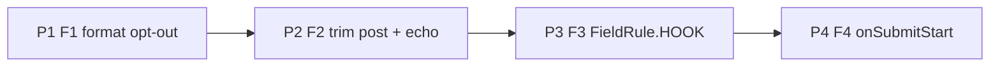

# 54 - Format Opt-Out, Trimmed Echo, Hook Field Errors and Submit Start for wix-forms

Status: Approved for implementation (2026-11-11), Phases P0–P4. Phase 0 (Wix format enforcement) must be recorded before F1 ships. Ships in one release with DL #53.

Builds on **DL#53** (page checks, `errorRule`/`FieldRule`, `FieldRejection`, `WIX_FORMS_CONTEXT`, `onSubmitOutcome`; approved, implemented on this branch, not yet released), **DL#41** (value store, `value` echo, confirmation), **DL#42** (submit hooks, settle table) and **DL#45** (outcomes are enum variants; text is a default). Four follow-ups found while moving a downstream site's forms onto the plugin. No site is named. Paths are relative to `packages/wix-forms/` unless stated. jay is referenced only by its public surface. Line numbers are for the `wix-forms-step-13` working tree (DL#53 implemented, uncommitted).

## Decisions for the Implementer (TL;DR)

- **Phase 0 first: a live check gates F1 (approval condition, 2026-11-11).** Before any F1 code, post a value the built-in rejects to a Wix Phone, Email and URL field and record whether Wix's server accepts it (Q5). The Phase 0 result must be recorded in Implementation Results before F1 ships. F1 is re-scoped only if Phase 0 forces it (Wix enforces a kind's format, Q5 "If Wix enforces"); otherwise it ships as designed.
- **Release (decided 2026-11-11): DL#53 and DL#54 ship together in one release.** This avoids a second contract regeneration for DL#53 adopters and avoids hook field copy ever shipping as `SERVER`.
- **Four items, four phases, tests first, no jay change.** Order: F1 format opt-out → F2 trimmed values → F3 hook-vs-Wix field errors → F4 submit-start event. Each phase is independent; F3 is the only one that changes the generated contract.
- **F1 — a page check can replace a field's built-in format rule.** `registerFieldChecks` accepts, per target, either today's `FieldCheck[]` or a new object `{ checks: FieldCheck[]; replacesFormat: true }`. With `replacesFormat`, the built-in **format** rule of that field's kind (EMAIL / PHONE / URL — `lib/utils/project-form-fields.ts:204-212`) is skipped; required, min/max length and the site owner's Wix `pattern` still run; the page checks own the format and fail as `CUSTOM`. The opt-out lives **only** in the registration, so it is active only while a replacement check is registered (no context, no registration, or an empty `checks` list → the built-in runs). No contract or config surface.
- **F2 — the plugin trims what it posts, what page checks see, and what it echoes.** One helper, `submittedValueOf(field, raw)` in `lib/components/submission-values.ts`, is the only place the trim rule is written. Visible text-like values (`text`, `textarea`, `email`, `tel`, `url`) are trimmed by it. It is used by the submission projection, by `trimTextValues` (echo), and by `checkField` for the `value` passed to page checks on **every** path (blur, typing, submit), so a page check never sees `"x "` on blur and `"x"` on submit. The post equals the value validation already judged (validation trims today, `project-form-fields.ts:175`). A `textarea` loses leading/trailing spaces **and newlines** (inner ones kept); a whitespace-only optional field posts `''`. On a shown confirmation the store's visible text-like values are replaced by their trimmed form, so `{k.firstName.value}` reads `Ann`, not `Ann `. Hidden, `select`, checkbox and multiselect values are never changed. While the user types, the input and the `value` echo stay raw (no caret jumps). Behaviour change for 0.26.x sites: stored submissions lose surrounding whitespace (release notes).
- **F3 — hook field errors get their own rule: `FieldRule.HOOK`** (name decided 2026-11-11, Q9). Appended **after** `SERVER` (member order is the contract, DL#45): `errorRule = HOOK` for a hook `FieldRejection`, `SERVER` stays for Wix's own field violations. The result carries the provenance as `fromHook?: boolean` (in the TS types, the action schema and the event alike; set to `true` only by the `FieldRejection` settle row); the `submitForm` output and the `onSubmitOutcome` failed event gain the same optional field. Generated contracts change (every visible field's `errorRule` enum gains `HOOK`); regenerate.
- **F4 — `WIX_FORMS_CONTEXT.onSubmitStart(handler) → unsubscribe`**, handler called with `{ event: { formId } }` (canonical id), backed by its own `Set` like `onSubmitOutcome`. Fired **once per submit actually handed off** — at the single hand-off point in `submit()` (`lib/components/wix-form.ts:427`), synchronously before `runFormSubmit` — and never for a busy click, a honeypot trip, a client-validation stop, or a reset during the pre-hand-off window. **Pairing holds in both directions only partly, and the docs say so:** (a) a start is followed by one `onSubmitOutcome` for that form unless the form is reset or the page unloads while in flight; (b) some outcomes have **no** start: a client-validation stop (`failed`/`VALIDATION`, `showClientErrors`, `wix-form.ts:462-466`) and a honeypot trip (`succeeded`, `:399`). **Reset mid-flight (decided 2026-11-11, Q12):** a start with no outcome is a documented gap, stated in the guide and in the `onSubmitStart` doc comment; no `abandoned` outcome is added. No correlation id is added: the busy guard allows one flight per form (`:389`), so a per-form "started" boolean set on start and cleared on outcome is enough, and the guide's example uses exactly that (Q14). Every handler runs in its own `try` for both events (L1): one throwing handler is logged and neither skips the others nor breaks the submit. Use it inside `createEffect` and return the unsubscribe.
- **Declarative first (F4, Q11 option A, decided 2026-11-11):** display concerns stay in markup. No `VALIDATING` member. `submitState === SUBMITTING` is changed to mean **handed to the server** (set at `:427`), while `isSubmitting` keeps meaning "busy, do not click" from the first click (DL#53 G2 guard, `:405`). So "Sending…" never flashes on a client-validation stop, with no new tag and no code. A page-owned error line clears declaratively by nesting it under `submitState === FAILED` (`submitFailure` is cleared at `:391`, Examples). `onSubmitStart` is only for imperative page state, such as pausing a page clock. `isHandedOff` has **no fallback**: it never defaults to `isSubmitting` when undefined. It is cleared on every `runFormSubmit` settle path through one combined busy setter (§4, L2). Behaviour change: this restores 0.26.1's `SUBMITTING` timing (busy was set inside `runFormSubmit`, after validation), so it changes only DL#53's unreleased behaviour.
- **Backward compatibility:** all API changes are additive (object entry in `FieldChecks`, optional `checkFormField` option, `FieldRule.HOOK` appended, optional `fromHook`, new `onSubmitStart` member). One behaviour change for release notes: trimming (F2). Because DL#53 and DL#54 ship together (DL#53 is still under `## Unreleased`, `CHANGELOG.md:3`), no released page ever saw `SERVER` for a hook error, so `HOOK` is an API addition, not a behaviour change.
- **Agent feedback:** guides only (`rich-forms.md` §1, §3, §7; `user-visible-messages.md`), plus one-time runtime warnings for a misused `replacesFormat`. No build-time validation (registrations are runtime TypeScript, as in DL#53).

---

## Background

After DL#53 (this branch, `package.json` version `0.26.1`, changes listed under `CHANGELOG.md` `## Unreleased`):

- Built-in rules come from the Wix field schema (`checkFormField`, `lib/utils/project-form-fields.ts:164-183`). The field kind comes from the Wix string format: `PHONE` → `tel`, `EMAIL` → `email`, `URL` → `url` (`readInputType`, `:73-77`). Each kind has a fixed regex (`checkTextRules`, `:191-214`; tel `:210-212` is `/^[+()\-\s\d]{7,}$/`).
- Page checks run **only after** every built-in rule passed (`checkField`, `lib/components/wix-form.ts:144-151`; runner `lib/components/page-checks.ts:72-89`). `FieldChecks` is `Record<string, FieldCheck[]>` (`lib/contexts/wix-forms-context.ts:39-40`); a non-array entry is ignored (`page-checks.ts:81`).
- Confirmation echo: each text-like field's `value` view state is the raw store value (`lib/components/form-view-state.ts:73-76`, fed from `values()` at `wix-form.ts:525`). The store is written raw from the input (`readNativeValue`, `wix-form.ts:685-695`) and kept on success so the confirmation can echo it (`wix-form.ts:496-498`; DL#41 Capability 1). The guide's echo example is `Thanks, {contact.firstName.value}!` (`agent-kit/plugin/rich-forms.md:32`).
- Submission projection: `projectSubmissionValues` copies store values unchanged (`lib/components/submission-values.ts:32-41`).
- Field errors from the server: both a hook `FieldRejection` (settle row `lib/submission/run-submission.ts:318-319`, `fieldRejectionResult` `:405-411`) and Wix's own violations (`failedSubmissionResult`, `:364-366`) return `{ success: false, reason: VALIDATION, fieldErrors }`; the client marks every visible target `FieldRule.SERVER` (`wix-form.ts:470-482`).
- Page code learns of a settled submit through `onSubmitOutcome` (own handler `Set`, unsubscribe, `{ event }` shape; `wix-forms-context.ts:134-143`), emitted by `createSubmitOutcomeReporter` (`lib/components/submit-outcome-events.ts:25-38`). Nothing tells page code that a submit **started**.

## Problem

**F1 — a page cannot accept a phone format the built-in rule rejects.** The tel regex rejects letters, dots and `/` (e.g. `+44 20 7946 0958 ext. 12`, `020.7946.0958`). Because page checks run only when built-ins pass (`wix-form.ts:149-150`), a page check can add rules but never relax one: the field shows `PHONE`, and submit is blocked (`validateVisibleFields`, `submission-values.ts:130-141`). The same holds for `email` and `url`. Product decision: a per-field way to disable the built-in format; the page's checks own that rule.

**F2 — echoed values keep the user's whitespace.** Validation trims (`project-form-fields.ts:175`), so `"Ann "` passes `required`, but the store, the post and the echo keep the space: the confirmation reads "Thank you, Ann ." and Wix stores `"Ann "`. An `email` of `"ann@example.com "` passes the client regex (it runs on the trimmed text, `:204`) and is posted with the space. Product decision: the plugin trims the values it exposes for display; this DL decides whether the post is trimmed too.

**F3 — markup cannot tell a hook's field error from Wix's refusal.** Both arrive as `reason: VALIDATION` + `fieldErrors` and both become `errorRule = SERVER` (`wix-form.ts:475-481`). The page wants its own copy (or the hook's text) under the field for a hook rejection, and its generic "we could not accept this value" line for a Wix refusal, whose text is Wix's English. Today the only difference is the message text, and matching text is what DL#53 G1 removed. (DL#53 G4 chose `errorRule = SERVER` for hook rejections; this DL separates the two.)

**F4 — page code cannot tell that a submit was handed to the server, and markup's "sending" flashes on client stops.** Pages need to pause a page clock (e.g. a slot-hold countdown) while a request is in flight; that is page state and needs code. They also want a page-owned error line to clear when a new send starts and a "Sending…" label that does not flash when client validation stops the submit; both are display concerns that should be markup (Q11). `isSubmitting` is set at the first click (`wix-form.ts:405`) and cleared again on client-validation stops (`:446`), and page code cannot read the headless component's view state anyway (DL#53 G3 Background). `onSubmitOutcome` fires only at the end.

## Prior Art / Adjacent Mechanisms

| Primitive                                                                                                         | Item | Verdict                                                                                                                                                                                                                                            |
| ----------------------------------------------------------------------------------------------------------------- | ---- | -------------------------------------------------------------------------------------------------------------------------------------------------------------------------------------------------------------------------------------------------- |
| Page checks, `registerFieldChecks` (`wix-forms-context.ts:61-69,106-119`; `page-checks.ts`)                       | F1   | **Solves the replacement, constrains the order.** Checks run after built-ins by design (DL#53 Q4). F1 extends the same registration.                                                                                                               |
| Wix field format (`readInputType`, `project-form-fields.ts:73-77`)                                                | F1   | **Partial.** The site owner could change the Wix field to plain text, removing the `tel` kind. That also changes the Wix field type the dashboard and contact mapping use (unverified, Q2), and it is a site-settings change, not a page decision. |
| Wix `pattern` (`project-form-fields.ts:216-226`)                                                                  | F1   | **No.** Adds a regex after the format rule; it cannot relax it. Kept running under F1 (the owner's rule).                                                                                                                                          |
| `config/.wix-forms.yaml` (`lib/config-loader.ts:11-24`)                                                           | F1   | **No.** Server-loaded generation/allowlist config; a client opt-out would need new carry-forward plumbing, and it would disable a rule even when no page check replaces it.                                                                        |
| `checkFormField` trims (`project-form-fields.ts:175`)                                                             | F2   | **Sets the semantics.** Validation already treats `" Ann "` as `Ann`; F2 makes the post and the echo agree.                                                                                                                                        |
| `projectSubmissionValues` (`submission-values.ts:32-41`)                                                          | F2   | **Solves the place.** The one projection used for the post and for page checks' `values` (`wix-form.ts:136-138,416`).                                                                                                                              |
| Store kept on success for the echo (`wix-form.ts:496-498`)                                                        | F2   | **Solves the echo channel.** F2 writes trimmed values into it at confirmation time; no new tag.                                                                                                                                                    |
| `FieldRule` + `enumDataType` (`lib/components/field-rule.ts:9-20`, `lib/generators/contract-utils.ts:87,160-163`) | F3   | **Solves the pattern.** Appending a member is the DL#45 additive rule.                                                                                                                                                                             |
| `fieldRejectionResult` (`run-submission.ts:405-411`)                                                              | F3   | **Solves the provenance point.** The only place a hook field error is built; it sets the flag.                                                                                                                                                     |
| `onSubmitOutcome` (`wix-forms-context.ts:64-68,134-143`), reporter (`submit-outcome-events.ts:25-38`)             | F4   | **Solves the pattern.** `onSubmitStart` copies it: own `Set`, unsubscribe, `{ event }`, symbol-keyed emit, a throwing handler logged.                                                                                                              |
| `isSubmitting` / `submitState` (`contract-utils.ts:147,150`; `form-view-state.ts:124-129`)                        | F4   | **Partial.** Declarative "busy" for markup; set before client validation (`wix-form.ts:405`), so not "handed off"; not readable by page code.                                                                                                      |
| wix-cart `WIX_CART_CONTEXT` events (`packages/wix-cart/lib/contexts/wix-cart-context.ts`)                         | F4   | **Precedent** for plugin→page events (already followed by DL#53).                                                                                                                                                                                  |

## Questions and Answers

**Q1 — Null hypothesis for F1: can a page relax a built-in rule today?** No. `checkField` returns the built-in failure before any page check runs (`wix-form.ts:149-150`), and the field kind comes from the Wix schema, not the page's markup (`readInputType`, `project-form-fields.ts:73-77`), so writing `type="text"` in jay-html changes nothing. **Answered.**

**Q2 — Why not tell the site owner to change the Wix field from Phone to plain text?** It removes the `tel` kind and therefore the rule, with no plugin change. It is rejected as the answer because (a) it is a site-settings change that every page using the form inherits, while the product decision is per page and per field; (b) the Wix field type likely drives the dashboard column and contact mapping (unverified; not needed for this DL's decision). It stays documented in the guide as the option when no page should run the built-in rule. **Answered.**

**Q3 — F1 surface: registration option vs contract/config?** Registration. Reasons: the opt-out is only safe when a replacement exists, and the registration is the one place where both are stated together; when client init is missing or the page unregisters, the built-in comes back automatically (`page-checks.ts:73-74`). A contract tag would need a new contract input concept (contracts are generated from the Wix schema, `contract-utils.ts:67-95`), and config would decouple the opt-out from the replacement (Prior Art). **Answered.**

**Q4 — F1: which built-ins does `replacesFormat` skip?** Only the kind's format regex: EMAIL (`:204`), URL (`:207`), PHONE (`:210`). `required` is a presence rule the Wix schema enforces, min/max length are explicit owner limits, and `pattern` is the owner's own regex; all keep running. A `replacesFormat` on a kind with no format rule (`text`, `textarea`, `select`, `checkbox`, `multiselect`) is warned about once and has no effect. **Answered.**

**Q5 — F1: does Wix's server validate the phone / email / URL format too? (open, Phase 0 live check, gates F1)** The code does not depend on the answer, but the feature does: if Wix enforces a kind's format, F1 for that kind only moves the error from the client (`PHONE`) to Wix (`SERVER`) after a round trip, and the visitor is still blocked. **Phase 0** (before any F1 code) posts, through `submitForm` on the QA testbed, one value the built-in rejects per kind (`+44 20 7946 0958 ext. 12` to a Phone field, `ann@localhost` to an Email field, `example` to a URL field) and records accepted/refused and the stored value in Implementation Results.

- **If Wix accepts** a kind: F1 ships as designed for it.
- **If Wix enforces** a kind: `replacesFormat` is not offered for that kind (treated like a kind with no format rule: one-time warning, no effect), and the guide documents "change the Wix field to plain text" (Q2) as the only fix. If Wix enforces all three, F1 is dropped from this DL and the decision returns to product.
  **Open.**

**Q6 — F2: trim the post, or only the display?** Both. Validation already decided that surrounding whitespace is not part of the value (`project-form-fields.ts:175`), so posting the raw text means Wix stores something other than what was validated (e.g. an email with a trailing space that the client accepted). Trimming only the echo would show `Ann` while the dashboard holds `Ann `. **Answered: trim the post for visible text-like kinds; hidden, select, checkbox and multiselect values are never changed** (hidden values are page-provided identifiers and select values are Wix option values; both are exact). The hook receives the trimmed values (they are the posted values). Direct `submitForm` posts that bypass the component are not trimmed on the server: the server does not normalise caller input today and the hook already sees exactly what was sent (Scope pre-mortem). Edge cases, by design: a `textarea` loses leading indentation and leading/trailing newlines (inner whitespace and newlines kept); a non-required field holding only whitespace posts `''`, matching `checkFormField`'s PASSED on empty.

**Q6a — F2: what value do page checks see?** The trimmed one, on every path. `checkField` defaults `value` to the raw store value on blur and typing (`wix-form.ts:146`, called from `:154` and `:203`), while submit passes the projected value (`:420`). Without a fix a strict page check (e.g. an anchored regex) would fail on blur and pass on submit. Fix: `checkField`'s `value` goes through `submittedValueOf(field, raw)` on every path, the same helper the projection uses. **Answered.**

**Q7 — F2: why not trim in the view state (`fieldToViewState`) always?** A page may bind `value` back to its input or show a live preview; trimming while the user types would remove a space the user just typed (the next keystroke's `input` event would carry the raw text again, but a preview would flicker). The echo is trimmed only when the confirmation is shown (`showSubmitted`, `wix-form.ts:322-327`), when typing has ended. **Answered.**

**Q8 — F3: a new `FieldRule` member or a separate per-field source variant?** A member. One variant per field answers "why is this field red" in one place; a second variant (`errorSource: enum (NONE | CLIENT | WIX | HOOK)`) would have to agree with `errorRule` in every branch (`errorRule === SERVER && errorSource === HOOK` is the only new information), doubling the markup and the state table in DL#53 §3. Appending `HOOK` after `SERVER` keeps every existing index (DL#45: member order is the contract). **Answered.**

**Q9 — F3: name of the member?** `HOOK`: the guide and the exports already call it "the submit hook" (`FieldRejection` doc, `lib/services/wix-forms-submit-hooks.ts`), so a page author recognises it. `REJECTED` was considered and dropped: `SubmitFailure.REJECTED` already covers both Wix refusals and hook `ActionError`s (`run-submission.ts:322-328,342-347`), so the same word would mean two things. **Answered (product decision 2026-11-11): keep `HOOK`.** Rationale: it parallels `SERVER` (both name a source), `REJECTED` is taken by `SubmitFailure.REJECTED`, and it matches the "submit hook" vocabulary of the guide and exports.

**Q10 — F3: how does the client learn the provenance?** The result. `fieldRejectionResult` (`run-submission.ts:405-411`) adds `fromHook: true`; Wix's row (`:364-366`) does not. A boolean is enough: there are two sources, and DL#53 already keeps hook codes in `code`. Using "has a `code`" as the signal is rejected: `FieldRejection`'s code is optional. **Answered.**

**Q11 — F4: which needs can declarations serve? (product guidance: prefer declarations over JavaScript)** Taken need by need:

- **"Sending…" without a flash on a client stop.** Today `submitState` is `SUBMITTING` whenever `isSubmitting` is true (`submitStateOf`, `form-view-state.ts:124-129`), and DL#53 G2 sets `isSubmitting` at the first click (`wix-form.ts:405`), so the label shows during reconcile/seed and on a client-validation stop. Alternatives: (A) **`SUBMITTING` only after hand-off**: a new internal `isHandedOff` signal set at `:427` and cleared where `isSubmitting` is cleared; `submitStateOf` returns `SUBMITTING` only when handed off, `IDLE` during the pre-hand-off window. (B) **append `VALIDATING`** to `SubmitState` (index 4, DL#45 additive) for the pre-hand-off window. **Chosen: A.** It fixes the flash with no contract change and no markup change, and the pre-hand-off window is a few ticks, too short for its own copy, so B adds a member nobody would bind. `isSubmitting` keeps its DL#53 meaning (busy guard; `disabled` on the button). B stays available later as an additive member.
- **Clearing a page-owned error line on a new send.** Already declarative, no event needed: `submit()` clears `submitFailure` and `statusMessage` at the very start (`:390-391`), so markup that nests the page's own error copy under `if="booking.submitState === FAILED"` (or binds `statusMessage`) disappears on the next send. The page variant (e.g. a hook `code` mapped by `onSubmitOutcome`) can stay set; it is hidden by its parent. Dropped from F4's motivation.
- **Pausing a page clock.** A page-state write (stop a timer); only code can do it, and page code cannot read the plugin's view state (DL#53 G3). This alone justifies `onSubmitStart`.
  **Behaviour change (A):** released 0.26.1 set `isSubmitting` inside `runFormSubmit`, after validation, so 0.26.x pages already saw `SUBMITTING` only after hand-off; A restores that. Only DL#53's unreleased timing changes. During the pre-hand-off window `isSubmitting` is true while `submitState` is `IDLE`; the guide says to bind `disabled` to `isSubmitting` and the label to `submitState`. **Answered (product/architecture decision 2026-11-11): option A.** `submitState` is `SUBMITTING` only after hand-off; `isSubmitting` stays early for `disabled` and the double-submit guard; no `VALIDATING` member; clearing a page error line is declarative; `onSubmitStart` is only for imperative page state (for example a page clock).

**Q14 — F4: do pages need a correlation id between start and outcome?** No. The busy guard allows one flight per form (`:389`), so for one form at most one start is unmatched at a time. The documented page pattern is a per-form boolean: set on start, and on any outcome act only if it is set, then clear it. That makes outcomes without a start (client stop, honeypot) harmless, and a later start after a reset mid-flight simply sets it again. A `handedOff` flag or submit id on the outcome was considered and not added: it would duplicate what the boolean already gives, on a union every outcome handler reads. **Answered.**

**Q12 — F4: what if the form is reset while a handed-off submit is in flight?** `resetForm` invalidates the flight (`wix-form.ts:307`), and `runFormSubmit` drops the late result (`lib/components/form-submit-execution.ts:37,43`), so no `onSubmitOutcome` follows that start. Default: no extra event; the guide says "a start is followed by one outcome unless the form is reset or the page unloads while in flight; treat a later `onSubmitStart` for the same form as superseding". An `outcome: 'abandoned'` member was considered (it would make the pair total) and deferred: no downstream page resets mid-flight (the reset button lives in the confirmation in every known page), and a new union member is a change every `onSubmitOutcome` handler would have to consider. **Answered (product decision 2026-11-11): accept the documented gap; no `abandoned` outcome.** Rationale: (a) a new union member has a blast radius on every `onSubmitOutcome` handler; (b) the per-form started flag, cleared on any outcome or on the next start, already covers the gap; (c) reset already invalidates the flight, so no late outcome can arrive. The gap is stated in the guide (§7) and in the `onSubmitStart` doc comment.

**Q13 — F4: fire before or after `ensureSessionFresh`?** Before, at the hand-off point in `submit()` (`wix-form.ts:427`). From there the component is committed to one `submitForm` attempt or a `NETWORK` outcome (`form-submit-execution.ts:30-41`): `ensureSessionFresh` failing is reported as `NETWORK` like a transport failure. Firing inside `runFormSubmit` would push a page-event concern into the transport helper. **Answered.**

## Design

### Phase map



The arrows are the recommended order only; no phase needs another. F1 and F4 both edit `lib/contexts/wix-forms-context.ts`, F2 and F3 both edit `lib/components/wix-form.ts`; doing them in order avoids merge noise.

### 1. F1 — `replacesFormat` (`lib/contexts/wix-forms-context.ts`, `lib/components/page-checks.ts`, `lib/utils/project-form-fields.ts`, `lib/components/wix-form.ts`)

**Types** (additive):

```ts
/** Checks that also take over the field's built-in format rule (email / phone / URL). */
export interface FormatReplacingChecks {
  checks: FieldCheck[];
  /** Skip the built-in format rule of this field's kind; required, length and pattern still run. */
  replacesFormat: true;
}

/** Field target → checks, run in order after the built-in rules pass; the first message wins. */
export type FieldChecks = Record<string, FieldCheck[] | FormatReplacingChecks>;
```

**Built-ins** — `checkFormField(field, value, options?: { format?: boolean })`; `format` defaults to `true`. `checkTextRules` skips the three format branches (`project-form-fields.ts:204-212`) when `format === false`. `validateFormField` (`:159-161`) is unchanged (always `format: true`). The exported signature gains an optional parameter only.

**Runner** — `createPageCheckRunner` (`page-checks.ts:27`) returns an object instead of a bare function:

```ts
export interface PageCheckRunner {
  run(
    field: FormFieldView,
    value: FieldValue,
    values: Readonly<Record<string, FieldValue>>,
  ): FieldCheckResult;
  /** True when a registration replaces this field's format rule with at least one check. */
  replacesFormat(field: FormFieldView): boolean;
}
```

Both read the context **at call time** (`useGlobalContext`, as `page-checks.ts:73`). A helper `checksOf(entry)` normalises an entry: an array → itself; a `FormatReplacingChecks` with an array `checks` → `checks`; anything else → `[]` (today's `Array.isArray` guard, `:81`, generalised). `replacesFormat(field)` is true when any registration for the form has an entry for `field.target` with `replacesFormat === true` **and** a non-empty `checks`. One-time warnings (same `console.warn` style as `:45-47`):

- `replacesFormat` with an empty or missing `checks`: "…replacesFormat needs at least one check; the built-in format rule still runs".
- `replacesFormat` on a field whose kind has no format rule (not `email`/`tel`/`url`): "…has no built-in format rule; replacesFormat has no effect".

**Component** — `checkField` (`wix-form.ts:144-151`):

```ts
const builtIn = checkFormField(field, value, { format: !pageChecks.replacesFormat(field) });
return builtIn.rule === FieldRule.NONE
  ? pageChecks.run(field, value, allValues) // P2 wraps value in submittedValueOf (F2)
  : builtIn;
```

Trace — tel field `phone`, page registers `{ phone: { checks: [acceptsExtensions], replacesFormat: true } }`, user types `+44 20 7946 0958 ext. 12`, submits:

1. `submit()` → `validateVisibleFields(..., (f, v) => checkField(f, v, submissionValues))` (`wix-form.ts:417-421`).
2. `checkField` → `replacesFormat(phone)` true → `checkFormField(phone, v, { format: false })`: not required-empty (`:176`), no min/max, tel branch skipped, no pattern → `NONE`.
3. `run` → `acceptsExtensions(v)` returns `undefined` → `NONE` → no client failure → hand-off (`:427`). Today: step 2 returns `PHONE` at `:210-211` and submit stops at `:422-425`.
4. If the page check returns `'Use digits only'` → `{ rule: CUSTOM, message }`, field shows the page's copy.

P1 passes `value` unchanged, so P1 does not depend on P2; Phase 2 alone introduces the `submittedValueOf(field, value)` wrap on this line (§2).

**Null hypothesis:** Q1–Q3. The change is one optional option on an existing function and one union member on an existing registration type.

### 2. F2 — trimmed post and echo (`lib/components/submission-values.ts`, `lib/components/wix-form.ts`)

```ts
/** Visible text-like kinds whose surrounding whitespace is not part of the value (DL#54 F2). */
const TRIMMED_KINDS = new Set<FormFieldInputType>(['text', 'textarea', 'email', 'tel', 'url']);

/** The value as submitted: trimmed for a visible text-like string, otherwise unchanged. The only trim rule. */
export function submittedValueOf(field: FormFieldView, raw: FieldValue): FieldValue;

/** The store with every visible text-like string trimmed (via submittedValueOf); every other value unchanged. */
export function trimTextValues(fields: FormFieldView[], store: FieldStore): FieldStore;
```

- `submittedValueOf` trims when `!field.hidden && TRIMMED_KINDS.has(field.inputType) && typeof raw === 'string'`. `projectSubmissionValues(fields, store)` (`submission-values.ts:32-41`) maps each value through it, and so does `trimTextValues`; neither repeats the rule. The post (`wix-form.ts:416`, `:435`) and the `values` argument of page checks (`:147`, `:420`) see the trimmed text, matching `checkFormField`'s own trim.
- `checkField` (`wix-form.ts:144-151`) passes page checks `submittedValueOf(field, value)` for its `value` argument, so blur and typing (`:146` default from the raw store, called from `:154`, `:203`) see the same value as submit (`:420`, already projected; trimming again is a no-op). The built-in `checkFormField` keeps receiving the same value (it trims internally).
- `showSubmitted()` (`wix-form.ts:322-327`) first calls `setValues((current) => trimTextValues(carryForward.fields, current))`, then sets `isSubmitted`. Both callers get it: the success branch (`:498`) and the honeypot trip (`:397-401`, so a bot sees the same echo as a person). A redirect skips `showSubmitted` (`:498`) and needs no echo.
- Not changed: the store while typing, the input's DOM value, failure paths (the user keeps their text to correct it), reset (`emptyStoreFor`).
- Interaction with DL#53 G2 reconcile (`wix-form.ts:285-304`): after a successful submit the store holds trimmed text while the (hidden) input may still hold the raw text. The reconcile runs only inside `submit()`, and after the confirmation the next submit is preceded by reset (`clearNativeInputsAfterRemount`, `:347-358`, reflects empty values), so no stale raw text is reconciled back. Verified by a P2 test (send another after a trimmed success posts the new input, not the old raw text).

Trace — `firstName` = `"Ann "`, submit, success: store `{ firstName: 'Ann ' }` → `readFormValues()` → projection `{ firstName: 'Ann' }` (new) → `checkFormField` passes → `submitForm({ values: { firstName: 'Ann' } })` (`form-submit-execution.ts:32-35`) → success → `presentSubmitResult` → `showSubmitted()` → store `{ firstName: 'Ann' }` → `fieldToViewState` → `value: 'Ann'` (`form-view-state.ts:75`) → "Thank you, Ann." Today: posted and echoed `"Ann "`.

**Null hypothesis:** no new tag or API. The projection and the kept store already exist.

### 3. F3 — `FieldRule.HOOK` (`lib/components/field-rule.ts`, `lib/types.ts`, `lib/actions/submit-form.jay-action`, `lib/submission/run-submission.ts`, `lib/components/submit-outcome.ts`, `lib/components/wix-form.ts`, `lib/contexts/wix-forms-context.ts`)

```ts
export enum FieldRule {
  NONE,
  REQUIRED,
  MIN_LENGTH,
  MAX_LENGTH,
  EMAIL,
  PHONE,
  URL,
  PATTERN,
  CUSTOM,
  SERVER,
  HOOK,
}
```

- `SERVER` is narrowed in its doc comment to "Wix refused this value"; `HOOK` is "the form's submit hook rejected this field (`FieldRejection`); `error` holds the hook's text".
- **Result:** the failure variant of `SubmitFormResult` (`lib/types.ts:75-82`) and `SubmitRejection` (`submit-outcome.ts:41-48`) gain `fromHook?: boolean`. `fieldRejectionResult` (`run-submission.ts:405-411`) adds `fromHook: true` to both of its shapes. No other row sets it (absent means `false`).
- **Action schema** (`lib/actions/submit-form.jay-action:9-15`) output gains `fromHook?: boolean  # true when fieldErrors come from the submit hook's FieldRejection (DL#54)`; the generated `.jay-action.d.ts` follows at build. The transport passes the extra output key through unchanged; precedent: DL#53's `code?` output (added in P4, Implementation Results deviation note), which reached the client and the event in the DL#53 G4 live check.
- **Client:** `presentSubmitResult` (`wix-form.ts:475-482`) sets `rule = result.fromHook ? FieldRule.HOOK : FieldRule.SERVER` for each visible target. `presentSubmitRejection` (`submit-outcome.ts:60-80`) is unchanged (hidden/unknown targets still go to `statusMessage`).
- **Event:** the `failed` member of `SubmitOutcomeEvent` (`wix-forms-context.ts:49-56`) gains `fromHook?: boolean`; `reportSubmitRejection` (`wix-form.ts:507-514`) copies it when set.
- **Typing:** `handleNativeInput` (`:199-206`) clears a `HOOK` error when the client rules pass, exactly as it clears `SERVER`; the next submit asks the hook again. No code change.
- **Contract:** `fieldTag`'s `errorRule` line (`contract-utils.ts:87`) renders the new member through `enumDataType` (`:160-163`); every visible field's contract changes from `enum (… | SERVER)` to `enum (… | SERVER | HOOK)`. Hidden fields have no `errorRule` (unchanged).

Trace — hook `throw new FieldRejection({ phone: 'We cannot reach this number.' })` before `submit()` → `settleSubmission` idle → row `:318-319` → `{ success: false, reason: VALIDATION, fieldErrors: { phone }, fromHook: true }` → transport → `presentSubmitResult` → `errorRule.phone = HOOK` → jay-html `if="booking.phone.errorRule === HOOK"` shows `{booking.phone.error}`. Wix 400 with a phone violation → `failedSubmissionResult` `:364-366` → no `fromHook` → `SERVER` → the page's generic line.

**Null hypothesis:** Q8, Q10. One enum member, one optional boolean.

### 4. F4 — `onSubmitStart` (`lib/contexts/wix-forms-context.ts`, `lib/components/submit-outcome-events.ts`, `lib/components/wix-form.ts`)

```ts
/** A submit the form handed to the server (DL#54 F4). `formId` is canonical. */
export interface SubmitStartEvent {
  formId: string;
}
export type SubmitStartHandler = (args: { event: SubmitStartEvent }) => void;

export interface WixFormsContext {
  registerFieldChecks(formId: string, checks: FieldChecks): () => void;
  onSubmitOutcome(handler: SubmitOutcomeHandler): () => void;
  /**
   * Fires once per submit handed to the server, before the request. Not for a busy click, a
   * honeypot trip, a client-validation stop, or a reset before hand-off.
   * Start → outcome: followed by one onSubmitOutcome for the same form unless the form is
   * reset or the page unloads meanwhile (no outcome then; this gap is by design, there is
   * no 'abandoned' outcome). Clear your started flag on any outcome or on the next start.
   * Outcome → start: not every outcome has a start. A client-validation stop
   * (failed/VALIDATION) and a honeypot trip (succeeded) emit an outcome with no start.
   * Keep a per-form "started" flag: set it here, act on an outcome only when it is set.
   * Display needs no code: bind submitState (SUBMITTING = handed off) in markup.
   * Returns an unsubscribe function: subscribe inside createEffect and return it.
   */
  onSubmitStart(handler: SubmitStartHandler): () => void;
}
```

- **Context state** (`createWixFormsContextState`, `wix-forms-context.ts:102-151`): a second `Set<SubmitStartHandler>`, `onSubmitStart` adds and returns a delete, exposed under a new symbol `EMIT_SUBMIT_START` next to `EMIT_SUBMIT_OUTCOME` (`:79`), with an exported `emitSubmitStart(context, event)` like `emitSubmitOutcome` (`:98-100`).
- **Per-handler isolation (L1, both events):** today `emitToHandlers` (`:141-143`) loops without a `try`, and the reporter wraps the whole emit in one `try` (`submit-outcome-events.ts:30-36`), so one throwing handler skips every later one. Both emits now go through one helper, `callEachHandler(handlers, event, eventName)`: snapshot the set (as today), call each handler in its own `try`, and log a throw as `[wix-forms] an ${eventName} handler threw` with `formId` and the error (the reporter's current fields). The reporter's outer `try` is removed (nothing left to catch). This fixes `onSubmitOutcome` as part of this DL.
- **Reporter** (`submit-outcome-events.ts`): `createSubmitStartReporter(formId): () => void`, same shape as `createSubmitOutcomeReporter` (`:25-38`): canonical id, `useGlobalContext` at call time, missing context → no-op.
- **`submitState` timing (Q11 option A):** a component signal `isHandedOff` (`setIsHandedOff(true)` together with the local `isHandedOff = true` at `:427`). **Clearing (L2): one combined setter.** The component defines `setBusy(value)`: it calls `setIsSubmitting(value)` and, when `value` is `false`, also `setIsHandedOff(false)`. It is passed to `runFormSubmit` as the existing `setIsSubmitting` param (`form-submit-execution.ts:8`; no new param, `runFormSubmit` unchanged), so both settle paths clear both flags: the network failure (`:39`) and the non-redirect settle (`:49`). Every other clear in the component also calls `setBusy(false)`: reset (`wix-form.ts:315`), `pageshow` (`:384`), and the `finally` (`:446`, reached only before hand-off). `setIsSubmitting(false)` is no longer called directly anywhere. `FormViewStateOverrides` gains `isHandedOff`, and `submitStateOf` (`form-view-state.ts:124-129`) returns `SUBMITTING` only when `isHandedOff === true`; **no fallback**: an undefined `isHandedOff` is `false`, never `isSubmitting` (success still wins first, then `SUBMITTING`, then `FAILED`). A redirect keeps both set, so DL#53 Q9's "SUBMITTING until unload" holds. `isSubmitting` is unchanged.
- **Component** (`wix-form.ts:427-428`): `isHandedOff = true; reportSubmitStart();` then `await runFormSubmit(...)`. Synchronous, inside the `try`, after the flag is owned by `runFormSubmit`; a throwing handler is caught per handler by `callEachHandler`, so it cannot reach the `finally` (`:446`) or skip the request.
- **Exports:** `SubmitStartEvent`, `SubmitStartHandler` from `lib/index.client.ts` and `lib/index.ts`, next to `SubmitOutcomeEvent` (DL#53 P6).

Trace — the stops that must **not** fire, against `submit()` (`wix-form.ts:388-448`): busy → `return` at `:389`; honeypot → `return` at `:397-401`; reset during reconcile/seed → `return` at `:412`/`:414`; client failure → `return` at `:422-425`; a throw in reconcile/seed → `finally` without hand-off. Each leaves `:427` unreached. The one path that fires: valid form → `:427` → start → `runFormSubmit` → `ensureSessionFresh` + `submitForm` (`form-submit-execution.ts:30-35`) → either `onNetworkFailure` → `NETWORK` outcome (`wix-form.ts:438-442`) or `presentSubmitResult` → `succeeded`/`failed` outcome (`:486`, `:499-503`), unless the flight is stale (`form-submit-execution.ts:37,43`, Q12).

**Null hypothesis:** Q11. Display needs are served by the existing `submitState` (with corrected timing) and `submitFailure`; only the page clock needs code. Page code has no other observer of the headless component; the context is the DL#53 channel and this is its existing event pattern.

### Generated contract and action impact

| Item | Contract                                                            | `submitForm` action                         | Client exports                                                                          |
| ---- | ------------------------------------------------------------------- | ------------------------------------------- | --------------------------------------------------------------------------------------- |
| F1   | none                                                                | none                                        | `FormatReplacingChecks`; `FieldChecks` widened; `checkFormField` optional 3rd parameter |
| F2   | none                                                                | none (values are trimmed, schema unchanged) | `trimTextValues` stays internal                                                         |
| F3   | `errorRule` enum gains `HOOK` on every visible field                | output `fromHook?: boolean`                 | `FieldRule.HOOK`                                                                        |
| F4   | none (`submitState` members unchanged; `SUBMITTING` timing changes) | none                                        | `onSubmitStart`, `SubmitStartEvent`, `SubmitStartHandler`                               |

### Backward compatibility

**0.26.x pages (released; no DL#53 surface):**

- No markup change is required by any item. F3's contract change adds an enum member to a tag those pages do not bind; the DL#53 `test/old-contract-compat.test.ts` fixture (a 0.26.1 contract without `errorRule`) keeps covering "extra view-state data is ignored".
- **Behaviour change (F2):** submissions store trimmed text for visible text-like fields, and the confirmation echo is trimmed. A site that relied on surrounding whitespace (none known) loses it. Release-notes item.

**DL#53 surface (unreleased on this branch):**

- `registerFieldChecks` with arrays behaves as before; `FieldChecks` accepts the new object form in addition.
- `checkFormField(field, value)` unchanged; the option is optional.
- `FieldRule` indices `NONE…SERVER` unchanged (`HOOK` is index 10).
- **DL#53 and DL#54 ship in the same release (decided 2026-11-11):** no released page ever saw `SERVER` for a hook error; nothing to migrate, and adopters regenerate once.
- `onSubmitOutcome` unchanged except the optional `fromHook` on `failed`, and a throwing handler no longer skips later handlers (L1).
- `submitState === SUBMITTING` now starts at hand-off, not at the first click (Q11 A). For 0.26.x pages this is no change (0.26.1 set busy inside `runFormSubmit`, after validation); for DL#53's unreleased timing, "Sending…" no longer shows during reconcile/seed or on a client-validation stop. `isSubmitting` (the busy guard) is unchanged.

**Release-notes items (CHANGELOG `## Unreleased`, appended after DL#53's five):** 6. **Text values are trimmed** before they are sent and in the confirmation echo (`text`, `textarea`, `email`, `tel`, `url`; hidden, select, checkbox and multiselect values unchanged). Before: `"Ann "` was stored and shown as "Thank you, Ann ."; after: `Ann`. Reason: validation already ignored the spaces. 7. **Hook field errors are `errorRule: HOOK`**, Wix's own field refusals stay `SERVER` (listed under API additions; same release as DL#53).

- API additions: `replacesFormat` registration entries, `checkFormField(…, { format })`, `FieldRule.HOOK`, result/event `fromHook`, `onSubmitStart`.

## Examples

✅ Declarative first — busy state needs no code (existing tags). `disabled` follows the busy guard; the label follows hand-off, so it never flashes on a client stop:

```html
<button ref="booking.submitButton" disabled="{booking.isSubmitting}">
  <span if="booking.submitState === SUBMITTING">Sending…</span>
  <span if="booking.submitState !== SUBMITTING">Book</span>
</button>
```

✅ Declarative first — a page-owned error line clears itself on the next send (the page variant `slotError` is set from `onSubmitOutcome`'s `code`; its parent hides it once `submit()` clears `submitFailure`):

```html
<div if="booking.submitState === FAILED">
  <p if="slotError === SLOT_TAKEN">That slot was just taken. Please pick another.</p>
</div>
```

✅ F3 — hook copy vs Wix refusal, in markup only:

```html
<span id="b-phone-err" aria-live="polite">
  <span if="booking.phone.errorRule === PHONE">Please enter a phone number.</span>
  <span if="booking.phone.errorRule === CUSTOM">{booking.phone.error}</span>
  <span if="booking.phone.errorRule === HOOK">{booking.phone.error}</span>
  <span if="booking.phone.errorRule === SERVER"
    >We could not accept this number. Please check it.</span
  >
</span>
```

✅ F2 — the echo needs no change; it now reads trimmed:

```html
<section if="booking.isSubmitted" ref="booking.confirmation" tabindex="-1">
  <h2>Thank you, {booking.firstName.value}.</h2>
</section>
```

✅ F1 + F4 — page code only for what needs code (the clock), in a page component's interactive phase:

```ts
const forms = useContext(WIX_FORMS_CONTEXT); // page declared .withContexts(WIX_FORMS_CONTEXT)
const unregister = forms.registerFieldChecks(BOOKING_FORM_ID, {
  phone: {
    checks: [(value) => (isDialable(String(value)) ? undefined : 'Please check the number.')],
    replacesFormat: true,
  },
});
// Outcomes without a start (client stop, honeypot) must not resume a clock that never paused.
let isClockPausedForSubmit = false;
createEffect(() =>
  forms.onSubmitStart(({ event }) => {
    if (event.formId !== BOOKING_FORM_ID) return;
    isClockPausedForSubmit = true;
    pauseHoldClock();
  }),
);
createEffect(() =>
  forms.onSubmitOutcome(({ event }) => {
    if (event.formId !== BOOKING_FORM_ID || !isClockPausedForSubmit) return;
    isClockPausedForSubmit = false;
    resumeHoldClock();
  }),
);
// A reset mid-flight emits no outcome; the next start sets the flag again (Q12).
```

❌ Clearing a page error line in `onSubmitStart` (`setPageError('')`) — markup does it (nest under `submitState === FAILED`, above).

❌ Resuming on every `onSubmitOutcome` without a start flag — a client-validation stop or honeypot trip would resume a clock that was never paused.

❌ `replacesFormat: true` with `checks: []` — the built-in still runs and a warning is logged; a rule is never removed without a replacement.

❌ Matching text to tell sources apart: `if="booking.phone.error === 'Invalid phone'"` — branch on `errorRule` (`HOOK` vs `SERVER`).

❌ Pausing a clock through a page-side watcher on the form's view state — page code cannot read it (DL#53 G3); use `onSubmitStart`.

## Implementation Plan

Each phase: failing tests first (doc comments cite this DL; bug-repro style for F2/F3), implement, `yarn build` + `npx vitest run` in `packages/wix-forms`, guide update in the same phase, an Implementation Results entry with red-before reasons and X/Y. Interactive tests use `test/support/wix-form-harness.ts`, calling `provideWixFormsContext()` before mount and clearing the global registry after each test, as DL#53 P3/P6 tests do. Tests labelled **regression guard** are green today by design; every other new test must fail today for the stated reason.

**Phase 0 — Q5 live check (no code; gates Phase 1).** On the QA testbed, post through `submitForm` one built-in-rejected value per kind (`+44 20 7946 0958 ext. 12` → Phone, `ann@localhost` → Email, `example` → URL). Record per kind: accepted or refused (Wix violation text), and the stored value in the dashboard. Write the result to Implementation Results and re-scope Phase 1 per Q5 before writing its tests.

**Phase 1 — F1** (for the kinds Phase 0 found unenforced).

- `test/project-form-fields.test.ts`: `checkFormField(tel, 'ext. 12345', { format: false })` → `NONE` (red: `PHONE`, the option is ignored); same for `email` `'not-an-email'` and `url` `'example.com'` (red); with `{ format: false }`, required-empty still `REQUIRED`, `minLength` still `MIN_LENGTH`, `pattern` still `PATTERN` (regression guards); `validateFormField` unchanged (existing tests).
- `test/wix-form-page-checks.interactive.test.ts`: tel field, registration `{ phone: { checks: [accept], replacesFormat: true } }`, value `+44 20 7946 0958 ext. 12`, submit → one `submitForm` call, `errorRule` `NONE` (red: blocked with `PHONE`); same registration with a check that fails → `CUSTOM` + its message (red: `PHONE`); `replacesFormat` with `checks: []` → `PHONE` and one warning (red on the warning; the `PHONE` part is green today); `replacesFormat` on a `text` field → one warning, no effect (red on the warning); unregister → built-in `PHONE` again (red: the object form is never registered as a replacement today, so the "after" assertion passes, but the "before unregister" assertion is `NONE` and fails); no context → `PHONE` (regression guard).
- Guide `rich-forms.md` §3 "Page checks": `replacesFormat`, what it keeps, Q5's live answer, the Wix-field alternative (Q2).

**Phase 2 — F2.**

- `test/submission-values.test.ts`: one table drives `submittedValueOf`, `projectSubmissionValues` and `trimTextValues` (red: `submittedValueOf`/`trimTextValues` are not functions; projection returns raw): `text`/`textarea`/`email`/`tel`/`url` strings trimmed; a textarea `'\n  Hello\n\n  world  \n'` → `'Hello\n\n  world'` (inner newlines kept, red); whitespace-only `'   '` in an optional text field → `''` (red); a hidden `' id '`, a select value, a checkbox and a multiselect untouched (regression guards).
- New `test/wix-form-trimmed-values.interactive.test.ts`: type `' Ann '` and `'ann@example.com '`, submit → `submitForm` values `{ firstName: 'Ann', email: 'ann@example.com' }` (red); after success the view state `firstName.value === 'Ann'` (red); a page check receives the trimmed value in `values` (red); **blur path (M1):** tel field with a strict page check `/^\+?\d[\d ]*\d$/` (rejects a trailing space), type `'+44 20 7946 0958 '`, blur → no error, `errorRule` `NONE` (red: the check gets the raw value and returns `CUSTOM`); **typing path:** with that `CUSTOM` error shown (set via a first invalid value), typing `'+44 20 7946 0958 '` clears it (red: raw value keeps it failing); **submit path:** same value submits once (regression guard: already projected); a server rejection keeps the store raw (`' Ann '`, regression guard); honeypot trip → echo trimmed (red); send another after a trimmed success → the next post is the new input, not the old raw text (regression guard for the reconcile interaction).
- Guide `rich-forms.md` §1 (echo is trimmed; which kinds), `CHANGELOG.md` item 6.

**Phase 3 — F3.**

- `test/submission/run-submission.test.ts`: **rewrite, not duplicate (round 2 M1)** the existing exact `toEqual` assertions on the `FieldRejection` result: with `code` (`:956-961`), without `code` (`:974-978`) and the duplicate-module case (around `:1020`). Each expected object gains `fromHook: true` (red: absent today). Wix field violation result has no `fromHook` (regression guard).
- Generator fixtures `test/fixtures/form-contract-generator/contact.jay-contract` and `choices.jay-contract`: `errorRule` enum ends `| SERVER | HOOK` (hand-written from this DL; red). The existing "jay compiles `errorRule` to the `FieldRule` members" test (`test/form-contract-generator.test.ts:169-192`) builds its expectation from `Object.keys(FieldRule)` (`:179`), so it cannot fail on a member change. It is rewritten to assert a **hard-coded** list written from this DL: `['NONE', 'REQUIRED', 'MIN_LENGTH', 'MAX_LENGTH', 'EMAIL', 'PHONE', 'URL', 'PATTERN', 'CUSTOM', 'SERVER', 'HOOK']` (red: the compiled enum ends at `SERVER`). A second assertion, compiled members equal `Object.keys(FieldRule)`, is kept as a regression guard.
- `test/wix-form-page-checks.interactive.test.ts`: result `{ fromHook: true, fieldErrors: { phone } }` → `errorRule = HOOK` (red: `SERVER`); the existing test at `:163-164` ("should mark fields from a hook FieldRejection result as SERVER") is **renamed** to "should mark fields from a VALIDATION result without fromHook (Wix) as SERVER" with its doc comment updated; it is the without-`fromHook` regression guard (no duplicate added); typing a valid value clears a `HOOK` error (red only through its `HOOK` precondition assertion; the clear itself is today's behaviour).
- `test/wix-form-submit-outcome.interactive.test.ts`: failed event carries `fromHook: true` (red).
- Guides `rich-forms.md` §3 (`errorRule` table: `HOOK` vs `SERVER`) and §7 ("Rejecting specific fields" → `HOOK`), `user-visible-messages.md` (field `errorRule`), CHANGELOG.

**Phase 4 — F4.**

- `test/contexts/wix-forms-context.test.ts`: `onSubmitStart` returns an unsubscribe and delivers `{ event }` (red: not a function); unsubscribe stops delivery (red).
- New tests in `test/wix-form-submit-outcome.interactive.test.ts`: a valid submit fires exactly one start, before `submitForm` is called, with the canonical form id from an upper-case id (red); start then `succeeded` order (red); network failure → start then `failed`/`NETWORK` (red); a second click while in flight → still one start (red: zero today); a throwing start handler → the submit still posts once and the form ends idle (red: reading the missing member throws today); honeypot trip, client-validation stop, reset during the pre-hand-off window → zero starts (regression guards: trivially zero today, kept to pin the rule); client-validation stop and honeypot trip → one outcome and zero starts, asserted together (pins "outcomes without a start", M3); no context → submit completes, no throw (regression guard).
- **L1** in `test/contexts/wix-forms-context.test.ts`: two `onSubmitOutcome` handlers, the first throws → the second is still called and one error is logged (red: the single outer `try` skips it); same for two `onSubmitStart` handlers (red: not a function).
- **`submitState` timing (Q11 A)** in `test/form-view-state.test.ts` and the outcome interactive file. **Existing tests rewritten (round 2 M1):** `form-view-state.test.ts:90-122` (`buildFormViewState` reserved tags) and `:153-156` ("should be SUBMITTING while a submit is in flight") pass `isHandedOff: true` alongside `isSubmitting: true` to expect `SUBMITTING`. **Rule: no fallback** — `isHandedOff` never defaults to `isSubmitting`; an implementation that keeps those two tests green unchanged by defaulting is wrong. New: `isSubmitting: true` without `isHandedOff` → `submitState` `IDLE` (red: `SUBMITTING`); during an awaited reconcile with an invalid form, `submitState` is never `SUBMITTING` while `isSubmitting` is `true` (red); a valid submit reads `SUBMITTING` while in flight (regression guard); a redirect keeps `SUBMITTING` (regression guard, DL#53 Q9); **L2 (round 3 M1), both regression guards** (green today, because today `runFormSubmit` clears `isSubmitting` on both settle paths and `submitStateOf` then falls through to `FAILED`; they exist to fail an implementation that clears `isHandedOff` on only one path): (a) after a network failure (`submitForm` rejects) `submitState` is `FAILED` and `isSubmitting` is `false`, not stuck `SUBMITTING`; it pins `setBusy` on the catch path (`form-submit-execution.ts:39`). (b) after a server rejection, a `submitForm` result `{ success: false, reason: VALIDATION, fieldErrors }` and, separately, `{ success: false, reason: REJECTED }`, `submitState` is `FAILED` and `isSubmitting` is `false`; it pins `setBusy` on the non-redirect settle (`:49`). An implementation that clears `isHandedOff` only at `:39` leaves `SUBMITTING` here, because `submitStateOf` checks `SUBMITTING` before `FAILED` (`form-view-state.ts:124-129`). No assertion on `isHandedOff` after a non-redirect success: `SUCCEEDED` wins first (`:125`), `isHandedOff` is internal, and reset calls `setBusy(false)` anyway, so it is unobservable; (b) covers that settle path.
- Guide `rich-forms.md` §7 ("Reacting to the outcome in page code" → declarative first: `submitState` = handed off, `isSubmitting` = busy, error line nested under `FAILED`; then `onSubmitStart` for page clocks only, both pairing directions, the start-flag pattern, Q12's reset caveat, `createEffect` + unsubscribe), CHANGELOG API additions and the `SUBMITTING` timing note.

**Release:** together with DL#53 in one release (decided 2026-11-11). CHANGELOG items 6–7 and the API additions above.

## Trade-offs

- **Opt-out bound to registration (F1).** Safe by construction (no replacement, no opt-out), but it is page code, not a declaration; a page without code cannot relax a rule. Acceptable: relaxing a rule always needs the replacement rule, which is code.
- **Only the format rule can be replaced (F1).** A page cannot relax `required`, length or `pattern`; those are the site owner's explicit settings and Wix likely enforces them server-side.
- **Trimming the post (F2)** changes stored data for existing sites; justified because the client already validated the trimmed value. Surrounding whitespace in a free-text message is lost, including a textarea's leading indentation and leading/trailing newlines (inner whitespace and newlines are kept); a whitespace-only optional field posts `''`.
- **Echo trimmed only at confirmation (F2).** A live preview of `value` while typing still shows spaces.
- **One more enum member (F3)** would mean a second regenerate for DL#53 adopters if the releases were split; avoided because they ship together.
- **Start/outcome pairing has a reset gap (F4, Q12) and outcomes without a start (Q14).** Documented, with the start-flag pattern, instead of a new outcome member or a correlation id.
- **`SUBMITTING` after hand-off vs a `VALIDATING` member (F4, Q11).** Chosen: re-time `SUBMITTING` (no contract change, fixes the flash declaratively, restores 0.26.1 timing). Rejected for now: `VALIDATING`, a member for a few-tick window no markup would bind; stays an additive option. Cost: `isSubmitting` and `submitState` now differ briefly; the guide says which to bind for what.
- **`onSubmitStart` kept for one need (F4).** Only the page clock needs code; the error-line need is served by markup, so the event's scope is narrower than first drafted.
- **Per-handler `try` (L1).** Small change to DL#53 code; worth it because F4 encourages several subscribers in different components.

## Verification Criteria

Unit / interactive (per phase, above): every new test red before the change for the stated reason, green after, except those labelled regression guard; the existing suite stays green except the listed rewrites: P3 generator fixtures and the compile test; P3 `run-submission.test.ts` `FieldRejection` assertions (`:956-961`, `:974-978`, ~`:1020`) and the rename at `wix-form-page-checks.interactive.test.ts:163-164`; P4 `form-view-state.test.ts:90-122` and `:153-156` (with `isHandedOff: true`). Any other existing test going red is a regression. Baseline on this branch after DL#53: **354/355** (`npx vitest run`, the only failure the pre-existing `test/rich-forms-chip-example.test.ts`). A phase may not add failures; `tsc`, `npm run build` (plugin validation) clean; `wix-bookings` 61/61 and `tsc --noEmit` clean after P1 and P3 (it imports `checkFormField`'s neighbours `getFormSummary` / `validateFormSummaryField` and `WIX_FORMS_SERVICE`, not `SubmitFormResult`; the gate guards the shared module whose `checkFormField` gains a parameter in P1).

Live browser checks (the QA testbed site and project used for DL#53, Chromium + Firefox + WebKit, demo video at the workspace root):

- [ ] Phase 0 (before P1): Wix server accepts/refuses a built-in-rejected Phone, Email and URL value; result recorded and F1 re-scoped per Q5.
- [ ] F2: a strict page check on a tel field shows no error on blur for `'+44 20 7946 0958 '` and the same value submits.
- [ ] F4: "Sending…" (`submitState === SUBMITTING`) never shows on a client-validation stop; a page error line nested under `FAILED` disappears on the next send.
- [ ] F1: a tel field with a `replacesFormat` page check accepts `+44 20 7946 0958 ext. 12`; the page check's own message shows (`CUSTOM`) for a value it rejects; record what Wix stores or refuses (Q5).
- [ ] F1: without client init or after unregister, the built-in phone message is back.
- [ ] F2: submit `" Ann "` / `"ann@example.com "` → confirmation reads "Thank you, Ann."; the dashboard submission holds `Ann` and `ann@example.com`.
- [ ] F3: a hook `FieldRejection` shows the page's `HOOK` copy under the field; a Wix field refusal (e.g. a value Wix rejects) shows the page's `SERVER` generic line.
- [ ] F4: a page clock pauses on start and resumes on the outcome; a client-validation stop and a filled honeypot do not pause it; a double click pauses once.
- [ ] Release notes: items 6 and 7 present (item 7 as an API addition; one release with DL#53).

## Scope Pre-mortem (what this will not handle)

- Relaxing `required`, length or Wix `pattern` from a page (F1, by design).
- Server-side trimming of direct `submitForm` posts that bypass the component (F2); hooks see exactly what was sent, as today.
- Trimming hidden/control values (page-provided, exact) or select option values (F2).
- A live trimmed `value` while typing (F2, Q7).
- An `abandoned` outcome for resets mid-flight (F4, Q12, rejected 2026-11-11; documented gap).
- A `VALIDATING` `submitState` member for the pre-hand-off window (F4, Q11, not added per the 2026-11-11 decision; `SUBMITTING` is re-timed instead).
- A start/outcome correlation id (F4, Q14; the per-form start flag suffices).
- Telling apart which hook rule rejected a field: that is the hook's `code` (DL#53), not a new enum member.

## Agent Feedback Loop (jay-feedback)

Priority validation → guide → feature:

- **Validation:** none new. `errorRule === HOOK` literals are checked by jay's variant validation once contracts are regenerated. `replacesFormat` misuse is caught by one-time runtime warnings (registrations are runtime TypeScript; no build-time validator sees them, as DL#53 and DL#50 Q10).
- **Guides (plugin agent-kit, this repo):** `agent-kit/plugin/rich-forms.md` §1 (echo trimmed), §3 (`replacesFormat`; `HOOK` vs `SERVER`), §7 (`FieldRejection` → `HOOK`, `onSubmitStart` with pairing and the reset caveat, declarative `submitState` first); `agent-kit/plugin/user-visible-messages.md` (the `errorRule` table gains `HOOK`; "show your own copy for `SERVER`, the hook's text for `HOOK`").
- **jay agent-kit:** no change.

## Review History

- Rounds 1–4 by independent reviewers: round 1 shared trim, false-red compile test, start/outcome pairing, declarations-first (Q11 A), Phase 0; round 2 listed test rewrites + no-fallback rule, phase independence, isHandedOff clearing; round 3 server-rejection busy test; round 4 READY-FOR-DEVELOPMENT.
- Architecture review: approve; Q12 no `abandoned`, keep `HOOK`, release with DL #53, Q11 A.
- **Approved for implementation** by the product owner, 2026-11-11.

## Implementation Results

### Phase 0 Results (Q5 live check, 2026-11-11)

Method: Wix REST API directly on the QA testbed site (not through the component, so no hook ran). A new form "QA Test DL54" (`15381943-348c-4ee7-8aa2-974a8a224536`) has `name` (no format), `email` (`EMAIL`), `phone` (`PHONE`) and `website` (`URL`). Each value below fails the plugin's built-in rule and was posted with `POST /form-submission-service/v4/submissions`.

| Kind  | Value                                                               | Wix response                                     |
| ----- | ------------------------------------------------------------------- | ------------------------------------------------ |
| PHONE | `050.123.4567`                                                      | **accepted**, stored as sent                     |
| PHONE | `020.7946.0958`                                                     | **accepted**, stored as sent                     |
| PHONE | `(050) 123/4567`                                                    | 400 `FORMAT_ERROR` "must match format \"phone\"" |
| PHONE | `０５０１２３４５６７` (full-width)                                 | 400 `FORMAT_ERROR` (phone)                       |
| PHONE | `+44 20 7946 0958 ext. 12`                                          | 400 `FORMAT_ERROR` (phone)                       |
| PHONE | `050-123-4567 x12`, `tel 0501234567`                                | 400 `FORMAT_ERROR` (phone)                       |
| EMAIL | `ann@localhost`, `not-an-email`, `ann@example`, `"a b"@example.com` | 400 `FORMAT_ERROR` "must match format \"email\"" |
| URL   | `example`, `not a url`, `example.com`, `www.example.com`            | 400 `FORMAT_ERROR` "must match format \"url\""   |
| URL   | `ftp://example.com`                                                 | **accepted**, stored as sent                     |

(Also seen: phone `050 123`, which the built-in accepts, is accepted by Wix too, so Wix's phone rule is not a superset of the built-in.)

**Finding:** Wix enforces its own format rule server-side for all three kinds. Its rules differ from the built-ins at the edges (Wix allows dots in phone numbers and non-http URL schemes), but none of the motivating values (extensions, `/`, full-width digits, scheme-less URLs, `ann@localhost`) gets through. Per Q5 "If Wix enforces all three, F1 is dropped from this DL and the decision returns to product." **Implementation stopped after Phase 0, before any F1 code; P1–P4 are not started.** Open question for product: drop F1 (the guide documents "change the Wix field to plain text", Q2), or narrow F1 to aligning the built-ins with Wix's rules (e.g. accept dots in phone, any scheme in URL), and whether P2–P4 proceed without F1.
