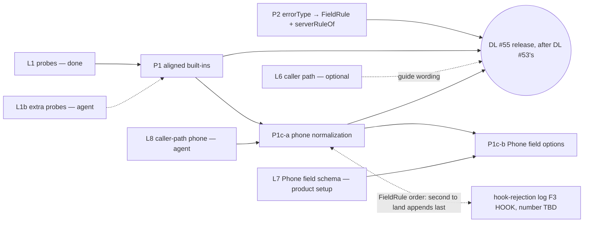

# 55 - Wix Validation Parity for wix-forms

Status: Implemented (2026-11-11; P1 + P2, see Implementation Results — caller-path phone finding). Approved for implementation — product/architecture, 2026-11-11 (fixture policy: keep QA form ids; redact `submitter.applicationId`, submission ids and the probe email). Scope: P1 (built-in format rules aligned to Wix) and P2 (Wix `errorType` → `FieldRule` mapping, client default text). DL #55 (P1+P2) is its own release, after DL #53's release; it needs no product live setup. **P1c (phone normalization): P1c approved (product, 2026-11-12); [Implemented] 2026-11-12 — P1c-a and P1c-b (L7 captured on a QA form created via the Forms API), see Implementation Results "Phase 1c results".** `FieldRule` order for the joint release: `PHONE_COUNTRY` = 10, the hook-rejection log's `HOOK` = 11 after it.

Builds on **DL#53** (`FieldRule`, `errorRule`, `checkFormField`, `FieldRejection`, `onSubmitOutcome`; implemented on the base branch and released before DL #55), **DL#41** (value store, field kinds) and **DL#45** (outcomes are enum variants; member order is the contract; text is a default). **Replaces F1 (format opt-out) of the planned wix-forms hook-rejection log** (the wix-forms log for format opt-out, trimmed echo, hook field errors and submit start; this DL calls its parts F1–F3 and its new rule `HOOK`). That log is not in this repo yet, and **its number is still to be assigned**: DL #54 on `main` is a different log (site-scoped app strategy), so the wix-forms log gets a new number when it lands. Wix enforces format on the server; that log's own revision records F1's removal. **Reverses one DL#53 Scope Pre-mortem line** ("Localizing Wix's own server violation text — `SERVER` + text as Wix sends it") for the error types P2 maps, and narrows DL#53's meaning of `SERVER`; a dated note goes into DL#53's Implementation Results in Phase 2. Paths are relative to `packages/wix-forms/` unless stated. Line numbers are for branch `wix-forms-validation-parity`: P1 + P2 citations against its base commit `9c4cca0`; P1c citations against the working tree with P1 + P2 applied (baseline 428/428). jay is referenced only by its public surface. Live checks are named L1, L1b, L6, L7 and L8; log ids from DL#42 are written "log id Ln".

## Decisions for the Implementer (TL;DR)

- **Two enforcers, two rules (L1, Q22).**
  - **Format (Phone / Email / URL): Wix enforces it.** A built-in format rule may reject only values Wix also rejects. Looser is fine: Wix refuses, and P2 shows the refusal with the same `errorRule` and default text after one round trip.
  - **`required` and choice options: Wix does not enforce them** on the API-key (site) path. L1 clean probe: a post with an empty required array, an unchecked required consent and an out-of-options dropdown value got HTTP 200 `status: PENDING`, and a read-back 4 s later showed `CONFIRMED` with those values. The plugin enforces `required` **in the browser only**. A site that needs server enforcement refuses in its submit hook with `FieldRejection`. This is **documentation only** in this DL (Q28); there is no server-side required check.
- **P1: built-in format rules aligned to Wix**, in one `FORMAT_RULES` table used by `checkTextRules`. The bookings participant check (`validateFormSummaryField`) keeps today's rules, because `createBooking` was never probed (Q20).
  - Phone: `/^[+()\-.\s\d]+$/`. Dots are allowed, there is no length minimum, and no digit is required (Wix accepted `12`, `.`, `---` and `+`; Q3).
  - URL: `/^[a-z][a-z\d+.-]*:\/\/\S+$/i`. Any scheme, any case, no whitespace. Deliberately looser than Wix, which refused `custom-scheme://foo.bar` (Q4).
  - Email: unchanged.
  - The oracle is **the L1 capture, checked in as a fixture** (Implementation Results, Phase 0 / L1), plus L1b's agent probes.
- **P2: Wix field errors map onto `FieldRule` on the server, and the client builds the text.**
  - `parseSubmissionViolations` (new, `lib/utils/wix-submission-errors.ts`) maps `FORMAT_ERROR` with `params.format` `email` / `phone` / `url` to `EMAIL` / `PHONE` / `URL`, the only shapes seen live.
  - `REQUIRED_VALUE_ERROR` → `REQUIRED` is kept. It is harmless but has never been observed (L1).
  - Everything else (`TYPE_ERROR`, `UNKNOWN_VALUE_ERROR`, length/pattern errors, any `customErrorMessage`) → `SERVER` with Wix's text. Length/pattern rows wait for the P3 follow-up's live capture.
  - New optional output **`fieldRules?: Record<target, FieldRule>`**. `fieldErrors` keeps Wix's text. The client's `presentSubmitRejection` uses `serverRuleOf` (`fieldRules[target] ?? SERVER`) and shows the plugin default text for a mapped rule (Q8).
  - Items without `errorPath` (form-level messages, a disabled form) are still dropped, as today: **behaviour is unchanged until the P3 follow-up**.
- **P1c: phone normalization — `[Design]`, added after the caller-path phone finding (Implementation Results, live check; Q29–Q39).** Approved product decisions: the visitor types freely and the input shows what they typed; the plugin **sends compact E.164** (`+972541234567`), the only phone shape Wix's caller (visitor) path accepted; the site (API-key) path is more lenient and is not the oracle.
  - **One pure, client-safe function** `checkPhone(trimmed, phoneRules)` (new `lib/utils/phone-normalization.ts`) gives both the browser verdict and the sent value, so they cannot disagree (Q31). It runs **in the browser only**: in `checkTextRules`' tel branch and in a new `toPostedValues` step just before `submitForm`. The server does not re-normalize (it has no schema at `runSubmission`; Q31).
  - Steps: P1's character pre-check stays first (letters, `ext`, `*#`, full-width digits → `PHONE`); strip separators; a leading `00` becomes `+` (libphonenumber-js parses `00…` only with a default country, measured); `+…` is parsed internationally and must be **possible** (length); a local number is converted with the default country and must be **valid** (guards a wrong-country reading, Q33); with no default country, a local number of 6–15 digits → new rule **`PHONE_COUNTRY`** (6 = shorter input is not a plausible full local number; 15 = the E.164 maximum; the bound only picks which message blocks submit) ("include the country code"), anything else → `PHONE`.
  - **Default country, in order:** the real Wix Phone field's `phoneInputOptions.defaultCountryCode`, then the new plugin-level key **`defaultPhoneCountry`** in `config/.wix-forms.yaml` (ISO 3166-1 alpha-2, validated at load; an invalid value fails init loudly). No page-level setting in this DL (Q30).
  - **`allowedCountryCodes`** of a real Phone field is respected: a number from another country → `PHONE_COUNTRY` (Q34).
  - **Gating:** P1c-a (normalization + `defaultPhoneCountry`, everything but the Phone-field options) needs only the agent's live check L8. P1c-b (reading `defaultCountryCode` / `allowedCountryCodes`) is **gated on L7**, a captured Get Form of a real Phone field, which needs **product live setup**; no hand-written schema shape is allowed (Q35).
  - **Library:** `libphonenumber-js` (MIT, no dependencies; license recorded as compatible with the repo's Apache-2.0) with **`min` metadata**: measured 29.2 KB gzipped for the parse + country helpers vs 33.7 KB (`mobile`) and 49.3 KB (`max`) (Q36). Imported statically. **Where it ends up (from the build, round 3 B1):** wix-forms runs two vite builds (`package.json` `build:client` = `vite build`, `build:server` = `vite build --ssr`; `vite.config.ts:12-27`). `rollupOptions.external` (`:28-43`) lists only the jay runtime packages and `@wix/sdk`, but the SSR build (`build.ssr: isSsrBuild`, `:17`) also externalizes every bare package import, so today `dist/form-slug-*.js:3,8` and `dist/tools.js:3` keep `import yaml from "js-yaml"` / `import { camelCase } from "change-case"` as bare imports, while `dist/index.client.js` inlines change-case (`:421-440`). libphonenumber-js behaves the same (measured in a scratchpad copy with a P1c-a stand-in): **external in the SSR outputs** (`dist/index.js` / the shared chunk keep `import … from "libphonenumber-js/min"`; the server and any root-export consumer resolve it from the site's `node_modules` at runtime, which is why it goes in `dependencies` and why `config-loader.ts` can import `isSupportedCountry`), and **inlined in `dist/index.client.js`** (35.8 KB → 204.6 KB raw, 8.9 → 45.0 KB gz). The client output is one module whose module-level `makeJayInit().withClient(…)` and `makeJayStackComponent()…withInteractive(WixFormInteractive)` calls reach `checkFormField` → `checkPhone`, so any page that loads the wix-forms client pays the whole library. **Accepted cost (product decision, round 4 split): about 29 KB gz extra on every page that loads the wix-forms client, bookings pages included** (wix-bookings' client build inlines wix-forms' client code; Implementation Plan "Bundle cost"). P1c makes **no build or packaging change**: `vite.config.ts`, `sideEffects` and the `exports` map stay as they are. Trimming the client is the deferred "wix-forms client packaging" follow-up. Units: KB = 1,000 bytes; gz = gzip of the minified output.
  - **Contract:** `FieldRule` gains `PHONE_COUNTRY`, **appended after `SERVER`** (member order is the contract, DL#45); Ordering with the hook-rejection log's `HOOK` rule (F3) is order-independent: **whichever of `PHONE_COUNTRY` / `HOOK` lands second is appended after the other**, and the generator contract test asserts the full ordered member list (Q37). P2's mapping is unchanged (Wix `FORMAT_ERROR` phone → `PHONE`).
  - **Changes P1's phone invariant:** for phones the oracle becomes the caller path; the browser now refuses values only the site path accepts (`054.123.4567` with no default country, `12`, `.`, `---`, `+`). Email and URL keep P1's rule (Q29).
- **`SERVER` is narrowed** to "Wix refused this value for a reason the plugin does not classify, or the site owner's custom validation message (and, until the hook-rejection log's F3 adds `HOOK`, a submit hook's `FieldRejection`)".
- **Order with the hook-rejection log's F3:** P2 lands first and introduces `serverRuleOf` in `submit-outcome.ts`; F3 later adds its `fromHook ? HOOK : SERVER` fallback there (Q9).
- **Live checks:** L1 done (2026-11-11). L1b: the agent runs a few extra probes for values the P1 rules reject (part of P1). L6 (caller path) is **optional and non-gating**; it only refines the guide's wording about the caller path (Q25). Agents never log in to the dashboard or change it.
- **Backward compatibility:** the only API change is the additive output `fieldRules`. Release-note behaviour changes: looser format rules (wix-forms pages only; bookings unchanged); mapped Wix errors show the default text.
- **Agent feedback:** P1 + P2: guides only — `rich-forms.md` §3 and §7, `user-visible-messages.md`; no validation rule. P1c: plugin validator warning 6 plus a fail-fast config check (Agent Feedback Loop). The jay agent-kit is unchanged.

---

## Background

- **Built-in rules** (`checkFormField`, `lib/utils/project-form-fields.ts:164-183`; `checkTextRules` `:191-214`): email `/^[^\s@]+@[^\s@]+\.[^\s@]+$/` (`:204`), URL `/^https?:\/\/.+/` (`:207`), phone `/^[+()\-\s\d]{7,}$/` (`:210`). The bookings participant path repeats the same three regexes (`validateFormSummaryField`, `:135`; regexes at `:143`, `:146`, `:149`). The browser checks only visible fields (`validateVisibleFields`, `lib/components/submission-values.ts:130-142`, hidden skipped at `:137`).
- **Server field errors:** a Wix 400 becomes a `WixApiError`. `failedSubmissionResult` (`lib/submission/run-submission.ts:350-381`) calls `fieldErrorsOf` (`:395-397`) → `parseSubmissionFieldErrors` (`project-form-fields.ts:228-252`), which keeps `errorPath → errorMessage` and **drops items without `errorPath`** (`:243`). The result is `{ success: false, reason: VALIDATION, fieldErrors }` (`run-submission.ts:364-367`). The client's `presentSubmitResult` (`lib/components/wix-form.ts:473-490`) marks every visible target `FieldRule.SERVER` (`:478-485`) and shows Wix's `errorMessage` text (`submit-outcome.ts:60-80`).
- **Wix's real 400 body** (L1, 2026-11-11): HTTP 400, `message: "Validation failed: submission Submission doesn't satisfy form requirements"`, one `details.validationError.fieldViolations[0]` with `ruleName: "SUBMISSION_VALIDATION"`, `violatedRule: "OTHER"`, and every error in `data.errors[]` (several per response: Wix reports all errors, not the first). Item shape: `{ errorPath, errorType, errorMessage, params }`. Seen live: `FORMAT_ERROR` (`params.format` `email` / `phone` / `url`), `TYPE_ERROR` (`params.type`), `UNKNOWN_VALUE_ERROR` (`params.additionalProperty`). The rest of Wix's `SubmissionErrorType` list (`REQUIRED_VALUE_ERROR`, `MIN_LENGTH_ERROR`, `PATTERN_ERROR`, `DISABLED_FORM_ERROR`, …) comes from Wix's Forms service-plugin type reference and is **unverified**.
- **What Wix enforces on the API-key (site) path (L1):** format (`FORMAT_ERROR`), JSON type (`TYPE_ERROR`) and unknown keys (`UNKNOWN_VALUE_ERROR`). **Not enforced: `required` and `enum`.** Evidence (2026-11-11): the clean probe to "QA Contact" (`interests: []` required, consent `false` required with `validation.enum: [true]`, dropdown `country: "Mars"`) and the empty `{}` post to "QA DL53 Booking" both answered HTTP 200 `PENDING` and read back `CONFIRMED`. A `PENDING` answer here is not a refusal: Wix confirms these submissions on its own. The caller path (visitor or member session, the plugin's default `postedAs: 'caller'`) is unverified (L6).

## Problem

1. **The browser is stricter than Wix on format.** L1 (form "QA Test DL54", 2026-11-11). The plugin column shows today's built-in rule:

   | Kind  | Value                                                                                                           | Wix     | Plugin today |
   | ----- | --------------------------------------------------------------------------------------------------------------- | ------- | ------------ |
   | Phone | `054.123.4567`, `050.123.4567`, `020.7946.0958`                                                                 | accepts | **blocks**   |
   | Phone | `12`, `.`, `---`, `+`                                                                                           | accepts | **blocks**   |
   | Phone | `050 123`, `+972-54-123-4567`                                                                                   | accepts | accepts      |
   | Phone | `abc`, `+1 (555) 123-4567 ext 5`, `phone: 123`, `(050) 123/4567`, full-width digits, `+44 20 7946 0958 ext. 12` | refuses | blocks       |
   | URL   | `HTTPS://EXAMPLE.COM`, `ftp://x.com`                                                                            | accepts | **blocks**   |
   | URL   | `https://example.com/path?q=1#h`                                                                                | accepts | accepts      |
   | URL   | `https://x`, `http://localhost:3000/a`, `https://exa mple.com`                                                  | refuses | accepts      |
   | URL   | `custom-scheme://foo.bar`, `mailto:a@b.com`, `example.com`, `www.example.com`, `bad`                            | refuses | blocks       |
   | Email | `ünïcode@exämple.com`, `ann@example.com`, `a+b@x.co.il`                                                         | accepts | accepts      |
   | Email | `a@b.c`, `a@b..com`                                                                                             | refuses | accepts      |
   | Email | `a@localhost`, `"a b"@x.com`, `bad2`                                                                            | refuses | blocks       |

   The rows marked **blocks** are valid input that Wix stores, but the page refuses it with no way out.

2. **Wix's field errors lose their meaning.** Every Wix violation becomes `SERVER` with validator text. A page that writes `EMAIL` copy shows it only when the browser caught the error; an email the browser accepts but Wix refuses (`a@b.c`) shows `must match format "email"`.
3. **The guides do not say who enforces `required`.** Wix accepts and confirms empty required fields and out-of-options choice values when the site posts (L1). The plugin's guides do not say that the browser check is the only enforcement, so a site that needs server enforcement does not know to add it in its submit hook.

## Prior Art / Adjacent Mechanisms

| Primitive                                                                        | Problem | Verdict                                                                                                                                          |
| -------------------------------------------------------------------------------- | ------- | ------------------------------------------------------------------------------------------------------------------------------------------------ |
| `checkTextRules` regexes (`project-form-fields.ts:204-212`)                      | 1       | **Fix in place.** No new mechanism, just new regexes in one table.                                                                               |
| Hook-rejection log F1 `replacesFormat` (approved, not built)                     | 1       | **Superseded.** It relaxed per page and needed page code; Wix still refuses the motivating values. that log's own revision records its removal.  |
| `parseSubmissionFieldErrors` (`:228-252`)                                        | 2       | **Replaced.** It already walks the right array; it now also keeps `errorType` and `params`.                                                      |
| `failedSubmissionResult` (`run-submission.ts:350-381`)                           | 2       | **Solves the place.** The one row that turns a failed attempt into a result.                                                                     |
| `presentSubmitRejection` (`submit-outcome.ts:60-80`)                             | 2       | **Solves the client place.** Pure and client-safe; already routes hidden or unknown targets to `statusMessage`; now also returns `ruleByTarget`. |
| `FieldRule` + `enumDataType` (`lib/components/field-rule.ts`)                    | 2       | **Sufficient.** Every mapped type has a member; no new member, so the contract does not change.                                                  |
| `reason?: number` in the action output (`submit-form.jay-action:14`)             | 2       | **Precedent** for an enum index on the wire.                                                                                                     |
| Hook-rejection log F3 `fromHook` + `HOOK`                                        | 2       | **Constrains.** Both pick a field's server rule; F3 later adds its fallback to P2's `serverRuleOf` (Q9).                                         |
| Browser `required` check (`checkFormField` `:167-178` + `validateVisibleFields`) | 3       | **Sufficient for the visitor path.** Kept as the only plugin enforcement (Q28).                                                                  |
| DL#53 submit hook `FieldRejection`                                               | 3       | **Solves server enforcement** for sites that need it, with no new plugin code (Q28).                                                             |

## Questions and Answers

**Q1 — Null hypothesis: why not keep the built-ins and let pages relax them (the hook-rejection log's F1)?** A wrong default fails every page that does not opt out, and F1 needed code on each page. Fixing the default fixes every page. **Answered.**

**Q2 — Why keep built-in format rules at all?** Instant feedback for common slips (no `@`, letters in a phone, a missing `https://`) saves a round trip. A loose subset keeps that value with no false blocks. **Answered.**

**Q3 — Phone: what is the minimum?** None. L1: Wix accepted `12` and also the digit-free `.`, `---` and `+`, so neither a length minimum nor a required digit is added. A page that wants stricter phones adds a page check (DL#53 `CUSTOM`). JavaScript `\s` already matches a non-breaking space, tab and newline; the hook-rejection log's F2 trims posted values. L1b probes the remaining characters the rule rejects (`*123#`, `1-800-FLOWERS`); if Wix accepts one, the class widens. **Answered (L1); L1b confirms.**

**Q4 — Tighten toward Wix where it is cheap?** Only by excluding characters a probe showed Wix rejects (whitespace in a URL; it falls out of `\S`). Structural rules (TLD length, `..`, a dotted host, `localhost`) are not copied: they guess at an unpublished rule that Wix can change, and P2 shows Wix's refusal with the same `errorRule` and text. **URL scheme:** Wix accepted `http`, `https` (any case) and `ftp`, and refused `custom-scheme://foo.bar`. The rule still accepts any `scheme://`: narrowing to the probed schemes would block other schemes Wix may accept (`sftp://`, `ws://` were not probed). Cost: `a@b.c`, `https://x` and `custom-scheme://foo.bar` each take one round trip. **Answered.**

**Q5 — Where does the errorType → `FieldRule` mapping live?** On the server, in `parseSubmissionViolations`: the raw Wix body never leaves the server, and `errorType` / `params` are only there. **The text is built on the client**, because the default messages need the field's label and min/max, which only the client has (`carryForward.fields`). **Answered.**

**Q6 — How do rules reach the client?** As a new optional output `fieldRules?: object` (target → `FieldRule` index), next to `fieldErrors`. Rejected: turning `fieldErrors` values into objects (breaks direct callers and the event); sending raw Wix `errorType` strings (exposes Wix vocabulary in a public output that DL#45 keeps plugin-owned). **Answered.**

**Q7 — New `FieldRule` members (MIN_VALUE, MAX_VALUE, items, TYPE, NOT_ALLOWED)?** Not now. Unmapped types stay `SERVER` with Wix's text. A member can be appended later (DL#45 additive rule). **Answered.**

**Q8 — The text for a mapped rule: plugin default or Wix text?** The plugin default (product decision, 2026-11-11), so the same rule shows the same default whether the browser or Wix caught it. When the template cannot be filled (a future `MIN_LENGTH` mapping with no projected `minLength`), Wix's text is kept and the rule stays. **Answered.**

**Q9 — Composition with the hook-rejection log's F3 (not yet implemented). Answered (product decision 2026-11-11: P2 lands first).** Both decide "which rule does this server field error get". P2 introduces one helper in `submit-outcome.ts`:

```ts
/** The rule of a server field error (DL#55 P2). */
function serverRuleOf(result: SubmitRejection, target: string): FieldRule {
  return result.fieldRules?.[target] ?? FieldRule.SERVER;
}
```

The hook-rejection log's F3, implemented later, adds its `result.fromHook ? HOOK : SERVER` choice as the fallback after `result.fieldRules?.[target]` in this helper (not in `presentSubmitResult`, whose `SERVER` map P2 replaces with `rejection.ruleByTarget`). `fieldRules` is built only from a Wix body, never on a hook `FieldRejection`, so `fieldRules` and `fromHook` never both apply. Neither adds an enum member here; F3's `HOOK` member is ordered by Q37. That log's revision states this order.

**Q13 — Does the `onSubmitOutcome` failed event carry the displayed text or Wix's text?** The result's `fieldErrors`, unchanged: Wix's text. `errorRule` is the display channel. A `fieldRules` copy on the event is not added (no page needs it yet). **Answered.**

**Q19 — Release? Answered (product decision 2026-11-11).** DL #55 (P1+P2) is its own release, after DL #53's release. It is not coupled to the hook-rejection log. It needs no product live setup. Narrowing `SERVER` after DL #53's release is a behaviour change for pages that print `error` under `SERVER`; they keep working (mapped errors now hit their `EMAIL`/`PHONE`/`URL` branch, or show nothing if the page has no such branch — release note).

**Q20 — Should the bookings participant path (`validateFormSummaryField`) change too? Answered: no, not in this DL.** Bookings posts through `createBooking`, which nobody has probed. Looser is safe only where Wix is known to enforce, and bookings has no P2 mapping, so a value `createBooking` refuses would become a generic booking failure instead of today's clear browser error. `validateFormSummaryField` (`:135-151`) keeps today's regexes: no bookings behaviour change, no wix-bookings CHANGELOG line.

**Q21 — Should a submit hook see classified errors?** No. A hook sees the `WixApiError` from `submit()` as today. Classification happens after the hook, in the `failed` row. **Answered.**

**Q22 — Does "the browser never rejects what Wix accepts" hold for `required` and choices? Answered: no; it is scoped to format rules.** Where Wix enforces, it is the authority, and the browser may only be looser. Where Wix does not enforce (`required`, options), the schema's `required` is the site owner's intent and the browser enforces it; options are limited by the plugin's own controls (`select`, chips).

**Q25 — Does the caller path enforce `required` or options? (open, optional, L6)** The plugin posts as the caller by default (`postedAs: 'caller'`), and L1 tested only the API-key site path. L6 is **non-gating**: it only refines the guide's sentence about the caller path. Until it runs, the guide says the caller path is unverified.

**Q28 — Should the plugin's server check `required` before calling Wix (former P6)? Answered: no (product decision 2026-11-11); documentation only.**

- Null hypothesis holds: the browser check covers every visitor who uses the plugin's form, and a site that needs server enforcement already has the tool: refuse in its submit hook with `FieldRejection` (DL#53).
- The former P6 needed a per-form schema cache, a re-fetch before refusing (so an owner's change is not blocked by staleness), a load timeout, fail-open logging, a new exported error and a new `WixFormsService` member. That complexity stops only honest-but-buggy direct callers; a determined poster can send `"x"`.
- Choice values are not checked on the server either; a hook can refuse one with `FieldRejection`.
- The plugin agent-kit guides state the facts (Phase 1 and Phase 2 guide steps).

**Q29 — P1c: does P1's phone rule "never stricter than Wix" survive? Answered: no, for phones it is replaced (product decision 2026-11-11).** The live check showed Wix's phone rule differs by path: the caller (visitor) path — the plugin's default — refused `054.123.4567`, `+972-54-123-4567` and `0541234567` and accepted `+972541234567`; the site path stored `054.123.4567`. The plugin posts as the caller, so the caller path is the oracle for phones. New invariant: **the browser refuses only values it cannot turn into an E.164 number Wix's caller path would accept, and it sends that E.164 form.** Values P1 let through but the caller path refuses and the plugin cannot convert (`12`, `.`, `---`, `+`, a local number with no known country) are now refused in the browser. P1's `FORMAT_RULES.tel` stays as the first step (it is still the right refusal for letters and symbols). Email and URL are untouched.

**Q30 — P1c: where does the fallback default country live? Answered: one plugin-level key, `defaultPhoneCountry`, in `config/.wix-forms.yaml`.** Null hypothesis — can an existing primitive carry it?

- _Field only, no config:_ most phone fields are Short answer + `format: PHONE` (the QA form; check report) and have no country at all, so the approved fallback needs a site-level source.
- _Extend `formIds`:_ `formIds` is a list (an allowlist, `config-loader.ts:11-24`); turning it into a per-form map breaks its shape for a use case nobody has asked for (one site, several countries).
- _A page-level prop on the form:_ `WixFormProps` is `PageProps & DynamicContractProps<WixFormMetadata>` (`wix-form.ts:65`); a new prop is a new authoring surface in every page and contract. Deferred until a site needs per-page countries (Scope Pre-mortem).
- _A page check (`registerFieldChecks`, DL#53):_ a page check can refuse a value but cannot change the posted value.
- _The submit hook:_ optional server code; the browser check would not agree with it.
  The config file already holds the site's plugin settings (`namespace`, `formIds`, `include`), has a loader (`loadWixFormsConfig`, `config-loader.ts:41-52`) and reaches the field projection through `provideWixFormsService(wixClient, config)` (`init.ts:12-13`). So the key costs no new channel: `getFormFields` (`wix-forms-service.ts:51-63`) passes it to `projectFormFields`, which writes it into each tel field's `phone.defaultCountry`, and the fields already reach the browser in the carry-forward (`wix-form.ts:76-79`). A field's own `defaultCountryCode` wins over the key.

**Q31 — P1c: client, server, or both? Answered: the client only, through one function.** The browser check and the sent value come from the same call (`checkPhone`), so a value that passes is exactly the value sent. Running it on the server too would need the form schema at `runSubmission` (`run-submission.ts:131-163` has only `formId` and `values`), i.e. a schema fetch or cache per submit — the complexity Q28 rejected. A direct `submitForm` caller that sends a local number gets Wix's refusal, shown as `PHONE` by P2.

**Q32 — P1c: what does the submit hook see? Answered: the E.164 value.** `toPostedValues` runs before `submitForm`, so the hook's `values` (`run-submission.ts:166-172`) hold `+972541234567`. The store, the visible input and the confirmation echo (`valueByTarget: values()`, `wix-form.ts:524`) keep what the visitor typed (decision 1). Guide §7 says so.

**Q33 — P1c: `isPossible` or `isValid`? Answered: possible for international input, valid for a converted local one.** Measured with `min` metadata: `+15551234567` is possible but not valid; Wix's caller-path rule for such numbers is unprobed, so refusing it could be stricter than Wix — a possible number is sent and Wix decides (round trip → `PHONE`). For a local number the plugin chooses the country itself, and a wrong guess silently sends a wrong number: `0541234567` with default `US` parses to `+10541234567`, possible but not valid. So a converted local number must be valid, otherwise `PHONE`.

**Q34 — P1c: how is `allowedCountryCodes` checked? Answered:** when the field has a non-empty list, the parsed number passes if its `country` is in the list, or — when libphonenumber-js leaves `country` undefined (e.g. an unassigned `+1 555` number) — if its calling code is the calling code of a listed country. Otherwise `PHONE_COUNTRY`. The default country is not checked against the list; a converted number is checked like any other. Whether Wix's caller path itself refuses a mismatched country (and with which `errorType`) is an L7 probe; a new mapping row is added only if observed.

**Q35 — P1c: why is reading the Phone field's options gated on L7? Answered:** the plugin has never seen a real Phone field (`CONTACTS_PHONE` / `PHONE_INPUT`): the check report found no reads of `phoneInputOptions`, `phoneOptions` or `allowedCountryCodes`, and "QA Test DL54" has none. Wix's docs place `phoneOptions.allowedCountryCodes` under `validation` and `defaultCountryCode` under `phoneInputOptions`, but the plugin reads the legacy `fields[]` shape (`get-form.ts:13-45`), and documented paths have been wrong before (P4 follow-up). The repo rule forbids a hand-written fixture for an uncaptured shape. So `RawFormField` gains these keys only after L7 captures them, and P1c-a ships without them. L7 also confirms that `readInputType` maps a real Phone field to `tel` (`project-form-fields.ts:73-75` keys only on `validation.string.format`); if it does not, the `componentType` check is added in P1c-b.

**Q36 — P1c: which libphonenumber-js metadata? Answered: `min`.** Measured on 1.13.15 (esbuild 0.24 `--bundle --minify`, gzip -9; entry imports `parsePhoneNumberFromString` and `isSupportedCountry`):

| Metadata | Metadata JSON (raw / gz) | Bundle (raw / gz)  | Needed for                                                                                   |
| -------- | ------------------------ | ------------------ | -------------------------------------------------------------------------------------------- |
| `min`    | 83.9 KB / 19.1 KB        | 121.5 KB / 29.2 KB | possible lengths, and `isValid` on length and leading digits, not number type — all P1c uses |
| `mobile` | 99.3 KB / 23.7 KB        | 136.9 KB / 33.7 KB | mobile-type checks (not used)                                                                |
| `max`    | 157.4 KB / 39.3 KB       | 195.0 KB / 49.3 KB | per-type patterns (`getType`; not used)                                                      |

Lazy loading is rejected: `checkFormField` is synchronous (typing, blur, submit, `wix-form.ts:149-152`), and an async check path for one rule is not worth ~29 KB gz. The implementer pins the latest 1.x at implementation time and re-measures; installs need the Wix VPN.

**Q37 — P1c: a new `FieldRule` member, or reuse `PHONE`? Answered: a new member, `PHONE_COUNTRY`.** Reusing `PHONE` with another default text fails pages with their own copy: they branch on `errorRule`, not text (`user-visible-messages.md`), so a localized "invalid phone" message would hide the one thing the visitor must do — add the country code. One member covers both causes (no country code; a country the field does not accept), because the fix is the same: enter the number with an accepted country code. Its default text depends on the field: without `allowedCountries`, `Please include the country code, starting with +.`; with them, `Please enter a number with one of these country codes: +972, +1.` (calling codes, deduplicated, in list order). It is **appended after `SERVER`**, so existing numeric values are unchanged (`field-rule.ts:9-20`, DL#45); every regenerated contract's `errorRule` gains the member (`contract-utils.ts:87`). Ordering with the hook-rejection log's `HOOK` (F3) does not depend on that log's state: whichever of the two lands second is appended after the other, and the generator contract test asserts the full ordered member list, so a wrong order fails the build.

**Q38 — P1c: is `00` handled, and are extensions dropped? Answered:** a leading `00` (after stripping separators) is rewritten to `+`, because libphonenumber-js parses `00972541234567` only with a default country whose international prefix is `00` (measured: undefined with none, `+100972…` with `US`). Extensions are never dropped silently: `ext`, `x` and `#` fail P1's pre-check first → `PHONE`.

**Q39 — P1c: do `minLength` / `maxLength` / `pattern` apply to the typed or the sent value? Answered: the typed value, as today** (`checkTextRules` order, `project-form-fields.ts:232-250`). Length and pattern rules on phone fields are rare and Wix's handling of them is the P3 follow-up's capture; a mismatch costs one round trip shown as `SERVER`.

## Design

### Phase map



P1 and P2 are independent. P1c-a and the hook-rejection log's F3 both append a `FieldRule` member; neither waits for the other, and whichever lands second appends its member after the other's (Q37). P1c builds on P1 (it replaces the tel branch of `checkTextRules`) and leaves P2 unchanged.

### 1. P1 — aligned built-ins (`lib/utils/project-form-fields.ts`)

```ts
/** Browser format rules: each may reject only values Wix's server also rejects (DL#55 P1, L1). */
const FORMAT_RULES = {
  email: /^[^\s@]+@[^\s@]+\.[^\s@]+$/,
  url: /^[a-z][a-z\d+.-]*:\/\/\S+$/i, // any scheme: looser than Wix by design (Q4)
  tel: /^[+()\-.\s\d]+$/,
} as const;
```

- `checkTextRules` (`:204-212`) tests `FORMAT_RULES`. The messages are unchanged. `validateFormSummaryField` (`:135-151`, bookings) is not touched (Q20).
- The oracle is the L1 capture (see Implementation Plan). The invariant is "every Wix-accepted value passes".

Trace: tel `054.123.4567` → `checkFormField` → not empty → `checkTextRules` → tel rule matches (dot allowed) → `checkPattern` (`:217`) → `NONE` → submit → Wix accepts. Today: `PHONE` at `:210-211`, and submit stops (`wix-form.ts:420-427`).

### 2. P2 — `errorType` → `FieldRule` (`lib/utils/wix-submission-errors.ts` new, `lib/submission/run-submission.ts`, `lib/types.ts`, `lib/actions/submit-form.jay-action`, `lib/components/submit-outcome.ts`, `lib/components/wix-form.ts`, `lib/utils/project-form-fields.ts`)

```ts
// lib/utils/wix-submission-errors.ts — pure, server-side use only
/** One item of a Wix 400: details.validationError.fieldViolations[].data.errors[] (L1). */
interface WixSubmissionError {
  errorPath?: string;
  errorType?: string;
  errorMessage?: string;
  customErrorMessage?: string;
  params?: { format?: string };
}

export interface SubmissionViolations {
  /** target → Wix text (first item per target, as today). Items without errorPath are dropped, as today. */
  fieldErrors: Record<string, string>;
  /** target → rule, only for items the plugin recognises. */
  fieldRules: Record<string, FieldRule>;
}

export function parseSubmissionViolations(responseBody: string): SubmissionViolations;
/** undefined = unmapped (SERVER). An item with customErrorMessage is always unmapped. */
export function fieldRuleOfWixError(error: WixSubmissionError): FieldRule | undefined;
```

| Wix `errorType`                                           | `params.format` (case-insensitive) | `FieldRule`               | Evidence                                                          |
| --------------------------------------------------------- | ---------------------------------- | ------------------------- | ----------------------------------------------------------------- |
| `FORMAT_ERROR`                                            | `email` / `phone` / `url`          | `EMAIL` / `PHONE` / `URL` | observed (L1)                                                     |
| `FORMAT_ERROR`                                            | other or missing                   | — (`SERVER`)              | —                                                                 |
| `REQUIRED_VALUE_ERROR`                                    | —                                  | `REQUIRED`                | **not observed** (Wix did not enforce `required` in L1); harmless |
| `TYPE_ERROR`, `UNKNOWN_VALUE_ERROR`                       | —                                  | — (`SERVER`)              | observed (L1)                                                     |
| any other (incl. length/pattern), or `customErrorMessage` | —                                  | — (`SERVER`)              | not observed; rows wait for the P3 follow-up's capture            |

- Item text: `customErrorMessage ?? errorMessage ?? 'Invalid value'` (today's fallback, `:244`). A target's rule is taken from the same first item that supplies its text.
- `parseSubmissionFieldErrors` (`project-form-fields.ts:228-252`) and its tests (`test/project-form-fields.test.ts:326-355`) move to the new module and test file. It is not exported publicly (`lib/index.ts`).
- **Server:** `fieldErrorsOf` (`run-submission.ts:395-397`) becomes `violationsOf(error): SubmissionViolations` (empty for a non-`WixApiError`). The field row (`:364-367`) returns `{ success: false, reason: VALIDATION, fieldErrors, ...optionalFieldRules(fieldRules) }`, where `optionalFieldRules(rules)` returns `{}` for an empty map. All other rows are unchanged.
- **Types:** the failure variant of `SubmitFormResult` (`lib/types.ts:75-82`) and `SubmitRejection` (`submit-outcome.ts:41-48`) gain `fieldRules?: Record<string, FieldRule>` ("server field errors the plugin classifies; absent targets are `SERVER`"). Action output (`submit-form.jay-action:9-15`): `fieldRules?: object  # target → FieldRule index (REQUIRED=1, …) for server field errors the plugin classifies; others are SERVER (DL#55)`. The generated `.jay-action.d.ts` shows **no diff**: the generator leaves `object` outputs out (the current file has no `fieldErrors` either). The transport passes extra output keys through (precedent: DL#53 `code`). Imports: `lib/types.ts` and `run-submission.ts` add `import { FieldRule } from` `lib/components/field-rule.ts` (a leaf module, so `types.ts` → `field-rule.ts` adds no cycle); the `parseSubmissionFieldErrors` import at `run-submission.ts:36` is replaced by the new module's import from `lib/utils/wix-submission-errors.ts`.
- **Default text, one source:** `defaultFieldMessage(rule, field): string | undefined` in `project-form-fields.ts` holds the seven messages now written inline in `requiredFailure` / `checkTextRules` / `checkPattern` (`:187-225`):
  - `REQUIRED`: `` `${label} is required.` ``
  - `MIN_LENGTH`: `` `${label} must be at least ${minLength} characters.` ``
  - `MAX_LENGTH`: `` `${label} must be at most ${maxLength} characters.` ``
  - `EMAIL`: `Please enter a valid email address.`
  - `URL`: `Please enter a valid URL.`
  - `PHONE`: `Please enter a valid phone number.`
  - `PATTERN`: `` `${label} is not in the expected format.` ``

  Those functions call it with no text change. It returns `undefined` for `MIN_LENGTH` / `MAX_LENGTH` without the bound, and for `NONE` / `CUSTOM` / `SERVER` (and any later member, such as the hook-rejection log's `HOOK`).

- **Client:** `presentSubmitRejection` gains `ruleByTarget: Record<string, FieldRule>` in `SubmitRejectionView`. For each visible target: `rule = serverRuleOf(result, target)` (Q9). The message is `defaultFieldMessage(rule, field) ?? wixText` when `rule` is not `SERVER`, otherwise `wixText`. Hidden and unknown targets keep today's `label || target: wixText` status line. `presentSubmitResult` (`wix-form.ts:473-490`) calls `setRuleByTarget(rejection.ruleByTarget)` instead of building the `SERVER` map (`:478-485`). `submit-outcome.ts` imports `defaultFieldMessage`; `project-form-fields.ts` is already imported by the client (`wix-form.ts:29`), so the import stays client-safe.
- **Typing** clears a server-mapped error once the browser rules pass, as it clears `SERVER` today (`handleNativeInput`, `wix-form.ts:199-206`). No change.

Trace: email `a@b.c`:

1. The browser accepts (Q4).
2. Wix 400 `FORMAT_ERROR`/`email` → `WixApiError` → `attempt.state = 'failed'` (`run-submission.ts:257`) → `settleSubmission` (`:308-309`) → `failedSubmissionResult` → `{ VALIDATION, fieldErrors: { email: 'must match format "email"' }, fieldRules: { email: 4 } }`.
3. The client: `presentSubmitResult` → `presentSubmitRejection` gives `errorByTarget.email = 'Please enter a valid email address.'`, `ruleByTarget.email = EMAIL`, and the page's `errorRule === EMAIL` copy shows.

Today: `SERVER` + `must match format "email"`.

**Null hypothesis:** Q5–Q7. One optional output key, one pure module (replacing a function), one helper; no enum or contract change.

### 1c. P1c — phone normalization `[Design]` (`lib/utils/phone-normalization.ts` new, `lib/utils/project-form-fields.ts`, `lib/components/field-rule.ts`, `lib/types.ts`, `lib/components/submission-values.ts`, `lib/components/wix-form.ts`, `lib/config-loader.ts`, `lib/services/wix-forms-service.ts`, `lib/setup.ts`, `lib/validators/wix-form-bindings.ts`, `package.json`)

Decisions: TL;DR P1c and Q29–Q39. Two parts: **P1c-a** (normalization, `PHONE_COUNTRY`, `defaultPhoneCountry`; needs L8 only) and **P1c-b** (the real Phone field's `defaultCountryCode` / `allowedCountryCodes`; gated on L7).

**Today's trace (caller path).** Visitor types `054.123.4567` in "QA Test DL54"'s Phone (Short answer, `format: PHONE`) → `readInputType` maps it to `tel` (`project-form-fields.ts:73-75`) → at submit `readFormValues` (`wix-form.ts:422`) → `validateVisibleFields` → `checkFormField` (`:164-183`) → `checkTextRules` (`:232-250`) → `FORMAT_RULES.tel` (`:229`) matches → `NONE` → `runFormSubmit` posts the raw string (`wix-form.ts:434-441`) → `submitForm` action (`forms-actions.ts:19-36`) → `runSubmission` → `submitSubmittableForm` (`run-submission.ts:131-163`) → `createSubmission(formId, values, authorization)` as the caller → Wix 400 `FORMAT_ERROR` phone → P2 `parseSubmissionViolations` → `PHONE` with the default text. One wasted round trip, and the visitor is never told what Wix wants.

**New types** (`lib/types.ts`):

```ts
/** Country rules for a tel field (DL#55 P1c). ISO 3166-1 alpha-2, upper case. */
export interface PhoneRules {
  /** The Phone field's defaultCountryCode (P1c-b), else config `defaultPhoneCountry`. */
  defaultCountry?: string;
  /** The Phone field's allowedCountryCodes (P1c-b); absent or empty = any country. */
  allowedCountries?: string[];
}

export interface FormFieldView {
  // …existing members…
  /** Only on `tel` fields, only when a rule is known. */
  phone?: PhoneRules;
}
```

**`FieldRule`** (`lib/components/field-rule.ts:9-20`): append `PHONE_COUNTRY` after `SERVER`. `defaultFieldMessage` (`project-form-fields.ts:200-224`) gains its case (texts in Q37).

**`checkPhone`** (`lib/utils/phone-normalization.ts`, new, client-safe, imports `libphonenumber-js/min`):

```ts
export type PhoneCheck =
  | { rule: FieldRule.NONE; e164: string }
  | { rule: FieldRule.PHONE | FieldRule.PHONE_COUNTRY };

/** The verdict on a non-empty trimmed phone value, and its E.164 form when it passes (DL#55 P1c). */
export function checkPhone(trimmed: string, rules: PhoneRules = {}): PhoneCheck;
```

1. `FORMAT_RULES.tel` (`project-form-fields.ts:229`, moved next to `checkPhone` or exported) fails → `PHONE`.
2. `compact` = `trimmed` without whitespace, `(`, `)`, `.`, `-`. A leading `00` → `+` (Q38). The rewrite runs before the local branch, so an all-zero value such as `0000000` with no default country becomes `+00000` and fails step 3 as `PHONE`, not `PHONE_COUNTRY`; harmless (no real number starts with `00` locally) and pinned by a test row.
3. `compact` starts with `+` → `parsePhoneNumberFromString(compact)`; undefined or not `isPossible()` → `PHONE`.
4. Otherwise (local): no `rules.defaultCountry` → `PHONE_COUNTRY` when `compact` has 6–15 digits (inclusive), else `PHONE`. Rationale: 15 is the E.164 maximum, so 16+ digits cannot become a number with any country code; below 6 digits the input is a fragment (`12`, `12345`) for which "add the country code" would mislead. Both verdicts block submit, so the bound is a message choice, not a correctness one. With one → parse with `{ defaultCountry }`; undefined or not `isValid()` → `PHONE` (Q33).
5. `rules.allowedCountries` non-empty and the number is not from a listed country (Q34) → `PHONE_COUNTRY`.
6. → `{ rule: NONE, e164: number.number }`.

**Browser check.** `checkTextRules`' tel branch (`project-form-fields.ts:245-247`) becomes `const phone = checkPhone(trimmed, field.phone); if (phone.rule !== FieldRule.NONE) return failure(phone.rule, field);` and falls through to `checkPattern` as today. Typing, blur and submit all reach it through `checkFormField`, so the visitor sees `PHONE_COUNTRY` before any network call. `validateFormSummaryField` (bookings, `:135-151`) is not touched (Q20).

**Sent value.** New `toPostedValues(fields, values)` in `lib/components/submission-values.ts`: for every `tel` field, visible or hidden, whose value is a string, it trims the value (as `checkFormField` does, `project-form-fields.ts:175`), and when the trimmed value is non-empty and `checkPhone(trimmed, field.phone)` is `NONE`, the value becomes `e164`; every other value is passed through unchanged. So a hidden tel the page fills with a convertible number is converted; a hidden tel that is not convertible is sent raw, and Wix's refusal lands in `statusMessage` (Scope Pre-mortem: hidden-field server errors). In `wix-form.ts` the validated `submissionValues` (`:422-431`) are passed as `submissionValues: toPostedValues(carryForward.fields, submissionValues)` to `runFormSubmit` (`:441`). The store (`values()`), the visible input and `valueByTarget` (`:524`) are not changed (decision 1). Because a visible tel field reached this point only with verdict `NONE`, every visible phone that is sent is E.164.

**Server.** `runSubmission` and the action are unchanged (Q31). P2 is unchanged: a Wix `FORMAT_ERROR` phone (a direct caller, or a possible-but-refused number) → `PHONE` (`wix-submission-errors.ts:35`).

**Config (P1c-a).** `WixFormsConfig` / `RawWixFormsConfig` (`config-loader.ts:11-40`) gain `defaultPhoneCountry?: string`. `loadWixFormsConfig` (`:41-52`) trims and upper-cases it; a value `isSupportedCountry` rejects throws `Error('config/.wix-forms.yaml: defaultPhoneCountry "<value>" is not a country code libphonenumber-js supports (use an ISO 3166-1 alpha-2 code, e.g. IL, US, GB). Fix or remove the key.')` (`isSupportedCountry` also accepts a few non-ISO libphonenumber regions such as `AC`; accepted as harmless), so init fails loudly instead of every local phone failing quietly. `getFormFields` (`wix-forms-service.ts:59`) calls `projectFormFields(form, { defaultPhoneCountry: config.defaultPhoneCountry })`; `projectFormFields` (`project-form-fields.ts:80-112`) sets `phone: { defaultCountry }` on `tel` fields only, and omits `phone` when nothing is known. `listForms` (`wix-forms-service.ts:46`) keeps calling `projectFormFields(form)` with no option: it feeds contract generation (`form-contract-generator.ts:43`) and the forms reference (`setup.ts:88`), neither of which reads `phone`. `CONFIG_TEMPLATE` (`setup.ts:25-42`) gains a commented example:

```yaml
# Country for phone numbers typed without a country code (ISO code, e.g. IL).
# A Wix Phone field's own default country wins. Unset: such numbers are refused
# in the browser with a request to add the country code.
# defaultPhoneCountry: IL
```

**Phone field options (P1c-b, after L7).** `RawFormField` (`get-form.ts:13-45`) gains exactly the paths L7 captures for `defaultCountryCode` and `allowedCountryCodes`; `projectFormFields` fills `phone.defaultCountry` (field wins over config) and `phone.allowedCountries`. If L7 shows a real Phone field without `validation.string.format: PHONE`, `readInputType` also maps its captured `componentType` to `tel`.

**Plugin validation.** `lib/validators/wix-form-bindings.ts` gains warning 6, a **new analysis** (`detectPhoneRuleWithoutCountryBranch`): warnings 3–5 inspect refs, labels and `<form>`, none parses `if=`. Spec:

- **Matched conditions:** an element's `if=` whose whole value, after trimming, is exactly `<key>.<field>.errorRule === <RULE>` or `<key>.<field>.errorRule == <RULE>` (`===` is the spelling the guides use, `rich-forms.md:131-134`; `==` is also matched), with `<key>` a `form/` import key. Any other form — `!=` / `!==`, `&&` / `||`, parentheses, negation — is **unrecognised and stays silent** (a missed warning, never a false one, like `detectScalarControlOverOptions`, `:308`).
- **Per field** `<key>.<field>`: collect the set of matched `<RULE>`s, and the `{<key>.<field>.error}` text bindings with whether each has a self-or-ancestor element carrying a matched `if=` on that field's `errorRule` (nesting: any depth counts as "inside a branch"; a binding under an unrecognised condition counts as unconditional, so it stays silent).
- **What a binding is, and how it is found:** a binding is `{<key>.<field>.error}` in an element's **own text nodes** only. The same expression inside an attribute (e.g. `aria-label`, `title`) is not a binding and is ignored, because it does not show the error to a sighted visitor. Bindings are found by the same `walkElements` pass that reads `if=`, scanning each element's direct text children, not the serialized HTML that `findErrorBinding` (`wix-form-bindings.ts:155`) searches; the ancestor walk for "inside a branch" follows `selfOrAncestorLoopsOver` (`:329`).
- **Warn** when the set contains `PHONE`, does not contain `PHONE_COUNTRY`, and every `error` binding of that field is inside a matched branch (including none at all).
- Message: "`<key>.<field>` branches on errorRule PHONE but not PHONE_COUNTRY: a phone without a country code would show no error. Add a PHONE_COUNTRY branch or print {<key>.<field>.error} unconditionally (DL#55 P1c)."
- **Phone-only, on purpose:** `PHONE_COUNTRY` is the only rule P1c makes a field newly produce that a page already branching on its format rule would miss. The same gap for P2's `EMAIL`/`URL` mappings (pages branching on `SERVER` only) needs to know which rules each field can produce; that general warning belongs to the P5a schema-warnings follow-up.

Trace after P1c, no default country: `054.123.4567` → `checkPhone` → pre-check passes → `0541234567` local, no default, 10 digits → `PHONE_COUNTRY` → "Please include the country code, starting with +." → no submit. With `defaultPhoneCountry: IL`: → valid → `NONE`, `e164 +972541234567` → `toPostedValues` → Wix caller path accepts → stored `+972541234567`; the input still shows `054.123.4567`.

### Generated contract and action impact

| Phase | Contract                                     | `submitForm` action                            | Exports                                                     |
| ----- | -------------------------------------------- | ---------------------------------------------- | ----------------------------------------------------------- |
| P1    | none                                         | none                                           | none (rules are internal)                                   |
| P2    | none (no `FieldRule` member)                 | output `fieldRules?: object` (no `.d.ts` diff) | `SubmitFormResult` widened                                  |
| P1c   | `errorRule` gains `PHONE_COUNTRY` (appended) | none (values are E.164 strings)                | `FieldRule.PHONE_COUNTRY`; config key `defaultPhoneCountry` |

### Backward compatibility

- **Released pages (DL#53 and earlier):** no markup change. They now see: values that used to be blocked (dotted phones, `HTTPS://`, `ftp://`, short phones) submit; mapped Wix field errors show the plugin's English default text and carry `EMAIL`/`PHONE`/`URL` instead of `SERVER`. A page that printed `error` only under `SERVER` shows nothing for a mapped error unless it also has a branch for that rule (release note: add the `EMAIL`/`PHONE`/`URL` branches, or print `error` unconditionally).
- **Form-level and disabled-form errors:** unchanged (generic text) until the P3 follow-up.
- **wix-bookings:** unchanged (Q20); no CHANGELOG line.
- **P1c:** pages that branch on `PHONE` and print `error` only there show nothing for `PHONE_COUNTRY` (validator warning 6, release note). Sites whose visitors type local numbers must set `defaultPhoneCountry` or those visitors are asked for a country code. Stored phone values become E.164 for plugin submissions; a hook that matched local formats must accept E.164. Existing `FieldRule` numeric values are unchanged. Sites now get `libphonenumber-js` installed as a runtime dependency: the server outputs import it (TL;DR Library), and the client build ships it inlined. Every page that loads the wix-forms client, bookings pages included, grows by about 29 KB gz (accepted, Implementation Plan "Bundle cost"); the client file layout and the `exports` map are unchanged. The exported `checkFormField` / `validateFormField` (`index.ts:9-10`, `index.client.ts:8-9`) change their tel verdicts: values they accepted are now refused, and they can return the new `PHONE_COUNTRY`; CHANGELOG (d) names both functions. `validateFormSummaryField` (wix-bookings) is unchanged.
- **Direct `submitForm` callers:** `fieldErrors` keeps Wix's text; `fieldRules` is new and optional. Empty required fields are still accepted by Wix when posted directly (documented, Q28).
- **Hook-rejection log (number to be assigned):** F1 is dropped; that log's revision records it. F3 adds its fallback to `serverRuleOf` (Q9); its checks that a Wix refusal shows `SERVER` must use an unmapped Wix error (`TYPE_ERROR`, an unknown format, or `customErrorMessage`).
- **CHANGELOG `## Unreleased`:**
  - (a) browser format rules for form fields are never stricter than Wix (the bookings participant check is unchanged)
  - (b) Wix field errors use `errorRule` `EMAIL`/`PHONE`/`URL` and the default text, and `SERVER` now means unclassified or the owner's custom message
  - API addition: output `fieldRules`.
  - (c)–(d) P1c, see Phase 1c "Docs"; (a) is amended to Email and URL.

## Examples

✅ One copy per rule, whoever caught it (no change to existing DL#53 markup):

```html
<span id="c-email-err" aria-live="polite">
  <span if="contact.email.errorRule === REQUIRED">Email is required.</span>
  <span if="contact.email.errorRule === EMAIL">That email doesn't look right.</span>
  <span if="contact.email.errorRule === SERVER">{contact.email.error}</span>
</span>
```

`a@b.c` passes the browser, Wix refuses it, and the `EMAIL` line shows.

✅ A site that needs `required` enforced on the server refuses in its submit hook:

```ts
if (!String(values.full_name ?? '').trim()) {
  throw new FieldRejection({ full_name: 'Full name is required.' });
}
```

❌ Matching Wix's validator text: `if="contact.email.error === 'must match format &quot;email&quot;'"`. Branch on `errorRule` instead.

❌ A page check that re-implements a stricter phone regex "to match Wix": Wix's rule is unpublished and changes; let Wix refuse (`PHONE` after submit).

❌ Relying on Wix to enforce `required` or a dropdown's options: it accepts and confirms them when the site posts (L1 clean probe).

## Implementation Plan

Each phase: write failing tests first (doc comments cite this DL; bug-repro style), implement, run `npm run build` and `npx vitest run` in `packages/wix-forms`, update the guides in the same phase, and add an Implementation Results entry with red-before reasons and X/Y. Tests labelled **regression guard** pass today by design; every other new test must fail today for the stated reason. Fixtures go under `test/fixtures/` (repo rule: external files). **No hand-written fixture stands in for a Wix response shape that was not captured.**

**Phase 0 — live checks (no code).** QA testbed site, REST `POST /form-submission-service/v4/submissions`. Format probes carry an invalid sibling field so that Wix answers 400 and stores nothing while still reporting per-field results (method of L1). Record status and body in Implementation Results and keep the raw capture.

- **L1 (agent): done 2026-11-11**, including the clean probe and read-backs. Results below.
- **L1b (agent; before P1's fixture is final):** with the L1 method, phone `*123#` and `1-800-FLOWERS`, email `a@b@c.com`. Any value Wix accepts widens the rule, and the capture is added to the fixture. Informational only: phone `054 123 4567` with U+00A0.
- **L6 (agent, optional, non-gating):** post through the plugin's default caller path (visitor session) to "QA DL53 Booking" with an empty `full_name`, and to "QA Contact" with `interests: []`, an unchecked consent and `country: "Mars"`, as clean probes; read back any accepted submission and list its id for the product owner to clean up. Refines the guide's caller-path sentence only (Q25).

**Phase 1 — aligned built-ins.**

- Fixture `test/fixtures/format-parity/wix-l1-probes-2026-11-11.json`: **the L1 capture, checked in verbatim except that `submitter.applicationId`, the submission ids and the probe email address are redacted to stable placeholders** (`<application-id>`, `<submission-id-N>`, `<probe-email>`; product decision — the oracle does not read them; QA form ids stay, as they are a QA testbed with no credentials) (plus L1b's capture as a second file, redacted the same way), with a sibling note that its `method` text predates the clean probes and is false for the two stored `cleanProbes` entries. The test derives the oracle from it:
  - only `results` entries whose label starts with `phone `, `url ` or `email ` are format probes; the `required:`, `enum:`, `type:` and `unknown key` entries and `cleanProbes` are skipped explicitly
  - the probed target comes from the label prefix: `phone` → `phone`, `url` → `website`, `email` → `email`
  - the value is `sent[target]`
  - Wix accepted the value when no `errors[]` item has `errorPath === target`
- `test/fixtures/format-parity/qa-test-dl54-fields.json`, written by hand: the `FormFieldView`s of "QA Test DL54" — `name` → Name (text), `email` → Email (email), `phone` → Phone (tel), `website` → Website (url), none required.
- New `test/format-parity.test.ts`:
  - (a) Every Wix-accepted value → `checkFormField` `NONE`. Red for `054.123.4567`, `050.123.4567`, `020.7946.0958`, `12`, `.`, `---`, `+`, `HTTPS://EXAMPLE.COM`, `ftp://x.com`. Regression guards: `050 123`, `+972-54-123-4567`, `https://example.com/path?q=1#h`, `ünïcode@exämple.com`, `ann@example.com`, `a+b@x.co.il`.
  - (b) Refused values the browser must still reject → the kind's rule (regression guards): `abc`, `+1 (555) 123-4567 ext 5`, `phone: 123`, `(050) 123/4567`, full-width digits, `+44 20 7946 0958 ext. 12`, `mailto:a@b.com`, `example.com`, `www.example.com`, `bad`, `a@localhost`, `"a b"@x.com`, `bad2`. `https://exa mple.com` → `URL` (red: accepted today).
  - (c) Refused values the browser accepts by design (Q4) → `NONE`: `https://x`, `http://localhost:3000/a`, `a@b.c`, `a@b..com` (regression guards), `custom-scheme://foo.bar` (red: blocked today).
  - (d) Bookings unchanged (Q20, regression guard): `validateFormSummaryField` still refuses `054.123.4567`, `12` and `HTTPS://EXAMPLE.COM`.
- The existing `checkFormField` table (`test/project-form-fields.test.ts:239-324`) stays green.
- Guides: `agent-kit/plugin/rich-forms.md` §3 "Live validation" gains the format parity rule (Wix enforces Phone/Email/URL format on its server; to accept other formats, change the Wix field to Short answer), and states: "Wix accepts and confirms empty required fields and choice values outside the field's options when the site posts (verified); the caller path is unverified. The plugin enforces `required` in the browser only. A site that needs server enforcement refuses in its submit hook with `FieldRejection`." §7 (submit hook) gets the matching sentence with the hook example. `user-visible-messages.md` "Field error" gets the format parity line and the `required` fact.

**Phase 2 — errorType mapping.**

- Fixtures, all copied verbatim from the L1 capture: `test/fixtures/submission/field-violation-400.json` is replaced by the `email a@b.c` response body (two `FORMAT_ERROR` items: `email`, `website`). New `type-error-400.json` is the `type:` response body (`TYPE_ERROR` ×2 plus `FORMAT_ERROR` on `email_7e06`). New `unknown-key-400.json` is the `unknown key` response body (`UNKNOWN_VALUE_ERROR` on `not_a_field` plus `FORMAT_ERROR` email on `email`). Each fixture file is exactly one captured body. New `phone-format-400.json` holds the `phone abc` response body (two `FORMAT_ERROR` items: `email` with `params.format` `email`, `phone` with `params.format` `phone`).
- New `test/wix-submission-errors.test.ts`:
  - each captured body → the full `SubmissionViolations` `toEqual`, written from the mapping table (red: module missing). For `phone-format-400.json`: `{ fieldErrors: { email: 'must match format "email"', phone: 'must match format "phone"' }, fieldRules: { email: FieldRule.EMAIL, phone: FieldRule.PHONE } }`. For `unknown-key-400.json`: `{ fieldErrors: { not_a_field: 'must NOT have additional properties', email: 'must match format "email"' }, fieldRules: { email: FieldRule.EMAIL } }` (the unknown key keeps Wix's text and stays `SERVER`; `fieldRules` is not empty)
  - `params.format` `EMAIL` (upper case) → `EMAIL`
  - classifier unit rows (no body fixture; marked "shape not observed live"): `REQUIRED_VALUE_ERROR` at a path → `REQUIRED`; `customErrorMessage` with `REQUIRED_VALUE_ERROR` → unmapped, with its text; two items for one path → the first wins; an item without `errorPath` → dropped (regression guard of today's behaviour)
  - invalid JSON → empty (regression guard, moved from `project-form-fields.test.ts:352-354`)
- `test/submission/run-submission.test.ts`: the exact assertions on the Wix field result are **rewritten** to the new fixture: `:188-196`, the shared `fieldErrorResult` constant at `:198-202` that the hook rows reuse, and `:702-710`. They become `fieldErrors: { email: 'must match format "email"', website: 'must match format "url"' }, fieldRules: { email: FieldRule.EMAIL, website: FieldRule.URL }` (red: no `fieldRules`). The captured `type:` body → `fieldRules` holds only the format target; the two `TYPE_ERROR` targets are absent (red). The fixture comment at `:37-40` ("Shaped after the documented Wix Forms 400 body. Not a live capture: DL#41's MUST-VERIFY … still open") is rewritten: the fixture is the L1 capture, and `errorPath` equals the field target, verified live. Other rows in this file post `email_4b3a` (`:136`, `:148`, `:160`, `:1057`, …) while the fixture targets are `email` and `website`; the results stay correct because `failedSubmissionResult` takes the targets from the captured body and nothing cross-checks them against the posted values.
- `test/submit-outcome.test.ts`:
  - `fieldRules: { email: EMAIL }` → `ruleByTarget.email === EMAIL` and the error equals `'Please enter a valid email address.'` (red)
  - `fieldRules: { name: MIN_LENGTH }` with no `minLength` on the field → Wix text, rule `MIN_LENGTH` (red; exercises `defaultFieldMessage`'s `undefined`)
  - no `fieldRules` → `SERVER` + Wix text (red only because `ruleByTarget` is missing)
  - hidden target with a rule → status line with Wix text (regression guard)
  - **rewrites** — seven existing whole-view `toEqual` assertions gain `ruleByTarget` (red: the view has no `ruleByTarget`, then green). None of these results has `fieldRules`, so each visible target is `SERVER` and no visible error gives `{}`:
    - `:31` visible `email` error → `ruleByTarget: { email: FieldRule.SERVER }`
    - `:44` hidden `reference` error → `ruleByTarget: {}`
    - `:54` unknown target `mystery` → `ruleByTarget: {}`
    - `:58` empty `fieldErrors` → `ruleByTarget: {}`
    - `:68` form-level message only → `ruleByTarget: {}`
    - `:85` message + hidden `reference` + visible `email` → `ruleByTarget: { email: FieldRule.SERVER }`
    - `:101` DL#43 caller messages (both `it.each` rows) → `ruleByTarget: {}`
- `test/project-form-fields.test.ts`: `defaultFieldMessage` per rule equals the seven `checkFormField` messages, table-driven against the same field fixtures (red: missing).
- `test/wix-form-page-checks.interactive.test.ts`: a result with `fieldRules: { email: EMAIL }` → `errorRule` `EMAIL`, default text (red: `SERVER`). The existing `:142` test ("rejected by the server as SERVER") stays as the no-`fieldRules` regression guard. The `:164` hook test is untouched (the hook-rejection log's F3 owns it). **Rewrites** of four existing DL#53 tests whose optional phone types the local `020 7946 0000` with no country: `should block submit with a failing page check…` (:238), `should run checks registered after the form was constructed` (:255) and `should keep a CUSTOM error while typing…` (:281) expect the page check's `CUSTOM`, but `PHONE_COUNTRY` now fires first (built-ins run before page checks); `should run built-in rules only… when no context is registered` (:354) expects `NONE` and gets `PHONE_COUNTRY`. Fix: give that phone field `phone: { defaultCountry: 'GB' }`, so the local value passes the built-ins and the page check still sees what was typed (mirrors the `wix-forms-context.ts:13` change); `020 7946 0000` and `020 7946 0001` (`:288`) are valid GB numbers, so `internationalOnly` still yields `CUSTOM`. `should run page checks only after built-in rules pass` (:268, expects `PHONE`) stays green and is not rewritten.
- Guides: `rich-forms.md` §3 `errorRule` (the rule is the same from the browser or Wix; `SERVER` narrowed, including the hook case until `HOOK`; typing clears it), plus one line in §3: "An error from Wix clears when the visitor types and comes back on the next submit if Wix still refuses the value.", `user-visible-messages.md` (`errorRule` table row `SERVER`; "Field error": mapped server errors use the default English text).
- Append to DL#53 Implementation Results: "2026-11-11 (DL#55 P2): `SERVER` is narrowed to unclassified Wix refusals and owner custom messages (hook `FieldRejection` until the hook-rejection log's `HOOK`). The Scope Pre-mortem line 'Localizing Wix's own server violation text' is reversed for mapped types (`EMAIL`/`PHONE`/`URL`): they show the default text. Wix accepts and confirms empty required fields when the site posts (DL#55 L1 clean probe); the plugin enforces `required` in the browser only, and the guides say so (documentation only)."

**Phase 1c — phone normalization `[Design]`.** Same rules as the other phases (red first, bug-repro doc comments citing DL#55 P1c, `npm run build` + `npx vitest run`, guides in the same phase, Implementation Results with red reasons and X/Y). Baseline: the P1+P2 suite, **428/428**. P1c-a first; P1c-b only after L7 is captured.

- **Dependency:** add `libphonenumber-js` (latest 1.x, imported only as `libphonenumber-js/min`) to `packages/wix-forms/package.json` `dependencies`; no `rollupOptions.external` entry is needed (the SSR build externalizes it anyway; the client build inlines it, TL;DR Library). In the same step:
  - No build or packaging change (round 4 split): `vite.config.ts`, `package.json` `exports`, `build:types` and the entry names stay as they are; no `sideEffects` key is added (`package.json` has none).
  - If install fails on the network, stop and ask for the VPN. Re-measure the bundle row of Q36 and record it.
- **Bundle cost (accepted, recorded, not a gate).** In client builds the jay-stack compiler rewrites a root import of a jay plugin that has a `/client` export to `<package>/client` (`@jay-framework/compiler-jay-stack` `transformImports`); wix-bookings' `vite.config.ts:38` externalizes only the exact string `@jay-framework/wix-forms`, so its client build **inlines** wix-forms' client code (today's `packages/wix-bookings/dist/index.client.js`: `"[wix-forms] Client ready"` `:575`, `getFormSummary` `:577`, `validateFormSummaryField` `:592`, `WixFormInteractive` defined `:1071`, used `:1474`). With P1c that inlined code carries libphonenumber-js. Product accepted this cost; trimming it is the "wix-forms client packaging" follow-up. After implementation, record in Implementation Results (same units and method as below): `dist/index.client.js` raw / gz before and after, and the rebuilt `packages/wix-bookings/dist/index.client.js` raw / gz and whether it contains `country_calling_codes` (expected: yes).
  - **Measured before the split** (units: B = bytes, KB = 1,000 B; gz = gzip; the Q36 row is minified, the `dist/index.client.js` rows are **unminified** (`vite.config.ts:15` `minify: false`); libphonenumber-js 1.13.15 `min`; vite 6):

    | Measurement                                                                                                                                        | Stand-in                                                                                                      | Result                                                                     |
    | -------------------------------------------------------------------------------------------------------------------------------------------------- | ------------------------------------------------------------------------------------------------------------- | -------------------------------------------------------------------------- |
    | Library alone (Q36)                                                                                                                                | esbuild 0.24 `--bundle --minify` entry importing `parsePhoneNumberFromString` + `isSupportedCountry`, gzip -9 | 121.5 KB / 29.2 KB gz                                                      |
    | wix-forms `dist/index.client.js`                                                                                                                   | round 3: `checkPhone` called from `checkTextRules`' tel branch, `isSupportedCountry` in `config-loader.ts`    | 35.8 KB → 204.6 KB raw; 8.9 → 45.0 KB gz (unminified; +36.1 KB gz)         |
    | same, independent re-measure                                                                                                                       | round 4: also `PHONE_COUNTRY`, `defaultFieldMessage`, `toPostedValues`                                        | 35,804 B → 206,498 B raw; 8,881 B → 44,902 B gz (unminified; +36,021 B gz) |
    | bookings-page consumer (`getFormSummary` + `validateFormSummaryField` from `/client`, own vite build, jay packages bundled, no jay-stack compiler) | round 3 stand-in                                                                                              | 6,961 → 36,174 B gz (+29.2 KB gz), metadata present                        |
    | wix-bookings `dist/index.client.js` today                                                                                                          | no stand-in (current wix-forms)                                                                               | 62,136 B raw; inlines the wix-forms client (lines above)                   |

    The ~29 KB gz cost quoted elsewhere is the minified figure (Q36, bookings-page consumer): what a minifying site build adds. The `dist/index.client.js` delta is ~36 KB gz because that file is not minified.

- **New `test/phone-normalization.test.ts`** (red: module missing), table-driven on `checkPhone(value, rules)` → exact `PhoneCheck`:
  - no rules, separators: `+972-54-123-4567`, `+972 (54) 123.4567`, `+972 54 123 4567` with U+00A0 → `NONE` `+972541234567`
  - no rules, `00`: `00972541234567` → `NONE` `+972541234567`; `00 44 20 7946 0958` → `NONE` `+442079460958`
  - no rules, local: `0541234567`, `054.123.4567`, `(050) 123-4567` → `PHONE_COUNTRY`
  - no rules, length boundary of step 4: `12345` (5 digits) → `PHONE`; `123456` (6) → `PHONE_COUNTRY`; `123456789012345` (15) → `PHONE_COUNTRY`; `1234567890123456` (16) → `PHONE`
  - no rules, `00` rewrite before the local branch (N4): `0000000` → `PHONE`
  - leading/trailing spaces: `checkFormField` and `toPostedValues` give the same verdict for ` +972541234567` as for the trimmed value
  - no rules, invalid: `12`, `.`, `---`, `+`, `+97212`, `abc`, `1-800-FLOWERS`, `*123#`, `+1 (555) 123-4567 ext 5`, `+972541234567x5`, full-width digits → `PHONE`
  - `{ defaultCountry: 'IL' }`: `0541234567`, `054.123.4567`, `054 123 4567` → `NONE` `+972541234567`; `+12025550123` → `NONE` `+12025550123` (international input ignores the default); `00442079460958` → `NONE` `+442079460958`; `12345` → `PHONE`
  - `{ defaultCountry: 'US' }`: `0541234567` → `PHONE` (wrong-country guard, Q33); `(202) 555-0123` → `NONE` `+12025550123`
  - `{ defaultCountry: 'GB' }`: `020 7946 0958` → `NONE` `+442079460958`
  - `allowedCountries` mismatch: `{ allowedCountries: ['IL'] }` + `+12025550123` → `PHONE_COUNTRY`; `{ allowedCountries: ['CA'] }` + `+12025550123` → `PHONE_COUNTRY` (shared `+1`, country `US`); `{ allowedCountries: ['IL'] }` + `+972541234567` → `NONE`; `{ allowedCountries: ['US'] }` + `+15551234567` → `NONE` (country undefined, calling code matches); `{ defaultCountry: 'IL', allowedCountries: ['US'] }` + `0541234567` → `PHONE_COUNTRY`
- `test/project-form-fields.test.ts`:
  - `checkFormField` on a tel field: `0541234567` → `PHONE_COUNTRY` with `Please include the country code, starting with +.` (red: `NONE` today); with `phone: { allowedCountries: ['IL', 'US', 'CA'] }` and `+442079460958` → `Please enter a number with one of these country codes: +972, +1.` (red)
  - `defaultFieldMessage` table gains the two `PHONE_COUNTRY` rows (red)
  - `projectFormFields(form, { defaultPhoneCountry: 'IL' })` → the tel field has `phone: { defaultCountry: 'IL' }`, the email/url/text fields have no `phone` key; without the option no field has `phone` (red)
  - P1c-b (after L7): the captured Phone field schema → `inputType: 'tel'`, `phone` from the field; the field's default wins over the option (red)
- `test/format-parity.test.ts` **rewrites** (P1c changes P1's phone oracle, Q29): the phone rows of (a) that the caller path refuses — `054.123.4567`, `050.123.4567`, `020.7946.0958`, `12`, `050 123`, `.`, `---`, `+`, and `054 123 4567` with U+00A0 (L1b, labelled informational) — 9 existing rows, move out of "every Wix-accepted value → `NONE`", which becomes email/URL only. A new block derives the phone oracle from the L8 caller-path capture (`test/fixtures/format-parity/wix-caller-path-phone-<date>.json`, redacted as in P1): every caller-path-accepted phone → `NONE`, and its `e164` equals the value Wix stored. Each fixture row records the `PhoneRules` it was captured under (`rules`: `{}` for L8(1), `{ defaultCountry: 'IL' }` for L8(2)), and the test calls `checkPhone(value, row.rules)`. Of these, `050 123` (no default country, 6 digits) now asserts `PHONE_COUNTRY` in the moved block. The (b) refused rows stay.
- `test/config-loader.test.ts` (new file; no existing test covers `loadWixFormsConfig`; writes `config/.wix-forms.yaml` in a temp dir): `defaultPhoneCountry: il` → `'IL'`; absent → `undefined`; `XX` and `Israel` → throws with the message above (red).
- `test/submission-values.test.ts` (existing file; gets the new tests): `toPostedValues` — visible tel `054.123.4567` with `phone: { defaultCountry: 'IL' }` → `+972541234567`, other values unchanged, input object not mutated; hidden tel `call me` → passed through; hidden tel `00972541234567` (the page filled it) with no `phone` rules → `+972541234567`; visible tel ` 054.123.4567` with IL → `+972541234567` (trimmed first); empty tel → `''` (red: missing).
- `test/wix-form-page-checks.interactive.test.ts`: with no default country, typing `054.123.4567` and submitting → `errorRule` `PHONE_COUNTRY`, `submitForm` not called (red); with `phone: { defaultCountry: 'IL' }` → `submitForm` called with `phone: '+972541234567'` while the input still shows `054.123.4567` (red).
- Generator: the contract test for `errorRule` asserts the **full ordered member list** (every member, in order, not only the last), with `PHONE_COUNTRY` appended after the members present when P1c-a lands — after `SERVER`, or after `HOOK` if the hook-rejection log's F3 landed first (red); if F3 lands second, its change appends `HOOK` after `PHONE_COUNTRY` and updates this list; `test/old-contract-compat.test.ts` stays green. **Rewrites** of two existing tests in `test/form-contract-generator.test.ts` that go red when `PHONE_COUNTRY` is appended (measured, round 5): `should generate one contract per form…` (:112; its `contact.jay-contract` fixture gains `PHONE_COUNTRY` in every `errorRule` enum) and `should model a checkbox as a boolean value variant…` (:139; its `choices.jay-contract` fixture gains `PHONE_COUNTRY` in each of its 3 `errorRule` enums). **Planned change (not a failure):** `should give every visible field an errorRule enum…` (:169) builds its expectation from `Object.keys(FieldRule)` (:180), so it stays green; it is rewritten to assert the literal ordered member list.
- Validator: `test/` validator cases for warning 6 — branch on `PHONE` only → warning; with a `PHONE_COUNTRY` branch → none; with an unconditional `{key.phone.error}` → none; `{key.phone.error}` only in an unconditional `aria-label` with a `PHONE`-only branch → warning; `{key.phone.error}` nested two levels inside a `PHONE` branch → warning; a compound condition `key.phone.errorRule === PHONE || key.phone.errorRule === SERVER` only → none (unrecognised, silent); `==` spelling → warning (red for the warning cases).
- **Docs:**
  - `agent-kit/plugin/user-visible-messages.md`: `errorRule` table row `PHONE_COUNTRY` ("phone without a country code and no default country, or from a country the Wix Phone field does not accept"); "Field error": phones are sent as compact international numbers (`+972541234567`) while the input shows what was typed; the "never stricter than Wix" sentence is scoped to Email / URL, and for phones says the browser refuses what it cannot send as an international number; a French `PHONE_COUNTRY` line in the example.
  - `agent-kit/plugin/rich-forms.md` §3 "Who enforces what": a Phone bullet (normalization; `defaultPhoneCountry` in `config/.wix-forms.yaml`; a Wix Phone field's default country and Accepted countries are respected once P1c-b lands; don't write a page check that re-validates phones); the `errorRule` list (`:122-125`) gains `PHONE_COUNTRY`; §7: a hook sees tel values in E.164.
  - `lib/contexts/wix-forms-context.ts:13`: the doc example's phone page check ("Use an international number") now duplicates the built-in; replace it with a non-phone example.
  - `CHANGELOG.md` `## Unreleased`, behaviour changes (compared with the released plugin): (c) phone values are sent as compact E.164; (d) a phone without a country code is refused in the browser with `errorRule` `PHONE_COUNTRY` unless `defaultPhoneCountry` (or, after P1c-b, the Wix Phone field's default country) supplies one; pages that branch on `PHONE` should add a `PHONE_COUNTRY` branch (the validator warns); the exported `checkFormField` / `validateFormField` refuse such phones and may return `PHONE_COUNTRY`; API additions: `FieldRule.PHONE_COUNTRY`, config key `defaultPhoneCountry`; new runtime dependency `libphonenumber-js` (imported by the server build, so it is installed on every site using wix-forms). Release note (a) is amended: "never stricter than Wix" covers Email and URL.
- **Live checks:**
  - **L8 (agent, caller/visitor path, gates P1c-a):** "QA Test DL54" through the plugin in a real browser, dl55 tarballs, as a visitor. (1) No `defaultPhoneCountry`: `054.123.4567` → `PHONE_COUNTRY` text, no `submitForm` request; `+972-54-123-4567` and `00972541234567` → submit, and the REST read-back stores `+972541234567`. (2) `defaultPhoneCountry: IL`: `054.123.4567` → submits, stored `+972541234567`, the input still shows `054.123.4567` until the confirmation. (3) Caller-path oracle probes for the fixture: `+12025550123`, `+442079460958`, `+15551234567`, and a short-but-possible number `+97250123456` (shows whether the caller path is stricter than `isPossible`) (accepted or refused — recorded either way; a refusal keeps the browser looser, Q33). Capture checked in redacted; list stored submission ids for the product owner to clean up. Video `dl55-p1c-<date>.webm` at the workspace root.
  - **L7 (product live setup, gates P1c-b):** the product owner adds to a QA form a real Wix Phone field with Default country Israel and Accepted countries Israel + United States. The agent captures its Get Form response verbatim (REST, API key) as `test/fixtures/format-parity/phone-input-field-schema.json`, and probes the caller path with `0541234567` (does Wix's own default apply?), `+972541234567` and `+442079460958` (country mismatch: refused? which `errorType`?). Agents never log in to the dashboard or change it.
- Implementation Results: a "Phase 1c results" entry; DL status and the readme row move P1c to `[Implemented]` (P1c-b may stay `[Design]` until L7).

### Follow-ups (separate design logs)

- **P3 — form-level and disabled-form messages.** Owner custom validations without a field key and `DISABLED_FORM_ERROR` (today dropped → generic text). Needs live checks set up by the product owner: L2 (custom validation with and without a field key, plus `minLength` / `maxLength` / `pattern` — the length/pattern mapping rows move here) and L3 (a disabled QA form).
- **P4 — documented `formFields` and layout order.** Project from the documented `formFields[]` (legacy `fields[]` as fallback) in `steps[].layout` order.
- **P5a — schema warnings** at generation time (`formRules`, `readOnly`, input types posted as text).
- **P5b — number fields** submit numbers (needs L4: Number and Rating fields on a QA form).
- **wix-forms client packaging** (future log, no number yet). Trim the client bundle so pages that do not render a form (bookings) stop paying for libphonenumber-js (about 29 KB gz) and the unused `wixForm` component. Inputs from P1c rounds 3–4: wix-bookings' client dist duplicates wix-forms' client code (the compiler's `/client` rewrite vs wix-bookings' exact-string `external`); round 3's client `preserveModules` + `"sideEffects": false` measured Entry A at 1,185 B gz without the jay-stack compiler, but round 4 found **B1** — bundled dependencies are emitted under `dist/node_modules/…` and `yarn pack` (the repo's publish path) drops nested `node_modules`, so the published client would not resolve (an `npm pack` tarball hides this) — and **B2** — the preserved `dist/_virtual/forms-actions.js` matches compiler-jay-stack's `-actions` action-import test and consumer builds (wix-bookings) fail. That log must check the `yarn pack` listing and build consumers with `jayStackCompiler`.

## Trade-offs

- **Loose browser format rules (P1, Q4).** No false blocks, at the cost of a round trip for values only Wix rejects. P2 makes that round trip look the same as a browser error.
- **Probe-based parity, not spec-based.** Wix publishes no format rules, so the fixture is a dated snapshot. If Wix changes a rule, the browser can become stricter again; re-run the probes when a block is reported.
- **Default text replaces Wix text (P2, Q8).** Visitors get readable copy, but lose Wix's specifics for mapped types.
- **Only observed shapes are mapped.** Length and pattern errors stay `SERVER` with Wix's text until the P3 follow-up captures them; chosen over a guessed mapping.
- **Classification on the server, text on the client (Q5).** One more output key, but no extra Wix call and no Wix vocabulary on the wire.
- **`required` enforced in the browser only (Q28).** A direct or scripted post, or a page bug, can store empty required fields; a site that cares adds a hook check. Chosen over a server check whose cache and re-fetch complexity only stopped honest-but-buggy callers.
- **Phones normalized in the browser only (P1c, Q31).** The check and the sent value cannot disagree and no schema is needed on the server; direct callers get Wix's refusal instead of normalization.
- **`min` metadata, static import (P1c, Q36).** About 29 KB gzipped on every page with a form, for synchronous checks; with `min`, `isValid` checks length and leading digits only, so a converted local number is accepted on length and leading digits, not number type.
- **No packaging change in P1c (round 4 split).** Phone normalization ships now and every page that loads the wix-forms client, bookings pages included, carries about 29 KB gz more; the packaging fix has its own failure modes (B1, B2) and is deferred to the "wix-forms client packaging" follow-up rather than blocking phones.
- **Refusing local numbers without a country (P1c).** A visitor must retype once on sites without `defaultPhoneCountry`, chosen over sending a number Wix refuses or guessing a country.
- **The phone message changes while typing (P1c, N6).** Typing re-runs `checkFormField`, so without a default country a visitor sees `PHONE` up to 5 digits and `PHONE_COUNTRY` from 6. This is expected, not a bug; P1's regex also changed verdict while typing.
- **Bookings keeps today's format rules (Q20).** Bookings visitors still see the false blocks of Problem 1 until `createBooking` is probed.

## Verification Criteria

Unit and interactive tests per phase (above): every new test is red before the change for the stated reason and green after, except those labelled regression guard. The existing suite stays green except the listed rewrites:

- P1: none
- P1c (15, verified against the round 4 stand-in run, 413/428; generator pair re-measured in round 5): 9 `format-parity.test.ts` (a) phone rows (`054.123.4567`, `050.123.4567`, `020.7946.0958`, `12`, `050 123`, `.`, `---`, `+`, `054 123 4567` with U+00A0; the phone oracle moves to the caller path); 2 `form-contract-generator.test.ts` tests (:112 `contact` fixture, :139 `choices` fixture; `errorRule` gains `PHONE_COUNTRY`; :169 stays green and is strengthened to the literal ordered list as a planned change, not counted); 4 `wix-form-page-checks.interactive.test.ts` tests (:238, :255, :281, :354; a local phone with no country now gets `PHONE_COUNTRY` before the `CUSTOM` page check / instead of `NONE`) — reasons and fixes in Phase 1c
- P2: the `run-submission.test.ts` Wix-violation assertions (`:188-202`, `:702-710`) and the replaced fixture; the `parseSubmissionFieldErrors` tests moved; the seven `submit-outcome.test.ts` whole-view `toEqual` assertions (`:31`, `:44`, `:54`, `:58`, `:68`, `:85`, `:101`) gain `ruleByTarget` — `{ email: FieldRule.SERVER }` at `:31` and `:85`, `{}` at the other five

P1c baseline: **428/428** on the P1 + P2 tree (base commit `9c4cca0` plus the uncommitted P1/P2 changes; `npx vitest run` in `packages/wix-forms`, re-run 2026-11-12). Earlier baseline for P1 + P2: **357/357** (2026-11-11, measured on a checkout of `7520859`, a `wix-forms-step-13` commit with the same DL#53 code — not an ancestor of this branch; `yarn confirm` green). The earlier `test/old-contract-compat.test.ts` failure is fixed on this base (it now compares with `prettifyHtml`). A phase may not add failures. `tsc` and `npm run build` (plugin validation) stay clean, and wix-bookings stays green (it calls `validateFormSummaryField`, which P1 leaves unchanged).

Live browser checks (the QA testbed project used for DL#53; a demo video per item at the workspace root, `dl55-<item>-<date>.webm`):

- [x] Phase 0 L1 recorded (2026-11-11), including the clean probe and read-backs.
- [x] L1b recorded before P1's fixture is final (2026-11-11; no rule widens). (L6 not run as such; the live check below exercised the caller path.)
- [~] P1: on "QA Test DL54", `054.123.4567` and `HTTPS://EXAMPLE.COM` submit, and the stored values are as typed (read back over REST). **Partly (2026-11-11):** the browser no longer blocks either value; `HTTPS://EXAMPLE.COM` submits and reads back as typed. `054.123.4567` passes the browser but **Wix refuses it on the plugin's caller path** (`FORMAT_ERROR` phone, shown as `PHONE` via P2); the site path stores it as typed. See Implementation Results, live check.
- [x] P1c-a (L8, 2026-11-12): without `defaultPhoneCountry`, `054.123.4567` shows `PHONE_COUNTRY` and sends nothing; `+972-54-123-4567` and `00972541234567` are stored as `+972541234567`; with `defaultPhoneCountry: IL`, `054.123.4567` is stored as `+972541234567` and the input shows what was typed.
- [x] P1c-b (L7, 2026-11-12): on the captured real Phone field, its default country converts local numbers and a number outside Accepted countries shows `PHONE_COUNTRY`.
- [x] P1c docs (2026-11-12): guides, CHANGELOG (c)–(d), config template and validator warning 6 present; bundle size re-measured and recorded (wix-forms client and rebuilt wix-bookings client, raw / gz; not a gate, cost accepted).
- [x] P2 (2026-11-11): `a@b.c` passes the browser; after submit the email field shows the page's `EMAIL` copy (`errorRule` `EMAIL`), not `must match format`.
- [x] Guides state the `required` / choice-value facts and the hook pattern (Q28).
- [x] Release notes (a)–(b) present; DL#53 Implementation Results carry the dated remark.

## Scope Pre-mortem (what this will not handle)

- Server enforcement of `required` or of choice values against options (documentation only, Q28).
- Form-level custom validation messages and a disabled form: generic text until the P3 follow-up.
- Length and pattern errors from Wix: `SERVER` with Wix's text until the P3 follow-up.
- Documented `formFields`, layout order, schema warnings and number fields (follow-ups P4, P5a, P5b).
- Translating Wix's text for unmapped types (page copy under `SERVER`).
- Server errors on hidden fields keep Wix's text in `statusMessage`.
- The bookings participant path's format alignment (`createBooking` never probed; Q20).
- Detecting Wix changing its format rules (the probe fixture is a snapshot).
- P1c: a page-level or per-form default phone country (one plugin-level key only, Q30); server-side phone normalization for direct `submitForm` callers (Q31); bookings participant phones (Q20); phone number types (mobile vs landline); a country picker UI.

## Agent Feedback Loop (jay-feedback)

Priority: validation, then guide, then feature.

- **Validation (P1 + P2):** none. The mistakes here are in browser rules and in assumptions about Wix, not in jay-html, and branching on `errorRule` literals is already checked by jay's variant validation. Schema warnings are the P5a follow-up.
- **Guides (plugin agent-kit, this repo):**
  - `agent-kit/plugin/rich-forms.md` §3: the format parity rule; server errors carry the same `errorRule`; `SERVER` narrowed; Wix accepts empty required fields and any choice value when the site posts (caller path unverified); the plugin enforces `required` in the browser only. §7: refuse in the submit hook with `FieldRejection` when server enforcement is needed.
  - `agent-kit/plugin/user-visible-messages.md`: the `errorRule` table, "Field error" text, the `required` fact.
- **jay agent-kit:** no change.
- **P1c:**
  - _Validation (first):_ plugin validator warning 6 in `lib/validators/wix-form-bindings.ts` (a `PHONE` branch without `PHONE_COUNTRY`), a located `jay-stack validate` finding; plugin-level, nothing in jay.
  - _Fail-fast init error (not a validation):_ `defaultPhoneCountry` is checked in `loadWixFormsConfig`, whose only caller is server `init` (`init.ts:12`), so a bad value fails the server at start-up with a message naming the file and key. `jay-stack setup` (`setupWixForms`, `setup.ts:47-66`) surfaces it through `ctx.initError` (`setup.ts:48`); `jay-stack agent-kit` throws `init failed: …` (`:77-79`). So a bad key surfaces before deploy.
  - _Guides:_ `user-visible-messages.md` (`PHONE_COUNTRY` row, E.164 sent value) and `rich-forms.md` §3/§7 (normalization, `defaultPhoneCountry`, the hook sees E.164, no page check that re-validates phones).
  - _jay agent-kit:_ no change.

## Review History

- P1c added by the author (2026-11-11), from the product decisions on phone normalization.
- P1c round 1 (independent): NEEDS-WORK — 2 blocking (F1, F2), 8 non-blocking; revised:
  - F1: step 4's 6–15 digit bound kept and justified (E.164 maximum; shorter input is a fragment; message choice only); the `050 123` format-parity row now expects `PHONE_COUNTRY`; boundary rows 5/6/15/16 digits added.
  - F2: ordering made order-independent — whichever of `PHONE_COUNTRY` / the hook-rejection log's `HOOK` (then called DL #54 F3) lands second is appended last; the generator test asserts the full ordered member list; dependency drawn in the phase map.
  - F3: warning 6 specified as a new analysis: matched spellings (`===` / `==` only), nesting at any depth, unrecognised conditions silent; phone-only rationale (general case to P5a); compound, nested and `==` test rows.
  - F4: the config check is now called a fail-fast init error, not a validation (also reached by `jay-stack setup`); the TL;DR "no validation rule" scoped to P1 + P2.
  - F5: `toPostedValues` trims first and converts hidden tel fields too; non-convertible hidden values go raw to Wix; test rows added.
  - F6: Backward compatibility and CHANGELOG name the changed `checkFormField` / `validateFormField` verdicts; a wix-bookings tree-shaking bundle check added.
  - F7: one description of `min` `isValid` (length and leading digits, not number type) in Q36 and Trade-offs.
  - F8: L8 probes the short-but-possible `+97250123456`.
  - F9: the error message says "a country code libphonenumber-js supports"; non-ISO regions such as `AC` accepted as harmless. `config-loader.ts` citation corrected to `:41-52`.
  - F10: §1c states `listForms` keeps `projectFormFields(form)` with no option.

- P1c round 6 (independent): READY-FOR-DEVELOPMENT; four non-blocking fixes applied: N1 page-checks rewrites (:238, :255, :281, :354 get `phone: { defaultCountry: 'GB' }`; :268 stays green); N2 `setup.ts` citation corrected (`setupWixForms` :47-66, `ctx.initError` at :48); N3 bundle-cost table row moved into the table; N4 test files named (`test/config-loader.test.ts` new, `test/submission-values.test.ts` existing).
- P1c round 5 (independent): NEEDS-WORK — 1 blocking (B1), 6 non-blocking; revised:
  - B1: the broken generator tests are `:112` (`contact` fixture) and `:139` (`choices` fixture, 3 `errorRule` enums), measured with `PHONE_COUNTRY` appended; `:169` stays green (expectation from `Object.keys(FieldRule)`) and is listed as a planned rewrite to the literal ordered list. Total stays 15 (9 + 2 + 4).
  - N1: header and Verification Criteria say P1c citations are against the P1 + P2 tree on base `9c4cca0` (428/428); `7520859` is recorded as a `wix-forms-step-13` checkout, not an ancestor.
  - N2: interactive test lines corrected to `:238`, `:255`, `:281`, `:354`.
  - N3: wix-bookings `WixFormInteractive` defined `:1071`, used `:1474`.
  - N4: "no `sideEffects` key is added" (`package.json` has none).
  - N5: `dist/index.client.js` rows labelled unminified (`minify: false`), delta ~36 KB gz; the ~29 KB gz figure is what a minifying site build adds.
  - N6: `050 123` folded into the 9 existing (a) rows that move.

- P1c round 4 (independent): NEEDS-WORK — 2 blocking (B1, B2), 3 non-blocking; product decision: **split**. P1c ships phone normalization with no build or packaging change; revised:
  - B1 (`yarn pack` drops `dist/node_modules`) and B2 (`forms-actions.js` trips compiler-jay-stack's `-actions` rewrite): the client `preserveModules` / `sideEffects` change and the bookings-cost gate are removed from P1c and recorded with these findings in the deferred "wix-forms client packaging" follow-up (future log).
  - N2: resolved by the split; the accepted cost (about 29 KB gz on every page that loads the wix-forms client, bookings included) is stated in the TL;DR, Backward compatibility and Trade-offs.
  - N1: all 15 existing tests P1c rewrites are listed with reasons (9 format-parity incl. `054 123 4567`, 2 generator, 4 page-check interactive tests), checked against the test files.
  - N3: every size states its units (KB = 1,000 B, gz) and its stand-in (Implementation Plan "Bundle cost" table).
  - Unchanged: the `FieldRule` order against the hook-rejection log (whichever lands second goes last).

- P1c round 3 (independent): NEEDS-WORK — 2 blocking (B1, B2), 5 non-blocking; revised, with every packaging claim grounded in a build:
  - B1: the TL;DR Library bullet and "Dependency" now say what each output does, from `dist/` and `vite.config.ts`: external in the SSR outputs (vite SSR externalizes bare imports, as for js-yaml / change-case), inlined in `dist/index.client.js`. The earlier replica's tree-shaking "pass" was re-measured on a real wix-forms build and **fails** (Entry A +29.2 KB gz, metadata present): the client output is one module whose module-level `makeJayInit` / `makeJayStackComponent` calls reach `checkPhone`. Also found: wix-bookings' client build inlines wix-forms `/client` (the compiler's `/client` rewrite + an exact-string `external`), so the check now also covers wix-bookings' own `dist/index.client.js`.
  - B2: the `./summary` fallback is replaced by a measured change that builds: client `preserveModules` + `"sideEffects": false` (Entry A 1.2 KB gz, no metadata; control 30.8 KB gz with it; `sideEffects` alone measured as no effect). It is now part of P1c-a. No new entry, `exports` entry or types entry. `./summary` was rejected because subpath imports are not rewritten to `/client`.
  - N1: TL;DR cites Q31 for "no schema at `runSubmission`".
  - N2: `detectScalarControlOverOptions` `:308`; `CONFIG_TEMPLATE` `setup.ts:25-42`.
  - N3: warning 6 says `===` is the guides' spelling and `==` is also matched.
  - N4: the check builds a client-only consumer of `/client` (what the compiler rewrites booking-flow's import to) and says why the root export must not be used there (`node:fs` breaks the browser build, measured), with per-entry builds.
  - N5: Backward compatibility and CHANGELOG (d) say `libphonenumber-js` becomes a runtime dependency installed on sites; the client file layout changes, the `exports` map does not.

- P1c round 2 (independent): NEEDS-WORK — 2 blocking (B1, B2), 6 non-blocking; revised:
  - B1: the bookings check now measures a throwaway site build (no example app uses bookings), with pass/fail thresholds and a control entry; a scratchpad replica showed vite tree-shakes the inlined library; fallback is a `./summary` export, with its vite `lib.entry` and `exports` changes.
  - B2: every DL #54 reference renamed to the planned wix-forms hook-rejection log (`HOOK` rule); its number is still to be assigned, since DL #54 on `main` is another log.
  - N1: libphonenumber-js is bundled, like `js-yaml` / `change-case`; not added to `external`.
  - N2: the L8 fixture rows record their `PhoneRules`.
  - N3: Q30 citation fixed to `config-loader.ts:41-52`.
  - N4: `0000000` → `PHONE` row added (the `00` rewrite runs first).
  - N5: warning 6 says what counts as a binding (element text nodes only, not attributes) and how they are found.
  - N6: Trade-offs note that the message flips from `PHONE` to `PHONE_COUNTRY` while typing.

- Round 1 (independent): NEEDS-WORK — 4 blocking (field order, unverified error shapes, unrecorded probe evidence, open Q10), 19 non-blocking; revised:
  - Blocking issues:
    - layout-based field order (Q24), verified neutral on the live capture
    - only observed error shapes are mapped; length and pattern are gated on L2, and fixtures come from captures
    - L1 run and recorded, and its capture is the P1 oracle
    - Q10 answered by product
  - New after L1 showed Wix does not enforce `required` or options on the site path:
    - the principle is scoped to format (Q22)
    - P5c and L5 dropped (Q17)
    - P6 server required check added
    - no server enum check (Q23)
    - caller-path check L6 added (Q25)
    - URL scheme decision restated (Q4)
  - Non-blocking N1–N19 folded in:
    - baseline failure named and explained
    - (e) relabelled a guard
    - log ids written "log id Ln"
    - `optionalFieldRules` defined
    - form-level logging defined
    - DL#53 and hook-rejection log remarks planned
    - `SERVER` hook caveat added
    - Q16 cites the docs
    - schema types corrected
    - no `.d.ts` diff noted
    - seven messages listed
    - P2 parallel to P1
    - dump provenance and the `UNKNOWN_FORMAT` phone explained
    - error vocabulary provenance marked
    - Q3 `\s` note fixed
    - "if any" settled as none
    - array-item paths listed
    - Phase 3 red reason corrected
- Round 2 (independent): NEEDS-WORK — 2 blocking (PENDING vs stored evidence, server schema cache staleness/timeout), 12 non-blocking; revised:
  - Blocking issues:
    - 1: evidence re-recorded precisely (create answers 200 `PENDING`; Wix confirms on its own; read-back `CONFIRMED`). The L1 clean probe (no invalid sibling) is now the cited evidence; the invalid-sibling rows only show those errors are not reported next to format errors. Fixed in the TL;DR, Background, Problem 5, the §6 trace, Backward compatibility, CHANGELOG (e) (caller-path wording waits for L6), Examples, the Phase 0 method note, the DL#53 append and Implementation Results.
    - 2: P6 schema cache redesigned (Q27): `SLOW_RENDER_TTL`, re-fetch once before refusing, one shared load per form, 5 s timeout, fail open with log id L10 on every load failure; `withTimeout` shared; red-first tests in `required-values-check.test.ts`; "both see the same projection" removed; DL #50 precedent narrowed to its mechanics.
  - Non-blocking:
    - 3: `MissingRequiredValuesError` carries `fieldRules` (no `allRequired` helper)
    - 4: `checkRequired` internal; the error exported next to its siblings and added to the `submit` JSDoc; `WixFormsService.checkRequiredValues` listed as an additive interface member; null hypotheses stated
    - 5: P6 test rewrites listed (call sites, harness default, actions stub)
    - 6: non-object `values` count as `{}`; wrong types become `REQUIRED` (Scope)
    - 7: bookings keeps today's rules until `createBooking` is probed (Q20); no bookings CHANGELOG line
    - 8: Q9 and the hook-rejection log append say whichever lands second moves F3's ternary into `serverRuleOf`
    - 9: no hand-made `TYPE_ERROR`-only body; the test uses the captured `type:` body
    - 10: Phase 3 owns the length/pattern rows if P2 ships first
    - 11: oracle filters by label prefix; field views sourced from the P4 table; NBSP probe marked informational
    - 12: Q24 reworded to "to be confirmed by the Phase 4 fixture"; hidden steps ordered like the others
    - 13: closed: both the empty and the clean API-key post were confirmed by Wix (Implementation Results)
    - 14: `validateVisibleFields` comment in P6; hook-rejection log Q4 note in the hook-rejection log append; P6 live check needs the visitor cookie; `readme.md` row says F1 is pending; Q26 (product re-confirms the combined release) added
- Round 3 (independent): READY-FOR-DEVELOPMENT — 6 non-blocking, all folded in.
- Round 4 (scope revision, product decisions 2026-11-11):
  - No personal names: every person reference replaced by "the product owner" or "product decision".
  - Re-scoped to P1 (aligned built-in format rules) and P2 (Wix `errorType` → `FieldRule`, client default text). DL #55 is its own release after DL #53's; no coupling to DL #53 or the hook-rejection log and no product live setup. Removed the combined-release answer of Q19 (rewritten), Q26, the Release paragraph and the phase map's release box.
  - P6 (server required check) dropped: no `required-values-check.ts`, `MissingRequiredValuesError`, `WixFormsService.checkRequiredValues`, `with-timeout.ts` move, `checkRequired` / `missingRequiredValues`, schema cache or P6 tests. Replaced by documentation in `rich-forms.md` §3/§7 and `user-visible-messages.md`; Q28 records the decision. Q23 and Q27 removed; Q21, Q22 and Q25 rewritten; L6 optional and non-gating.
  - P3, P4 and P5 moved to "Follow-ups (separate design logs)"; their sections, Q10–Q12, Q14–Q18, Q24, plans, tests and verification items deleted. P2 maps only observed shapes; length/pattern rows move to the P3 follow-up; form-level and disabled-form behaviour unchanged until then.
  - Order with the hook-rejection log's F3 fixed: P2 lands first and introduces `serverRuleOf`; F3 later adds its fallback there (Q9). The planned hook-rejection log Implementation Results append removed (that log's own revision records F1's removal). DL #53 append narrowed to P1/P2 facts.
  - Facts refreshed at `7520859`: citations re-verified (`wix-form.ts` shifted by `watchControlValues`: `presentSubmitResult` `:473-490`, submit stop `:420-427`, typing clear `:199-206`; `run-submission.test.ts` caller row `:702-710`); DL #53 status: implemented, released before DL #55. Test baseline measured at `7520859`: 357/357 (Verification Criteria).
  - Round 4 review findings: I1 (red `old-contract-compat` baseline) is fixed on the base (357/357); I2 (shown-vs-sent display bug, stale visible `control` default) was fixed in DL#53 on the base branch (commit `7520859`) and is out of scope here.

- Round 5 (independent): READY-FOR-DEVELOPMENT — 6 non-blocking (N1–N6), all folded in:
  - N1: the seven `submit-outcome.test.ts` whole-view `toEqual` assertions listed as P2 rewrites with their expected `ruleByTarget` (Phase 2 and Verification Criteria).
  - N2: product decision — the checked-in L1 capture is verbatim except `submitter.applicationId`, submission ids and the probe email, redacted to stable placeholders; the oracle does not read them.
  - N3: `defaultFieldMessage` no longer names `HOOK` as an existing rule.
  - N4: Round 4 baseline line updated to 357/357; I1 and I2 outcomes recorded.
  - N5: phone-format fixture named `phone-format-400.json`, with its expected `SubmissionViolations`.
  - N6: `rich-forms.md` §3 gets a line that a Wix error clears on typing and returns on the next submit.
- Round 6 (independent): READY-FOR-DEVELOPMENT — 5 non-blocking, all folded in:
  - unknown-key body described correctly (`UNKNOWN_VALUE_ERROR` plus `FORMAT_ERROR` email) with its expected `SubmissionViolations`.
  - `type-and-unknown-400.json` split into `type-error-400.json` and `unknown-key-400.json`, one captured body each.
  - `run-submission.test.ts:37-40` fixture comment rewrite added to the Phase 2 rewrites.
  - note that harness rows post `email_4b3a` while fixture targets are `email`/`website`, and nothing cross-checks them.
  - import changes named (`FieldRule` in `types.ts` and `run-submission.ts`; `parseSubmissionFieldErrors` import moves to the new module).

## Implementation Results

### Phase 0 / L1 results (2026-11-11, agent, REST)

Method: `POST /form-submission-service/v4/submissions` with the site API key on the QA testbed. Each format probe includes a deliberately invalid sibling field, so Wix answers 400, stores nothing and still reports per-field results. Two posts had no invalid sibling and were stored: the `{}` post and the clean probe (below). Wix lists every error in one response (several items per body), so a probed field with no error item was accepted. The raw request and response bodies are **the L1 capture, checked in as a fixture** in Phase 1 (`test/fixtures/format-parity/wix-l1-probes-2026-11-11.json`).

Every refusal: HTTP 400, `details.validationError.fieldViolations[0]` with `ruleName: SUBMISSION_VALIDATION`, errors in `data.errors[]`.

**Format — form "QA Test DL54"** (`15381943-…`; targets `phone`, `website`, `email`):

| Kind  | Value                                                                                                                                                | Wix      | errorType      | errorMessage                | params                |
| ----- | ---------------------------------------------------------------------------------------------------------------------------------------------------- | -------- | -------------- | --------------------------- | --------------------- |
| Phone | `054.123.4567`, `050.123.4567`, `020.7946.0958`, `12`, `050 123`, `+972-54-123-4567`, `.`, `---`, `+`                                                | accepted | —              | —                           | —                     |
| Phone | `abc`, `+1 (555) 123-4567 ext 5`, `phone: 123`, `(050) 123/4567`, `０５０１２３４５６７`, `+44 20 7946 0958 ext. 12`                                 | refused  | `FORMAT_ERROR` | `must match format "phone"` | `{ format: "phone" }` |
| URL   | `HTTPS://EXAMPLE.COM`, `ftp://x.com`, `https://example.com/path?q=1#h`                                                                               | accepted | —              | —                           | —                     |
| URL   | `https://x`, `http://localhost:3000/a`, `https://exa mple.com`, `custom-scheme://foo.bar`, `mailto:a@b.com`, `example.com`, `www.example.com`, `bad` | refused  | `FORMAT_ERROR` | `must match format "url"`   | `{ format: "url" }`   |
| Email | `ünïcode@exämple.com`, `ann@example.com`, `a+b@x.co.il`                                                                                              | accepted | —              | —                           | —                     |
| Email | `a@b.c`, `a@b..com`, `a@localhost`, `"a b"@x.com`, `bad2`                                                                                            | refused  | `FORMAT_ERROR` | `must match format "email"` | `{ format: "email" }` |

**Required, enum, type and unknown keys** — forms "QA DL53 Booking" (`66f47ddc-…`; `full_name`, `email` required) and "QA Contact" (`6bf38693-…`; `interests` ARRAY required, consent `form_field_aa5f` BOOLEAN required with `validation.enum: [true]`):

| Case                                                                     | Wix                                                                                           | errorType             | errorMessage                          | params                                  |
| ------------------------------------------------------------------------ | --------------------------------------------------------------------------------------------- | --------------------- | ------------------------------------- | --------------------------------------- |
| Booking `{}` (no sibling)                                                | HTTP 200, `status: PENDING`, `submitter.applicationId` set; read back `CONFIRMED` (see below) | —                     | —                                     | —                                       |
| Booking `full_name` omitted / `""` / `"   "` (sibling `email: "bad"`)    | no error for `full_name` (only the sibling `FORMAT_ERROR`)                                    | —                     | —                                     | —                                       |
| Contact `interests: []`, consent `false`                                 | no error for either                                                                           | —                     | —                                     | —                                       |
| Contact `interests` and consent omitted                                  | no error for either                                                                           | —                     | —                                     | —                                       |
| Contact `interests: ["Nope"]`, `country: "Mars"` (dropdown with options) | no error for either                                                                           | —                     | —                                     | —                                       |
| Contact `interests: "News"` (a string)                                   | refused                                                                                       | `TYPE_ERROR`          | `must be array`                       | `{ type: "array" }`                     |
| Contact consent `"yes"`                                                  | refused                                                                                       | `TYPE_ERROR`          | `must be boolean`                     | `{ type: "boolean" }`                   |
| Booking `not_a_field: "y"`                                               | refused                                                                                       | `UNKNOWN_VALUE_ERROR` | `must NOT have additional properties` | `{ additionalProperty: "not_a_field" }` |

The "no error" rows above each carried an invalid sibling, so they show only that Wix does not report `required` or `enum` errors **next to** a format error. The clean probe below is the evidence that Wix does not enforce them at all on this path.

**Clean probe and read-backs (2026-11-11, agent; `cleanProbes` in the capture):**

| Post                                                                                                                                                                          | Create answer                                                   | Read-back (`GET /form-submission-service/v4/submissions/{id}`)                                                      |
| ----------------------------------------------------------------------------------------------------------------------------------------------------------------------------- | --------------------------------------------------------------- | ------------------------------------------------------------------------------------------------------------------- |
| "QA Contact", no invalid sibling: `first_name_5820: "DL55 clean probe"`, `email_7e06: "dl55-probe@example.com"`, `interests: []`, `form_field_aa5f: false`, `country: "Mars"` | HTTP 200, `status: PENDING`, the values echoed, `revision: "1"` | 4 s later: `CONFIRMED`, exactly those values                                                                        |
| "QA DL53 Booking" `{}` (the row above)                                                                                                                                        | HTTP 200, `status: PENDING`, created 12:13:49.852Z              | about 12:20Z: `CONFIRMED`, `submissions: {}`, `revision: "2"`, `updatedDate` 12:13:51.148Z (confirmed after ~1.3 s) |

- Required ARRAY (empty), required BOOLEAN with `validation.enum: [true]` (false) and a dropdown value outside its options are all accepted and confirmed on the API-key path, with no other error in the request.
- The capture holds the create responses and both read-backs (the clean probe's is `cleanProbes[2]`). The capture's `method` text ("every case includes a deliberately invalid sibling so nothing is stored") predates the clean probes and is false for the two stored entries; the checked-in fixture is kept verbatim apart from the redacted identifiers, with a note next to it (Phase 1 fixture bullet).
- **Review round 2, finding 13 (are valid API-key posts left `PENDING` and deleted?): closed.** Both the empty post and the clean post were confirmed by Wix on its own within seconds, and the Booking form's earlier submissions are also `CONFIRMED`. The plugin's `{ as: 'site' }` path is not affected.
- **Stored QA rows, left for the product owner to clean up (decision 2026-11-11):** `9561e35e-e76a-46b0-94e3-8ce58d50262e` ("QA DL53 Booking", empty) and `05e36e75-c2ef-4428-b23f-8d459b1c017d` ("QA Contact", clean probe).

Not observed:

- `REQUIRED_VALUE_ERROR` and `NOT_ALLOWED_VALUE_ERROR` (Wix enforced neither).
- `MIN_LENGTH_ERROR`, `MAX_LENGTH_ERROR` and `PATTERN_ERROR`: no QA form configures them, so they move to L2.
- The caller path, which moves to L6.

Consequences: Problem 1 and Q3, Q4, Q22 and Q25 were updated from these results (round 2; the other questions then affected moved out in round 4); the wording of the `required` / `enum` claims was made precise in round 3.

### L1b results (2026-11-11, agent, REST, L1 method)

Form "QA Test DL54", each probe with an invalid sibling (nothing stored). Raw capture kept in the workspace; redacted copy checked in as `test/fixtures/format-parity/wix-l1b-probes-2026-11-11.json`.

| Value                                            | Wix                             | Browser (P1)     |
| ------------------------------------------------ | ------------------------------- | ---------------- |
| phone `*123#`                                    | refused, `FORMAT_ERROR` `phone` | blocks (`PHONE`) |
| phone `1-800-FLOWERS`                            | refused, `FORMAT_ERROR` `phone` | blocks (`PHONE`) |
| email `a@b@c.com`                                | refused, `FORMAT_ERROR` `email` | blocks (`EMAIL`) |
| phone `054 123 4567` with U+00A0 (informational) | accepted                        | accepts (`\s`)   |

No rule widens. No new stored submission; the stored QA rows to clean up stay the two L1 ones (`9561e35e-…`, and the clean probe `05e36e75-c2ef-4428-b23f-8d459b1c017d`).

### Phase 1 results (2026-11-11)

- `FORMAT_RULES` in `lib/utils/project-form-fields.ts`, used by `checkTextRules`; `validateFormSummaryField` untouched (Q20). Messages unchanged.
- Fixtures: `test/fixtures/format-parity/wix-l1-probes-2026-11-11.json` (L1, redacted per the fixture policy), `wix-l1b-probes-2026-11-11.json`, `qa-test-dl54-fields.json`, and a sibling `README.md` noting that the L1 `method` text is false for the two stored entries.
- `test/format-parity.test.ts` (42 tests; the oracle reads 34 L1 + 4 L1b format probes). Red before the change (12): the probe-count check (an arithmetic slip in the test, 37 → 38, fixed before implementing; not a code red), the nine Wix-accepted values `054.123.4567`, `050.123.4567`, `020.7946.0958`, `12`, `.`, `---`, `+`, `HTTPS://EXAMPLE.COM`, `ftp://x.com` (blocked today), `https://exa mple.com` (accepted today) and `custom-scheme://foo.bar` (blocked today) — exactly the reds the plan names. All others are regression guards and passed before. L1b's `*123#`, `1-800-FLOWERS`, `a@b@c.com` were added to (b) as regression guards.
- Guides: `rich-forms.md` §3 "Who enforces what" (format parity; `required` / choice options browser-only, caller path unverified, hook `FieldRejection`), §7 hook example for `required`; `user-visible-messages.md` "Field error" format-parity and `required` line. CHANGELOG Unreleased behaviour change 6.
- `npm run build` clean; `npx vitest run` in `packages/wix-forms`: **399/399** (357 + 42).

### Phase 2 results (2026-11-11)

- New `lib/utils/wix-submission-errors.ts` (`parseSubmissionViolations`, `fieldRuleOfWixError`) replaces `parseSubmissionFieldErrors`, which is removed from `project-form-fields.ts`; its two tests moved to `test/wix-submission-errors.test.ts` (retargeted to the replacing function; no orphan tests). `run-submission.ts`: `violationsOf` + `optionalFieldRules`. `fieldRules?` on `SubmitFormResult`, `SubmitRejection` and the `submitForm` action output (no `.jay-action.d.ts` diff). `defaultFieldMessage` in `project-form-fields.ts` is the single source of the seven messages (`requiredFailure` / `checkTextRules` / `checkPattern` call it through a small `failure(rule, field)` helper; no text change). `presentSubmitRejection` returns `ruleByTarget` via `serverRuleOf`; `presentSubmitResult` uses it.
- Fixtures copied from the L1 capture: `field-violation-400.json` (replaced; old copy moved out of the repo), `type-error-400.json`, `unknown-key-400.json`, `phone-format-400.json`.
- Red before the change (34 tests): `wix-submission-errors.test.ts` (module missing, 11 tests incl. the 2 moved); `run-submission.test.ts` — the rewritten `:188-196`, the five `fieldErrorResult` hook rows, `:702-710`, and the new `type-error` row (no `fieldRules`); `submit-outcome.test.ts` — the seven whole-view rewrites and four new rows (no `ruleByTarget`; the hidden-target "regression guard" was also red, only because `ruleByTarget` was missing); `project-form-fields.test.ts` — 14 `defaultFieldMessage` rows (missing); `wix-form-page-checks.interactive.test.ts` — the new `fieldRules` row (`SERVER` today). The `:142` and `:164` tests stayed green.
- Guides: `rich-forms.md` §3 (same rule from the browser or Wix; `SERVER` narrowed incl. the hook case; a Wix error clears on typing and returns on the next submit), `user-visible-messages.md` ("Field error" text, `SERVER` row). CHANGELOG behaviour change 7 and the `fieldRules` API addition. DL#53 dated remark appended.
- `npm run build` clean; `npx vitest run` in `packages/wix-forms`: **428/428**. `packages/wix-bookings`: 61/61. `yarn confirm` at the worktree root: green (exit 0).

### Live check (2026-11-11, QA testbed, dl55 tarballs, browser + REST)

Testbed pointed at `qa-testbed/tarballs-dl55` (packed from this branch); QA-only page `/dl55` bound to "QA Test DL54" (testbed only). Evidence and the raw posts are kept in the workspace.

- **P2 — passes.** `a@b.c`: no browser error; after submit the email field shows the `EMAIL` branch with `Please enter a valid email address.` (`aria-invalid=true`, `submitFailure=VALIDATION`), not `must match format`.
- **P1 — URL passes; phone finding.** `HTTPS://EXAMPLE.COM` submits on the plugin's caller path and reads back as typed. Phone on the **caller path** (the plugin default): Wix refused `054.123.4567`, `+972-54-123-4567` and `0541234567` (`FORMAT_ERROR` `phone`) and accepted `+972541234567`. On the **site path** (API key) a clean post of `054.123.4567` was stored as typed (`CONFIRMED`), and with an invalid sibling none of these phones gets a phone error. So Wix's phone format rule **differs by path**: L1's phone parity holds for the site path only; on the caller path Wix is stricter than both the old and the new browser rule.
- Consequence: no code change. The invariant (the browser never rejects what Wix accepts) still holds on both paths, because the browser is looser; on the caller path a dotted/dashed phone costs one round trip and shows `PHONE` with the default text (P2 working as designed). The guides' wording "a value only Wix refuses comes back after submit" stays true. Problem 1's phone rows are true for the site path only; a follow-up should probe the caller path's phone rule (L6) before claiming caller-path phone parity in the guides or release notes.
- Videos: `dl55-p1-2026-11-11.webm` (dotted phone refused by Wix as `PHONE`, then `+972541234567` + `HTTPS://EXAMPLE.COM` submits), `dl55-p2-2026-11-11.webm`.
- **Stored QA rows to clean up (product owner):** L1's `9561e35e-e76a-46b0-94e3-8ce58d50262e` and `05e36e75-c2ef-4428-b23f-8d459b1c017d`; from this check on "QA Test DL54": `19342e84-96a0-4f0c-a31e-39e876032b76` (site-path clean post), `6457302b-a680-4da4-90f5-8ed8d017cd3c` and `e61593df-2127-49fd-8c76-0cf13c828d7b` (caller-path submits).

### Deviations

- `parseSubmissionFieldErrors` is replaced, not kept beside the new function (the plan says it "moves"; Prior Art says "Replaced"); its tests moved and now target `parseSubmissionViolations`.
- `defaultFieldMessage` is reached through a private `failure(rule, field)` helper in `project-form-fields.ts`.
- Fixture JSON is formatted by the repo's prettier (content verbatim apart from the redactions).
- The P1 live criterion is only partly met (caller-path phone finding above).

### Phase 1c results (2026-11-12)

P1c approved (product, 2026-11-12); P1c-a and P1c-b implemented. Fixed for the joint release: `PHONE_COUNTRY` = 10, `HOOK` = 11 (appended after it by the hook-rejection log, which extends the generator test's literal list).

- **Code.** `libphonenumber-js` 1.13.15 in `dependencies` (imported only as `libphonenumber-js/min`; `yarn.lock` gains only that entry; no build/packaging change). New `lib/utils/phone-normalization.ts` (`checkPhone`, `PHONE_CHARACTERS` = P1's tel regex moved there, `callingCodesOf`). `FieldRule.PHONE_COUNTRY`; `PhoneRules` + `FormFieldView.phone`; `checkTextRules`' tel branch calls `checkPhone`; `defaultFieldMessage` gains `PHONE_COUNTRY` (both texts of Q37). `toPostedValues` in `submission-values.ts`, called in `wix-form.ts` for `runFormSubmit`. `defaultPhoneCountry` in `config-loader.ts` (trim + upper-case, `isSupportedCountry`, fail-fast message); `getFormFields` passes it to `projectFormFields(form, { defaultPhoneCountry })`; `listForms` unchanged. `CONFIG_TEMPLATE` comment block. `wix-forms-context.ts` doc example replaced by a non-phone check. Validator warning 6 (`detectPhoneRuleWithoutCountryBranch`) as specified.
- **P1c-b (after L7).** `RawFormField` gains `view.defaultCountry` and `validation.string.phoneOptions.allowedCountryCodes` — the legacy `fields[]` paths in the capture (the documented `phoneInputOptions.defaultCountryCode` / `stringOptions.validation.phoneOptions` exist only in `formFields[]`). The field's default wins over config. The captured Phone field has `validation.string.format: PHONE`, so `readInputType` needed no `componentType` branch.
- **Red first.** Before any P1c code: 23 failing tests plus `phone-normalization.test.ts` (module missing, 40 rows): `checkFormField` / `defaultFieldMessage` `PHONE_COUNTRY` rows (4), `projectFormFields` option (1; the "no option" row is a regression guard), `config-loader.test.ts` (3; "absent" is a guard), `toPostedValues` (6), interactive P1c rows (2), generator (3: `:112` `contact`, `:139` `choices` fixtures, and the strengthened literal list at `:169`), validator warning 6 (4 warning rows; the 3 silent rows are guards). After the code, exactly the 9 planned `format-parity` (a) phone rows went red, and moved once L8 was captured. The 4 planned `wix-form-page-checks` rewrites (`gbPhone`, GB default) were applied with the red tests, so they never went red. P1c-b: 4 tests red before (`+12025550123` row is a guard).
- **Tests.** `packages/wix-forms`: **428 → 508/508**. `packages/wix-bookings`: 61/61. `yarn confirm` at the worktree root: green (exit 0; wix-forms 508/508 inside it). `tsc` clean; `npm run build` (plugin validation) clean.
- **L7 (2026-11-12, agent, Forms API with the testbed API key; no dashboard login).** Created one QA form "QA DL55 Phone" (`b342967d-455b-422b-be20-1ce5c34bb624`): `full_name` (Short answer) + `phone` (`CONTACTS_PHONE` / `PHONE_INPUT`, contact-mapped, default country IL, accepted IL + US). Get Form checked in verbatim as `test/fixtures/format-parity/phone-input-field-schema.json`. Caller-path probes (visitor tokens): `0541234567` → 400 `FORMAT_ERROR` phone + `INVALID_PHONE_COUNTRY_CODE_ERROR` (**Wix's own default country is not applied to an API post**); `+972541234567` → 200; `+442079460958` → 400 **`NOT_ALLOWED_VALUE_ERROR`** ("Phone number's country code must correspond to one from allowed countries", `params.allowedCountryCodes`). In the browser: `0541234567` is sent as `+972541234567` and stored; `+442079460958` shows `PHONE_COUNTRY` "Please enter a number with one of these country codes: +972, +1." with no request.
- **L8 (2026-11-12, agent, "QA Test DL54", plugin from this branch in Chromium + REST read-back).** (1) No `defaultPhoneCountry`: `054.123.4567` → `PHONE_COUNTRY` text, no `submitForm` request; `+972-54-123-4567` and `00972541234567` → posted and stored `+972541234567`; the confirmation echoes what was typed. (2) `defaultPhoneCountry: IL`: `054.123.4567` → posted and stored `+972541234567`; the input showed `054.123.4567` while sending. (3) Direct caller posts: `+12025550123`, `+442079460958`, `+97250123456` → 200 stored as sent (the caller path is no stricter than `isPossible` for the short IL number); `+15551234567` → 400 `NOT_ALLOWED_VALUE_ERROR` on a form with no accepted-countries list (Wix lists every country in `params`). The browser sends it (possible, Q33) and Wix's refusal shows as `SERVER` with Wix's text — looser by design, pinned in `format-parity.test.ts`. Capture: `test/fixtures/format-parity/wix-caller-path-phone-2026-11-12.json` (13 rows, built by script from the raw captures; ids redacted).
- **`jay-stack validate` on the testbed:** warning 6 fired on the existing QA page `/dl55` (PHONE-only branch) and cleared after adding a `PHONE_COUNTRY` branch.
- **Bundle (re-measured, same units/method as the plan; unminified dist, gzip -9).** wix-forms `dist/index.client.js`: 35,804 B → 207,259 B raw; 8,852 B → 45,140 B gz (+36,288 B gz). wix-bookings `dist/index.client.js` (rebuilt): 62,136 B → 233,612 B raw; 15,041 B → 51,521 B gz (+36,480 B gz); contains `country_calling_codes`: yes. SSR output keeps `import … from "libphonenumber-js/min"` external.
- **Videos (workspace root):** `dl55-p1c-phone-2026-11-12.webm` (no default country: `PHONE_COUNTRY` with no request, `+972-…` / `00972…` sent as E.164, the real Phone field's default and accepted countries), `dl55-p1c-phone-default-il-2026-11-12.webm` (`defaultPhoneCountry: IL`).
- **Guides.** `rich-forms.md` §3 leads with a "what the visitor types vs what gets sent" Phone bullet (caller-path note: site-key posts are more lenient, so don't test phones that way); Email / URL format bullet scoped; `errorRule` list + `PHONE_COUNTRY` bullet with the author checklist (branch on `PHONE` and `PHONE_COUNTRY`, or show `{field.error}`); §7 the hook sees E.164. `user-visible-messages.md`: `PHONE_COUNTRY` row, E.164 sent value, the scoped "never stricter" sentence, French `PHONE` / `PHONE_COUNTRY` lines, the checklist line and a note that the `PHONE` → `PHONE_COUNTRY` flip while typing is expected. CHANGELOG: (a) amended (item 6), (c)–(d) as items 8–9, API additions (`FieldRule.PHONE_COUNTRY`, `defaultPhoneCountry`, `libphonenumber-js`).

### Phase 1c deviations

- **`NOT_ALLOWED_VALUE_ERROR` is not mapped (open, needs product).** Q34 said a mapping row is added only if observed. It was observed, but on two causes: an accepted-countries mismatch (`PHONE_COUNTRY` would fit) and an unassigned number on a form with no list (`+15551234567`, where `PHONE_COUNTRY`'s "include the country code" would mislead). So P2's table is unchanged and both stay `SERVER` with Wix's text; the browser already refuses the mismatch case before posting. `INVALID_PHONE_COUNTRY_CODE_ERROR` (seen beside `FORMAT_ERROR`) is also unmapped; the first item for the path, `FORMAT_ERROR` → `PHONE`, wins as before.
- **The config error message shows the trimmed, upper-cased value** (`"ISRAEL"` for `Israel`); the design wrote `"<value>"` without saying which form.
- **The L7 form was created by the agent through the Forms API** (product permission, 2026-11-12) instead of in the dashboard. The Phone field is contact-mapped like the dashboard's Phone field, so accepted submissions also create or update a CRM contact on the QA site.
- **The step-4 digit bound counts digits** in the compact local value (it may still hold a stray `+`); both verdicts block submit, as designed.
- **The interactive rewrites** use one shared `gbPhone` field (`optionalPhone` + `phone: { defaultCountry: 'GB' }`).
- **Testbed install for L8:** the built `dist` of wix-forms and wix-bookings was copied over the testbed's installed copies (backups in the session scratchpad) and `libphonenumber-js` added with `npm install --no-save`, instead of repacking tarballs: the branch is on 0.26.3 while the testbed runs jay 0.26.1. `jay-stack validate` on the testbed also reports 2 pre-existing errors on `/book` (`FORM_UNSUPPORTED` missing from wix-bookings' `BookingFailure` on main), unrelated to P1c.

### Live gap checks (2026-11-12)

Agent, QA page `/dl55-phone` on the QA testbed (plugin from this branch), Chromium + read-only REST read-back, form "QA DL55 Phone".

- **Gap 1, US numbers (form as created via the API: default IL, accepted IL + US).** `202-555-0123` (local, no `+`) → `PHONE` "Please enter a valid phone number." with no request: it is parsed with the field's default IL and is not a valid IL number (step 4, Q33), not `PHONE_COUNTRY`. `+1 202-555-0123` → sent `+12025550123`, stored. `+44 20 7946 0958` → `PHONE_COUNTRY` "Please enter a number with one of these country codes: +972, +1." with no request.
- **Gap 2, dashboard settings.** In the dashboard form builder, Phone → Field Settings: Accepted countries changed to Israel + United Kingdom, default country to United Kingdom, form saved (revision 1 → 2). Get Form: `fields[].view.defaultCountry` = `GB` and `fields[].validation.string.phoneOptions.allowedCountryCodes` = `["IL","GB"]`, exactly the paths the plugin reads; `formFields[]` (`phoneInputOptions.defaultCountryCode`, `stringOptions.validation.phoneOptions`) mirror them. No plugin bug.
- **Gap 2, live after a dev restart.** `020 7946 0958` → sent and stored `+442079460958`; `+972541234567` → stored; `+1 202-555-0123` → `PHONE_COUNTRY` "… +972, +44." with no request.
- **Schema caching (by design, worth knowing).** Before the restart the page still used the old rules for up to `SLOW_RENDER_TTL` (600 s): the UK local number was refused as `PHONE` and `+12025550123` was posted, refused by Wix (`NOT_ALLOWED_VALUE_ERROR`) and shown as `SERVER` with Wix's text. So a dashboard change reaches visitors within 10 minutes, and Wix's server check covers the gap.
- **Videos (workspace root):** `dl55-gap1-us-number-2026-11-12.webm`, `dl55-gap2-dashboard-countries-2026-11-12.webm` (after restart), `dl55-gap2-stale-cache-2026-11-12.webm` (before restart).
