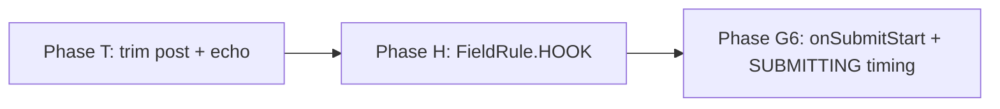

# 57 - Trimmed Echo, Hook Field Errors and Submit Start for wix-forms

Status: [Implemented] — Approved (product, 2026-11-12); implemented 2026-11-12 (uncommitted on `wix-forms-starkdale-blockers`).

Builds on **DL #53** (page checks, `errorRule` / `FieldRule`, `FieldRejection`, `WIX_FORMS_CONTEXT`, `onSubmitOutcome`, the busy flag owned from the first click; **released in 0.26.3**), **DL #41** (value store, `value` echo, confirmation), **DL #42** (submit hooks, settle table) and **DL #45** (outcomes are enum variants; text is a default; member order is the contract). Three follow-ups found while moving a real customer site's forms onto the plugin. No site is named. Paths are relative to `packages/wix-forms/` unless stated. jay is referenced only by its public surface. Line numbers are for `main` at `4fcd2eb` (`v0.26.3`), which includes DL #53.

This log replaces an earlier draft that was approved but never implemented. Its first item, a per-field opt-out of the built-in **format** rule, is **dropped**: phone format is handled separately by the **phone normalization phase ("P1c") of a sibling design log**, which is not on this branch. A live check from the earlier draft showed that Wix enforces its own email, phone and URL formats server-side (Background), so a client-only opt-out would only move the error behind a round trip.

## Decisions for the Implementer (TL;DR)

- **Three items, three phases, tests first, no jay change.** Order: **T** trimmed values → **H** hook field errors (`FieldRule.HOOK`) → **G6** submit start (`onSubmitStart` + `SUBMITTING` re-timed). G6 continues DL #53's gap numbering (G1–G5). Each phase is independent; only H changes the generated contract.
- **T — the plugin trims what it posts, what page checks see, and what it echoes.** One helper, `submittedValueOf(field, raw)` in `lib/components/submission-values.ts`, is the only place the trim rule is written. It trims a string value of a **visible** field of kind `text`, `textarea`, `email`, `tel` or `url`. It is used by `projectSubmissionValues` (the post), by a new `trimTextValues` (the echo), and by `checkField` for the `value` handed to page checks on every path (blur, typing, submit). On a shown confirmation, the store's visible text-like values are replaced by their trimmed form, so `Thank you, {k.firstName.value}.` reads "Thank you, Ann." for input `"Ann "`. Hidden, `select`, checkbox and multiselect values are never changed. While the user types, the input and `value` stay raw. **Behaviour change** (release notes): stored submissions lose surrounding whitespace.
- **H — a hook's field errors get their own rule: `FieldRule.HOOK`.** `errorRule = HOOK` for a hook `FieldRejection`, and `SERVER` now means only "Wix refused this value". The server result, the `submitForm` action output and the `onSubmitOutcome` `failed` event gain `fromHook?: boolean`, set to `true` only by `fieldRejectionResult`. **Behaviour change for 0.26.3 pages** (DL #53 is released): a page that showed hook text under `errorRule === SERVER` must add a `HOOK` branch. Contracts change (every visible field's `errorRule` enum gains `HOOK`), so regenerate.
- **Enum ordering with the sibling log.** A sibling design log will append `FieldRule.PHONE_COUNTRY`. Members are only ever **appended** after `SERVER`. **Whichever of `HOOK` / `PHONE_COUNTRY` lands second goes last.** The generator test asserts the **full, hard-coded, ordered member list**, so the second log to land must rewrite that list and its fixtures. That rewrite turns the test red first.
- **G6 — `WIX_FORMS_CONTEXT.onSubmitStart(handler) → unsubscribe`**, called with `{ event: { formId } }` (canonical id). It fires **once per submit actually handed to the server**, synchronously at the single hand-off point in `submit()` (`lib/components/wix-form.ts:433`), before `runFormSubmit`. It never fires for a busy click, a honeypot trip, a client-validation stop, or a reset before hand-off. Some outcomes have no start (client stop, honeypot). A start whose form is reset or unloaded in flight has no outcome (documented gap, no `abandoned` outcome, no correlation id). Pages keep a per-form "started" flag.
- **G6, declarative first:** `submitState === SUBMITTING` is re-timed to mean **handed to the server**. A new internal `isHandedOff` signal is set at `:433` and cleared with `isSubmitting` through one combined setter. `isSubmitting` keeps meaning "busy, do not click" from the first click. "Sending…" therefore never flashes on a client-validation stop, with no contract change. Clearing a page's old error line at send start is already declarative: `submit()` clears `submitFailure` at `:397`, so markup nested under `submitState === FAILED` disappears. `onSubmitStart` is only for imperative page state, such as pausing a 60-second hold clock. **Behaviour change for 0.26.3 pages:** "Sending…" no longer shows during the pre-hand-off window. 0.26.1 already behaved this way.
- **Per-handler isolation (L1).** Every `onSubmitOutcome` and `onSubmitStart` handler runs in its own `try`. A throwing handler is logged and does not skip the others. Today a single outer `try` skips the later handlers (`submit-outcome-events.ts:30-36`, `wix-forms-context.ts:141-143`).
- **CHANGELOG:** DL #53's items still sit under `## Unreleased` although they shipped as 0.26.3. The first phase relabels that block `## 0.26.3` and opens a fresh `## Unreleased` for this log's items (CHANGELOG plan).
- **Agent feedback:** guides only (`rich-forms.md` §1, §3, §7; `user-visible-messages.md`). There is no new validation: `errorRule === HOOK` literals are already checked by jay's variant validation once contracts are regenerated, and handlers are runtime TypeScript.

---

## Background

On `main` at 0.26.3 (DL #53 released):

- **Built-in rules** come from the Wix field schema through `checkFormField` (`lib/utils/project-form-fields.ts:164-183`). It trims before judging (`:175`), so `"Ann "` passes `required` and `"ann@example.com "` passes the email regex (`:204`).
- **Page checks** run only after every built-in rule passed (`checkField`, `lib/components/wix-form.ts:147-154`; runner `createPageCheckRunner`, `wix-form.ts:128`, `lib/components/page-checks.ts`). On blur and typing, `checkField` defaults `value` to the **raw** store value (`:149`; callers `:157` and `:206`). On submit it receives the projected value (`:426`).
- **Store and echo.** The store is written raw from the input (`readNativeValue`, `wix-form.ts:716-726`; `handleNativeInput`, `:202-209`). It is kept on success so the confirmation can echo it (`:502-504`; DL #41 Capability 1). Each field's `value` view state is the raw store value (`lib/components/form-view-state.ts:94`, fed from `values()` at `wix-form.ts:531`). The guide's example is `Thanks, {contact.firstName.value}!` (`agent-kit/plugin/rich-forms.md:32`).
- **Submission projection.** `projectSubmissionValues` copies store values unchanged (`lib/components/submission-values.ts:32-41`). Its output is both the post (`wix-form.ts:422`, `:441`) and the `values` given to page checks (`:150`, `:426`).
- **Server field errors.** A hook `FieldRejection` (settle row `lib/submission/run-submission.ts:318-319` → `fieldRejectionResult`, `:405-411`) and Wix's own violations (`failedSubmissionResult`, `:364-366`) both return `{ success: false, reason: VALIDATION, fieldErrors }`. The client marks every visible target `FieldRule.SERVER` (`presentSubmitResult`, `wix-form.ts:481-488`). The guides document `SERVER` as "Wix or the hook" (`rich-forms.md:91-93,125,400`; `user-visible-messages.md:80`).
- **`FieldRule`** ends at `SERVER` (index 9, `lib/components/field-rule.ts:9-20`). It renders into each visible field's contract through `enumDataType` (`lib/generators/contract-utils.ts:87,160`).
- **Submit lifecycle.** `submit()` (`wix-form.ts:394-454`) does the following, in order:
  - returns on busy (`:395`);
  - clears `statusMessage`, `submitFailure` and the field errors (`:396-400`);
  - handles a honeypot trip (`:403-407`);
  - sets `isSubmitting(true)` and begins a flight (`:411-412`);
  - reconciles and seeds (`:417-420`);
  - validates (`:422-431`);
  - sets the local `isHandedOff = true` (`:433`; renamed `hasHandedOff` by G6, see §3) and calls `runFormSubmit` (`:434-449`);
  - the `finally` clears busy only before hand-off (`:450-453`).

  `runFormSubmit` clears busy on the network failure (`lib/components/form-submit-execution.ts:39`) and on a non-redirect settle (`:49`). It drops a stale result after a reset (`:37`, `:43`). `submitStateOf` returns `SUBMITTING` whenever `isSubmitting` is true (`form-view-state.ts:124-129`), so since DL #53 "Sending…" shows from the first click, including on a client-validation stop.

- **Page events.** `onSubmitOutcome` has its own handler `Set`, returns an unsubscribe, and delivers `{ event }` (`lib/contexts/wix-forms-context.ts:61-69,134-149`). It is emitted by `createSubmitOutcomeReporter` (`lib/components/submit-outcome-events.ts:25-39`). Nothing tells page code that a submit **started**. Page code cannot read the headless component's view state (DL #53 G3).
- **Format opt-out (dropped).** The earlier draft's live check posted, on the QA testbed, values the built-ins reject straight to Wix. Wix refused all the motivating values with `FORMAT_ERROR`: phone extensions and `/`, full-width digits, scheme-less URLs, and `ann@localhost`. Phone format is now the sibling log's phone normalization phase (P1c).

## Problem

The consumer requirements come from a real site migration:

1. **Trimmed echo.** A contact form's thank-you reads "Thank you, Ann." for the input `"Ann "`. Today it reads "Thank you, Ann ." and Wix stores `"Ann "`. An email `"ann@example.com "` passes the client regex and is posted with the space.
2. **Hook vs Wix refusal.** On a visit-booking form, a Wix refusal of a visible field other than email or phone shows the site's generic failure line, and a hook rejection shows the site's own copy. Today both are `errorRule = SERVER` (`wix-form.ts:481-488`), and the only difference is the message text. Matching on text is exactly what DL #53 G1 removed.
3. **Submit start.** The visit-booking form holds a slot for 60 seconds with a page clock. When a send starts, the page must pause the clock and clear the old error line. Page code has no start signal: `onSubmitOutcome` fires only at the end, and page code cannot read `isSubmitting`. A "Sending…" label bound to `submitState` also flashes on a client-validation stop, because `SUBMITTING` starts at the first click (`wix-form.ts:411`).

## Prior Art / Adjacent Mechanisms

| Primitive                                                                                             | Item | Verdict                                                                                                                                                                                   |
| ----------------------------------------------------------------------------------------------------- | ---- | ----------------------------------------------------------------------------------------------------------------------------------------------------------------------------------------- |
| `checkFormField` trims (`project-form-fields.ts:175`)                                                 | T    | **Sets the semantics.** Validation already treats `" Ann "` as `Ann`. T makes the post and the echo agree with it.                                                                        |
| `projectSubmissionValues` (`submission-values.ts:32-41`)                                              | T    | **Solves the place.** It is the single projection behind the post and the page checks' `values` (`wix-form.ts:139-141`).                                                                  |
| Store kept on success for the echo (`wix-form.ts:502-504`)                                            | T    | **Solves the echo channel.** T writes trimmed values into it when the confirmation is shown. No new tag.                                                                                  |
| `FieldRule` + `enumDataType` (`field-rule.ts:9-20`, `contract-utils.ts:87,160`)                       | H    | **Solves the pattern.** Appending a member is the DL #45 additive rule.                                                                                                                   |
| `fieldRejectionResult` (`run-submission.ts:405-411`)                                                  | H    | **Solves the provenance point.** It is the only place a hook field error is built.                                                                                                        |
| `code` on the result/event (DL #53 G3; `submit-form.jay-action:15`)                                   | H    | **Precedent** for an optional output key that the transport passes through to the client and the event. As a provenance signal it is **not enough**: `FieldRejection`'s code is optional. |
| `onSubmitOutcome` + reporter (`wix-forms-context.ts:64-68,134-149`; `submit-outcome-events.ts:25-39`) | G6   | **Solves the pattern.** `onSubmitStart` copies it: its own `Set`, unsubscribe, `{ event }`, a symbol-keyed emit, and a context lookup at call time.                                       |
| `isSubmitting` / `submitState` (`contract-utils.ts:147,150`; `form-view-state.ts:124-129`)            | G6   | **Partial.** Declarative "busy" for markup, but set before client validation (`wix-form.ts:411`) and not readable by page code.                                                           |
| `submitFailure` cleared at the start of `submit()` (`wix-form.ts:397`)                                | G6   | **Solves "clear the old error".** Markup nested under `submitState === FAILED` hides itself on the next send.                                                                             |
| `WIX_CART_CONTEXT` events (wix-cart client context)                                                   | G6   | **Precedent** for plugin→page events, already followed by DL #53.                                                                                                                         |

## Questions and Answers

**Q1 — Null hypothesis for T: can a page get a trimmed echo today?** No. `value` is the raw store value (`form-view-state.ts:94`), and jay-html has no string functions to trim in markup. A page could trim in its own code only by reading the view state, which page code cannot do (DL #53 G3). The post is raw (`submission-values.ts:38`), so no page-side fix can repair what Wix stores. No new surface: an existing projection and the existing store are reused. **Answered.**

**Q2 — T: trim the post, or only the display?** Both. Validation already decided that surrounding whitespace is not part of the value (`project-form-fields.ts:175`). Posting the raw text stores something other than what was validated, for example an email with a trailing space. Trimming only the echo would show `Ann` while the dashboard holds `Ann `.

- **Kinds:** trim visible `text`, `textarea`, `email`, `tel` and `url`. Never trim hidden fields (page-provided identifiers), `select` (Wix option values), checkbox or multiselect values.
- **Hooks** receive the trimmed values, because those are the posted values.
- **Direct `submitForm` posts** that bypass the component are not trimmed on the server. The server does not normalise caller input today (Scope pre-mortem).
- **Edge cases, by design:** a `textarea` loses leading indentation and leading/trailing newlines (inner whitespace kept), and a whitespace-only optional field posts `''`, matching `checkFormField`'s PASSED on empty.

**Answered.**

**Q3 — T: what value do page checks see?** The trimmed one, on every path. Without that, a strict anchored check fails on blur (raw, `:149`) and passes on submit (projected, `:426`). `checkField` passes `submittedValueOf(field, value)` to the page checks. The built-in `checkFormField` keeps receiving the same value (it trims internally). **Answered.**

**Q4 — T: why not trim in `fieldToViewState` always?** A page may show a live preview of `value`. Trimming while typing would drop a space the user just typed and make the preview flicker. The echo is trimmed only in `showSubmitted()` (`wix-form.ts:326-331`), after typing has ended. **Answered.**

**Q5 — T and phone normalization (sibling log).** The sibling's phone normalization (P1c) may rewrite a `tel` value beyond trimming. T is the base rule. If P1c lands, it composes inside `submittedValueOf` for `tel` (normalize the trimmed string) and does not add a second projection. This log does not design normalization. **Answered (boundary).**

**Q6 — Null hypothesis for H: can markup tell a hook rejection from a Wix refusal today?** Only by message text (`error`), which DL #53 G1 forbids (`user-visible-messages.md:88`). The `code` on the outcome reaches page code but not markup, it is optional, and it is per submit, not per field. **Answered: a new surface is needed.**

**Q7 — H: a new `FieldRule` member, or a separate per-field source variant?** A member. One variant answers "why is this field red" in one place. A second `errorSource` variant would have to agree with `errorRule` everywhere, and its only new information is `SERVER` + hook. Appending keeps every existing index (DL #45). **Answered.**

**Q8 — H: the member's name?** `HOOK`. It parallels `SERVER` (both name a source), and it matches the "submit hook" wording of the guide and exports (`FieldRejection`, `lib/services/wix-forms-submit-hooks.ts:102`). `REJECTED` is ruled out because `SubmitFailure.REJECTED` already covers Wix refusals and hook `ActionError`s (`run-submission.ts:324`). This name was decided in the earlier approved draft. **Answered.**

**Q9 — H: how does the client learn the provenance?** Through the result. `fieldRejectionResult` adds `fromHook: true`, and Wix's row (`:364-366`) does not. A boolean is enough, because there are two sources. "Has a `code`" is rejected because the code is optional. **Answered.**

**Q10 — H: is the switch from `SERVER` to `HOOK` a breaking change?** It is a behaviour change for 0.26.3 pages that use a hook `FieldRejection` **and** show the hook text only under `errorRule === SERVER`. After upgrading, those fields would be red with no text, until the page adds a `HOOK` branch or a regenerated contract adds it. Mitigations:

- the CHANGELOG "Behaviour changes" item with a before/after snippet;
- the guide's example shows both branches;
- `invalid` stays `true`, so a page that renders `{field.error}` without branching keeps working.

Keeping `SERVER` for hooks and adding a separate flag was rejected (Q7). **Answered.**

**Q11 — H: ordering with the sibling's `PHONE_COUNTRY`.** Both logs append after `SERVER`. Whichever lands second goes last. The generator test asserts a hard-coded full list, so the second log fails red until its list is updated. The fixture contracts (`contact.jay-contract`, `choices.jay-contract`) already hard-code the full enum, so a member change already turns the fixture tests red today; the hard-coded compile-test list adds the same guard to the compile test, which currently derives its list from `Object.keys(FieldRule)`:

- this log first: `[…, SERVER, HOOK]`, then `[…, SERVER, HOOK, PHONE_COUNTRY]`;
- the sibling first: `[…, SERVER, PHONE_COUNTRY, HOOK]`.

The implementer checks `field-rule.ts` at the start of Phase H and writes the list that matches. **Answered.**

**Q12 — Null hypothesis for G6: which needs can declarations serve?**

- **"Sending…" without a flash** → markup, once `SUBMITTING` is re-timed (Q13).
- **Clearing the old error line at send start** → markup already: `submitFailure` is cleared at `:397`, so a line nested under `submitState === FAILED` hides itself. A page variant set from `onSubmitOutcome` (e.g. a hook `code`) may stay set; its parent hides it.
- **Pausing a page clock** → a page-state write that only code can do, and page code cannot observe the component. **This alone justifies `onSubmitStart`.**

**Answered.**

**Q13 — G6: re-time `SUBMITTING`, or add a `VALIDATING` member?** Re-time (option A, decided in the earlier approved draft). `submitStateOf` returns `SUBMITTING` only when `isHandedOff`, and is `IDLE` during the few-tick pre-hand-off window. There is no contract change, and nobody would bind copy to a `VALIDATING` member. That member stays a possible additive change later. `isSubmitting` keeps DL #53's meaning: bind `disabled` to `isSubmitting` and the label to `submitState`. **Answered.**

**Q14 — G6: correlation id between start and outcome?** No. The busy guard allows one flight per form (`:395`). The documented pattern is a per-form boolean: set it on start; on any outcome, act only if it is set, then clear it. **Answered.**

**Q15 — G6: a reset while a handed-off submit is in flight?** `resetForm` invalidates the flight (`wix-form.ts:311`), and `runFormSubmit` drops the late result (`form-submit-execution.ts:37,43`), so no outcome follows that start. This is a documented gap: no `abandoned` member is added, because it would affect every `onSubmitOutcome` handler. The next start sets the flag again. For a hold clock, the page's own reset handling resumes it. **Answered.**

**Q16 — G6: fire before or after `ensureSessionFresh`?** Before, at `:433`. From there the component is committed to one `submitForm` attempt or a `NETWORK` outcome (`form-submit-execution.ts:30-41`). **Answered.**

## Design

### Phase map



The arrows only recommend an order; no phase needs another. T and H both edit `wix-form.ts`, and H and G6 both edit `wix-forms-context.ts`.

### 1. T — trimmed post and echo (`lib/components/submission-values.ts`, `lib/components/wix-form.ts`)

```ts
/** Visible text-like kinds whose surrounding whitespace is not part of the value (DL #57 T). */
const TRIMMED_KINDS = new Set<FormFieldInputType>(['text', 'textarea', 'email', 'tel', 'url']);

/** The value as submitted: trimmed for a visible text-like string, otherwise unchanged. The only trim rule. */
export function submittedValueOf(field: FormFieldView, raw: FieldValue): FieldValue;

/** The store with every visible text-like string trimmed (via submittedValueOf); other values unchanged. */
export function trimTextValues(fields: FormFieldView[], store: FieldStore): FieldStore;
```

- `submittedValueOf` trims when `!field.hidden && TRIMMED_KINDS.has(field.inputType) && typeof raw === 'string'`. `projectSubmissionValues` (`:32-41`) maps each value through it, and so does `trimTextValues`; neither repeats the rule.
- `checkField` (`wix-form.ts:147-154`) changes its page-check call to `runPageChecks(field, submittedValueOf(field, value), allValues)`. On submit the value is already projected, so trimming again is a no-op.
- `showSubmitted()` (`:326-331`) first calls `setValues((current) => trimTextValues(carryForward.fields, current))`, then sets `isSubmitted`. Both callers get this: success (`:504`) and the honeypot trip (`:404`), so a bot sees the same echo as a person. A redirect skips `showSubmitted`.
- Unchanged: the store while typing, the input's DOM value while editing and on failure, failure paths (the user keeps the text to correct it), and reset (`emptyStoreFor`).
- Input binding after success: a page that keeps the form visible after success and binds an input to `{x.value}` sees the trimmed text in that input. This is accepted: the store is the submitted value at that point.
- Reconcile interaction (`:289-308`): after success the store is trimmed while the hidden input may hold raw text. "Send another" goes through `resetForm` and `clearNativeInputsAfterRemount` (`:351-365`), which reflect empty values, so raw text is never reconciled back. A Phase T test pins this.

Trace for `firstName = "Ann "`:

1. The store holds `'Ann '`.
2. `readFormValues()` (`:139-141`) projects `{ firstName: 'Ann' }`.
3. `checkFormField` passes.
4. `submitForm({ values: { firstName: 'Ann' } })` (`form-submit-execution.ts:32-35`) succeeds.
5. `presentSubmitResult` calls `showSubmitted()`, and the store becomes `{ firstName: 'Ann' }`.
6. The view state's `value` is `'Ann'` (`form-view-state.ts:94`), so the page reads "Thank you, Ann."

**Null hypothesis:** Q1. Two internal functions; no tag and no API.

### 2. H — `FieldRule.HOOK` (`field-rule.ts`, `lib/types.ts`, `lib/actions/submit-form.jay-action`, `run-submission.ts`, `submit-outcome.ts`, `wix-form.ts`, `wix-forms-context.ts`)

```ts
export enum FieldRule {
  NONE,
  REQUIRED,
  MIN_LENGTH,
  MAX_LENGTH,
  EMAIL,
  PHONE,
  URL,
  PATTERN,
  CUSTOM,
  /** Wix refused this value; `error` is Wix's text. */
  SERVER,
  /** The form's submit hook rejected this field (`FieldRejection`); `error` is the hook's text. */
  HOOK,
  // Q11: if PHONE_COUNTRY is already here, HOOK goes after it.
}
```

- **Result:** the failure variant of `SubmitFormResult` (`lib/types.ts:73-82`) and `SubmitRejection` (`submit-outcome.ts:41-48`) gain `fromHook?: boolean`. `fieldRejectionResult` (`run-submission.ts:405-411`) sets `fromHook: true` on both of its shapes. No other row sets it.
- **Action schema** (`submit-form.jay-action:9-15`): `fromHook?: boolean  # true when fieldErrors come from the submit hook's FieldRejection (DL #57)`. The generated `.d.ts` follows at build.
- **Client:** `presentSubmitResult` (`wix-form.ts:481-488`) sets `result.fromHook ? FieldRule.HOOK : FieldRule.SERVER` for each visible target. `presentSubmitRejection` is unchanged: hidden and unknown targets still go to `statusMessage`.
- **Event:** the `failed` member of `SubmitOutcomeEvent` (`wix-forms-context.ts:47-56`) gains `fromHook?: boolean`. `reportSubmitRejection` (`wix-form.ts:513-520`) copies it when set.
- **Typing:** `handleNativeInput` (`:202-209`) clears a `HOOK` error once the client rules pass, as it clears `SERVER`. Only its comment (`:205`) is updated.
- **Contract:** `errorRule` (`contract-utils.ts:87`) gains `HOOK` on every visible field. Hidden fields have no `errorRule`.

Traces:

- A hook throws `new FieldRejection({ firstName: 'Use the name on your ID.' })` before `submit()`. Row `:318-319` returns `{ success: false, reason: VALIDATION, fieldErrors, fromHook: true }`. The client sets `errorRule.firstName = HOOK`, and markup shows the site's copy.
- Wix returns a 400 with a violation on `firstName`. `failedSubmissionResult` (`:364-366`) returns no `fromHook`, so the rule is `SERVER`, and the page's generic failure line shows.
- A hook calls `submit()`, Wix refuses, and the hook then throws `FieldRejection`. The `attempt.state === 'failed'` row (`run-submission.ts:308-309`) comes before the `FieldRejection` row (`:318`), so the result is still `SERVER` with no `fromHook`.

**Null hypothesis:** Q6, Q7, Q9. One enum member and one optional boolean.

### 3. G6 — `onSubmitStart` and `SUBMITTING` timing (`wix-forms-context.ts`, `submit-outcome-events.ts`, `wix-form.ts`, `form-view-state.ts`)

```ts
/** A submit the form handed to the server (DL #57 G6). `formId` is canonical. */
export interface SubmitStartEvent {
  formId: string;
}
export type SubmitStartHandler = (args: { event: SubmitStartEvent }) => void;

export interface WixFormsContext {
  registerFieldChecks(formId: string, checks: FieldChecks): () => void;
  onSubmitOutcome(handler: SubmitOutcomeHandler): () => void;
  /**
   * Fires once per submit handed to the server, before the request. Not for a busy click, a
   * honeypot trip, a client-validation stop, or a reset before hand-off.
   * Usually followed by one onSubmitOutcome for the same form; not when the form is reset or the
   * page unloads meanwhile (no 'abandoned' outcome). Some outcomes have no start (a client-
   * validation stop, a honeypot trip): keep a per-form "started" flag, set here, act on an
   * outcome only when it is set. Display needs no code: bind submitState (SUBMITTING = handed off).
   * Returns an unsubscribe function: subscribe inside createEffect and return it.
   */
  onSubmitStart(handler: SubmitStartHandler): () => void;
}
```

- **Context state** (`createWixFormsContextState`, `:102-151`): a second `Set<SubmitStartHandler>`, a new symbol `EMIT_SUBMIT_START` next to `EMIT_SUBMIT_OUTCOME` (`:79`), and an exported `emitSubmitStart(context, event)` like `emitSubmitOutcome` (`:98-100`).
- **L1, per-handler isolation:** both emits go through one helper, `callEachHandler(handlers, event, eventName)`. It snapshots the set and calls each handler in its own `try`. A throw is logged as `[wix-forms] an ${eventName} handler threw` with `formId` and the error. The reporter's outer `try` (`submit-outcome-events.ts:30-36`) is removed.
- **Reporter:** `createSubmitStartReporter(formId): () => void`, shaped like `createSubmitOutcomeReporter`. It uses the canonical id, looks up `useGlobalContext` at call time, and does nothing when there is no context.
- **Timing (Q13).** A component signal `isHandedOff`:
  - **Setter (L2).** The component defines `setBusy(value)`. It calls `setIsSubmitting(value)` and, when `value` is `false`, also `setIsHandedOff(false)`. It is passed to `runFormSubmit` as its existing `setIsSubmitting` param (`form-submit-execution.ts:8`; `runFormSubmit` unchanged), so both settle paths (`:39`, `:49`) clear both flags.
  - **Other clears.** Reset (`wix-form.ts:319`), `pageshow` (`:390`) and the `finally` (`:452`) also call `setBusy(false)`. No code calls `setIsSubmitting(false)` directly any more.
  - **View state.** `FormViewStateOverrides` gains an **optional** `isHandedOff?: boolean` (absent means `false`), so existing `buildFormViewState` calls in tests still compile; only the listed rewrites change. `submitStateOf` (`form-view-state.ts:124-129`) returns `SUCCEEDED` first, then `SUBMITTING` only when `isHandedOff === true`, then `FAILED`. There is **no fallback** to `isSubmitting`.
  - **Redirect.** A redirect keeps both flags set, so `SUBMITTING` lasts until unload (DL #53).
- **Rename (no shadowing).** The local `let isHandedOff` in `submit()` (`wix-form.ts:413`, set at `:433`, read in the `finally` at `:452`) is renamed `hasHandedOff`, so it no longer shadows the new signal getter `isHandedOff` that the `render` override reads. The signal keeps the name `isHandedOff` because it matches the view-state override key.
- **Component** (`wix-form.ts:433`): `hasHandedOff = true; setIsHandedOff(true); reportSubmitStart();` then `await runFormSubmit(...)`. All of it runs synchronously inside the `try`. A throwing handler is caught by `callEachHandler`, so it cannot reach the `finally` or skip the request.
- **Exports:** `SubmitStartEvent` and `SubmitStartHandler` from `lib/index.client.ts:18-19` and `lib/index.ts:19-20`, next to `SubmitOutcomeEvent`.

Trace of the stops that must **not** fire, in `submit()`. None of them reaches `:433`:

- a busy click returns at `:395`;
- a honeypot trip returns at `:403-407`;
- a reset during reconcile or seed returns at `:418` / `:420`;
- a client failure returns at `:428-431`;
- a throw in reconcile or seed goes to the `finally` without hand-off.

The one path that fires: valid form → `:433` → start → `runFormSubmit`. That ends in a `NETWORK` outcome (`:444-448`) or in `presentSubmitResult` → `succeeded` / `failed` (`:492`, `:505-509`), unless the flight is stale (Q15).

**Null hypothesis:** Q12. Display is served by the existing `submitState` with corrected timing and by `submitFailure`. Only the page clock needs code, and the context is DL #53's existing event channel.

### Generated contract and action impact

| Item | Contract                                        | `submitForm` action         | Client exports                                               |
| ---- | ----------------------------------------------- | --------------------------- | ------------------------------------------------------------ |
| T    | none                                            | none (values trimmed)       | none (`submittedValueOf` and `trimTextValues` stay internal) |
| H    | `errorRule` gains `HOOK` on every visible field | output `fromHook?: boolean` | `FieldRule.HOOK`                                             |
| G6   | none (`SUBMITTING` timing changes)              | none                        | `onSubmitStart`, `SubmitStartEvent`, `SubmitStartHandler`    |

### Backward compatibility (0.26.3 pages)

- **T (behaviour):** stored text values and the echo are trimmed.
- **H (behaviour):** hook field errors move from `SERVER` to `HOOK`. `invalid` and `error` are unchanged. A page that branches only on `SERVER` must add `HOOK` (Q10). `FieldRule` indices `NONE…SERVER` are unchanged. The old-contract fixture (`test/old-contract-compat.test.ts`) keeps covering "extra view-state data is ignored".
- **G6 (behaviour):** `submitState === SUBMITTING` starts at hand-off, not at the first click (as in 0.26.1). `isSubmitting` is unchanged. A throwing `onSubmitOutcome` handler no longer skips the later handlers.

## Examples

✅ Busy state with no code. `disabled` follows the busy guard, and the label follows hand-off:

```html
<button ref="booking.submitButton" disabled="{booking.isSubmitting}">
  <span if="booking.submitState === SUBMITTING">Sending…</span>
  <span if="booking.submitState !== SUBMITTING">Book</span>
</button>
```

✅ The old error line clears at send start, declaratively:

```html
<div if="booking.submitState === FAILED">
  <p if="slotError === SLOT_TAKEN">That slot was just taken. Please pick another.</p>
  <p if="slotError !== SLOT_TAKEN">We could not send your request. Please try again.</p>
</div>
```

✅ H: the hook's copy vs a Wix refusal, in markup only:

```html
<span id="b-name-err" aria-live="polite">
  <span if="booking.firstName.errorRule === REQUIRED">Please enter your name.</span>
  <span if="booking.firstName.errorRule === HOOK">{booking.firstName.error}</span>
  <span if="booking.firstName.errorRule === SERVER"
    >We could not accept this value. Please check it.</span
  >
</span>
```

✅ T: the echo needs no change:

```html
<section if="contact.isSubmitted" ref="contact.confirmation" tabindex="-1">
  <h2>Thank you, {contact.firstName.value}.</h2>
</section>
```

✅ G6: code only for the 60-second hold clock:

```ts
const forms = useContext(WIX_FORMS_CONTEXT); // page declared .withContexts(WIX_FORMS_CONTEXT)
let isClockPausedForSubmit = false; // outcomes without a start must not resume a clock never paused
createEffect(() =>
  forms.onSubmitStart(({ event }) => {
    if (event.formId !== BOOKING_FORM_ID) return;
    isClockPausedForSubmit = true;
    pauseHoldClock();
  }),
);
createEffect(() =>
  forms.onSubmitOutcome(({ event }) => {
    if (event.formId !== BOOKING_FORM_ID || !isClockPausedForSubmit) return;
    isClockPausedForSubmit = false;
    resumeHoldClock();
  }),
);
```

❌ Clearing the error line in `onSubmitStart` (`setPageError('')`). Nest the line under `submitState === FAILED` instead.

❌ Resuming the clock on every outcome without the start flag. A client stop or a honeypot trip would resume a clock that was never paused.

❌ `if="booking.firstName.error === 'Use the name on your ID.'"`. Branch on `errorRule` instead.

## Implementation Plan

Rules for every phase:

- Write failing tests first. Doc comments cite DL #57, bug-repro style.
- Then implement, run `yarn build` and `npx vitest run` in `packages/wix-forms`, and update the guide and CHANGELOG in the same phase.
- Add an Implementation Results entry with the red-before reasons and X/Y.
- Interactive tests use `test/support/wix-form-harness.ts`, call `provideWixFormsContext()` before mount, and clear the global registry after each test.
- Tests labelled **regression guard** are green today by design. Every other new test must fail today, for the stated reason.

**Phase 0 — baseline and CHANGELOG relabel (docs only).** Record the `npx vitest run` baseline on this branch in Implementation Results. Relabel the CHANGELOG's DL #53 block from `## Unreleased` to `## 0.26.3`, and open an empty `## Unreleased` above it.

**Phase T.**

- `test/submission-values.test.ts`: one table drives `submittedValueOf`, `projectSubmissionValues` and `trimTextValues`. Red: the two new functions do not exist, and the projection returns raw values.
  - `text`, `textarea`, `email`, `tel` and `url` strings are trimmed (red).
  - The textarea `'\n  Hello\n\n  world  \n'` becomes `'Hello\n\n  world'` (red).
  - A whitespace-only optional text value becomes `''` (red).
  - A hidden `' id '`, a select value, a checkbox and a multiselect are untouched (regression guards).
- New `test/wix-form-trimmed-values.interactive.test.ts`:
  - typing `' Ann '` and `'ann@example.com '` and submitting posts `{ firstName: 'Ann', email: 'ann@example.com' }` (red);
  - after success, the view state's `firstName.value` is `'Ann'` (red; this is the "Thank you, Ann." requirement);
  - a page check receives trimmed `values` (red);
  - **blur:** a strict page check `/^\+?\d[\d ]*\d$/` on a tel field with `'+44 20 7946 0958 '` reports no error after blur (red: the check gets the raw value and returns `CUSTOM`);
  - **typing:** typing that value clears a shown `CUSTOM` error (red);
  - **submit:** the same value submits once (regression guard);
  - a server rejection keeps the store raw (regression guard);
  - a honeypot trip shows a trimmed echo (red);
  - "send another" after a trimmed success posts the new input (regression guard).
- Guide `rich-forms.md` §1 (the echo is trimmed, and for which kinds), and the CHANGELOG behaviour item.

**Phase H.**

- First, read `field-rule.ts` to see whether `PHONE_COUNTRY` has landed (Q11).
- `test/submission/run-submission.test.ts`: **rewrite** the exact `toEqual` assertions on `FieldRejection` results so each expects `fromHook: true` (red):
  - with a code (`:956`);
  - without a code (`:974`);
  - the duplicate-module case (`:1020`).

  A Wix field-violation result has no `fromHook` (regression guard).

- Generator: in the fixtures `test/fixtures/form-contract-generator/contact.jay-contract` (`:17,31,45,57`) and `choices.jay-contract` (`:16,28,49`), the `errorRule` enum ends `| SERVER | HOOK`, or with the Q11 order. Hand-written; red.
  - The compile test (`test/form-contract-generator.test.ts:169-192`) builds its expectation from `Object.keys(FieldRule)` (`:180`), so it cannot catch a member change by itself (the fixture contracts above already do). Rewrite it to assert a **hard-coded ordered list**: `['NONE','REQUIRED','MIN_LENGTH','MAX_LENGTH','EMAIL','PHONE','URL','PATTERN','CUSTOM','SERVER','HOOK']`, adjusted per Q11 (red).
  - Keep "compiled equals `Object.keys(FieldRule)`" as a regression guard.
- `test/wix-form-page-checks.interactive.test.ts`:
  - a result with `{ fromHook: true, fieldErrors }` gives `errorRule = HOOK` (red);
  - **rewrite** `:163-182` ("should mark fields from a hook FieldRejection result as SERVER"): its mock gains `fromHook: true` and expects `HOOK` (red);
  - the existing `:142` test without `fromHook` stays the `SERVER` regression guard;
  - typing a valid value clears a `HOOK` error (red through its `HOOK` precondition).
- `test/wix-form-submit-outcome.interactive.test.ts`: the `failed` event carries `fromHook: true` (red).
- Guides:
  - `rich-forms.md`: §3 lines 91-93, 112, 121, 125 (`HOOK` vs `SERVER`); §7 line 400;
  - `user-visible-messages.md:72-80`: add a `HOOK` row and narrow `SERVER`;
  - CHANGELOG.
- Gate: `wix-bookings` tests and `tsc --noEmit` stay clean. It imports `getFormSummary`, `validateFormSummaryField` and `WIX_FORMS_SERVICE` from this package.

**Phase G6.**

- `test/contexts/wix-forms-context.test.ts`:
  - `onSubmitStart` delivers `{ event }` and returns an unsubscribe (red);
  - unsubscribe stops delivery (red);
  - **L1:** with two handlers where the first throws, the second still runs and one error is logged, for both `onSubmitOutcome` (red) and `onSubmitStart` (red).
- `test/wix-form-submit-outcome.interactive.test.ts`:
  - a valid submit fires one start, before `submitForm`, with the canonical id from an upper-case id (red);
  - order is start then `succeeded` (red);
  - a network failure gives start then `failed` / `NETWORK` (red);
  - a double click gives one start (red);
  - a throwing start handler still posts once and ends idle (red);
  - a honeypot trip, a client stop and a reset before hand-off give zero starts (regression guards);
  - a client stop and a honeypot trip give one outcome and zero starts, asserted together (regression guard);
  - with no context, the submit completes (regression guard).
- `test/form-view-state.test.ts`:
  - **rewrite** `:90-122` and `:153-156` to pass `isHandedOff: true` with `isSubmitting: true`. An implementation that keeps them green by falling back to `isSubmitting` is wrong;
  - new: `isSubmitting: true` without `isHandedOff` gives `IDLE` (red).
- Interactive:
  - during an awaited reconcile with an invalid form, `submitState` is never `SUBMITTING` (red);
  - a valid submit is `SUBMITTING` in flight (regression guard);
  - a redirect keeps `SUBMITTING` (regression guard);
  - **L2** (regression guards):
    - after a network failure, `FAILED` and not busy (pins `:39`);
    - after `{ success: false, reason: VALIDATION, fieldErrors }` and after `{ success: false, reason: REJECTED }`, `FAILED` and not busy (pins `:49`).
- Guide `rich-forms.md` §7 (around `:416-430`):
  - declarative first (`submitState` vs `isSubmitting`, the error line under `FAILED`);
  - then `onSubmitStart` for page clocks, both pairing directions, the start flag, the reset gap, and `createEffect` + unsubscribe.
- CHANGELOG.

## CHANGELOG plan (`packages/wix-forms/CHANGELOG.md`)

Phase 0 relabels DL #53's block `## 0.26.3`. The new `## Unreleased` holds:

- **Behaviour changes:**
  1. **Text values are trimmed** before sending and in the confirmation echo (`text`, `textarea`, `email`, `tel`, `url`; hidden, select, checkbox and multiselect unchanged). Before: `"Ann "` was stored and shown as "Thank you, Ann ."; after: `Ann`. Why: validation already ignored the spaces.
  2. **Hook field errors are `errorRule: HOOK`**; Wix's refusals stay `SERVER`. Pages that showed hook text under `SERVER` add a `HOOK` branch (snippet). Regenerate contracts.
  3. **`submitState: SUBMITTING` starts when the request is sent**, not at the click, so "Sending…" no longer flashes on a client-validation stop. `isSubmitting` is unchanged (keep `disabled` on it).
  4. **A throwing `onSubmitOutcome` handler no longer skips the other handlers.**
- **API additions:** `FieldRule.HOOK`; `fromHook?` on the result, the action output and the `failed` event; `WIX_FORMS_CONTEXT.onSubmitStart`, `SubmitStartEvent`, `SubmitStartHandler`.

## Trade-offs

- **Trimming the post (T)** changes stored data. This is justified because the client already validated the trimmed value. A textarea's surrounding newlines are lost.
- **The echo is trimmed only at confirmation (T).** A live preview still shows spaces.
- **`HOOK` (H)** is a visible behaviour change for released DL #53 pages. A source flag that keeps `SERVER` was rejected (Q7), and the cost is one markup branch.
- **Enum coordination (H).** Two logs append members. The hard-coded list makes the second lander fail loudly instead of silently reordering.
- **Re-timed `SUBMITTING` (G6)** instead of `VALIDATING`. No contract change; the cost is that `isSubmitting` and `submitState` differ briefly.
- **Pairing gaps (G6)** are documented (reset, outcomes without a start) instead of adding an `abandoned` outcome or a correlation id.

## Verification Criteria

- Every new test is red before its change for the stated reason and green after, except the regression guards.
- The existing suite stays green except the listed rewrites:
  - Phase H: the run-submission `:956` / `:974` / `:1020` assertions, the generator fixtures and compile test, and page-checks `:163-182`;
  - Phase G6: `form-view-state.test.ts:90-122` and `:153-156`.

  Any other red test is a regression.

- After each phase, `tsc` and `npm run build` (plugin validation) are clean. After Phase H, `wix-bookings` tests and `tsc --noEmit` are clean.
- The baseline is recorded in Phase 0. A phase may not add failures.
- `yarn confirm` passes at the end.

## Live-check plan (QA testbed)

Run on the QA testbed site and project used for DL #53, with this branch's built tarballs installed. Use Chromium, Firefox and WebKit, and record a demo video at the workspace root. Use the testbed form that has `name`, `email`, `phone` and `website` fields, and add a QA page with a submit hook and a mock 60-second clock.

- [ ] **Pre-step (read-only):** read the testbed form's schema and confirm it has a `website` URL field and a `name` field. If either is missing, adapt the H candidates to existing fields or go to the fallback.

- [ ] **T:** submit `" Ann "` / `"ann@example.com "`. The confirmation reads "Thank you, Ann.", and the dashboard submission holds `Ann` and `ann@example.com`.
- [ ] **T:** a strict tel page check shows no error on blur for `'+44 20 7946 0958 '`, and the value submits.
- [ ] **H:** a hook `FieldRejection` on `name` shows the page's `HOOK` copy, and the `failed` event has `fromHook: true`.
- [ ] **H:** a Wix refusal of a visible non-email/phone field shows the generic `SERVER` line, and the event has no `fromHook`. The value must pass the built-in check (`checkTextRules`, `project-form-fields.ts:191-214`), which reads only `minLength`, `maxLength`, `pattern` (`:106-108`) and a URL rule of `^https?:\/\/.+` (`:208`). Agents may not use the dashboard or change forms, so try these on the existing testbed form, in order, and record the first one Wix refuses:
  1. `website` = `http://localhost`: passes the built-in; a URL format check that requires a dotted host would refuse it.
  2. `website` = `http://a`: same reason, single-label host with no TLD.
  3. `website` = `https://exa mple.com`: passes the built-in (`.+` allows a space); a URL format check rejects whitespace in the host. The QA page's `<form>` uses `novalidate` (or renders `website` as `type="text"`) for this probe, otherwise the browser's own URL validation blocks the submit and Wix is never asked.
  4. `name` = a 10,000-character string: the projected schema has no `maxLength` for it, so the built-in passes; this probes a server-side length cap the projection does not read.
  5. Needs a product-side form change (not doable by agents): a field with a constraint the projection does not read, or a lower server `maxLength` than the page uses. List it in the QA report as a request; do not do it.
  - **Fallback** if Wix refuses none of 1–4: the `SERVER` path is verified by the unit tests (the `presentSubmitResult` regression guard) plus a regression-guard test (green today) that feeds the captured Wix 400 through the mocked client and asserts `errorRule === SERVER` and no `fromHook`. The test uses a derived copy of `test/fixtures/submission/field-violation-400.json` made inside the test, with `errorPath` (`:14`, `email_4b3a`) set to a non-email field; the shared fixture is not edited, since other tests use it as-is. Record in the Implementation Results that the live `SERVER` line was not observed and why.
- [ ] **G6:** the clock pauses on send start and resumes on the outcome; a client-validation stop and a filled honeypot do not pause it; a double click pauses once.
- [ ] **G6:** "Sending…" never shows on a client-validation stop, and the old error line disappears at the next send.
- [ ] **Release notes:** the four behaviour items and the API additions are present.
- [ ] **Cleanup:** record the ids of any QA submission rows created, for manual cleanup.

## Scope Pre-mortem (what this will not handle)

- A per-field format opt-out: dropped. Phone format belongs to the sibling log's phone normalization phase (P1c).
- Server-side trimming of direct `submitForm` posts that bypass the component.
- Trimming hidden, control or select values, or a live trimmed `value` while typing.
- An `abandoned` outcome, a `VALIDATING` member, or a start/outcome correlation id.
- Telling apart which hook rule rejected a field: that is the hook's `code` (DL #53).

## Agent Feedback Loop (jay-feedback)

The priority order is validation → guide → feature.

- **Validation: none new.**
  - `errorRule === HOOK` literals are checked by jay's existing variant validation once contracts are regenerated: a page that writes `HOOK` against a stale contract fails that check. That covers only pages that add a `HOOK` branch. The real migration hazard is a page that never adds one: its hook rejections now show no line under its `SERVER` branch, and nothing fails.
  - **Considered and rejected: a `jay-stack validate` warning** for "page has a submit hook but branches on `SERVER` and not `HOOK`". Not feasible deterministically: the hook is registered in the site's backend code, not in the page or its contract, so the validator cannot see whether a form has a hook that throws `FieldRejection`. Warning on every `SERVER`-without-`HOOK` page would fire on hookless forms, where it is correct. The guide line below and the CHANGELOG notice carry this instead.
  - Handlers and trimming are runtime behaviour that no build-time validator sees (as in DL #53).
- **Guides (plugin agent-kit, this repo):**
  - `agent-kit/plugin/rich-forms.md`: §1 the echo is trimmed; §3 the `errorRule` list and `HOOK` vs `SERVER`; §7 `FieldRejection` → `HOOK`, with the line "if your form has a submit hook that throws `FieldRejection`, branch on `HOOK` (not only `SERVER`), or its rejections show no text", and `onSubmitStart` with pairing, the start flag and the reset gap, declarative `submitState` first.
  - `agent-kit/plugin/user-visible-messages.md`: the `errorRule` table gains `HOOK`. Show your own copy for `SERVER` and the hook's text, or your own copy, for `HOOK`.
- **jay agent-kit:** no change.

## Review History

- Earlier draft (4 independent review rounds, then architecture and product approval). This log carries that draft's settled decisions: `HOOK` name, Q13 option A, no `abandoned`, the start-flag pattern and L1/L2.
- This revision: the format opt-out is dropped, references are re-verified against 0.26.3, the H/G6 compatibility notes are rewritten because DL #53 is now released, and the enum ordering with the sibling log is added.
- Pending: an independent review round on this revision.
- Round 1 independent review (NEEDS-WORK, minor). Fixed: the H live check now lists ordered candidate values with reasons, drops the hookless-post route, and states the unit-test plus mocked-400 fallback; the local `isHandedOff` is renamed `hasHandedOff`; the `isHandedOff` override is optional; the variant-validation claim is narrowed, a §7 guide line is added, and a validate warning is considered and rejected with its reason; the trimmed input binding after success is stated; the `SubmitOutcomeEvent` citation is `:47-56`.
- Round 2 (independent): READY-FOR-DEVELOPMENT; five minor fixes applied (QA probe `novalidate` and schema pre-step; fallback uses an in-test fixture copy labelled a regression guard; Q11 notes the fixture contracts already catch enum changes; H trace for refuse-then-throw stays `SERVER`; export citations corrected).

## Implementation Results

Branch `wix-forms-starkdale-blockers` from `main` `4fcd2eb` (`v0.26.3`). Uncommitted. Test counts are `npx vitest run` in `packages/wix-forms`.

### Phase 0 — baseline and CHANGELOG relabel

- Baseline: **357/357** (32 files).
- CHANGELOG: DL #53's block is now `## 0.26.3`, under a fresh `## Unreleased`.

### Phase T — trimmed post, echo and page-check value

- `submittedValueOf` / `trimTextValues` in `lib/components/submission-values.ts` (`TRIMMED_KINDS` is the only trim rule); `projectSubmissionValues` maps through it; `checkField` hands `submittedValueOf(field, value)` to page checks; `showSubmitted()` trims the store before `isSubmitted`.
- Red first: `submission-values.test.ts` 26 failed / 32 passed (20 because the functions did not exist, 6 projection cases returned raw values; the 4 untouched-kind projection guards passed). `wix-form-trimmed-values.interactive.test.ts` 7 failed / 2 passed.
- **Deviation (test label):** "a padded tel value that passes a strict check submits once" is listed as a regression guard, but it was **red** before T: the submit-time projection was raw too, so the strict check failed on submit as well. It is green after T.
- After: **396/396**. Guide `rich-forms.md` §1 and CHANGELOG item 1.

### Phase H — `FieldRule.HOOK`

- `field-rule.ts` at the start of H had no `PHONE_COUNTRY`, so `HOOK` = **10 on this branch**. **Joint release order: `PHONE_COUNTRY` = 10, `HOOK` = 11.** `PHONE_COUNTRY` lands from the sibling phone-normalization branch (P1c), which inserts it before `HOOK` in `field-rule.ts`, the fixture contracts and the generator list.
- **Generator test choice:** it asserts **this branch's** hard-coded list (`…, SERVER, HOOK`) and states the intended joint list in a comment, rather than asserting the joint list and staying red here. Why: this branch must pass `yarn confirm` on its own. The guard still works, because the second branch to land turns this test and the fixtures red until it writes the joint order. "Compiled equals `Object.keys(FieldRule)`" is kept, as "runtime members equal the hard-coded list".
- `fromHook?: boolean` on `SubmitFormResult`, `SubmitRejection`, the `submitForm` action output and the `failed` event. Only `fieldRejectionResult` sets it. `presentSubmitResult` picks `HOOK` / `SERVER`, and `reportSubmitRejection` copies the flag.
- Red first: 10 failed (page-checks ×3, run-submission ×3 rewrites, generator ×3 via fixtures and the compile list, submit-outcome `failed` event ×1). New guards, green: Wix violation has no `fromHook`; refuse-then-throw stays without `fromHook`; the live-check fallback (captured 400 re-targeted in-test at `website`).
- **Deviation (placement):** the fallback regression guard lives in `test/submission/run-submission.test.ts`, where the captured 400 really flows through `runSubmission`. The client half ("a result without `fromHook` is `SERVER`") is the existing page-checks guard. The shared fixture is unchanged.
- After: **402/402**. wix-bookings **61/61**, `tsc --noEmit` clean. Guides: `rich-forms.md` §3 and §7, `user-visible-messages.md` (`HOOK` row, `SERVER` narrowed). CHANGELOG item 2 plus a **Migration checklist**: pages with hooks that throw `FieldRejection` add a `HOOK` branch.

### Phase G6 — `onSubmitStart`, `SUBMITTING` re-timed, L1/L2

- Context: `onSubmitStart`, `EMIT_SUBMIT_START`, `emitSubmitStart`, and both emits through `callEachHandler` (one `try` per handler, logged as `[wix-forms] an <event> handler threw`). The reporter's outer `try` is removed; `createSubmitStartReporter` is added. Component: `isHandedOff` signal, `setBusy` is the only caller of `setIsSubmitting` (passed to `runFormSubmit`; also reset, `pageshow`, `finally`), and the local flag is renamed `hasHandedOff`. `submitStateOf` returns `SUBMITTING` only for `isHandedOff === true`, with no fallback. `SubmitStartEvent` / `SubmitStartHandler` are exported from both entry points.
- Red first: context 4 failed; view state 1 failed (`isSubmitting` without hand-off is `IDLE`); interactive 7 failed (start order and canonical id, network, double click, throwing handler, reconcile window).
- **Deviation (test labels):** the two zero-start guards ("honeypot / client stop / reset give no start" and "one outcome and no start") were red before G6: subscribing needs `onSubmitStart`, and jay's context proxy throws on a missing member. This cannot be avoided; they are green after G6.
- **Test technique:** the "never `SUBMITTING` during an awaited reconcile" test holds reconcile open with a fake input whose `value` read returns a pending promise (`exec$` awaits it).
- After: **420/420**. Guide `rich-forms.md` §3 (busy vs `submitState`) and §7 (declarative first, then `onSubmitStart`, pairing, start flag, reset gap). CHANGELOG items 3–4 and API additions.

### Gate

- `yarn confirm`: exit 0. wix-forms 420/420, wix-bookings 61/61, all other suites green.

### Live check (QA testbed, 2026-11-12)

The QA testbed was **copied** to the session scratchpad and only the copy was rewired to this branch's wix-forms tarball. The tarball was repacked with the testbed's `^0.26.1` jay ranges so the runtime dedupes. The copy also got a `/dl56` page and a hook for the "QA Test DL54" form (`HOOKME` → `FieldRejection` on `name`; `SLOWME` → a 2.5 s delay before `submit()`), and its dev port moved to 3300. The shared testbed's `package.json` and lockfile were not touched, because a sibling run was using it. No dashboard login and no form change.

- [x] **Pre-step (read-only):** "QA Test DL54" has `name`, `email`, `phone` and `website` (URL). Stale-contract check observed: before regenerating, `jay-stack validate` rejected `errorRule === HOOK` ("Unknown enum value HOOK"), as the agent-feedback section predicts.
- [x] **T:** `" Ann "` / padded email → "Thank you, Ann." in Chromium and Firefox. Wix stored `Ann` and an unpadded email (read back read-only through the submissions query API). **WebKit** on `http://localhost` got `PERMISSION`: this is the known `Secure`-cookie-on-localhost item from the end-to-end checklist, not DL #57.
- [~] **T, strict tel:** `'+44 20 7946 0958 '` shows **no error on blur** (pass), but **Wix refused** the submit with `must match format "phone"` (SERVER). Wix rejects the inner spaces, not the trailing one: `' +442079460958 '` passes blur and is stored as `+442079460958`. Spaced numbers belong to the sibling log's phone normalization (P1c), which composes inside `submittedValueOf` (Q5).
- [x] **H, hook:** `HOOKME` shows the page's `HOOK` copy, and the `failed` event and result carry `fromHook: true`.
- [x] **H, Wix refusal:** **candidate 1** (`website = http://localhost`) was refused by Wix (`must match format "url"`). The page showed the generic `SERVER` line, and the event has no `fromHook`. Candidates 2–4 were not needed, and the fallback was not needed.
- [x] **G6:** a client stop (bad email) gives 0 starts, the clock is not paused and "Sending…" never appears. A double click on a valid slow send gives one start; the clock shows "(paused)" and the button "Sending…" during the send, then resumes on `succeeded`. The old error line (after a `HOOK` failure) is gone during the next send. A honeypot trip gives 0 starts, the clock is not paused, and there is one `succeeded` outcome. (The QA page's interval clock does not re-render between events, so the pause shows as the "(paused)" flag, not as a countdown.)
- [x] **Release notes:** four behaviour items, API additions and the migration checklist are present.
- [x] **Cleanup:** QA submission rows created (manual cleanup, form "QA Test DL54"): `e7ab306c-3f3b-4fc4-abf1-f8891c717a78`, `551cbad7-3d8f-45ad-b39d-05e2b4ad014c`, `1820b455-80a9-4690-b4fb-490bc4fc0795`, `f2357349-40e3-432a-bd64-76bb484f23a9`.
- Videos (workspace root): `dl56-t-trimmed-echo-{chromium,firefox,webkit}-2026-11-12.webm`, `dl56-t-strict-tel-blur-2026-11-12.webm`, `dl56-t-strict-tel-unspaced-2026-11-12.webm`, `dl56-h-hook-field-rejection-2026-11-12.webm`, `dl56-h-server-candidate-1-localhost-2026-11-12.webm`, `dl56-g6-clock-and-sending-2026-11-12.webm`, `dl56-g6-honeypot-no-start-2026-11-12.webm`.

### Summary of deviations

1. Three tests labelled "regression guard" were red before their phase, for the reasons stated above (T submit-once; G6 zero-start ×2).
2. The H live-check fallback guard is in the run-submission suite rather than the page-checks suite.
3. The generator asserts this branch's list (`HOOK` = 10) with the joint order in a comment; the joint release order is `PHONE_COUNTRY` = 10, `HOOK` = 11.
4. Live: the spaced tel value is refused by Wix's phone format (a P1c concern), and the WebKit run hit the known localhost cookie item.

### Rebase onto DL #55 (2026-11-12)

The work was re-applied on `main` after DL #55 (validation parity, phone normalization) merged. Status stays [Implemented].

- **Joint enum order applied:** `SERVER = 9`, `PHONE_COUNTRY = 10`, `HOOK = 11` in `field-rule.ts`, both fixture contracts and the generator test, which now asserts the full literal list and both indices. This resolves deviation 3 above.
- **Trim, then phone-normalize.** `readFormValues` → `projectSubmissionValues` → `submittedValueOf` trims; the validated values then pass through DL #55's `toPostedValues` (E.164) just before `runFormSubmit`. Both designs agree (DL #55 §1c applies `toPostedValues` to the validated values; this log's T owns the trim). `toPostedValues` still trims itself, so a hidden tel (never trimmed by T) is converted the same way. The echo shows the trimmed typed value, not E.164.
- **HOOK vs P2 mapping in one place.** `serverRuleOf` (`submit-outcome.ts`) returns `HOOK` for a `fromHook` result, else DL #55's `fieldRules[target] ?? SERVER`; `serverFieldMessage` shows the returned text for both `SERVER` and `HOOK`. `wix-form.ts` uses `presentSubmitRejection`'s `ruleByTarget` instead of its own `fromHook` branch.
- **Kept from this log in `wix-form.ts`:** `submittedValueOf` for page checks, `trimTextValues` in the echo, the `hasHandedOff` rename, the `isHandedOff` signal, `setBusy` and `onSubmitStart`.
- **Tests adapted to DL #55 (intent unchanged):** DL #55's "hook FieldRejection is SERVER" guard is replaced by this log's HOOK test. The run-submission "Wix refusal without fromHook" guard uses the captured email + url 400 that DL #55 made the shared fixture, instead of re-targeting the old one. The trimmed-values "clear a shown CUSTOM error" setup types `+44-20-7946-0958`: the old local `020-7946-0958` is now refused as `PHONE_COUNTRY` before page checks run.
- **Guides and CHANGELOG:** `rich-forms.md` and `user-visible-messages.md` carry both logs' rules; `SERVER` no longer covers hook rejections. This log's release notes moved into `0.26.4` as behaviour changes 5–8 after DL #55's 1–4, with the API additions and a joint migration checklist; the duplicate `0.26.3` relabel and any `Unreleased` section are gone.
- **Results:** wix-forms 575/575 (37 files), wix-bookings 61/61 (11 files), `yarn build` and `yarn confirm` green.

### Code review follow-up (2026-11-12)

- **Shipped alongside, owned by DL #55:** Wix `NOT_ALLOWED_VALUE_ERROR` on a phone field now maps to `FieldRule.PHONE` (`lib/utils/wix-submission-errors.ts`). It is a DL #55 P2 follow-up approved by product on 2026-11-12 and recorded in DL #55 Implementation Results ("Follow-up 2026-11-12, shipped with DL #57") and CHANGELOG 0.26.4 item 9; it is not part of this log's design.
- **Release notes:** CHANGELOG `## 0.26.4` deliberately carries both DL #55 and this log, because DL #55 merged after 0.26.3 was published and has not shipped yet.
- **Invariant documented:** `serverRuleOf` treats `fromHook` as result-wide (every target is `HOOK`). That holds because a hook's `FieldRejection` never carries Wix field errors, since a Wix refusal settles first (`run-submission.ts:308-309` before `:318`). The comment on `serverRuleOf` says to revisit this if a result ever mixes both.
- **Added test:** `test/submit-outcome.test.ts` › "presentSubmitRejection with a hook rejection (DL #57 H)". It is a regression guard and passes on the current code: `fromHook` wins over `fieldRules` and keeps the hook's text.
- Tests: wix-forms 576/576.

### Agent-kit review follow-up 2026-11-12

Doc-only fixes from the agent-kit and validators review (no code or validator changes; the proposed "SERVER-only error copy" warning was declined by product on 2026-11-12: guides and the CHANGELOG checklist cover it, as in the rejected validation above):

- `wix-forms-setup.md` config reference: added `defaultPhoneCountry` (ISO code; a Wix Phone field's default wins; else `PHONE_COUNTRY`; unsupported code fails init), linking `rich-forms.md` §3.
- `user-visible-messages.md`: new "Busy vs sending" subsection (`isSubmitting` from the click vs `submitState === SUBMITTING` once handed to the server, G6); field-error example now shows `HOOK` (hook text) vs `SERVER` (generic copy); checklist bullets for busy/Sending…, `HOOK`, `PHONE` + `PHONE_COUNTRY`, and `jay-stack agent-kit` + `validate` after upgrading.
- `rich-forms.md`: §6 makes `aria-busy` the primary busy pattern and `disabled` an optional trade-off; §3 and the §7 example now use `aria-busy` to match.
- `wix-bookings-setup.md` and `wix-bookings-troubleshooting.md`: callout that participant fields use `validateFormSummaryField` (`booking-flow.ts`), so the `wixForm` phone pipeline, `PHONE_COUNTRY`, `HOOK` and `onSubmitStart` do not apply.
- `plugin.yaml`: `wix-forms-bindings` description now lists the errors and warnings `lib/validators/wix-form-bindings.ts` actually emits.
- Tests: wix-forms 576/576, wix-bookings 61/61, `yarn confirm` green.

### Renumbered to DL #57 (2026-11-12)

While this branch was open, `main` merged a different design log as #56 ("User-Token (Contributor) Auth Strategy (PoC)"). This log was renumbered to #57. Its file name, title, the readme row and every `DL #56` reference in code comments, tests, guides and the CHANGELOG now say #57. The content is unchanged.
