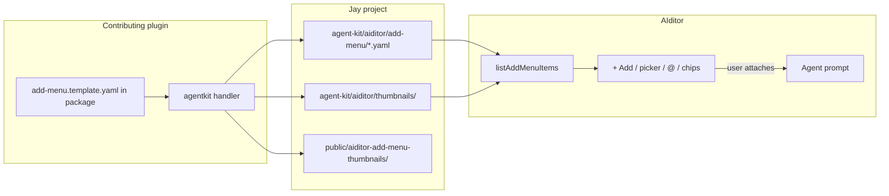

# AIditor Add Menu — plugin contributor guide

**Audience:** Plugin authors and AI agents integrating Jay plugins with AIditor.

**Installed at:** `agent-kit/plugin/aiditor-add-menu.md` when you run `jay-stack setup aiditor`.

**Keep this file current:** When you change Add Menu behavior, schema, surfaces, or validation, update **this guide** in the same change. This file is the **operational source of truth** for contributors.

---

## What is the Add Menu?

The Add Menu is AIditor's extension point for **plugin-contributed agent context**. Each catalog **item** is a user-selectable entry with:

- **`title`** and **`category`** / **`subCategory`** — discovery and navigation labels (not a type system)
- **`prompt`** — complete agent instructions, injected **verbatim** when the user attaches the item

There are **no mini-forms** and **no `parameters` field** on catalog items. Plugins **materialize** URLs, contract keys, Wix IDs, and instructions into `prompt` at **agent-kit generation time** (or via a plugin rebuild command).

When the user picks an item, AIditor adds a **chip** to the request. On submit, each attachment becomes a `## Add Menu attachments` block in the agent task.

**Agent behavior rule:** One attachment = one **resource in scope**. The user may describe multiple uses in prose; the agent wires only what the user referenced — not every attached item automatically.

---

## Three AIditor plugin surfaces

Plugins can contribute to AIditor in three orthogonal ways (see Design Log **#27** and **#33**):

| Surface                      | User goal                                   | Plugin declares                                                 |
| ---------------------------- | ------------------------------------------- | --------------------------------------------------------------- |
| **Add Menu** (`+ Add` / `@`) | Attach prepared context to a change request | `agentkit` → `agent-kit/aiditor/add-menu/*.yaml`                |
| **Project settings tab**     | Configure the project once; run backend ops | `agentkit` → `agent-kit/aiditor/settings/*.yaml` + plugin route |
| **Headless on page**         | Runtime behavior on the live site           | `contracts` + components                                        |

### Project settings (materialized)

Opt-in — only **installed** plugins with a materialized settings file get a tab in **Project settings**. Discovery mirrors Add Menu: AIditor reads `agent-kit/aiditor/settings/*.yaml` after `jay-stack agent-kit`.

**Canonical plugin-author guide:** `agent-kit/plugin/aiditor-settings-guide.md` (from jay stack-cli agent-kit template). This section covers **AIditor runtime** behavior; follow that guide for package layout, materialization, and `devOnly` routes.

**1. Ship a template in the plugin package** (exact path — validated by `jay-stack validate-plugin`):

```yaml
# agent-kit/aiditor/settings.template.yaml
label: Media Manager
route: /wix-media/settings
requires:
  - plugin: wix-server-client
    status: configured
```

Include `agent-kit/` in `package.json` `files` so the template survives `yarn add`.

**2. Materialize in the `agentkit` handler** to `agent-kit/aiditor/settings/<plugin>.yaml` in the **project root** (or `<plugin>.generated.yaml` for fixtures). Copy static templates or generate YAML when settings depend on live data.

**Path resolution (required):** Handlers run from bundled `dist/index.js`. Do **not** use a fixed `..` hop count from `import.meta.url` — walk up parent directories until `agent-kit/aiditor/settings.template.yaml` exists. See `aiditor-settings-guide.md` for `resolvePackagedAgentKitPath`.

**3. Declare the route** in `plugin.yaml` `routes[]` with **`devOnly: true`** — path must match `route` in the materialized YAML.

**Materialized file fields:**

- **`label`** — tab title in Project settings (text only in v1).
- **`route`** — plugin route path; AIditor embeds it in an iframe with `?_jay_embed=true`.
- **`requires`** — optional; tab shows a blocker until dependency `setupStatus === "configured"`.
- **`pluginName`** — optional; defaults from filename (`wix-media.yaml` → `wix-media`).

Dev-only routes are hidden from the AIditor **Pages** dropdown but remain reachable at their URL. See agent-kit `plugin/plugin-routes.md` and `plugin/aiditor-settings-guide.md`.

**Settings route responsibilities:**

- Show **About** / onboarding (purpose, `config/` paths, doc links).
- Run **plugin actions** or **jay-commands** (upload, rebuild catalog) — never arbitrary shell.
- Write **project-owned generated** files only (`*.generated.yaml` under `agent-kit/aiditor/add-menu/`).
- Signal the parent when the Add Menu catalog changes:

```typescript
window.parent.postMessage(
  { type: "aiditor:addMenuCatalogChanged" },
  window.location.origin,
);
```

**Optional — hand off to the AIditor agent (explicit user click only):**

```typescript
window.parent.postMessage(
  {
    type: "aiditor:submitAgentTask",
    prompt: "…",
    context: { pageRoute: "/", renderedUrl: window.location.origin },
  },
  window.location.origin,
);
```

**Never** collect API keys or OAuth secrets in settings UI forms.

**Fixture:** `examples/starter/src/plugins/plugin-settings-fixture/` — local dogfood plugin for tab discovery, iframe host, rebuild, and agent bridge tests.

---

## How it works



1. **Plugin ships a template** — `agent-kit/aiditor/add-menu.template.yaml` (and optional thumbnails) inside the npm package.
2. **`jay-stack agent-kit`** (project `yarn agent-kit`) runs each plugin's **agent-kit handler** (`agentkit` in `plugin.yaml`) — writes `<pluginName>.yaml` under `agent-kit/aiditor/add-menu/`, copies thumbnails.
3. **`jay-stack setup <plugin>`** is for **config and credentials only** — it must **not** write add-menu catalogs.
4. **AIditor reads** all `*.yaml` in that directory at runtime via `listAddMenuItems`.
5. **Visibility filter** — items appear only when their `packageName` / `pluginName` matches an **installed** plugin (`package.json` or `src/plugins/<name>/`).
6. **User attaches** items via Add Menu surfaces; **`prompt` is injected** into the agent task.

**Dynamic route segments** (`[slug]`, `[category]`, …) are edited in the **page route** / **planned route** fields — not on catalog items. Use id convention `<pluginName>:<contractName>` so AIditor can resolve contract params (see [Contract lookup](#contract-lookup)).

### Plugin phases (locked)

| `plugin.yaml`     | CLI                        | Responsibility                                                        |
| ----------------- | -------------------------- | --------------------------------------------------------------------- |
| `plugin.yaml` key | CLI                        | Responsibility                                                        |
| ----------------- | ---                        | --------------                                                        |
| `setup`           | `jay-stack setup <plugin>` | Config files, credential validation — **not** add-menu catalogs       |
| `agentkit`        | `jay-stack agent-kit`      | Write `agent-kit/aiditor/add-menu/*.yaml`, thumbnails, reference data |

Plugins that ship `add-menu.template.yaml` **must** declare `agentkit` pointing at an agent-kit handler. `jay-stack validate-plugin` warns when the handler is missing.

**Reference implementations:** `@jay-framework/wix-media` (generated catalog), `@jay-framework/design-system-validator` (DESIGN.md tokens), `@jay-framework/ui-kit` and `@jay-framework/wix-stores` (static template + thumbnails in references handler).

---

## Quick start — add items from your plugin

### 1. Add a catalog template to your package

```
packages/<your-plugin>/
  agent-kit/aiditor/
    add-menu.template.yaml       # static items (validated by validate-plugin)
    thumbnails/<your-plugin>/…   # images, GIFs, posters (optional)
```

For **dynamic** items (e.g. one row per Wix media file), the agent-kit handler also writes:

```
<project>/agent-kit/aiditor/add-menu/
  <pluginName>.generated.yaml
```

### 2. Implement the agent-kit handler

In `plugin.yaml`:

```yaml
setup: setupMyPlugin # config + credentials only
agentkit: generateMyAgentKit # add-menu + discovery data
```

The handler runs on `jay-stack agent-kit`:

1. Create `<project>/agent-kit/aiditor/add-menu/` if missing.
2. Copy `add-menu.template.yaml` → `<project>/agent-kit/aiditor/add-menu/<pluginName>.yaml` (skip if exists unless `ctx.force`).
3. Copy thumbnails to `agent-kit/aiditor/thumbnails/` and `public/aiditor-add-menu-thumbnails/` (idempotent).
4. Optionally write `<pluginName>.generated.yaml` from live service data.

Export the handler from the package entry (`lib/index.ts`).

### 3. Validate — `jay-stack validate-plugin` only

When your package includes `agent-kit/aiditor/add-menu.template.yaml` or `add-menu.yaml`, **`jay-stack validate-plugin`** automatically:

- Validates catalog **schema** (required fields, `folderPath`, `interaction`, `presentation`, `browse`)
- Runs **lint** rules (gif poster, html-fragment safety, browse size hints)
- Warns if `agentkit` is missing (catalog must not be generated in setup)

```bash
jay-stack validate-plugin
# or from package root:
yarn validate
```

Use `--strict` to fail on warnings (recommended in CI once warnings are clean).

**Source of truth:** validation lives in `@jay-framework/plugin-validator` (`add-menu-catalog-lint.ts`). AIditor runtime uses the same module when loading project catalogs — there is no separate AIditor-only schema.

### 4. Verify in AIditor

1. Ensure plugin and aiditor are in the project `package.json`.
2. Run `yarn agent-kit` (or `jay-stack agent-kit`) to materialize catalogs.
3. Open AIditor → **+ Add** or Add Page **Add Menu** → items appear under your `category`.
4. Click **Refresh catalog** after editing project yaml during development.

---

## File layout

### Project paths (written by agent-kit handler)

```
<project>/agent-kit/aiditor/
  add-menu/
    wix-stores.yaml              # one file per plugin (convention)
    wix-media.generated.yaml     # optional dynamic catalog
  thumbnails/<plugin>/…          # image / gif / poster assets
```

```
<project>/public/aiditor-add-menu-thumbnails/<plugin>/…
```

**Html-fragment preview markup** lives **inline in catalog yaml** (`presentation.html`) — there is no separate `previews/*.html` path.

### Merge rules

- AIditor reads every `*.yaml` / `*.yml` in `add-menu/`.
- Files are merged in **lexicographic path order**.
- **Duplicate `id`:** later file wins (warning logged).
- Items are grouped by `category` → `subCategory` (merged **across plugins** when `category` / `subCategory` strings match exactly).
- Within a subCategory, browse order follows **yaml declaration order** in each catalog file (files merged lexicographically). Do not rely on alphabetical `title` order.

Browse left sidebar shows **`category`** labels — not `pluginName`. Prefer product-facing categories (`Store`, `UI Kit`) over package names.

### `subCategory` vs `folderPath`

Use **both together** when a plugin has many items:

| Field             | Purpose                                                   | Example                          |
| ----------------- | --------------------------------------------------------- | -------------------------------- |
| **`subCategory`** | Optional coarse type filter (horizontal chips)            | `Images`, `Videos`, `Components` |
| **`folderPath`**  | Plugin-owned recursive folder tree (main grid drill-down) | `["Marketing", "Campaigns"]`     |

- **`folderPath`** is navigation only — not attachable; folders are derived from item paths (no folder-only yaml rows).
- Omit **`folderPath`** for small catalogs (e.g. wix-stores components).
- **wix-media** generated items set **`folderPath`** from the Wix Media Manager parent chain. Do **not** include a top-level `Site Files` container segment — browse root shows first-level folders and loose files. Omit **`subCategory`** on wix-media items — browse by folders only.
- **Sub-category filter chips** appear only when a category has **two or more** distinct `subCategory` buckets. Items with omitted `subCategory` group into one implicit **General** bucket; if that is the only bucket, the chip row is hidden (folder navigation only).

---

## Catalog schema

Each file:

```yaml
items:
  - id: <pluginName>:<slug> # required — stable, unique
    title: User-facing label # required
    category: Store # required — top-level nav label
    prompt: | # required — injected verbatim
      Complete agent instructions (markdown).
    pluginName: wix-stores # recommended
    packageName: "@jay-framework/wix-stores"
    subCategory: Components # optional — second nav level (type filter)
    folderPath: # optional — recursive folder drill-down
      - Marketing
      - Campaigns
    thumbnail: thumbnails/... # optional — legacy; prefer presentation
    presentation: # optional — browse grid preview
      type: image | gif | html-fragment
      src: thumbnails/... # image | gif
      poster: thumbnails/... # gif only — recommended
      html: | # html-fragment only — inline markup
        <div class="am-preview">…</div>
    browse: # optional — browse grid footprint
      size: large | medium | small # default: medium
    interaction: # optional — how user attaches
      mode: reference | stage-place
      stagePromptTemplate: | # stage-place only
        Add spring effect at this location.
```

### Required fields

`id`, `title`, `category`, `prompt`

### Rejected fields (validation errors)

| Field / pattern | Code                           | Why                                                |
| --------------- | ------------------------------ | -------------------------------------------------- |
| `kind`          | `rejected-field-kind`          | No core type enum — express intent in `prompt`     |
| `parameters`    | `rejected-field-parameters`    | No mini-forms — bake values into `prompt`          |
| `component`     | `rejected-field-component`     | Use `prompt` + contract paths                      |
| `allowedScopes` | `rejected-field-allowedScopes` | Attachments are request-level or per-marker via UI |

---

## AIditor surfaces

One catalog, **different views**. Plugins do **not** ship separate manifests per surface.

| Surface                                                   | What the user does                        | Which items appear                                                                           | Preview rendering                                                              |
| --------------------------------------------------------- | ----------------------------------------- | -------------------------------------------------------------------------------------------- | ------------------------------------------------------------------------------ |
| **Add Menu picker** (Add Page rail, change-request panel) | Browse and attach chips                   | All **browsable** items — excludes `subCategory: Categories` and ids containing `:category:` | Full `presentation` (image, gif, html-fragment)                                |
| **+ Add dock** (preview overlay)                          | Drag or click to **place on stage**       | **`stage-place` only** (subset of browsable)                                                 | Full `presentation`                                                            |
| **`@` autocomplete** (marker / markdown fields)           | Insert `@{title}` reference               | **Full catalog** including category rows                                                     | Static image only (`image` src or gif `poster`) — no live GIF or html-fragment |
| **Attachment chips**                                      | Shows what's attached                     | Attached items                                                                               | Static thumb only                                                              |
| **Page Info**                                             | Route + contract explorer from `jay-html` | Headless contracts detected automatically — **no catalog entry required**                    | n/a                                                                            |

### Recently Used (AIditor UI only)

When the user **successfully attaches** an item (picker, + Add dock, `@` autocomplete, Add Page composer, or marker attachments), AIditor records up to **15** most-recent `itemId` values in **browser `localStorage`** (per project). The **+ Add dock** and **Add Menu picker** then show a **Recently Used** category at the top of the left nav (hidden when empty). Items stay in their yaml **category** as well; Recently Used is a flat grid with **no sub-category chips**. Plugins do not declare this category in yaml.

### `@` autocomplete navigation

`@` drill-down uses the **same discovery hierarchy** as Add Menu browse (categories, sub-categories, folders, then leaves):

1. **Categories** — root list; exact `category` strings merged across all installed plugins (product-facing names like `Store`, `Effects` — not package or plugin names).
2. **Sub-categories** — within the selected category when **two or more** distinct buckets exist; exact `subCategory` strings merged across plugins (`null` / omitted → label **General**). Skipped when only one bucket.
3. **Folders** — within the selected sub-category (or category when sub-category chips are hidden); drill down `folderPath` segments the same way as the Add Menu picker and + Add dock.
4. **Leaves** — attachable items at the current folder path; yaml declaration order (not title sort).

When a category has only one sub-category bucket, `@` auto-skips to folders or leaves (same as browse hiding the chip row).

**Search mode** (non-empty query): flat leaf list — no drill-down; folder path appears in result labels when relevant.

Leaf rows show **`pluginName` as subtitle** on chips and in the autocomplete list.

### `interaction.mode`

| Mode          | Default | User experience                                                                                        |
| ------------- | ------- | ------------------------------------------------------------------------------------------------------ |
| `reference`   | **yes** | Attach as request context or `@` mention — no stage placement                                          |
| `stage-place` |         | Click or drag onto live preview → creates a marker with `stagePromptTemplate` (defaults to item title) |

### High-cardinality items

Store **category** rows (`subCategory: Categories`, ids like `wix-stores:category:bedroom`) are **`@`-only** — too many for browse grids. AIditor filters them in code; plugins do not need a yaml flag.

---

## `presentation` — browse grid previews

Optional. Controls how an item **looks** in **Add Menu picker** and **+ Add dock** browse grids.

| `type`          | Fields                             | Behavior                                                     |
| --------------- | ---------------------------------- | ------------------------------------------------------------ |
| `image`         | `src`                              | Static ``                                               |
| `gif`           | `src`, optional `poster`           | Autoplay GIF; `poster` when `prefers-reduced-motion: reduce` |
| `html-fragment` | **`html`** (inline yaml, required) | Live HTML/CSS demo via Jay `html-string`                     |

**Legacy `thumbnail`:** still accepted — `.gif` → `gif`; otherwise → `image`. New items should use explicit `presentation`.

**Not rendered on `@` autocomplete or chips** — those surfaces use title + optional static image only.

**Rejected:** top-level `kind`, `gif`, `htmlFragment` without `presentation` wrapper; `presentation.src` on `html-fragment` (use `html`).

### Html-fragment authoring

Put all preview markup in **`presentation.html`** as **one root `<div>`** with scoped styles:

```html
<div class="am-preview am-preview--{pluginName}-{slug}">
  <style>
    @scope (.am-preview) {
      .am-preview {
        display: flex;
        align-items: center;
        justify-content: center;
        height: 100%;
      }
      .am-preview-btn {
        padding: 10px 18px;
        border-radius: 10px;
        border: none;
        background: #2563eb;
        color: #fff;
      }
    }
  </style>
  <button type="button" class="am-preview-btn">Hover me</button>
</div>
```

| Rule                                                | Why                                             |
| --------------------------------------------------- | ----------------------------------------------- |
| Single root `<div>`                                 | Preview containment; validated                  |
| `<style>` with `@scope (.am-preview)`               | Styles must not leak into Add Menu chrome       |
| Unique root class `am-preview--{pluginName}-{slug}` | Avoid collisions in browse grid                 |
| No `<script>`, no `on*` handlers                    | Sanitized at catalog read + runtime             |
| Keep under 8 KB (32 KB hard max)                    | Browse card preview — use `gif` for rich motion |

`poster` on GIFs is optional at runtime but **recommended** — lint emits `gif-missing-poster` as a **warning**.

---

## Browse size

Optional layout control for **picker** and **+ Add dock** browse grids only — not `@` autocomplete, chips, or Page Info. Orthogonal to `presentation`.

```yaml
browse:
  size: large | medium | small # default: medium when omitted
```

| Size     | Browse footprint                                             |
| -------- | ------------------------------------------------------------ |
| `large`  | 1 per row band (full width)                                  |
| `medium` | 2 per row band (default)                                     |
| `small`  | 4 per row band (horizontal strip or 2×2 quad beside mediums) |

### Packing (author order matters)

Within each **subCategory** (at a given folder level), AIditor packs items in **yaml order** into bands:

| Sequence                 | Layout                                      |
| ------------------------ | ------------------------------------------- |
| 4× `small` → 1× `medium` | One band: 2×2 small quad left, medium right |
| 1× `medium` → 4× `small` | One band: medium left, 2×2 quad right       |
| 4× `small` → 2× `medium` | Small strip row, then band with 2 mediums   |
| 4× `small` only          | One small strip row                         |

Incomplete small quads leave empty cells (best-effort). `large` without `presentation` / `thumbnail` logs a **warning** (`browse-large-without-presentation`).

---

## Contract lookup

Use id convention **`<pluginName>:<contractName>`** (e.g. `wix-stores:product-page`).

AIditor resolves `agent-kit/materialized-contracts/<plugin>/<contract>.jay-contract` for:

- Route param helper buttons when multiple attached contracts share required params
- Collision warnings when multiple contracts need the same route param

Dynamic segments are edited in route fields — never as catalog item parameters.

---

## Examples

### Headless contract (reference)

```yaml
- id: wix-stores:product-page
  title: Product page
  category: Store
  subCategory: Components
  pluginName: wix-stores
  packageName: "@jay-framework/wix-stores"
  prompt: |
    Use headless @jay-framework/wix-stores / product-page (key: p).
    Read agent-kit/materialized-contracts/wix-stores/product-page.jay-contract.
```

### Stage-place visual effect

```yaml
- id: ui-kit:spring-button-hover
  title: Spring button hover
  category: Effects
  subCategory: Animation
  pluginName: ui-kit
  presentation:
    type: gif
    src: thumbnails/ui-kit/spring-hover.gif
    poster: thumbnails/ui-kit/spring-hover-poster.png
  interaction:
    mode: stage-place
    stagePromptTemplate: |
      Add spring hover effect at this location.
  prompt: |
    Read agent-kit/aiditor/skills/ui-kit/spring-button-hover.md and implement the effect.
```

### Html-fragment preview

```yaml
- id: ui-kit:button-demo
  title: Button demo
  category: Effects
  presentation:
    type: html-fragment
    html: |
      <div class="am-preview am-preview--ui-kit-button-demo">
        <style>
          @scope (.am-preview) {
            .am-preview-btn { padding: 10px 18px; border-radius: 10px; background: #2563eb; color: #fff; border: none; }
          }
        </style>
        <button type="button" class="am-preview-btn">Hover me</button>
      </div>
  prompt: |
    …
```

### Generated media item

```yaml
- id: wix-media:hero-summer-2026
  title: Hero — summer 2026
  category: Media
  pluginName: wix-media
  folderPath:
    - Marketing
  prompt: |
    URL: https://static.wixstatic.com/media/abc123~mv2.jpg
    Media id: abc123-def-456-789
```

### Category row (@-only — excluded from browse)

```yaml
- id: wix-stores:category:bedroom
  title: Bedroom
  category: Store
  subCategory: Categories
  pluginName: wix-stores
  prompt: |
    Wix category id: abc-123. Use for product-search category filter on home page.
```

---

## Validation

All rules below are enforced by **`jay-stack validate-plugin`** when the plugin ships add-menu yaml. Each finding includes a **code**, **location**, and **suggestion** pointing back to this guide.

Warnings do not fail validation unless `--strict`.

### Schema errors

| Code                                                                   | When                                           |
| ---------------------------------------------------------------------- | ---------------------------------------------- |
| `missing-id` / `missing-title` / `missing-category` / `missing-prompt` | Required string missing or empty               |
| `rejected-field-kind`                                                  | `kind` field present                           |
| `rejected-field-parameters`                                            | `parameters` field present                     |
| `rejected-field-component`                                             | `component` field present                      |
| `rejected-field-allowedScopes`                                         | `allowedScopes` field present                  |
| `interaction-invalid-mode`                                             | `interaction.mode` not reference / stage-place |
| `presentation-missing-src`                                             | `image` or `gif` without `src`                 |
| `html-fragment-src-not-allowed`                                        | `html-fragment` with `presentation.src`        |
| `html-fragment-missing-html`                                           | `html-fragment` with missing or empty `html`   |
| `html-fragment-unsafe-markup`                                          | `<script>`, event handlers, `javascript:` URLs |
| `html-fragment-oversize-hard`                                          | sanitized html > 32 KB                         |
| `browse-unknown-size`                                                  | `browse.size` not large / medium / small       |
| `folder-path-not-array`                                                | `folderPath` is not a string array             |
| `folder-path-segment-type`                                             | non-string segment                             |
| `folder-path-empty-segment`                                            | empty segment string                           |
| `folder-path-invalid-segment`                                          | `..`, `/`, or `\` in segment                   |
| `folder-path-adjacent-duplicate`                                       | duplicate consecutive segments                 |
| `folder-path-too-deep`                                                 | more than 32 segments                          |
| `catalog-yaml-parse-error`                                             | invalid yaml syntax                            |
| `catalog-not-object` / `catalog-items-not-array`                       | malformed file root                            |

### Lint warnings and errors

| Code                                | Severity | When                                                                            |
| ----------------------------------- | -------- | ------------------------------------------------------------------------------- |
| `gif-missing-poster`                | warning  | `presentation.type: gif` without `poster`                                       |
| `html-fragment-missing-root-div`    | warning  | html does not have a single root `<div>`                                        |
| `html-fragment-missing-at-scope`    | warning  | no `<style>` with `@scope` on root class                                        |
| `html-fragment-oversize-soft`       | warning  | sanitized html > 8 KB                                                           |
| `browse-large-without-presentation` | warning  | `browse.size: large` without presentation or thumbnail                          |
| `add-menu-missing-agentkit-handler` | warning  | catalog template in package but no `agentkit` in `plugin.yaml`                  |
| `add-menu-legacy-setup-handler`     | warning  | `setup` handler source writes `agent-kit/aiditor/add-menu` — move to `agentkit` |

### Where validation runs

| When                      | How                                                                                                   |
| ------------------------- | ----------------------------------------------------------------------------------------------------- |
| **Plugin CI / local dev** | `jay-stack validate-plugin` (or `yarn validate` in package)                                           |
| **AIditor runtime**       | Same rules when loading `agent-kit/aiditor/add-menu/*.yaml` — invalid items are skipped with warnings |

---

## Dev workflow

Catalog files are read when you **open + Add** or the Add Menu picker, or click **Refresh catalog**.

| You changed…                                     | Do this                                                                                                   |
| ------------------------------------------------ | --------------------------------------------------------------------------------------------------------- |
| Project yaml under `agent-kit/aiditor/add-menu/` | **Refresh catalog** in + Add / picker, or close and reopen                                                |
| Package **template** in your plugin repo         | `yarn agent-kit` (or `jay-stack agent-kit`), then Refresh in AIditor                                      |
| Thumbnails or GIFs in package                    | Re-run agent-kit (copies to `agent-kit/aiditor/` and `public/aiditor-add-menu-thumbnails/`), then Refresh |

There is **no** automatic file-watch refresh.

---

## Verification checklist

1. `plugin.yaml` declares `agentkit` → agent-kit handler
2. `yarn agent-kit` — yaml + thumbnails under `agent-kit/aiditor/`
3. `jay-stack validate-plugin` — add-menu schema and lint clean (use `--strict` in CI)
4. Plugin listed in project `package.json` (or `src/plugins/` for local dev)
5. AIditor → **+ Add** / Add Menu — items under your `category`
6. Attach item → submit → agent prompt contains your `prompt` block
7. `jay-stack validate` on pages the agent creates

---

## Philosophy (short)

> Plugins extend AIditor by contributing catalog items. Each item is a prepared agent context block. The user attaches context through two surfaces: **place on stage** when location matters (`stage-place`); **`@` reference** when scope matters (`reference`, default).

For generic plugin development, read `agent-kit/plugin/INSTRUCTIONS.md` and `agent-kit/plugin/setup-guide.md`.
